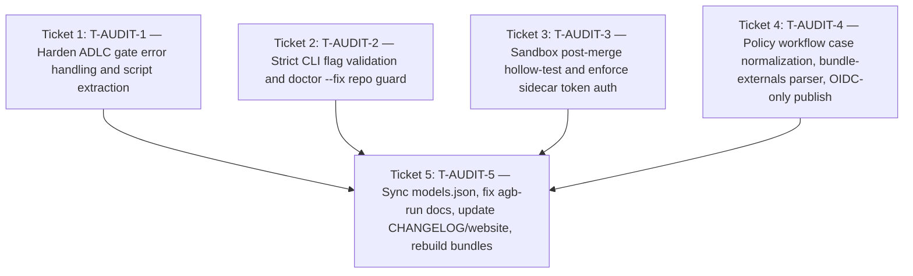

# Release Audit 1.3.0 SHOULD-FIX Remediation Plan

- **Base**: `fix/release-audit-1-3-0-should-fix`
- **Gate**: `npm test`

## Overview

Resolve all 19 `SHOULD-FIX` findings identified in the `1.3.0` release audit (`VERDICT: GO-WITH-RISK`) across ADLC gates, CLI flag validation, doctor repo guard, scheduler `hollow-test` sandboxing, sidecar token enforcement, policy-guard case normalization, supply-chain hardening, model catalog synchronization, skill docs, changelog, website documentation, and distribution bundles.

Standing frozen rails across all tickets: `lib/lock.mjs`, `lib/gates.mjs`, `.adlc/config.json`.

### Ticket 1: `T-AUDIT-1` — Harden ADLC gate error handling and script extraction

- **Scope**: `lib/plan.mjs`, `lib/review.mjs`, `lib/plan-integrity.mjs`, `test/audit-adlc-gates.test.mjs`
- **Rails**: `lib/lock.mjs`, `lib/gates.mjs`, `.adlc/config.json`
- **Tier**: `mid`

#### Requirements
1. **`lib/plan.mjs` (`compilePlan` / `writeAdlcTickets`):**
   - Currently `compilePlan` downgrades symlink-refusal and ticket-store write/integrity errors from `writeAdlcTickets` to a log warning (only rethrowing `LEGACY_TICKET_STORE`).
   - Treat symlink-refusal and store-integrity / write errors as fatal (rethrow / fail closed) so `compilePlan` never silently succeeds when ticket projection fails due to symlink refusal or store corruption.
2. **`lib/review.mjs` (`triageFindings`):**
   - When the LLM arbiter invocation fails and falls back to `deterministicTriage`, emit a warning (via `console.warn` / stderr diagnostic) and include `arbiterDegraded: true` and `arbiterError: String(err?.message ?? err)` on the returned triage result object.
3. **`lib/plan-integrity.mjs` (`extractDelegatedScripts`):**
   - Update the `npm run` / `npm run-script` regex so optional flags before the script name (such as `npm run --silent <name>`, `npm run -s <name>`, `npm run --if-present <name>`) are skipped and `<name>` is still extracted.

#### Acceptance Criteria
- [ ] `compilePlan` in `lib/plan.mjs` fails closed (throws) when `writeAdlcTickets` fails due to symlink refusal or ticket-store integrity/write errors.
- [ ] `triageFindings` in `lib/review.mjs` logs a warning and returns `arbiterDegraded: true` and `arbiterError` when falling back to `deterministicTriage`.
- [ ] `extractDelegatedScripts` in `lib/plan-integrity.mjs` extracts script names preceded by `--silent`, `-s`, `--if-present`, or multiple flags.
- [ ] Unit tests in `test/audit-adlc-gates.test.mjs` cover all three fixes and `npm test` passes.

---

### Ticket 2: `T-AUDIT-2` — Strict CLI flag validation and doctor --fix repo guard

- **Scope**: `bin/agb.mjs`, `lib/doctor.mjs`, `test/audit-cli-and-doctor.test.mjs`
- **Rails**: `lib/lock.mjs`, `lib/gates.mjs`, `.adlc/config.json`
- **Tier**: `mid`

#### Requirements
1. **`bin/agb.mjs` (`--interval` validation in `status` and `watch`):**
   - Validate that `--interval` is followed by a non-flag argument that parses as a strict positive integer (`/^\d+$/` and `>= 1`). If missing or invalid (e.g. `0`, `-5`, `abc`, `--json`), write a clear error message to stderr and exit with code `1` instead of falling back to `NaN`/`0` and busy-looping.
2. **`bin/agb.mjs` (unknown `--*` flag rejection):**
   - Reject unknown `--*` flags across `plan`, `review`, `preflight`, `status`, `watch`, `bootstrap`, `doctor`, `sync-models`, and `validate` (consistent with `run`, `shape`, `migrate`, `sidecar`), writing a clear error message to stderr and exiting with code `1`. Preserve all existing valid flags and short flags.
3. **`lib/doctor.mjs` (`applyDoctorFixes`):**
   - Guard creation of `.adlc/`, `.adlc/config.json`, and `.adlc/tickets/` on `existsSync(join(realRepo, '.git')) || existsSync(join(realRepo, '.adlc'))` so running `agb doctor --fix` outside a git or ADLC repository does not scaffold `.adlc/` in an unrelated directory.

#### Acceptance Criteria
- [ ] `agb status --interval` and `agb watch --interval` exit `1` with an error on missing, non-numeric, zero, or negative values.
- [ ] Unknown `--*` flags exit `1` with an error on `plan`, `review`, `preflight`, `status`, `watch`, `bootstrap`, `doctor`, `sync-models`, and `validate`.
- [ ] `applyDoctorFixes` in `lib/doctor.mjs` refuses to create `.adlc/` when neither `.git` nor `.adlc` exists in the target directory, while continuing to work inside git repos.
- [ ] Unit/CLI tests in `test/audit-cli-and-doctor.test.mjs` cover all three fixes and `npm test` passes.

---

### Ticket 3: `T-AUDIT-3` — Sandbox post-merge hollow-test and enforce sidecar token auth

- **Scope**: `lib/scheduler.mjs`, `sidecars/server.mjs`, `sidecars/jetski-launcher.mjs`, `test/audit-scheduler-sidecar.test.mjs`
- **Rails**: `lib/lock.mjs`, `lib/gates.mjs`, `.adlc/config.json`
- **Tier**: `mid`

#### Requirements
1. **`lib/scheduler.mjs` (Pass 2 `adlc hollow-test` sandboxing):**
   - In the post-merge `adlc hollow-test --test-cmd <gate.test>` invocation, wrap `gate.test` using `wrapConsensusGateCommand` (already imported from `lib/scheduler-verify.mjs`) when `process.env.AGB_SANDBOX_GATES !== '0'`.
   - If `wrapConsensusGateCommand` reports that no OS sandbox is available (fails closed), fail the verification gate with a clear error rather than executing candidate `gate.test` unsandboxed on the host.
2. **`sidecars/server.mjs` and `sidecars/jetski-launcher.mjs` (strict token enforcement):**
   - In `sidecars/server.mjs`, remove the `&& !process.env.ANTIGRAVITY_SIDECAR_WEB_PORT` bypass on both `/` (`/index.html`) and `/events` so that whenever `serveSidecar` is called with a non-null/non-empty `token`, token authentication is strictly enforced regardless of `ANTIGRAVITY_SIDECAR_WEB_PORT`.
   - In `sidecars/jetski-launcher.mjs`, only generate/write/pass a token when `!isJetski` (pass `null` to `serveSidecar` when `isJetski` is true), preserving Jetski HTTP fallback without weakening explicit-token callers.

#### Acceptance Criteria
- [ ] Post-merge `adlc hollow-test --test-cmd` in `lib/scheduler.mjs` wraps `gate.test` via `wrapConsensusGateCommand` when `AGB_SANDBOX_GATES !== '0'` and fails closed if no OS sandbox is available.
- [ ] `serveSidecar(repo, 0, 'secret')` returns `403` on `/` and `/events` without a valid token even when `ANTIGRAVITY_SIDECAR_WEB_PORT` is set in `process.env`, and returns `200` with a valid token.
- [ ] `sidecars/jetski-launcher.mjs` passes `null` token to `serveSidecar` when `isJetski` is true and passes a generated token otherwise.
- [ ] Unit tests in `test/audit-scheduler-sidecar.test.mjs` cover both fixes and `npm test` passes.

---

### Ticket 4: `T-AUDIT-4` — Policy workflow case normalization, bundle-externals parser, OIDC-only publish

- **Scope**: `hooks/policy/evaluate.mjs`, `scripts/check-bundle-externals.mjs`, `.github/workflows/publish.yml`, `test/audit-policy-and-supply.test.mjs`
- **Rails**: `lib/lock.mjs`, `lib/gates.mjs`, `.adlc/config.json`
- **Tier**: `mid`

#### Requirements
1. **`hooks/policy/evaluate.mjs` (`evaluateWorkflowTool`):**
   - Normalize `args` using `normalizeArgsCaseInsensitive(args)` and read `norm.folded.cwd` and `norm.folded.scriptpath` (and fail closed on case-collision just like other tool evaluators) instead of reading `args?.Cwd` and `args?.ScriptPath` case-sensitively.
2. **`scripts/check-bundle-externals.mjs`:**
   - Harden static external-dependency scanning to handle: (a) nested-parenthesis `createRequire(...)` expressions (e.g. `createRequire(pathToFileURL(...))`), (b) aliased `createRequire` imports (`import { createRequire as cr } from 'node:module'`), and (c) `import.meta.resolve(...)` calls.
3. **`.github/workflows/publish.yml`:**
   - Remove `NODE_AUTH_TOKEN: ${{ secrets.NPM_TOKEN }}` from the publish step so npm publishing relies strictly on OIDC Trusted Publishing (`id-token: write`).

#### Acceptance Criteria
- [ ] `evaluateWorkflowTool` in `hooks/policy/evaluate.mjs` normalizes args case-insensitively and blocks rail/outside-repo `cwd`/`scriptpath` regardless of casing or case collisions.
- [ ] `scripts/check-bundle-externals.mjs` detects nested-paren `createRequire(...)`, aliased `createRequire` imports, and `import.meta.resolve(...)`.
- [ ] `.github/workflows/publish.yml` contains no `NPM_TOKEN` or `NODE_AUTH_TOKEN` references.
- [ ] Unit tests in `test/audit-policy-and-supply.test.mjs` cover all three fixes and `npm test` passes.

---

### Ticket 5: `T-AUDIT-5` — Sync models.json, fix agb-run docs, update CHANGELOG/website, rebuild bundles

- **Scope**: `CHANGELOG.md`, `skills/**`, `commands/agb-run.md`, `website/**`, `dist/**`
- **Rails**: `lib/lock.mjs`, `lib/gates.mjs`, `.adlc/config.json`
- **Tier**: `mid`

#### Requirements
1. **Sync `skills/adversarial-review/references/models.json`:**
   - Run `node scripts/sync-models.mjs --write --offline` so `skills/adversarial-review/references/models.json` includes all models from `lib/models.mjs` (including `gemini-4-carbon-*`, `gemini-4-hydrogen-*`, `gemini-pro-orchestrator*`).
2. **Fix `skills/agb-run/SKILL.md` and `commands/agb-run.md`:**
   - Remove unsupported `project` and `cwd` parameters from the `mcp__agb__agb_run` invocation documentation so it matches `mcp/server.mjs` (which accepts only `plan`).
3. **Update `CHANGELOG.md` (`[Unreleased]`):**
   - Document PR #154, PR #157 (CLI commands/flags `shape`, `watch`, `init`, `sync-models`, `run -c <n>`, `status --watch/-w/--tui/--follow/--compact`, `plan --decompose/--max-ticket-scope/--no-fast-path`, `review --plan/--loop/--five-lens/--no-arbiter`, `doctor --fix`, `ARL_FINDING_SCHEMA`, `ARBITER_TRIAGE_SCHEMA`, `agb_init`/`agb_shape` MCP tools), PR #158 (`agy 1.5.9`, `@adlc/* 1.13.0`, Hydrogen/orchestrator models), PR #160, PR #161, and this release-audit hardening batch.
4. **Update website docs:**
   - `website/content/docs/reference/cli/run.mdx` and `website/content/docs/reference/mcp-tools.mdx`: update prose claiming `agb run` has no concurrency flag (now supports `-c <n>`).
   - `website/content/docs/reference/cli/{doctor,plan,review,status}.mdx` and `website/content/docs/reference/exit-and-error-codes.mdx`: reflect `doctor [repo] [--fix]`, `plan --decompose/--max-ticket-scope/--no-fast-path`, `review --plan/--loop/--five-lens/--no-arbiter`, `status -w/--tui/--follow/--compact` + 200ms default interval, and `shape`/`watch`/`init`/`sync-models` exit codes.
   - `website/content/docs/concepts/pools-and-tiers.mdx`: update `frontier` table and prose to reflect `gemini-pro-orchestrator` / `gemini-pro-orchestrator-argon` frontier routing (`agy >= 1.5.9`, opt-out via `AGB_DISABLE_ORCHESTRATOR=1` / `plan.disableOrchestrator`).
   - `website/content/docs/reference/{skills,slash-commands,mcp-tools}.mdx` and `website/content/docs/guides/headless-and-mcp.mdx`: update hardcoded counts from `8 skills / 8 commands / 6 MCP tools` to current `17 skills / 16 commands / 8 MCP tools`.
5. **Rebuild bundles & generated website pages:**
   - Run `npm run build` and `node website/scripts/gen-reference.mjs`.

#### Acceptance Criteria
- [ ] `skills/adversarial-review/references/models.json` includes all 22 models from `lib/models.mjs`.
- [ ] `skills/agb-run/SKILL.md` and `commands/agb-run.md` document only `plan` for `mcp__agb__agb_run`.
- [ ] `CHANGELOG.md` and all listed `website/content/docs/**` pages are updated and `node website/scripts/gen-reference.mjs --check` passes.
- [ ] `npm run build`, `npm run plugin:validate`, `npm run skills:check`, `node scripts/check-bundle-externals.mjs`, and `npm test` all pass.
