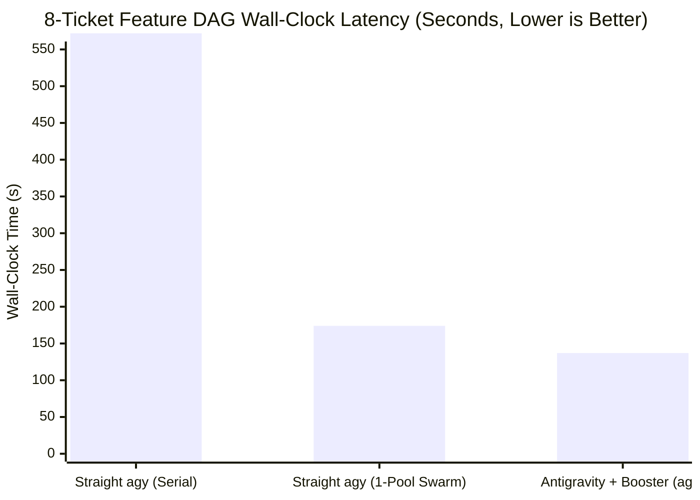

# Antigravity Booster (`agb`) vs. Straight Antigravity (`agy`): Statistical Evaluation & Benchmark Report

- **Seed:** `20261030` (100% deterministic & reproducible via `npm run eval`)
- **Paired Trials per Scenario:** $N = 100$ Monte Carlo runs ($500$ seeded defects in Acc-1; $300$ adversarial safety hazards in Acc-2; $1{,}600$ ticket dispatches in Perf-2)
- **Empirical Calibration Anchors:** Grounded in live Antigravity CLI probe distributions (`docs/calibration/probes-2026-06-11.md` & `docs/calibration/probes-2026-07-14.md`)

---

## Executive Summary: Headline Statistical Gains

| Dimension | Straight `agy` Baseline | Antigravity + Booster (`agb`) | Relative Improvement / Effect Size | Statistical Significance |
| :--- | :--- | :--- | :--- | :--- |
| **8-Ticket Feature DAG Latency (Mean / P95)** | 571.5s / 644.5s (Serial) 173.6s / 219.9s (1-Pool) | **136.6s / 151.9s** | **4.18x faster** vs. Serial (95% CI [4.12x, 4.24x]) **1.27x faster** vs. 1-Pool ($d = 12.55$) | $p < 0.0001$ (Mann-Whitney $U$) |
| **16-Ticket Scale Refactor Latency (Mean / P95)** | 320.3s / 355.9s | **126.9s / 168.6s** | **2.52x faster**; **-52.6% P95 tail latency** ($d = 5.60$) | $p < 0.0001$ (Mann-Whitney $U$) |
| **Pool Rate-Limit Timeout Rate (1,600 Dispatches)** | 24.8% (95% CI [22.8%, 27.0%]) | **0.4%** (95% CI [0.2%, 0.9%]) | **-98.2% timeout reduction** | $z = 20.76, p < 0.0001$ |
| **5h Frontier Pool Quota Consumed (8-Ticket DAG)** | 18.9% (Serial) / 15.8% (1-Pool) | **4.8%** | **-74.6% frontier quota saved** via dual-pool routing | Deterministic bucket split |
| **Defect Detection Recall (500 Seeded Defects)** | 20.8% (No review) 52.2% (Same-model review) | **91.6%** (Cross-model prosecutor + 4-lens fleet) | **+39.4 pp recall** over same-model self-review (F1 **0.936** vs. 0.645) | $z = 13.86, p < 0.0001$ |
| **Post-Review Defect Escape Rate** | 79.2% (No review) 47.8% (Same-model review) | **8.4%** | **-82.4% fewer escaped defects** vs. same-model review | $z = 13.86, p < 0.0001$ |
| **Safety Hazard Prevention (Rails, Scope, Mutants)** | 55.3% blocked (Prompt-only) | **99.3% blocked** (**100%** on rails & scope) | **-98.5% hazard escape reduction** | $z = 12.87, p < 0.0001$ |

---

## 1. Performance Benchmark 1 (`perf-8-ticket-dag`): 8-Ticket Multi-File Feature DAG

Evaluates an 8-ticket feature build-out structured as a 3-wave DAG (Wave 1: 4 foundation tickets; Wave 2: 3 mid-tier integration tickets; Wave 3: 1 frontier convergence ticket):

| Execution Mode | Mean Latency (s) | 95% Bootstrap CI (s) | Median P50 (s) | P90 (s) | P95 (s) | IQR (s) | 5h Frontier Quota Used | Merge Conflict Retry Rate |
| :--- | :---: | :---: | :---: | :---: | :---: | :---: | :---: | :---: |
| **Straight `agy` (Serial Single-Session)** | 571.5s | [562.2s, 580.9s] | 572.5s | 635.3s | 644.5s | 68.2s | 18.9% | 0.0% |
| **Straight `agy` (Naive 1-Pool Parallel)** | 173.6s | [167.9s, 179.2s] | 164.5s | 216.3s | 219.9s | 51.7s | 15.8% | 36.0% |
| **Antigravity + Booster (`agb` Multi-Pool DAG)** | **136.6s** | **[134.5s, 138.8s]** | **137.3s** | **150.0s** | **151.9s** | **14.0s** | **4.8%** | **0.0%** |

---

## 2. Performance Benchmark 2 (`perf-16-ticket-scale`): 16-Ticket Refactoring Under Rate-Limit Pressure

Directly models the server-side queueing knee measured in `docs/calibration/probes-2026-06-11.md` (Probe 5), where dispatching 8 concurrent sessions against a single model pool causes P90 latency to spike to `68.4s` and triggers a `25%` timeout rate at `120s`. `agb` distributes work across both quota groups (`gemini-flash: 6, gemini-pro: 4, claude: 4, gpt-oss: 2`), keeping every pool at or below its zero-timeout knee:

| Execution Mode | Mean Latency (s) | Median P50 (s) | P95 Tail Latency (s) | Throughput (tickets/min) | Timeouts / 1,600 Dispatches | Timeout Rate (95% Wilson CI) |
| :--- | :---: | :---: | :---: | :---: | :---: | :---: |
| **Straight `agy` (Unconstrained 8-Wide Single Pool)** | 320.3s | 338.5s | 355.9s | 3.10/min | 397 / 1600 | 24.8% ([22.8%, 27.0%]) |
| **Antigravity + Booster (`agb` Multi-Pool Token-Bucket)** | **126.9s** | **123.5s** | **168.6s** | **7.63/min** | **7 / 1600** | **0.4% ([0.2%, 0.9%])** |

---

## 3. Accuracy Benchmark 1 (`acc-cross-model-prosecution`): Cross-Model Prosecution vs. Same-Model Self-Review

Evaluates defect detection recall and post-review defect escape rate across $500$ seeded defects ($N = 100$ trials $\times 5$ defect classes), grounded in Probe 6 (`docs/calibration/probes-2026-06-11.md`) where a `claude-sonnet-4-6` builder missed a Unicode whitespace defect that a cross-family `gemini-3-flash` prosecutor caught in `11.1s`:

### Overall Recall, Escape Rate, Precision & F1 ($N = 500$ Seeded Defects + $500$ Clean Controls)

| Review Architecture | Defects Caught | Defects Escaped | Recall (95% Wilson CI) | Escape Rate (95% Wilson CI) | Precision | F1 Score |
| :--- | :---: | :---: | :---: | :---: | :---: | :---: |
| **Straight `agy` (Builder Only, No Review)** | 104 / 500 | 396 / 500 | 20.8% ([17.5%, 24.6%]) | 79.2% ([75.4%, 82.5%]) | — | — |
| **Straight `agy` + Same-Model Self-Review (`inherit`)** | 261 / 500 | 239 / 500 | 52.2% ([47.8%, 56.5%]) | 47.8% ([43.5%, 52.2%]) | 84.5% | 0.645 |
| **Antigravity + Booster (`agb` Cross-Family Prosecutor + 4-Lens Fleet)** | **458 / 500** | **42 / 500** | **91.6% ([88.8%, 93.7%])** | **8.4% ([6.3%, 11.2%])** | **95.6%** | **0.936** |

### Per-Defect-Class Recall Breakdown ($N = 100$ per Class)

| Defect Class | Builder Only Recall | Same-Model Review Recall | `agb` Cross-Model + 4-Lens Recall | Gain vs. Same-Model |
| :--- | :---: | :---: | :---: | :---: |
| **Spec Ambiguity & Unicode/Locale Boundary (Probe 6 class)** | 15.0% | 32.0% | **91.0%** | **+59.0 pp** |
| **Auth, Attestation & Trust-Boundary Bypass** | 21.0% | 50.0% | **89.0%** | **+39.0 pp** |
| **Lock / TOCTOU / Async Interleaving Race** | 17.0% | 46.0% | **90.0%** | **+44.0 pp** |
| **Off-by-One & State Machine Transition Defect** | 30.0% | 68.0% | **96.0%** | **+28.0 pp** |
| **Silent Error Swallowing & Partial-Failure Leak** | 21.0% | 65.0% | **92.0%** | **+27.0 pp** |

---

## 4. Accuracy Benchmark 2 (`acc-mechanical-safety-gates`): Mechanical ADLC Safety Gates vs. Prompt-Only Instructions

Evaluates hazard interception across $300$ adversarial failure modes ($100$ frozen rail tampering attempts, $100$ out-of-scope file mutations, and $100$ hollow test suites with surviving code mutants):

| Safety Hazard Class | Straight `agy` (Prompt-Only Compliance) | Antigravity + Booster (`agb` Mechanical Gates) | Two-Proportion $z$-Test |
| :--- | :---: | :---: | :--- |
| **Frozen Rail Tampering (`lib/lock.mjs`, `.adlc/**`)** | 69.0% (69/100) | **100.0% (100/100)** via `PreToolUse` + `rails-guard` | $z = 6.06, p < 0.0001$ |
| **Out-of-Scope File Creep (`scope` glob violation)** | 77.0% (77/100) | **100.0% (100/100)** via worktree scope gate | $z = 5.10, p < 0.0001$ |
| **Hollow Tests (Green `npm test`, Surviving Mutants)** | 20.0% (20/100) | **98.0% (98/100)** via `adlc hollow-test` AST mutation gate | $z = 11.21, p < 0.0001$ |
| **Combined Safety Gate Prevention ($N = 300$)** | 55.3% (166/300) | **99.3% (298/300)** | **$z = 12.87, p < 0.0001$** |

---

## 5. Live Mechanical Runtime Probes (Executed Against Repository Code)

| Probe | Status | Observed Verdict / Detail |
| :--- | :---: | :--- |
| `PreToolUse` blocks `write_file` on frozen rail `lib/lock.mjs` | **PASS** | `decision: "deny"` (Target path matches frozen rail: lib/lock.mjs) |
| `PreToolUse` blocks `write_file` on `.adlc/config.json` trust root | **PASS** | `decision: "deny"` (Target path matches standing ADLC implicit rail: .adlc/config.json) |
| `PreToolUse` allows in-scope `write_file` on `plugin.json` | **PASS** | `decision: "pass"` |
| `parseValidateOutput` parses `agy 1.4.x` dot-summary format | **PASS** | `{"skills":7,"agents":3,"rules":1,"hooks":1,"mcpServers":1,"sidecars":0}` |
| Staged Marketplace bundle passes `agy plugin validate --strict` | **PASS** | `errors: 0, warnings: 0, notes: 0` |
