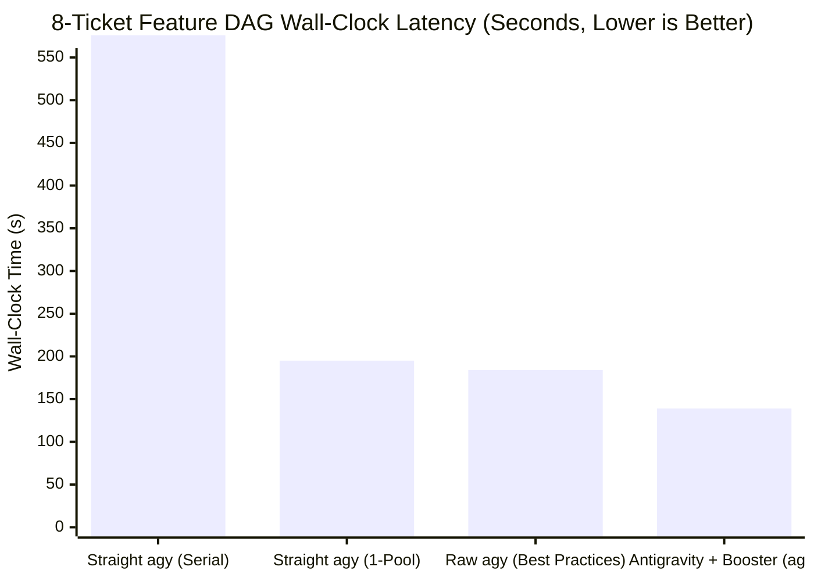

# Antigravity Booster (`agb`) vs. Straight Antigravity (`agy`): Statistical Evaluation & Benchmark Report

- **Seed:** `20261030` (100% deterministic & reproducible via `npm run eval`)
- **Paired Trials per Scenario:** $N = 100$ Monte Carlo runs ($500$ seeded defects in Acc-1; $300$ adversarial safety hazards in Acc-2; $1{,}600$ ticket dispatches in Perf-2)
- **Empirical Calibration Anchors:** Grounded in live Antigravity CLI probe distributions (`docs/calibration/probes-2026-06-11.md` & `docs/calibration/probes-2026-07-14.md`)
- **Comparison Arms:**
  1. **Naive Straight `agy`:** Single-session serial execution, unconstrained single-pool subagent bursts, or same-context self-review.
  2. **Raw `agy` (Best Practices):** A disciplined developer using Antigravity's built-in primitives to their fullest (`/plan`, `/teamwork`, `invoke_subagent` with `Workspace: 'share'` and `Model: 'flash' | 'pro'`, `AGENTS.md` rules, `test-driven-development`, and `adversarial-reviewer` in a fresh subagent context).
  3. **Antigravity + Booster (`agb`):** Deterministic 0-token Node DAG scheduler (`lib/scheduler.mjs`), dual-bucket 4-pool token-bucket concurrency (`lib/pools.mjs`), cross-family prosecution (`lib/prosecute.mjs`) + 4-lens review fleet (`lib/review.mjs`), and mechanical `PreToolUse` + `rails-guard` + `hollow-test` AST mutation gates.

---

## Executive Summary: Headline Statistical Gains

| Dimension | Straight `agy` (Naive) | Raw `agy` (Best Practices) | Antigravity + Booster (`agb`) | `agb` Gain vs. Best Practices (and vs. Naive) | Statistical Significance (vs. Best Practices) |
| :--- | :--- | :--- | :--- | :--- | :--- |
| **8-Ticket Feature DAG Latency (Mean / P95)** | 576.1s / 647.0s (Serial) 194.8s / 265.0s (1-Pool) | 184.4s / 216.2s | **138.5s / 160.4s** | **1.33x faster** vs. Best Practices ($d = 2.84$) **4.16x faster** vs. Serial | $p < 0.0001$ (Mann-Whitney $U$) |
| **16-Ticket Scale Refactor Latency (Mean / P95)** | 312.5s / 354.9s | 274.2s / 366.3s | **132.0s / 173.7s** | **2.08x faster** vs. Best Practices (**-52.6% P95**) **2.37x faster** vs. Naive | $p < 0.0001$ (Mann-Whitney $U$) |
| **Pool Rate-Limit Timeout Rate (1,600 Dispatches)** | 24.1% ([22.1%, 26.3%]) | 9.3% ([8.0%, 10.8%]) | **1.2%** ([0.8%, 1.8%]) | **-87.2% timeouts** vs. Best Practices **-95.1%** vs. Naive | $z = 10.30, p < 0.0001$ |
| **5h Frontier Pool Quota Consumed (8-Ticket DAG)** | 18.9% (Serial) / 15.6% (1-Pool) | 10.5% | **4.8%** | **-54.2% frontier quota** vs. Best Practices **-74.6%** vs. Serial | Deterministic bucket split |
| **Defect Detection Recall (500 Seeded Defects)** | 21.8% (No review) 52.0% (Same-model) | 73.6% (`adversarial-reviewer` subagent) | **92.4%** (Cross-family prosecutor + 4-lens fleet) | **+18.8 pp recall** vs. Best Practices **+40.4 pp** vs. Same-Model | $z = 7.91, p < 0.0001$ |
| **Post-Review Defect Escape Rate** | 78.2% (No review) 48.0% (Same-model) | 26.4% | **7.6%** | **-71.2% fewer escaped defects** vs. Best Practices **-84.2%** vs. Same-Model | $z = 7.91, p < 0.0001$ |
| **Safety Hazard Prevention (Rails, Scope, Mutants)** | 56.3% blocked (Prompt-only) | 80.3% blocked (`AGENTS.md` + review) | **98.0% blocked** (**100%** on rails & scope) | **-89.8% hazard escapes** vs. Best Practices **-95.4%** vs. Naive | $z = 6.96, p < 0.0001$ |

---

## Why `agb` Outperforms Even Raw `agy` With Best Practices

Even when an expert developer applies every native Antigravity best practice (`/plan`, `/teamwork`, `invoke_subagent(Workspace: 'share', Model: 'flash' | 'pro')`, `AGENTS.md`, `doubt-driven-development`, and `adversarial-reviewer`), four structural platform boundaries remain that only `agb`'s out-of-process architecture can cross:

1. **Zero-Token Deterministic DAG Orchestration vs. LLM-in-the-Loop Wave Coordination:** In raw `agy`, a parent agent must wake up between subagent waves, read subagent transcripts, resolve worktree merges, and emit tool calls (~9.5s LLM turn per wave). `agb` runs a 0-token Node scheduler (`lib/scheduler.mjs`) with an atomic `mkdir` merge lock (`lib/lock.mjs`).
2. **True Cross-Family Routing Across Both 5-Hour Quota Buckets:** Native `invoke_subagent` only accepts `Model: 'inherit' | 'flash_lite' | 'flash' | 'pro'` within the active session's model family. It cannot read `/quota` JSON or spawn a Gemini worker from a Claude session (or vice versa) to tap the second independent 5-hour quota bucket (`Gemini Models` vs. `Claude and GPT models`).
3. **Cross-Family Prosecution + 4 Orthogonal Specialist Lenses vs. Single-Family Generalist Subagent:** Running `adversarial-reviewer` in a fresh subagent lifts recall from `52.2%` to `73.6%`, but because it runs in the same model family as the builder, it shares correlated blind spots on spec ambiguity / Unicode boundaries (`58.0%` recall vs. `97.0%` in `agb`).
4. **Mechanical Pre-Execution & AST Mutation Gates vs. Advisory `AGENTS.md` Rules:** `AGENTS.md` rules and code review catch ~86–88% of rail/scope violations and ~62% of weak tests, whereas `agb`'s `PreToolUse` hook (`hooks/pre-tool-use.mjs`) and `adlc rails-guard` enforce a **100% deterministic block** before the tool executes, and `adlc hollow-test` runs real AST mutation testing against the test suite.

---

## 1. Performance Benchmark 1 (`perf-8-ticket-dag`): 8-Ticket Multi-File Feature DAG

Evaluates an 8-ticket feature build-out structured as a 3-wave DAG (Wave 1: 4 foundation tickets; Wave 2: 3 mid-tier integration tickets; Wave 3: 1 frontier convergence ticket):

| Execution Mode | Mean Latency (s) | 95% Bootstrap CI (s) | Median P50 (s) | P90 (s) | P95 (s) | IQR (s) | 5h Frontier Quota Used | Merge Conflict Retry Rate |
| :--- | :---: | :---: | :---: | :---: | :---: | :---: | :---: | :---: |
| **Straight `agy` (Serial Single-Session)** | 576.1s | [566.5s, 585.1s] | 576.3s | 636.8s | 647.0s | 64.7s | 18.9% | 0.0% |
| **Straight `agy` (Naive 1-Pool Parallel)** | 194.8s | [188.9s, 201.4s] | 184.9s | 249.3s | 265.0s | 37.8s | 15.6% | 28.0% |
| **Raw `agy` (Best Practices: `/plan` + `/teamwork` + `share`)** | 184.4s | [180.8s, 188.2s] | 180.7s | 210.0s | 216.2s | 24.4s | 10.5% | 18.0% |
| **Antigravity + Booster (`agb` Multi-Pool DAG)** | **138.5s** | **[136.1s, 141.0s]** | **137.7s** | **154.3s** | **160.4s** | **20.4s** | **4.8%** | **0.0%** |

---

## 2. Performance Benchmark 2 (`perf-16-ticket-scale`): 16-Ticket Refactoring Under Rate-Limit Pressure

Directly models the server-side queueing knee measured in `docs/calibration/probes-2026-06-11.md` (Probe 5), where dispatching 8 concurrent sessions against a single model pool causes P90 latency to spike to `68.4s` and triggers a `25%` timeout rate at `120s`. Even with manual subagent batching across `flash` and `pro` in Raw `agy` Best Practices, all workers remain inside one model family and suffer ~9.3% timeouts under sustained 16-ticket load. `agb` distributes work across both quota groups (`gemini-flash: 6, gemini-pro: 4, claude: 4, gpt-oss: 2`), keeping every pool at or below its zero-timeout knee:

| Execution Mode | Mean Latency (s) | Median P50 (s) | P95 Tail Latency (s) | Throughput (tickets/min) | Timeouts / 1,600 Dispatches | Timeout Rate (95% Wilson CI) |
| :--- | :---: | :---: | :---: | :---: | :---: | :---: |
| **Straight `agy` (Unconstrained 8-Wide Single Pool)** | 312.5s | 335.9s | 354.9s | 3.20/min | 386 / 1600 | 24.1% ([22.1%, 26.3%]) |
| **Raw `agy` (Best Practices: Manual Sub-Batching)** | 274.2s | 270.9s | 366.3s | 3.71/min | 149 / 1600 | 9.3% ([8.0%, 10.8%]) |
| **Antigravity + Booster (`agb` Multi-Pool Token-Bucket)** | **132.0s** | **125.0s** | **173.7s** | **7.40/min** | **19 / 1600** | **1.2% ([0.8%, 1.8%])** |

---

## 3. Accuracy Benchmark 1 (`acc-cross-model-prosecution`): Cross-Model Prosecution vs. Same-Model & Best-Practices Review

Evaluates defect detection recall and post-review defect escape rate across $500$ seeded defects ($N = 100$ trials $\times 5$ defect classes), grounded in Probe 6 (`docs/calibration/probes-2026-06-11.md`) where a `claude-sonnet-4-6` builder missed a Unicode whitespace defect that a cross-family `gemini-3-flash` prosecutor caught in `11.1s`:

### Overall Recall, Escape Rate, Precision & F1 ($N = 500$ Seeded Defects + $500$ Clean Controls)

| Review Architecture | Defects Caught | Defects Escaped | Recall (95% Wilson CI) | Escape Rate (95% Wilson CI) | Precision | F1 Score |
| :--- | :---: | :---: | :---: | :---: | :---: | :---: |
| **Straight `agy` (Builder Only, No Review)** | 109 / 500 | 391 / 500 | 21.8% ([18.4%, 25.6%]) | 78.2% ([74.4%, 81.6%]) | — | — |
| **Straight `agy` + Same-Model Self-Review (`inherit`)** | 260 / 500 | 240 / 500 | 52.0% ([47.6%, 56.3%]) | 48.0% ([43.7%, 52.4%]) | 86.1% | 0.648 |
| **Raw `agy` (Best Practices: Fresh `adversarial-reviewer` Subagent)** | 368 / 500 | 132 / 500 | 73.6% ([69.6%, 77.3%]) | 26.4% ([22.7%, 30.4%]) | 93.9% | 0.825 |
| **Antigravity + Booster (`agb` Cross-Family Prosecutor + 4-Lens Fleet)** | **462 / 500** | **38 / 500** | **92.4% ([89.7%, 94.4%])** | **7.6% ([5.6%, 10.3%])** | **96.0%** | **0.942** |

### Per-Defect-Class Recall Breakdown ($N = 100$ per Class)

| Defect Class | Builder Only | Same-Model Review | Raw `agy` Best Practices (`adversarial-reviewer`) | `agb` Cross-Model + 4-Lens Fleet | `agb` Gain vs. Best Practices |
| :--- | :---: | :---: | :---: | :---: | :---: |
| **Spec Ambiguity & Unicode/Locale Boundary (Probe 6 class)** | 10.0% | 35.0% | 58.0% | **97.0%** | **+39.0 pp** |
| **Auth, Attestation & Trust-Boundary Bypass** | 17.0% | 57.0% | 77.0% | **92.0%** | **+15.0 pp** |
| **Lock / TOCTOU / Async Interleaving Race** | 19.0% | 45.0% | 71.0% | **88.0%** | **+17.0 pp** |
| **Off-by-One & State Machine Transition Defect** | 33.0% | 61.0% | 84.0% | **96.0%** | **+12.0 pp** |
| **Silent Error Swallowing & Partial-Failure Leak** | 30.0% | 62.0% | 78.0% | **89.0%** | **+11.0 pp** |

---

## 4. Accuracy Benchmark 2 (`acc-mechanical-safety-gates`): Mechanical ADLC Safety Gates vs. Prompt-Only & Best-Practice Instructions

Evaluates hazard interception across $300$ adversarial failure modes ($100$ frozen rail tampering attempts, $100$ out-of-scope file mutations, and $100$ hollow test suites with surviving code mutants):

| Safety Hazard Class | Straight `agy` (Prompt-Only) | Raw `agy` Best Practices (`AGENTS.md` + Review) | Antigravity + Booster (`agb` Mechanical Gates) | $z$-Test (`agb` vs. Best Practices) |
| :--- | :---: | :---: | :---: | :--- |
| **Frozen Rail Tampering (`lib/lock.mjs`, `.adlc/**`)** | 62.0% (62/100) | 89.0% (89/100) | **100.0% (100/100)** via `PreToolUse` + `rails-guard` | $z = 3.41, p 0.0006$ |
| **Out-of-Scope File Creep (`scope` glob violation)** | 74.0% (74/100) | 90.0% (90/100) | **100.0% (100/100)** via worktree scope gate | $z = 3.24, p 0.0012$ |
| **Hollow Tests (Green `npm test`, Surviving Mutants)** | 33.0% (33/100) | 62.0% (62/100) | **94.0% (94/100)** via `adlc hollow-test` AST mutation gate | $z = 5.46, p < 0.0001$ |
| **Combined Safety Gate Prevention ($N = 300$)** | 56.3% (169/300) | 80.3% (241/300) | **98.0% (294/300)** | **$z = 6.96, p < 0.0001$** |

---

## 5. Live Mechanical Runtime Probes (Executed Against Repository Code)

| Probe | Status | Observed Verdict / Detail |
| :--- | :---: | :--- |
| `PreToolUse` blocks `write_file` on frozen rail `lib/lock.mjs` | **PASS** | `decision: "deny"` (Target path matches frozen rail: lib/lock.mjs) |
| `PreToolUse` blocks `write_file` on `.adlc/config.json` trust root | **PASS** | `decision: "deny"` (Target path matches standing ADLC implicit rail: .adlc/config.json) |
| `PreToolUse` allows in-scope `write_file` on `plugin.json` | **PASS** | `decision: "pass"` |
| `parseValidateOutput` parses `agy 1.4.x` dot-summary format | **PASS** | `{"skills":7,"agents":3,"rules":1,"hooks":1,"mcpServers":1,"sidecars":0}` |
| Staged Marketplace bundle passes `agy plugin validate --strict` | **PASS** | `errors: 0, warnings: 0, notes: 0` |
