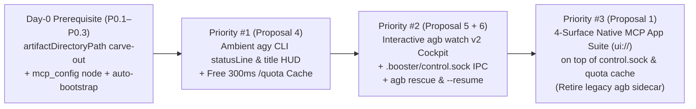

# Antigravity Booster: Next-Generation Architecture, CLI/TUI & GUI Advancement Proposals

- **Date:** 2026-11-22
- **Branch / Worktree:** `explore-advancements` (`.worktrees/explore-advancements`)
- **Ticket:** `T-EXPLORE-ADVANCEMENTS-DOC`
- **Probed Baselines:** `antigravity-booster 1.2.0` (`main` @ `171ba2d`), `agy 1.5.14`, Antigravity App `v2.34+`, `@adlc/* 1.13.0`, `@adlc/antigravity 1.7.0`
- **Status:** Proposal Catalog & Prioritized Roadmap (Owner-Aligned Decisions Recorded)

---

## 1. Executive Thesis & Confirmed Strategic Alignment

`antigravity-booster` (`agb`) has already solved the hardest orchestration primitives for multi-agent software delivery: deterministic DAG scheduling (`lib/scheduler.mjs`), dual-pool quota routing (`lib/pools.mjs`), warm persistent NDJSON builder daemons (`lib/ndjson-worker.mjs`), sub-turn flail/rail supervision (`lib/stream-watchdog.mjs`), cross-pool TDD splits (`lib/tdd-split.mjs`), static/CodeGraph context slicing (`lib/context-slice.mjs`), empirical Beta-Bernoulli model routing (`lib/bandit-router.mjs`), and 60-tool physical-path containment (`hooks/policy/evaluate.mjs`).

The next order-of-magnitude leap comes from evolving `agb` from an **out-of-band CLI batch wrapper** into a **bi-modal, native Antigravity harness accelerator** across both `agy` CLI/TUI and Antigravity App (GUI).

### Recorded Owner Alignment (2026-11-22)

1. **GUI Direction (Confirmed):** Make **Antigravity MCP Apps (`ui://`)** served by `mcp/server.mjs` the primary GUI architecture in Antigravity App, retiring `agb sidecar`'s temporary plugin installer hack while retaining an optional plain `--browser` localhost fallback for SSH / Antigravity IDE environments (where `ui://` iframes are not mounted).
2. **In-Session Lifecycle Hook Posture (Confirmed):** Expand `hooks.json` across all 6 Antigravity lifecycle events (`SessionStart`, `PreInvocation`, `PreToolUse`, `PostToolUse`, `PostInvocation`, `Stop`) with graduated, configurable repo-level strictness in `.adlc/config.json` (zero-token `metadata.user_markdown` cards + soft single-turn completion/context-rot nudges by default, with strict fail-closed option).
3. **Three Execution Gears (Confirmed with Guardrails — see §3):** Support a unified 3-gear model (`/agb-swarm` for small interactive tasks, async `run_workflow` v2 for medium in-session DAGs, and `agb run` for heavy isolated worktree fleets), strictly sharing a single underlying ADLC verification & merge kernel.

---

## 2. P0 Prerequisites (Foundational Harness Bugfixes)

Before building new UI or orchestration layers, three low-effort, high-leverage fixes remove immediate friction across CLI and GUI:

### P0.1 — Carve Out Active `artifactDirectoryPath` in `PreToolUse` Policy Guard
- **Discovery:** `hooks/policy/paths.mjs` (`protectedRoots`) blanket-blocks all writes under `~/.gemini`. Because Antigravity stores conversation artifacts (`implementation_plan.md`, `walkthrough.md`, `/generative_ui` HTML widgets, scratch files) under `~/.gemini/{antigravity,antigravity-cli,antigravity-ide}/brain/<conversationId>/`, having `antigravity-booster` installed currently blocks Antigravity agents from creating native `/plan` and `/generative_ui` artifacts—breaking the exact Brain Artifact pipeline `lib/brain.mjs` was designed to ingest.
- **Fix:** In `hooks/policy/evaluate.mjs` and `hooks/policy/paths.mjs`, allow file writes strictly within the exact physical `payload.artifactDirectoryPath` matching `payload.conversationId` under `~/.gemini/{antigravity,antigravity-cli,antigravity-ide,jetski}/brain/<conversationId>/`, while keeping `.system_generated/**` and symlink escapes fail-closed denied.

### P0.2 — Switch `mcp_config.json` to `"command": "node"`
- **Discovery:** `mcp_config.json` currently invokes `"/bin/sh"` with `bin/node-launcher.sh`. Per Antigravity's plugin specification (`build-plugins.md` / `mcp-apps.md`), Antigravity **falls back to its own bundled Node.js runtime only when `"command": "node"`**.
- **Fix:** Change `mcp_config.json` to `"command": "node", "args": ["${PLUGIN_ROOT}/dist/mcp-server.mjs"]`, eliminating `/bin/sh` failure modes on Windows and GUI `PATH` misses when Node is managed by shell-init version managers (`nvm`/`fnm`/`mise`).

### P0.3 — Zero-Manual-Bootstrap via `SessionStart`
- **Discovery:** Marketplace installs still ask users to manually run `/bin/sh ".../node-launcher.sh" dist/agb.mjs bootstrap` in a terminal before `/agb` works (`README.md`, `skills/agb/SKILL.md`).
- **Fix:** Run an idempotent `<15ms` stamp check (`${PLUGIN_DATA}/bootstrapped-<version>`) inside a `SessionStart` hook that installs `~/.local/bin/agb` and verifies/stages the vendored `adlc-antigravity` tarball automatically on first CLI or GUI session startup.

---

## 3. Deep Dive: The "Three Execution Gears" Concept — Downsides & Mitigations

Offering three execution gears—**Gear 1 (`/agb-swarm`)**, **Gear 2 (`run_workflow` v2)**, and **Gear 3 (`agb run`)**—lets users trade off immediacy and native UI interactivity against scale and isolation. However, **there are four real engineering downsides** that must be explicitly mitigated in the design:

| Downside / Risk | Concrete Failure Mode if Unmitigated | Architectural Mitigation ("Non-Negotiable Rule") |
| :--- | :--- | :--- |
| **1. Gate & Security Drift ("Three Schedulers" Tax)** | `lib/scheduler.mjs` + `lib/scheduler-verify.mjs` + `lib/worktrees.mjs` encode ~3,500 LOC of hardened checks (symlink containment, `verifyRootGitIntegrity`, `rails-guard`, `hollow-test`, `flail-detector`, integration-journal rollback). Duplicating even part of this in `/swarm` Markdown prompts or generated Python will cause security and merge invariants to diverge across gears. | **Thin Frontends, One Verification Kernel:** Extract atomic CLI commands `agb verify-worktree <ticket-id> <worktree>` and `agb merge-worktree <ticket-id> <worktree>` backed by `scheduler-verify.mjs` + `worktrees.mjs`. Gears 1 and 2 **never** implement custom gate or merge logic—they only dispatch worker turns and call `agb` to gate, prosecute, and merge. |
| **2. Single-Pool Quota Skew & Board Chatter Burn** | Antigravity's `run_workflow` `agent(model=...)` only accepts `"inherit" \| "flash_lite" \| "flash" \| "pro"`—it **cannot dispatch Claude or GPT-OSS builders**, concentrating 100% of builder burn onto the Gemini pool! Meanwhile, `/swarm` wakes agents on @mentions, so chatty peers can burn quota quadratically and bypass `agb_pools_v2.json` cross-repo leases. | **Cross-Pool Prosecution + Lease Wrapping + Hub-and-Spoke Protocol:** In Gear 2, keep `agb prosecute` as a `run_booster_gate` call (so Claude/GPT still prosecutes Gemini builders!) and wrap waves in `agb pool lease`. In Gear 1 (`/agb-swarm`), cap at `<= 4` tickets and enforce a strict silent-peer charter (workers post *once* to `verifier`; zero worker-to-worker chatter). |
| **3. User Choice Paralysis & Upstream Preview Churn** | Users won't know whether to type `/agb-swarm`, `agb plan --emit-workflow`, or `agb run`; furthermore, upstream Antigravity marks `/swarm` as **Preview**, meaning its tool schema can shift across `agy` minor releases. | **Deterministic Auto-Gear Router:** `/agb` picks the gear automatically from `agb shape` metrics (`<= 3` tickets & interactive session -> Gear 1/2; `>= 4` tickets, `frontier` TDD-split, or `--yolo` -> Gear 3 `agb run`), with `--gear=swarm\|workflow\|fleet` for manual override. Keep `/agb-swarm` isolated in a modular skill so upstream `/swarm` preview changes never break core `agb`. |
| **4. Worktree & Charter Asymmetry (`workspace: "share"`)** | Antigravity-managed `workspace: "share"` directories live outside `.worktrees/agb-<id>`, so `agb`'s per-worktree `AGENTS.md` projection, `materializeWorktreeNodeModules`, and `AGB_WORKER_TICKET` env variable aren't automatically present. | **Path-Anchored Ticket Resolution:** Have `agb prepare-worktree <ticket-id> <cwd>` materialize `node_modules` and write a signed `.booster/active-ticket.json` marker inside the shared workspace so `PreToolUse` enforces exact per-ticket `scope` and `rails` even without `AGB_WORKER_TICKET` in `env`. |

---

## 4. Complete Catalog of All 12 Advancement Proposals

### Track A: GUI Surfaces (Antigravity App & IDE)

#### Proposal 1 — 4-Surface Native MCP App Suite (`io.modelcontextprotocol/ui` + `com.google.antigravity/ui`)
Replace `agb sidecar`'s dynamic plugin hack (`bin/agb.mjs`, `sidecars/server.mjs`) with single-file `ui://` HTML resources (`text/html;profile=mcp-app`) served directly by `mcp/server.mjs` (retaining `agb sidecar --browser` only as a localhost fallback for SSH/IDE):
1. **Inline Chat Cards (`_meta.ui.resourceUri`, up to 800px):** Interactive SVG DAG swimlane cards for `agb_shape` / `agb_plan` (`[Run Preflight]`, `[Launch Fleet]`) and interactive 5-Lens Arbiter Triage cards for `agb_review` (`[Open File:Line in Side Panel]` via `com.google.antigravity/toggle-aux-pane`, `[Drop]`, `[Attach to Prompt]` via `ui/update-model-context`).
2. **Auto-Opening Side Panel Flight Deck (`aux_pane` entrypoint):** Opens beside the active conversation during `agb_run` with live sub-turn thought/tool streaming, worktree diff viewer, pool pause/drain, model re-routing, P6 merge sign-off, and **`[Spawn Rescue Thread]`** (`ui/message` with `_meta["com.google.antigravity/message"]: { target: "new" }`).
3. **Full-Page Multi-Repo Mission Control (`global` entrypoint in Left Sidebar > Plugins):** Cross-repo `weekly` + `5h` Gemini & Claude/GPT burn curves, empirical `BanditModelRouter` leaderboards (`model_stats.jsonl`), `adlc spend` barbell charts, and 1-click `agb distill` rule review.
4. **Custom Visual DAG File Editor (`file` entrypoint):** Claims `.agbplan` via `antigravity-file://` + `com.google.antigravity/resources/write` for visual drag-and-drop DAG/scope/rail inspection without consuming model context tokens.

#### Proposal 2 — Line-Commentable Plan Artifacts (`--delta`) & `/generative_ui` Blast-Radius Simulators
- Emit `/agb-shape` plans natively as `implementation_plan.md` (`RequestFeedback: true`) with `<!-- agb:ticket=Tn -->` section markers. When a user highlights passages, attaches inline comments (`2 Comments` chip), and clicks **Proceed**, `agb plan --delta` content-hashes unchanged tickets so **only modified tickets and their downstream dependents** re-run `coldstart`/`parallax` (70–90% faster spec iteration).
- Auto-generate standalone `/generative_ui`-compatible HTML artifacts for P6 human review: interactive caller blast-radius explorers (`discoverExternalCallers`), `adlc behavior-diff` API snapshots, and surviving `adlc hollow-test` mutant overlays.

#### Proposal 3 — True Antigravity 2.0 Background Sidecars & Automations (`sidecars/<id>/sidecar.json` + `agentapi`)
Ship three opt-in Antigravity 2.0 background daemons/automations under `sidecars/<name>/sidecar.json`:
1. **`agb-quota-resumer`:** Watches paused `.booster/run.json` states (`q.paused`, `q.resumesAt`), wakes on 5h/weekly quota reset, verifies `/quota`, resumes `agb run --resume`, and notifies the active conversation via `agentapi send-message`.
2. **`agb-nightshift-autopilot`:** Scheduled cron automation (`"builtin": "schedule"` + `agentapi new-conversation` + scoped `agent_permissions`) running `adlc backlog-groom` + `adlc autopilot` on `adlc:ready` GitHub issues during expiring 5h quota windows (leaving P6 PR merge human-gated).
3. **`agb-defense-gardener`:** Weekly scheduled hygiene pass running `adlc model-ratchet`, `adlc skill-rot`, and `agb distill`.

---

### Track B: CLI & TUI Surfaces (`agy` CLI + `agb` Terminal)

#### Proposal 4 — Ambient `agy` CLI `statusLine` + `title` HUD & Zero-Cost Live Quota Pipe
Configure `~/.gemini/antigravity-cli/settings.json` (`statusLine` with `stack_with_default: true` + `title`) via `agb bootstrap` / `/agb-statusline`:
- Consumes `agy`'s 300ms JSON state payload on `stdin` (`context_window`, `exceeds_200k_tokens`, `quota`, `model`, `effort`, `agent_state`, `sandbox`, `subagents`, `cost`) plus `.adlc/tickets/` and `.booster/run.json` in `<10ms`.
- Renders a live ANSI ADLC status bar directly under the `agy` prompt: active ticket ID, frozen rail count, Gemini & Claude/GPT remaining quota %, live context-rot cliff gauge (`>150k` warn / `>190k` red `/agb-handoff` alert), and active fleet progress (`5/8 ✓`).
- Updates unfocused terminal tab titles (`title`) and **caches `stdin.quota` directly into `agb_pools_v2.json`**, eliminating cold `agy -p /quota` subprocess spawns across `agb plan`, `preflight`, `review`, and `run`.

#### Proposal 5 — Interactive `agb watch` v2 Flight Deck + Surgical Rescue (`agb rescue <ticket>`)
Upgrade `lib/tui.mjs` + `lib/status.mjs` from a passive table into an interactive keyboard-driven cockpit connected to `lib/scheduler.mjs` via an owner-only `.booster/control.sock` IPC channel:
- **Multi-Pane Inspector (`j`/`k` navigation, `1`–`4` tabs):** `[1] Live Worker Stream` (sub-turn `stream-json` thoughts & tool calls), `[2] Git Diff`, `[3] Gate & Prosecutor Output`, `[4] Topological Wave Graph & Pool Burn`.
- **Live Fleet Controls:** `[p]` true scheduler lease pause/resume, `[x]` abort & re-queue flailing worker on opposite pool / `xhigh` effort, `/` filter tickets/events.
- **One-Key Surgical Rescue (`[Enter]` in TUI or `agb rescue <ticket-id>`):** Persist `NdjsonWorkerDaemon.conversationId` and `worktreePath` in `run.json`. When a hard ticket fails Strike 1, `agb rescue T3` drops straight into interactive `agy --conversation <convId> -i "<failing gate + prosecutor summary>"` inside `.worktrees/agb-T3` with warm builder context intact; upon exit, `agb` runs gates, merges `T3`, and resumes downstream DAG edges.

#### Proposal 6 — Subgraph Resume (`agb run --resume`) & Inline TTY Escalation (`--interactive`)
- **`agb run --resume`:** Verify already-merged tickets via `.adlc/manifest.jsonl` + commit metadata so interrupted or partially failed runs execute only the unmerged subgraph.
- **`agb run --interactive`:** When run in an interactive TTY and an arbiter returns `verdict: "escalate"` (`resolution_route: "grill-me"`), prompt the operator inline in the terminal to resolve the product/design question and continue rather than exiting `2`.

---

### Track C: Deep Harness Symbiosis (Hooks, Context-Rot & Three Execution Gears)

#### Proposal 7 — Full 6-Event Lifecycle Hook Architecture ("Always-On In-Session ADLC")
Extend `hooks.json` across all 6 Antigravity lifecycle events (configurable per-repo in `.adlc/config.json`):
- **`SessionStart`:** Zero-manual-bootstrap (P0.3) + zero-model-token ADLC Readiness Banner (`injectSteps[].systemMessage.metadata.user_markdown` with `systemMessage: ""`) surfacing active tickets, rails, and stale unarchived shards.
- **`PreInvocation`:** `adlc build-gate` context-rot check before starting high-risk builds in degraded sessions.
- **`PreToolUse`:** Active `artifactDirectoryPath` carve-out (P0.1) + safe `overwrite` command normalizations (e.g. `git --no-pager`) to save retry turns.
- **`PostToolUse`:** Per-session **Dirty-Since-Gate** state tracker in `${PLUGIN_DATA}` (dirty on file mutations; clean when test gate exits `0`) + consecutive tool-error flail counter.
- **`PostInvocation`:** Conditional `[ADLC FLAIL INTERVENTION]` steering when `PostToolUse` crosses the identical-failure threshold.
- **`Stop`:** Mechanical P5 completion guard (`decision: "continue"` when `!continuationActive` and `Dirty-Since-Gate === true`), preventing premature "Done!" claims when source edits haven't passed tests.

#### Proposal 8 — Mechanical Context-Rot Immunity (`adlc build-gate` + `adlc handoff` + Thread Spawning)
Wire `@adlc 1.13`'s `build-gate` and `handoff` tools into `/agb-handoff` / `agb handoff`: synthesize a verified `<8 KB` checkpoint artifact from `transcript.jsonl` + git diff + ticket contract, and launch a clean-context continuation session in one click (`ui/message` with `target: "new"` in Antigravity App; `agy -i` / `/fork` in CLI).

#### Proposal 9 — Three Execution Gears (`agb run` + Async `run_workflow` v2 + `/agb-swarm`)
1. **Extract Shared Verification Kernel:** `agb prepare-worktree`, `agb verify-worktree`, and `agb merge-worktree`.
2. **Rewrite `lib/workflow-emit.mjs` (Gear 2):** Fix synchronous `parallel_fn(*tasks)` and missing `schema` bugs; emit top-level `await parallel(wave, run_ticket)` using stateful `agent(..., workspace="share")` handles (`await b(build)` -> `agb verify-worktree` -> `await b(fix)` -> `agb merge-worktree`), rendering native Agent Cards and clickable transcripts in the Antigravity UI.
3. **Add `/agb-swarm` (Gear 1):** Partition `scope`/`rails` via `agb shape`, spawn `<= 4` silent hub-and-spoke `workspace: "share"` workers + a cross-family `prosecutor` on Antigravity's native Swarm `Board`/`Members`/`Graph` UI, use `swarm(action="model")` for lossless cross-pool failover on quota pauses, and gate merges through `agb verify-worktree`.

---

### Track D: Execution Engine & Dormant `@adlc 1.13.0` Powertools

#### Proposal 10 — In-Memory `git merge-tree --write-tree` Conflict Oracle & $O(\log K)$ Tournament Merge
- **Mid-Turn Conflict Oracle:** Run `<15ms` in-memory `git merge-tree --write-tree` + exported symbol signature diffing (`lib/context-slice.mjs`) across concurrent worktrees *as builders edit*, steering colliding workers via `StreamWatchdog` before build/prosecution tokens are wasted.
- **Logarithmic Batch Merge Gate:** Combine $K$ prosecuted branches via chained `git merge-tree --write-tree` in `executeSpeculativeMergeBatch`, run the test suite once on the combined tree, and binary-search bisect ($O(\log K)$) only on failure.

#### Proposal 11 — Hybrid Cloud Bursting (`agy --remote-agent`), `agy acp` Pool & Cost-Adjusted Orchestrator Routing
- **Cloud Bursting (`--remote-agent`):** Offload read-only 5-lens ARL (`agb review --remote`), `parallax`/`coldstart`, or branch-pushed `autopilot` runs onto Google-managed Remote Agents (`agy --remote-agent --project <name>`) so runs survive laptop sleep.
- **`agy acp --process-per-session` Pool:** Benchmark persistent stdio JSON-RPC ACP sessions for multi-round 5-lens reviews to eliminate 18 cold CLI process startups per 3-round ARL.
- **Quota-Efficiency Bandit Scoring:** Weight `BanditModelRouter` rewards by Strike-0 merge yield *per quota-% consumed* so multi-file `frontier` builds favor `Orchestrator (Carbon | Argon | Neon)` while single-turn `prosecute`/`arbiter` calls favor direct reasoning models.

#### Proposal 12 — Activate the Full `@adlc 1.13.0` Compounding & Calibration Arsenal
- **Executable `agb distill` (`lesson-foundry` + `rejection-mining` + `skill-rot`):** Compile recurring findings into zero-token deterministic checks (`.adlc/learned-policy.json` enforced by `PreToolUse` / `agb gate`) and custom repo review micro-lenses rather than prose markdown bullets alone; add `skill-rot` checks to `agb doctor`.
- **Empirical Model Calibration (`agb calibrate` via `review-calibration` + `model-ratchet`):** Benchmark new `agy` models (e.g., `gemini-4-neon-*`) against seeded `hollow-test` mutants to compute empirical recall/precision priors automatically, and flag hot files needing re-prosecution on model upgrades.
- **Barbell Economics & P6 Acceptance (`agb spend` + `agb accept`):** Surface P1 : P4 : P5 barbell spend diagnostics (`adlc spend`) and automated `adlc behavior-diff` + cryptographic `adlc accept` dossiers at the P6 human merge gate.

---

## 5. Top 3 Prioritized Proposals (Recommended Execution Sequence)

These three proposals are ordered so **each stage builds the exact plumbing consumed by the next**, advancing CLI/TUI and GUI in lockstep with zero throwaway code. *(Include P0.1–P0.3 as the quick Day-0 prerequisite ticket.)*

### Priority #1: Ambient `agy` CLI `statusLine` + `title` HUD & Zero-Cost Quota Pipe (Proposal 4 + P0 Prerequisites)
- **Why First:** Highest ROI-per-line-of-code in the entire catalog (`Low` effort, `Transformative` daily CLI visibility + architectural speedup).
  - Instantly gives `antigravity-booster` a permanent, zero-friction visual presence inside every `agy` CLI session (`stack_with_default: true`).
  - Surfaces active P0 ticket, frozen rail count, dual-pool fuel gauges, unfocused window `title` progress, and live context-rot cliff warnings (`exceeds_200k_tokens`) *before* a session degrades.
  - **Architectural multiplier:** Writing `stdin.quota` (delivered free by `agy` every 300ms) into `agb_pools_v2.json` eliminates slow cold `agy -p /quota` subprocess probes across `agb plan`, `preflight`, `review`, and `run`.
- **Key Scope:** `lib/cli-statusline.mjs` (new `<10ms` renderer), `lib/pools.mjs` (consume fresh `statusLine`-cached quota), `lib/bootstrap.mjs` & `lib/doctor.mjs` (configure/verify `settings.json` `statusLine` + `title`), plus P0.1–P0.3 (`hooks/policy/paths.mjs`, `mcp_config.json`, `SessionStart` bootstrap check).

### Priority #2: Interactive `agb watch` v2 Cockpit + Surgical Rescue `agb rescue <ticket>` & `--resume` (Proposals 5 & 6)
- **Why Second:** Eliminates the #1 operational cliff in parallel agent fleets—when 9 of 10 tickets merge and 1 complex ticket fails Strike 1—while establishing the bidirectional scheduler control API needed by both TUI and GUI.
  - Persists `conversationId` (`NdjsonWorkerDaemon`) and `worktreePath` in `.booster/run.json`.
  - Adds owner-only `.booster/control.sock` IPC to `lib/scheduler.mjs` (pause/resume lease dispatch, abort/escalate ticket, stream sub-turn `stream-json` steps, query worktree diff).
  - Upgrades `agb watch` (`lib/tui.mjs`, `lib/status.mjs`) with `j`/`k` ticket selection, 4-tab split inspector (`Live Stream`, `Git Diff`, `Prosecutor/Gate`, `Wave Graph`), `[p]` scheduler pause, `[x]` abort/re-route, and **`[Enter]` / `agb rescue <ticket>`** (`agy --conversation <id> -i` warm rescue + `agb run --resume` subgraph continuation).
- **Key Scope:** `lib/scheduler.mjs`, `lib/ndjson-worker.mjs`, `lib/status.mjs`, `lib/tui.mjs`, `lib/rescue.mjs` (new), `bin/agb.mjs`.

### Priority #3: 4-Surface Native MCP App Suite (`ui://`) Replacing Legacy `agb sidecar` (Proposal 1)
- **Why Third:** Delivers the transformative Antigravity App (`v2.34+`) GUI overhaul **directly on top of Priority #1's live quota cache and Priority #2's `.booster/control.sock` + `agb rescue` primitives**—zero duplicated backend logic!
  - Upgrades `mcp/server.mjs` to advertise and serve bundled `ui://` MCP App HTML views (`text/html;profile=mcp-app`) respecting host CSS theme variables and default-deny CSP:
    1. **Inline Chat Cards** (`agb_shape`, `agb_plan`, `agb_preflight`, `agb_review`) with interactive DAG swimlanes, `[Open File:Line]` side-pane actions, `[Attach to Prompt]` context chips, and `[Launch Fleet]`.
    2. **Auto-Opening `aux_pane` Flight Deck** (`agb_run`) wired to `.booster/control.sock` for live worker thought streaming, diff inspection, pool controls, P6 approval, and 1-click `[Spawn Rescue Thread]` (`target: "new"`).
    3. **Full-Page `global` Mission Control** (multi-repo quota burn curves, `BanditModelRouter` empirical leaderboards, `distill` rule approvals).
    4. **Custom `.agbplan` `file` Viewer/Editor**.
  - Retires `agb sidecar`'s temporary plugin installer hack cleanly while keeping `agb sidecar --browser` as a lightweight localhost viewer for SSH/IDE users.
- **Key Scope:** `mcp/server.mjs`, `mcp/ui/**` (bundled zero-external-script HTML/SVG views), `bin/agb.mjs`, `sidecars/server.mjs`.

*(**Immediate Next Wave / #4:** **Proposals 7 & 8 — Full 6-Event Lifecycle Hooks + `adlc build-gate` / `handoff`**, bringing zero-token `user_markdown` readiness cards, `Stop` untested-edit protection, and one-click context-rot handoffs to every interactive session.)*
