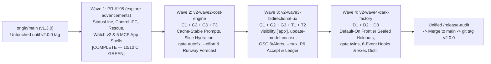

# Antigravity Booster v2.0: Dependable & Cost-Effective Agentic Software Factory Proposals (Waves 2–4)

- **Date:** 2026-11-24
- **Base Branch / PR:** `explore-advancements` (PR #195 — `v2.0.0` Wave 1 Cockpit, Rescue & MCP Apps)
- **Active Stacked Worktree:** `.worktrees/v2-wave2-cost-engine` (`v2-wave2-cost-engine`)
- **ADLC Ticket:** `T-W2-SPEC`
- **Probed Baselines:** `antigravity-booster 2.0.0-rc1` (`34ef651`, rebased atop `v1.3.0`), `agy 1.5.15`, `@adlc/* 1.13.0`
- **Status:** Owner-Aligned Stacked Release Architecture & Proposal Catalog

---

## 1. Strategic Context & Recorded Owner Decisions (2026-11-24)

PR #195 (`explore-advancements`, Wave 1 of `v2.0.0`) established the bi-modal Antigravity 2.0 foundation: detached `SessionStart` bootstrap, interactive Brain Artifact carve-outs, `<15ms` `agy` CLI `statusLine` + `title` HUD with lock-free 4-window quota caching, 256-bit authenticated `control.sock` IPC, two-phase surgical `agb rescue`, interactive `agb watch` v2 Flight Deck, and the 5 `ui://agb/*.html` native MCP App shells (`2,219/2,219` passing tests, `10/10` CI checks green).

This catalog defines the **next-horizon Software Factory advancements** to maximize **Strike-0 First-Pass Merge Yield per Quota-% Spent** while eliminating reward hacking and human review fatigue across CLI/TUI and GUI.

### Confirmed Architectural Decisions

1. **Stacked Sequential Waves Targeting `v2.0.0` ("The Sweet Spot"):**
   - Keep `main` untouched at `v1.3.0` (`5c346ed`) until the full `v2.0.0` stack is complete (since `.github/workflows/publish.yml` publishes to npm strictly on `v*` tag push, whereas merging to `main` immediately updates Vercel docs and git-URL plugin installs).
   - Treat `explore-advancements` (PR #195) as **Wave 1 (Stack Base)** and stack focused child PR waves (`Wave 2`, `Wave 3`, `Wave 4`) sequentially atop the stack tip — preserving small, P6-reviewable, 5-lens-prosecutable diffs **without** suffering simultaneous `dist/*.mjs` and `website/generated/*.mdx` bundle rebase cascades across 4 open branches at once.
   - Conclude with a single unified `/release-audit` pass across the converged `2.0.0` branch, merge to `main`, and tag `v2.0.0`.

2. **Default-On vs. Opt-In Enforcement Posture:**
   - **Sealed Holdout Scenarios (`D1`, Wave 4):** **Default-on for `frontier` tickets** (`tier === 'frontier'` or `holdout_scenarios === true`, with `holdout_scenarios: false` / `plan.holdouts === false` opt-out), matching Cross-Pool Adversarial TDD Split (`lib/tdd-split.mjs`).
   - **Deterministic Blueprint `gate.autofix` (`C1`, Wave 2):** **Opt-in** via `plan.gate.autofix` (`npm (test|run <script>)`), verified via `verifyGateScriptIntegrity`, sandboxed via `wrapGateCommand`, and strictly bounded to `ticket.scope` and `rails-guard`.
   - **Cache-Stable 3-Layer Prompts (`C3`), Direct Context-Slice Hydration (`C1`), and Joint `(Model × Effort)` Escalation (`C2`):** **Default-on** (zero behavioral mutation to target repos; pure token/quota & latency reduction).

---

## 2. External Harness Research Synthesis

| External System / Research | Key Architectural Mechanism | Adaptation into `antigravity-booster` (`agb` + ADLC) |
| :--- | :--- | :--- |
| **Stripe Minions** | Interleaves probabilistic **Agentic Nodes** with zero-token **Deterministic Blueprint Nodes** (context hydration, autofix/format/codegen, scoped test slice) so LLMs never burn full retries on lint or boilerplate drift. | **Proposal C1:** Pre-inject `buildContextSlice` + `deriveImpactedTests` into worktree `AGENTS.md` before Turn 1; run sandboxed `plan.gate.autofix` + scope/rail check after builder completion before P5 gates. |
| **StrongDM Attractor / Software Factory** | Stores end-to-end behavioral **Holdout Scenarios** *outside* the codebase so agents cannot read test assertions and reward-hack, returning only behavioral satisfaction symptoms; pairs with local **Digital Twins**. | **Proposals D1 & D2:** Sealed Holdout Suites stored under `<plugin_data>/holdouts/` (blocked by `PreToolUse` + excluded from builder mounts, default-on for `frontier` tickets) + ephemeral `gate.twins` localhost fixture servers. |
| **Prefix-Caching & RepoMap Economics (2025–2026)** | Strict sequential prompt ordering (100% static doctrine/RepoMap first, ticket/diff middle, volatile instructions/diagnostics last) yields 80–85% KV-cache hits (up to 90% input token discount) and avoids tool-loop disorientation. | **Proposal C3:** 3-Layer Cache-Aligned Charter & Review Compiler with deterministic HMAC-derived boundary nonces (`deriveDeterministicFenceTag`) so all 5 review lenses share an identical prefix. |
| **`cmux` & `workmux` Multi-Agent TUIs** | Replaces passive tab babysitting with **Attention Rings / OSC notifications**, **OSC 8 clickable `file://` links**, and native **`tmux`/`zellij`/`cmux` split-pane orchestration**. | **Proposals T1 & T2:** OSC 8 hyperlinks across `watch`/`review`/`status`, OSC 9/777 desktop attention alerts on actionable states, `agb watch --mux`, and `lazygit`-style `agb accept` P6 hunk review TUI. |
| **MCP Apps (`io.modelcontextprotocol/ui`, 2026)** | Separates model-visible tools from UI-private RPCs (`_meta.ui.visibility: ["app"]`) to eliminate per-turn tool-schema bloat, and syncs widget state silently into chat via `ui/update-model-context`. | **Proposals G1, G2 & G3:** Hide UI-polling/control RPCs from LLM `tools/list`, wire `ui/update-model-context` across Plan/Review/Flight-Deck views, and add Visual Split-Diff Acceptance + Factory Economics Ledger. |

---

## 3. Complete Catalog of All 12 Wave 2–4 Proposals

### Axis 1: Token & Quota Cost Engineering (Wave 2)

- **C1 — "Stripe Minions" Deterministic Blueprint Nodes (`gate.autofix` + Pre-Hydrated `AGENTS.md`):**
  - Pre-bake `buildContextSlice()` + `deriveImpactedTests()` directly into worktree `AGENTS.md` Layer 3 so builders skip 2–5 initial search/read turns.
  - Execute opt-in `plan.gate.autofix` (`npm run ...`, verified by `verifyGateScriptIntegrity` and confined inside `bwrap`/`sandbox-exec`) post-build; automatically roll back if out-of-scope or rail paths are touched, otherwise stage clean formatting/codegen fixes at 0 LLM tokens prior to `gate.test` and prosecution.
- **C2 — Joint `(Model × Effort)` Escalation Ladder (`agy --effort`) & Cost-Normalized Bandit Routing (+ Warm `agy acp` Pool):**
  - Dynamically pass `--effort low|medium|high|xhigh` based on `(tier, role, strike)` (`low` on `cheap`/coldstart, `medium` on `mid` Strike 0, `high` on `mid` Strike 1 & `frontier` Strike 0, `xhigh` on `frontier` Strike 1 / Arbiter tie-break).
  - Record token & `quotaDeltaPct` telemetry in `BanditModelRouter` (`model_stats.jsonl`) to rank models by **Strike-0 Merge Yield per Quota-% Consumed**.
  - *(Wave 3/4 extension)* Optional warm `agy acp --process-per-session --stdio` pool for multi-round read-only gates.
- **C3 — 3-Layer KV-Cache Prefix-Stable Charter & Review Prompt Compiler:**
  - Restructure `lib/charters.mjs` and `lib/review.mjs` into Layer 1 (static ADLC charter & charges), Layer 2 (shared ticket/diff with HMAC-derived deterministic boundary tag per run+diff), and Layer 3 (lens-specific prompt or Strike-1 diagnostic tail).

### Axis 2: Dependability & Anti-Reward-Hacking Factory (Wave 4)

- **D1 — Sealed Holdout Scenarios (`agb holdout`, Default-On for `frontier` Tickets):**
  - Author black-box holdout scenarios into `<plugin_data>/holdouts/<repoHash>/<runId>/<ticketId>/` (unreadable by builders via `PreToolUse` and excluded from worktree mounts). Execute externally during P5 and return only sanitized behavioral failure symptoms (never holdout source or line numbers) until satisfaction passes.
- **D2 — Ephemeral "Digital Twin" Fixture Sidecars (`gate.twins`):**
  - Launch declarative zero-network local mock HTTP/DB servers on ephemeral localhost ports inside the P5 gate sandbox (`API_BASE_URL` injected into test env) with guaranteed process-group teardown.
- **D3 — Full 6-Event In-Session Lifecycle Hooks (`PostToolUse`, `PreInvocation`, `PostInvocation`, `Stop`) + Executable `agb distill`:**
  - Zero-token `metadata.user_markdown` readiness/context-rot cards (`systemMessage: ""`), `Stop` hook Dirty-Since-Gate guard (`decision: "continue"` when `!continuationActive`), and `agb distill --compile-checks` emitting deterministic `.adlc/learned-checks.json` invariants.

### Axis 3: CLI & TUI Cockpit UX (Waves 2 & 3)

- **T1 — Attention-Driven Terminal Cockpit (OSC 8 Hyperlinks, OSC 9/777 Notifications & `agb watch --mux`):**
  - Clickable `file:///abs/path#Lline` OSC 8 links in `watch`/`review`/`status`, desktop notifications strictly on human-actionable transitions (`Needs Rescue`, `Quota Reset`, `P6 Ready`), and native `tmux`/`zellij`/`cmux` split-pane & socket integration.
- **T2 — Interactive `agb accept` P6 Hunk-Level Sign-Off TUI:**
  - Ticket-grouped diff hunks, inline external-caller blast radius, prosecutor findings/rebuttals, surviving/equivalent mutant overlays, 1-key reopen-to-`agb rescue`, and automated PR Evidence Dossier generation.
- **T3 — Pre-Run Quota Runway Forecaster (`agb plan --estimate` + TUI / `statusLine` Runway Badge):**
  - Combines per-wave ticket tiers/scopes, `model_stats.jsonl` historical burn, and live `agb_statusline_quota.json` 5h/weekly remaining % to warn *before* launch when a wave will exhaust a pool and recommend pool shifts.

### Axis 4: Native GUI & MCP App Workbench UX (Wave 3)

- **G1 — Bidirectional MCP Apps v2 (`_meta.ui.visibility: ["app"]` + `ui/update-model-context`):**
  - Hide UI-exclusive RPC tools (`agb_control`, diff/ledger fetchers) from LLM `tools/list` (~2k tokens saved every chat turn) and push interactive checklist/DAG/hunk selections silently via `ui/update-model-context`.
- **G2 — Interactive Visual DAG Swimlane Composer & Side-by-Side P6 Acceptance Workbench (`ui://agb/accept-workbench.html`):**
  - Live `tier`/`effort`/`pool_hint`/`tdd_split` controls in `plan-viewer.html` with real-time quota burn preview + side-by-side P6 diff & screenshot timeline workbench.
- **G3 — Append-Only Factory Economics Ledger (`factory_ledger.jsonl` + Mission Control Economics Tab):**
  - Tracks Strike-0 Yield %, Quota-% per Merged Ticket, KV-Cache Hit %, Deterministic Autofix Saves, and P1:P4:P5 Barbell Spend across runs.

---

## 4. Stacked `v2.0.0` Execution Sequence

