# Specification: Antigravity Booster End-to-End Autonomous Factory Parity (`v1.3.0`)

**Base:** `main` \
**Gate:** `{"test": "npm test"}`

--------------------------------------------------------------------------------

## 1. Overview & Objectives

This specification defines the complete engineering build-out required for the
external open-source **Antigravity Booster** (`antigravity-booster`, built on
Google Antigravity CLI `agy` $\ge$ `1.4.7`) to achieve 100% end-to-end
autonomous "Factory" execution parity and runtime ergonomics parity with our
internal implementation.

Today, the external repository (`v1.2.0`) provides an intent-routing `/agb`
table, an LLM-only `brainToPlan()` converter in `agb plan`, a 4-lens diff
reviewer in `agb review`, and parallel worktree execution in `agb run`. However,
it lacks:

1.  **Pre-Plan Shaping & Deterministic DAG Pre-Analyzer** (`agb shape` /
    `/agb-shape` / `agb_shape`),
2.  **Structured Spec Fast-Path & Ticket Decomposer** in `agb plan`
    (`lib/plan-integrity.mjs`),
3.  **5-Lens Cross-Model Plan & Code Adversarial Review Loop with Neutral
    Arbiter Triage** (`/plan-review`, `/code-review`, `/implement-and-review`,
    `agb review --plan`),
4.  **5-Phase End-to-End Autonomous Factory Orchestrator with Two-Tier `--yolo`
    Governance** (`/agb`),
5.  **Live Terminal TUI Dashboard & Inline `agb run` Terminal HUD** (`agb
    watch`, `/agb-watch`, `lib/tui.mjs`, `lib/hud.mjs`, `report.md`),
6.  **One-Command Target Repo Onboarding & Self-Healing Diagnostics** (`agb
    init`, `agb doctor --fix`, `agb --version --provenance`, `agb run -c <n>`),
    and
7.  **Modular File-Size Decomposition (<800-Line Discipline for New/Refactored
    Modules) & Live `agy models` Drift Sync** (`lib/scheduler-verify.mjs`,
    `lib/doctor-models.mjs`, `lib/schemas.mjs`, `lib/json.mjs`,
    `scripts/sync-models.mjs`, `agb sync-models`, `/agb-sync-models`).

### Core Factory & Runtime Parity Pillars

1.  **Pillar A — Modular Foundation, Node 22 Test Runner & Pre-Plan Shaping
    Engine (`scripts/run-tests.mjs`, `lib/json.mjs`, `lib/schemas.mjs`,
    `lib/plan-integrity.mjs`, `lib/shape.mjs`)**:
    -   Replace `node --test test/*.test.mjs` (which crashes on Node 22
        `lazyMinimatch`) with `scripts/run-tests.mjs` (`readdirSync` discovery +
        parallel child process runner).
    -   Extract resilient RFC 8259 JSON extraction (`safeExtractJson` in
        `lib/json.mjs`), versioned draft-07 JSON schemas + validator
        (`lib/schemas.mjs`, re-exported from `lib/agy.mjs`), and deterministic
        plan/pathspec/decomposition helpers (`lib/plan-integrity.mjs`).
    -   Build `lib/shape.mjs` (`parseStructuredSpec`,
        `scanStaticImportCoupling`, `preAnalyzeSpec`, `syncBrainPlanArtifact`,
        `formatShapeReport`, `runShapeCli`) and
        `templates/specs/feature-template.md`.
2.  **Pillar B — Structured Spec Fast-Path, Ticket Decomposition & Brain
    Artifact Sync (`lib/plan.mjs`, `lib/brain.mjs`, `lib/preflight.mjs`)**:
    -   Upgrade `compilePlan()` in `lib/plan.mjs` with a deterministic Stage A
        **Structured Spec Fast-Path** (`fastPath = true` default, bypassable via
        `--no-fast-path`): when `preAnalyzeSpec()` succeeds on a shaped spec,
        skip the initial frontier LLM `brainToPlan()` call (`0` Stage A LLM
        tokens) and proceed directly to Stage B (`coldstart`, `parallax`,
        `premortem`, `adlc model-router`, `adlc merge-forecast`).
    -   Protect source plans in `lib/brain.mjs` via `resolveSourcePlanMarkdown`
        so generated `agb_plan_artifact.md` files never shadow
        `implementation_plan.md`, preserve OSS brain directory discovery order
        (`[antigravity-cli, antigravity, jetski]`), and render rich Mermaid DAG
        + GFM tables via `formatPlanMarkdown()`.
3.  **Pillar C — Unified 5-Lens Plan & Code Adversarial Review Engine with
    Neutral Arbiter & Model Sync (`lib/review.mjs`, `lib/models.mjs`,
    `lib/doctor-models.mjs`, `scripts/sync-models.mjs`)**:
    -   Extend `lib/review.mjs` to support both **5-Lens Code ARL**
        (`correctness_redteam`, `security`, `simplicity`, `evidence_runner`,
        `anti_slop`, plus backward-compatible aliases for `correctness`,
        `tests`, `contracts`) and **5-Lens Plan ARL** (`devils_advocate`,
        `requirements_fidelity`, `simplicity`, `evidence_strategy`,
        `dag_topology` via `agb review --plan <spec.md> [--loop]`), backed by a
        **Neutral Arbiter** (`triageFindings` emitting `gate_verdict: "SHIP" |
        "ITERATE"` and per-finding `resolution_route: "auto-fix" | "grill-me"`).
    -   Extract `lib/doctor-models.mjs` (`parseAgyModels`,
        `compareModelCatalog`, `checkModelCatalog`) and build pure-Node
        `scripts/sync-models.mjs` (`--check`, `--offline`, `--json`, `--write`)
        to audit live `agy models` output against `lib/models.mjs`.
4.  **Pillar D — Live Terminal TUI, Inline `agb run` HUD, Self-Healing Doctor &
    Scheduler Decomposition (`lib/tui.mjs`, `lib/hud.mjs`, `lib/status.mjs`,
    `lib/scheduler-verify.mjs`, `lib/scheduler.mjs`, `lib/doctor.mjs`)**:
    -   Add `lib/tui.mjs` (interactive ANSI dashboard with pool gauges, progress
        bars, ticket matrix, event stream, and `[q]`/`[r]`/`[c]`/`[space]`
        hotkeys) and `lib/hud.mjs` (`TerminalHUD` inline status bar rendering
        exclusively to `process.stderr` during `agb run` on TTY terminals,
        disableable via `AGB_HUD=0`), plus `.booster/report.md` Markdown summary
        generation in `lib/status.mjs`.
    -   Preserve all existing OSS security containment, Windows AppContainer
        sandbox attestation, plugin integrity, root git integrity, and 4-phase
        integration journal functions in `lib/scheduler.mjs` and
        `lib/doctor.mjs` while extracting `lib/scheduler-verify.mjs`, importing
        `./doctor-models.mjs`, and adding `runDoctor({ fix: true })` and
        `runInit({ repo })`.
5.  **Pillar E — CLI, MCP Server, 5-Phase `/agb` Factory Skills & Two-Tier
    `--yolo` Governance (`bin/agb.mjs`, `mcp/server.mjs`, `skills/**`,
    `commands/**`)**:
    -   Expose `agb shape`, `agb watch`, `agb init`, `agb sync-models`, `agb
        doctor --fix`, `agb --version --provenance`, `agb run -c <n>`, `agb plan
        --decompose --max-ticket-scope <n> --no-fast-path`, and `agb review
        --plan <spec.md> [--loop] [--five-lens] [--no-arbiter]` in
        `bin/agb.mjs`, plus `agb_shape` and `agb_init` in `mcp/server.mjs`.
    -   Upgrade `/agb` to the 5-Phase End-to-End Autonomous Factory with
        **Two-Tier `--yolo`** (`/agb-shape --yolo` pauses at the Human Sign-Off
        Gate; `/agb --yolo` runs all 5 phases end-to-end) and ship `/agb-shape`,
        `/plan-review`, `/code-review`, `/implement-and-review`, `/agb-watch`,
        `/agb-preflight`, `/agb-status`, and `/agb-sync-models` (using
        vendor-neutral Git/PR terminology throughout).

--------------------------------------------------------------------------------

## 2. Architecture & Ticket DAG

```mermaid
graph TD
    T1["T-FACTORY-1: Test Runner, Schemas, Plan Integrity & Shaping Engine<br/>(scripts/run-tests.mjs, lib/json.mjs, lib/schemas.mjs, lib/agy.mjs, lib/plan-integrity.mjs, lib/shape.mjs, templates/specs/feature-template.md, test/shape.test.mjs)"]
    T2["T-FACTORY-2: Plan Compiler Fast-Path & Brain Artifact Sync<br/>(lib/brain.mjs, lib/plan.mjs, lib/preflight.mjs, test/plan-fastpath.test.mjs)"]
    T3["T-FACTORY-3: 5-Lens Plan & Code ARL + Arbiter & Model Sync<br/>(lib/models.mjs, lib/doctor-models.mjs, lib/review.mjs, scripts/sync-models.mjs, test/review-arl.test.mjs, test/sync-models.test.mjs)"]
    T4["T-FACTORY-4: Live Terminal TUI, HUD, Self-Healing Doctor & Decomposition<br/>(lib/tui.mjs, lib/hud.mjs, lib/status.mjs, lib/scheduler-verify.mjs, lib/scheduler.mjs, lib/doctor.mjs, test/tui-hud.test.mjs, test/unit.test.mjs)"]
    T5["T-FACTORY-5: CLI & MCP Server Factory Surface<br/>(bin/agb.mjs, mcp/server.mjs, test/cli-fixes.test.mjs)"]
    T6["T-FACTORY-6: Factory Skills, Personas, Slash Commands & Staging<br/>(skills/**, commands/**, plugin.json, scripts/stage-marketplace-plugin.mjs, test/commands.test.mjs, test/plugin-layout.test.mjs, test/skills-cross-harness.test.mjs)"]
    T7["T-FACTORY-7: Bundles, Packaging, Website Docs & Verification Suite<br/>(dist/**, website/**, package.json, README.md, USAGE.md, test/packaging.test.mjs)"]

    T1 --> T2
    T2 --> T3
    T3 --> T4
    T4 --> T5
    T5 --> T6
    T6 --> T7
```



### Architectural Data Flow

```mermaid
sequenceDiagram
    autonumber
    actor User
    participant Shape as Phase 1: /agb-shape & agb shape
    participant PlanARL as 5-Lens Plan ARL (agb review --plan --loop)
    participant Plan as Phase 2 & 3: agb plan (Fast-Path) & preflight
    participant Run as Phase 4: agb run (HUD + TUI Watch + Prosecution)
    participant CodeARL as Phase 5: /code-review (5-Lens Code ARL + Arbiter)

    User->>Shape: Feature Idea or Prompt (/agb or /agb-shape [--yolo])
    Shape->>Shape: Reconnaissance + /grill-me (or Recommended defaults in --yolo)
    Shape->>Shape: Write specs/<slug>-spec.md + run agb shape --sync-brain
    Shape->>PlanARL: Execute 5-Lens Cross-Model Plan Review (up to 3 rounds)
    PlanARL-->>Shape: Arbiter Triage (auto-fix -> edit spec; grill-me -> ask_question)
    alt /agb-shape (interactive or --yolo) or /agb (interactive)
        Shape->>User: Human Sign-Off Gate (Approve -> agb plan / Re-run / Refine)
    else /agb --yolo (Full Factory Autonomy)
        Shape->>Plan: Auto-advance on gate_verdict === "SHIP" & agb shape ok
    end
    Plan->>Plan: preAnalyzeSpec Fast-Path (0 Stage A LLM calls) -> Stage B Gates
    Plan->>Run: Validated plan.json + .adlc/tickets/ + concurrencyCap
    Run->>CodeARL: Parallel Sandboxed Worktrees + Inline TerminalHUD + Merge
    CodeARL-->>User: Final 5-Lens Code ARL + Arbiter Verdict ("SHIP") + report.md
```

--------------------------------------------------------------------------------

## 3. Component Details & Ticket Specifications

### Ticket 1: `T-FACTORY-1` — Test Runner, Schemas, Plan Integrity & Pre-Plan Shaping Engine

-   **Scope**: `scripts/run-tests.mjs`, `lib/json.mjs`, `lib/schemas.mjs`, `lib/agy.mjs`, `lib/plan-integrity.mjs`, `lib/shape.mjs`, `templates/specs/feature-template.md`, `test/shape.test.mjs`
-   **Rails**: `lib/pools.mjs`, `lib/lock.mjs`
-   **Edges**: `T-FACTORY-1 -> T-FACTORY-2`
-   **Gate**: `node --test test/shape.test.mjs`
-   **Tier**: `frontier`
-   **Pool Hint**: `auto`
-   **Objectives**:
    1.  Create `scripts/run-tests.mjs` (porting the Node 22-safe test runner that
        discovers `test/*.test.mjs` via `readdirSync` instead of CLI globbing
        `lazyMinimatch`, supporting explicit file arguments, `--coverage`, and
        `--coverage-check`).
    2.  Create `lib/json.mjs` exporting `safeExtractJson(text)` to strip
        markdown fences, repair unescaped control characters / invalid escape
        sequences / trailing commas in LLM JSON responses, and parse balanced
        JSON payloads.
    3.  Create `lib/schemas.mjs` exporting `validateJsonSchema(data, schema)`
        and versioned draft-07 schemas (`QUOTA_RESPONSE_SCHEMA`,
        `STREAM_EVENT_SCHEMA`, `PROSECUTION_VERDICT_SCHEMA`,
        `COLDSTART_VERDICT_SCHEMA`, `COLDSTART_FINDINGS_SCHEMA`,
        `COLDSTART_SCHEMA` as an alias for `COLDSTART_FINDINGS_SCHEMA`,
        `PARALLAX_VERDICT_SCHEMA`, `BRAIN_PLAN_SCHEMA`,
        `REVIEW_FINDINGS_SCHEMA`). Update `lib/agy.mjs` to import and re-export
        `safeExtractJson` from `./json.mjs` and `validateJsonSchema` + schemas
        from `./schemas.mjs` so there is a single source of truth.
    4.  Create `lib/plan-integrity.mjs` (copying existing pathspec/gate/plan
        validation helpers from `lib/plan.mjs`, which `T-FACTORY-2` will replace
        with re-exports) and add decomposition and path helpers so
        `lib/shape.mjs`, `lib/plan.mjs`, and `lib/preflight.mjs` share one
        source of truth without cross-ticket import cycles:
        -   `TICKET_ID_RE`, `PATHSPEC_RE`, `normalizePathspec(p)`,
            `validatePathspec(p, { allowRootWildcard })`,
            `isSafePathSegment(seg)`, and `writeArtifactFileAtomically(dir,
            filename, content)`.
        -   `verifyGateScriptIntegrity(candidatePkg, baselinePkg, gateCommand)`
            (preserving exact SHA-256 script and lifecycle hook tamper checks).
        -   `decomposeTickets(tickets, { maxScope = 3, repo })`: splits tickets
            whose `scope.length > maxScope` into sequential sub-tickets
            (`<id>-p1`, `<id>-p2`, ...) with disjoint scopes, automatic rail
            protection for sibling chunks, and rewired incoming/outgoing edges.
        -   `verifyDeclaredPaths(tickets, repo)`: verifies literal (non-glob)
            rail paths declared on tickets exist in `repo` OR are produced in
            the `scope` of an upstream ancestor ticket in the DAG, and rejects
            path traversal (`..` or absolute paths).
        -   `formatStructuralDefects(overlaps, missingRails)` and
            `validatePlan(plan, { strictGates })`.
    5.  Create `lib/shape.mjs` implementing the deterministic pre-plan analyzer
        and structured spec parser (importing `verifyDeclaredPaths`,
        `isSafePathSegment`, and `writeArtifactFileAtomically` from
        `./plan-integrity.mjs` so `T-FACTORY-1` has zero dependency on
        `T-FACTORY-2` exports):
        -   `parseStructuredSpec(markdown, { repo, gate })`: parses `# <Title>`,
            top-level `**Base:**` and `**Gate:**`, and `### Ticket <N>: [`]<ID>[`]
            — <Title>` sections (`Scope`, `Rails` supporting globs like
            `lib/**`, `Edges` supporting `A -> B` and `(none)`, optional
            per-ticket `Gate`, `Tier`, `Pool Hint`, `Objectives`, `Acceptance
            Criteria`) into a candidate `plan` object plus `parseErrors`.
        -   `scanStaticImportCoupling(tickets, repo)`: scans static JS/TS ES
            module `import`/`export ... from` and CommonJS `require()` edges
            across existing literal files in concurrent tickets (plus optional
            `process.env.AGB_GRAPH_COUPLING_FILE` overrides) and returns
            advisory `couplingWarnings` when two parallel tickets directly
            import each other without a serializing DAG edge.
        -   `preAnalyzeSpec(specOrId, { repo, gate, brainDir, raw,
            maxTicketScope = 12, strict = false })`: runs `parseStructuredSpec`,
            `validatePlan`, `forecastOverlaps`, `verifyDeclaredPaths`, and
            `scanStaticImportCoupling`, returning `{ ok, structured, source,
            plan, structuralErrors, overlaps, missingRails, couplingWarnings,
            scopeWarnings, readinessScore }`, where `readinessScore = Math.max(0,
            100 - structuralErrors.length * 25 - couplingWarnings.length * 10 -
            scopeWarnings.length * 5)` and `ok = structuralErrors.length === 0
            && (!strict || (couplingWarnings.length === 0 &&
            scopeWarnings.length === 0))`.
        -   `syncBrainPlanArtifact(markdown, { repo, brainDir, sessionId, plan
            })`: writes `<repo>/.booster/agb_plan_artifact.md` and, when a brain
            session exists, syncs `<brainDir>/<sessionId>/implementation_plan.md`.
        -   `formatShapeReport(result)` and `runShapeCli(rest, { repo, stdout,
            stderr })`.
    6.  Create `templates/specs/feature-template.md` (using glob rails such as
        `lib/**` so `preAnalyzeSpec` passes in both this repository and any
        `agb init` target repo) and `test/shape.test.mjs`.
-   **Acceptance Criteria**:
    -   `lib/json.mjs`, `lib/schemas.mjs`, `lib/plan-integrity.mjs`, and
        `lib/shape.mjs` are each strictly under 800 lines.
    -   `preAnalyzeSpec` on both `templates/specs/feature-template.md` and
        `specs/factory-parity-spec.md` (with `maxTicketScope: 12`) returns `ok:
        true`, `structured: true`, and `readinessScore: 100`.
    -   `node --test test/shape.test.mjs` passes with 0 failures.

--------------------------------------------------------------------------------

### Ticket 2: `T-FACTORY-2` — Plan Compiler Fast-Path, Decomposition & Brain Artifact Sync

-   **Scope**: `lib/brain.mjs`, `lib/plan.mjs`, `lib/preflight.mjs`, `test/plan-fastpath.test.mjs`
-   **Rails**: `lib/shape.mjs`, `lib/plan-integrity.mjs`, `lib/schemas.mjs`
-   **Edges**: `T-FACTORY-2 -> T-FACTORY-3`
-   **Gate**: `node --test test/plan-fastpath.test.mjs`
-   **Tier**: `frontier`
-   **Pool Hint**: `auto`
-   **Objectives**:
    1.  Update `lib/brain.mjs`:
        -   Preserve OSS's brain directory discovery precedence
            (`[antigravity-cli, antigravity, jetski]`) in `getBrainDir()`.
        -   Add `SOURCE_PLAN_FILENAMES = ['implementation_plan.md', 'plan.md',
            'spec.md', 'walkthrough.md']` and export
            `resolveSourcePlanMarkdown(brain)` so that `agb_plan_artifact.md`
            written by a prior `agb shape` or `agb plan` run never shadows the
            human-authored `implementation_plan.md` when re-compiling a brain
            conversation.
        -   Re-export `isSafePathSegment` and `writeArtifactFileAtomically` from
            `./plan-integrity.mjs`, and export `writePlanArtifact(plan, { repo,
            source })` (using `getBrainDir()` and writing both
            `<repo>/.booster/agb_plan_artifact.md` and active brain
            `agb_plan_artifact.md`) and `formatPlanMarkdown(plan, { source,
            generatedAt })`.
        -   Enhance `conversionPrompt(brain, repo, gate, feedback, previousPlan,
            tag)` and `brainToPlan()` to honor `process.env.AGB_BRAIN_MODEL` and
            `process.env.AGB_BRAIN_REPAIR_MODEL`, wrap untrusted spec inputs in
            `<<UNTRUSTED:SPEC:${tag}>>` boundary markers, and pass `previousPlan`
            on repair attempts.
    2.  Update `lib/preflight.mjs`:
        -   Import and re-export `verifyDeclaredPaths` from
            `./plan-integrity.mjs` and include `missingRails:
            verifyDeclaredPaths(plan.tickets, opts.repo ?? plan.repo)` in
            `preflight(plan, opts)` (`ok` requires `missingRails.length === 0`).
        -   Honor `process.env.AGB_COLDSTART_MODEL` and wrap untrusted ticket
            bodies in `coldstartPrompt` with `<<UNTRUSTED:SPEC:${tag}>>`
            boundary markers.
    3.  Update `lib/plan.mjs` and create `test/plan-fastpath.test.mjs`:
        -   Replace the local copies of `PATHSPEC_RE`, `TICKET_ID_RE`,
            `normalizePathspec`, `validatePathspec`,
            `verifyGateScriptIntegrity`, `decomposeTickets`,
            `verifyDeclaredPaths`, `formatStructuralDefects`, and `validatePlan`
            with imports and re-exports from `./plan-integrity.mjs` while
            retaining whole-word identifier references in `lib/plan.mjs` to all
            13 `plan-schema.mdx` `<TypeTable>` fields (`repo`, `gate`,
            `tickets`, `pools`, `adlcBin`, `id`, `title`, `body`, `scope`,
            `rails`, `edges`, `tier`, `pool_hint`) so
            `website/scripts/check-schema-drift.mjs` passes.
        -   Honor `process.env.AGB_PREMORTEM_MODEL`,
            `process.env.AGB_PARALLAX_READER_MODEL`, and
            `process.env.AGB_PARALLAX_JUDGE_MODEL`.
        -   Integrate the **Stage A Structured Spec Fast-Path** into
            `compilePlan(idOrPrefix, opts)` (`fastPath = true` default,
            `decompose = false`, `maxTicketScope = opts.maxTicketScope ??
            (decompose ? 3 : 12)`):
            -   When `fastPath !== false`, run `preAnalyzeSpec(sourcePlanMd, {
                repo, gate, raw: true, maxTicketScope })`.
            -   When `preAnalysis.ok && preAnalysis.plan`, adopt
                `preAnalysis.plan` directly (`fastPathUsed = true`, `attempts =
                1`, `couplingWarnings = preAnalysis.couplingWarnings`),
                optionally run `decomposeTickets` when `decompose: true`, and
                skip the initial `brainToPlan()` LLM call—proceeding directly to
                Stage B (`coldstartTickets`, `parallaxEdges`, `premortemPlan`).
            -   Write `agb_plan_artifact.md` via `writePlanArtifact()` after
                Stage B validation/repair succeeds, and include `fastPath:
                fastPathUsed` and `couplingWarnings` in the returned `report`.
-   **Acceptance Criteria**:
    -   `compilePlan()` on a valid structured spec with `fastPath: true`
        completes Stage A with `report.fastPath === true` and `0` calls to
        `brainToPlan()`.
    -   `compilePlan()` with `decompose: true, maxTicketScope: 2` splits a
        4-file ticket into `-p1` and `-p2` sub-tickets with valid edges and
        rails.
    -   `lib/plan.mjs`, `lib/brain.mjs`, and `lib/preflight.mjs` are each strictly
        under 800 lines, and `node --test test/plan-fastpath.test.mjs` passes.

--------------------------------------------------------------------------------

### Ticket 3: `T-FACTORY-3` — Unified 5-Lens Plan & Code ARL + Neutral Arbiter & Model Sync

-   **Scope**: `lib/models.mjs`, `lib/doctor-models.mjs`, `lib/review.mjs`, `scripts/sync-models.mjs`, `test/review-arl.test.mjs`, `test/sync-models.test.mjs`
-   **Rails**: `lib/shape.mjs`, `lib/plan-integrity.mjs`, `lib/agy.mjs`
-   **Edges**: `T-FACTORY-3 -> T-FACTORY-4`
-   **Gate**: `node --test test/review-arl.test.mjs test/sync-models.test.mjs && node scripts/sync-models.mjs --offline --check`
-   **Tier**: `frontier`
-   **Pool Hint**: `auto`
-   **Objectives**:
    1.  Update `lib/models.mjs` and create `lib/doctor-models.mjs`:
        -   In `lib/models.mjs`, add cross-model lens routing table
            `ARL_LENS_MODELS` and role defaults in `ROLE_MODELS` (`arbiter:
            'gemini-4-argon-high'`, `brainRepair: 'gemini-4-argon-high'`) using
            only canonical model slugs present in `ALL_MODELS` / `LIVE_CATALOG`:
            -   **Code ARL Lenses (`CODE_ARL_LENSES`)**:
                1.  `correctness_redteam`: primary `claude-opus-5-5-high`
                    (fallback `gemini-4-argon-high`)
                2.  `security`: primary `gemini-4-argon-high` (fallback
                    `claude-opus-5-5-high`)
                3.  `simplicity`: primary `claude-sonnet-5-5-medium` (fallback
                    `gemini-3.8-flash-medium`)
                4.  `evidence_runner`: primary `gemini-3.8-flash-medium`
                    (fallback `claude-sonnet-5-5-medium`)
                5.  `anti_slop`: primary `claude-sonnet-5-5-high` (fallback
                    `gemini-3.8-flash-high`)
            -   **Plan ARL Lenses (`PLAN_ARL_LENSES`)**:
                1.  `devils_advocate`: primary `claude-opus-5-5-high` (fallback
                    `gemini-4-argon-high`)
                2.  `requirements_fidelity`: primary `gemini-4-argon-medium`
                    (fallback `claude-sonnet-5-5-high`)
                3.  `simplicity`: primary `claude-sonnet-5-5-medium` (fallback
                    `gemini-3.8-flash-medium`)
                4.  `evidence_strategy`: primary `gemini-3.8-flash-medium`
                    (fallback `claude-sonnet-5-5-medium`)
                5.  `dag_topology`: primary `gemini-4-argon-high` (fallback
                    `claude-opus-5-5-high`)
            -   **Arbiter**: primary `gemini-4-argon-high` (fallback
                `claude-opus-5-5-high`).
        -   Create `lib/doctor-models.mjs` exporting `parseAgyModels(stdout)`,
            `compareModelCatalog(liveIds, catalogIds, aliasIds)`, and
            `checkModelCatalog(opts)` (honoring
            `process.env.AGB_SYNC_MODELS_OFFLINE`) so both `lib/doctor.mjs` and
            `scripts/sync-models.mjs` share one parser and catalog comparator.
    2.  Upgrade `lib/review.mjs` (keeping `lib/review.mjs` strictly under 800
        lines):
        -   Keep `LENSES` (`correctness`, `security`, `tests`, `contracts`),
            `REVIEW_FINDINGS_SCHEMA`, `reviewDiff`, `reviewFleet`, and
            `reviewCalibration` 100% backward-compatible for existing callers.
        -   Export `CODE_LENSES`, `PLAN_LENSES`, `ARL_FINDING_SCHEMA`,
            `ARBITER_TRIAGE_SCHEMA`, and `normalizeSeverity(sev)` (mapping
            `blocker -> critical`, `major -> high`, `minor -> medium`, `nit ->
            low` so ARL findings and CLI exit gates share a unified severity
            scale).
        -   Export `triageFindings({ findings, targetType, context, pools,
            model, project, repo, mode })`: runs the **Neutral Arbiter** via
            `runAgy()` (with deterministic fallback deduplication/ranking when
            `arbiter: false`), deduplicating cross-lens findings, downweighting
            `evidence: null` + low-confidence noise, enforcing the severity
            floor (`minor`/`medium` and above, except `blast_radius: true` which
            always escalates), assigning `verdict: "accept-candidate" |
            "escalate" | "drop"`, and in Plan ARL mode assigning
            `resolution_route: "auto-fix" | "grill-me"` and `gate_verdict:
            "SHIP" | "ITERATE"`.
        -   Export `reviewPlan({ specPath, specContent, repo, pools, lenses,
            arbiter = true, loop = false, maxRounds = 3, log, project })`:
            1.  Runs deterministic `preAnalyzeSpec()` from `lib/shape.mjs` and
                injects its JSON pre-analysis summary into the `dag_topology`
                and arbiter context (when `shapeReport.structured === false`,
                injects a deterministic `critical` `"auto-fix"` finding
                instructing the caller to format the spec with `/agb-shape`).
            2.  Fans out the 5 `PLAN_LENSES` in parallel across `ARL_LENS_MODELS`
                (selecting the cross-family fallback if the primary pool has 0
                available capacity).
            3.  Runs `triageFindings()` to produce `{ ok, gateVerdict, summary,
                findings, autoFixFindings, grillMeFindings, shapeReport, rounds,
                requests, errors }`, where `gateVerdict === "SHIP"` requires
                `shapeReport.ok === true`, `errors.length === 0`, and zero
                surviving `critical`/`high` (`blocker`/`major`) findings.
    3.  Create pure-Node `scripts/sync-models.mjs` and tests
        (`test/review-arl.test.mjs`, `test/sync-models.test.mjs`):
        -   Reuse `parseAgyModels` and `compareModelCatalog` from
            `../lib/doctor-models.mjs`, and export `parseAgyModelsOutput`,
            `auditModels`, and `syncModels`.
        -   Support `--check` (CI gate, exits `1` on unmapped live models),
            `--offline`, `--json`, `--input <file>`, and `--write` (reading and
            writing `skills/adversarial-review/references/models.json` directly
            via Node `fs` when present, never shelling out to `python3`).
-   **Acceptance Criteria**:
    -   `lib/models.mjs`, `lib/doctor-models.mjs`, `lib/review.mjs`, and
        `scripts/sync-models.mjs` are each strictly under 800 lines.
    -   `node --test test/review-arl.test.mjs test/sync-models.test.mjs` and
        `node scripts/sync-models.mjs --offline --check` pass with 0 failures.

--------------------------------------------------------------------------------

### Ticket 4: `T-FACTORY-4` — Live Terminal TUI, Inline HUD, Self-Healing Doctor & Modular Decomposition

-   **Scope**: `lib/tui.mjs`, `lib/hud.mjs`, `lib/status.mjs`, `lib/scheduler-verify.mjs`, `lib/scheduler.mjs`, `lib/doctor.mjs`, `test/tui-hud.test.mjs`, `test/unit.test.mjs`
-   **Rails**: `lib/pools.mjs`, `lib/lock.mjs`, `lib/worktrees.mjs`
-   **Edges**: `T-FACTORY-4 -> T-FACTORY-5`
-   **Gate**: `node --test test/tui-hud.test.mjs test/unit.test.mjs`
-   **Tier**: `frontier`
-   **Pool Hint**: `auto`
-   **Objectives**:
    1.  Create `lib/tui.mjs` (zero-dependency ANSI Terminal UI engine):
        -   Export `ANSI`, `SPINNERS`, `PHASE_CONFIG`, `stripAnsi`,
            `visibleLength`, `padVisible`, `formatDuration`,
            `renderProgressBar`, `renderPoolGauge`, and
            `renderTUIDashboard(state, { cols, spinnerIndex, compact, now })`.
    2.  Create `lib/hud.mjs` (importing `renderProgressBar` and
        `renderPoolGauge` from `./tui.mjs`):
        -   Export `TerminalHUD` (`updateTicket`, `updatePools`, `clearHUD`,
            `log`, `formatStatus`, `render`, `stop`) writing ANSI HUD frames
            exclusively to `process.stderr` when `process.stderr.isTTY &&
            process.env.AGB_HUD !== '0'` so `agb run` JSON output on
            `process.stdout` is never corrupted.
    3.  Update `lib/status.mjs`:
        -   Export `sanitizeRunId`, `cleanOldLogs`, and
            `formatReportMarkdown(summary, state)` (writing `.booster/report.md`
            atomically alongside `.booster/report.json` on `RunStatus.report()`).
        -   Upgrade `renderStatus(repo, options)` to support `{ tui: true }` via
            `renderTUIDashboard` while keeping default output 100%
            backward-compatible with existing tests.
        -   Upgrade `watchStatus(repo, optionsOrInterval)` to support both
            numeric `intervalMs` and `{ intervalMs, interactive, follow,
            compact, stream }` with alternate-buffer ANSI rendering and
            keyboard hotkeys (`[q]` quit, `[r]` refresh, `[c]` compact,
            `[space]` pause/resume) on interactive TTYs.
    4.  Extract `lib/scheduler-verify.mjs` from `lib/scheduler.mjs` and wire
        `TerminalHUD` + `concurrencyCap`:
        -   **Mandatory Security Invariant**: Preserve 100% of existing OSS root
            git integrity, attempt git database isolation, host-mediated fetch,
            and 4-phase integration journal functions/exports in
            `lib/scheduler.mjs` (`snapshotRootGit`, `verifyRootGitIntegrity`,
            `setupAttemptGitDatabase`, `reconcileIntegrationJournal`, etc.).
        -   Extract `checkFlailDetector`, `runConsensusFix`, `recordGate`,
            `checkRailsGuard`, `checkEnforcementAvailable`, and
            `verifyScopeAndAntiNoOp` into `lib/scheduler-verify.mjs` and
            re-export them from `lib/scheduler.mjs`.
        -   Wire `TerminalHUD` and optional `concurrency` (`concurrencyCap`)
            into `runPlan()` in `lib/scheduler.mjs` so live ticket phase
            updates, pool snapshots, and log lines render cleanly to
            `process.stderr` on interactive terminals and `hud.stop()` runs in
            `finally`.
    5.  Update `lib/doctor.mjs` and `test/unit.test.mjs`, and create
        `test/tui-hud.test.mjs`:
        -   **Mandatory Security Invariant**: Preserve 100% of existing OSS
            Windows AppContainer sandbox attestation
            (`verifyWindowsSandboxAttestation`, `verifyWindowsSandboxActive`),
            plugin integrity (`evaluateStagedAdlcPlugin`), and doctor check
            exports in `lib/doctor.mjs`.
        -   Import and re-export `parseAgyModels`, `compareModelCatalog`, and
            `checkModelCatalog` from `./doctor-models.mjs` (created in
            `T-FACTORY-3`), and update the `isoRoot/lib` copy list in
            `test/unit.test.mjs` (around line 775) to include
            `doctor-models.mjs` and `models.mjs`.
        -   Export `runInit({ repo })` (initializing `.adlc/config.json`,
            copying `templates/specs/feature-template.md` to
            `<repo>/specs/feature-template.md` if absent, and calling
            `ensureGitignore(repo)`).
        -   Update `runDoctor({ cwd, fix = false, ... })` so passing `fix: true`
            (`agb doctor --fix`) checks `assertNoLegacyTicketStore(cwd)`,
            initializes `.adlc/tickets` directory store if missing, updates
            `.gitignore` via `ensureGitignore`, and dynamically imports
            `./bootstrap.mjs` (`await import('./bootstrap.mjs')`) to repair the
            companion plugin when `not-installed`, `outdated-plugin`, or
            `corrupt-tree`.
-   **Acceptance Criteria**:
    -   `lib/tui.mjs`, `lib/hud.mjs`, `lib/status.mjs`, and
        `lib/scheduler-verify.mjs` are each strictly under 800 lines, and
        grandfathered `lib/scheduler.mjs` and `lib/doctor.mjs` preserve all
        existing security/sandbox exports while decreasing in net line count.
    -   `RunStatus.report()` writes both `.booster/report.json` and
        `.booster/report.md`.
    -   `node --test test/tui-hud.test.mjs test/unit.test.mjs` passes with 0
        failures.

--------------------------------------------------------------------------------

### Ticket 5: `T-FACTORY-5` — CLI & MCP Server Factory Surface

-   **Scope**: `bin/agb.mjs`, `mcp/server.mjs`, `test/cli-fixes.test.mjs`
-   **Rails**: `lib/shape.mjs`, `lib/plan.mjs`, `lib/review.mjs`, `lib/status.mjs`, `lib/doctor.mjs`
-   **Edges**: `T-FACTORY-5 -> T-FACTORY-6`
-   **Gate**: `node --test test/cli-fixes.test.mjs && node bin/agb.mjs --help && node bin/agb.mjs shape templates/specs/feature-template.md --json`
-   **Tier**: `frontier`
-   **Pool Hint**: `auto`
-   **Objectives**:
    1.  Update `bin/agb.mjs`:
        -   Format all `COMMANDS[name].flags` entries using
            `[--flag <arg> (desc)]` syntax matching
            `website/scripts/gen-reference.mjs`'s parser regex, and implement a
            value-aware argv helper so flag arguments (`--max-ticket-scope <n>`,
            `--plan <spec.md>`, `--interval <ms>`, `-c <n>`, `-w`) are never
            misparsed as positional `[repo]` arguments:
            -   `shape`: `args: '<spec.md | brain-id> [repo]'`, `flags:
                '[--analyze (pre-analyze spec)] [--json (emit JSON)]
                [--sync-brain (sync to brain and .booster)] [--max-ticket-scope
                <n> (warn above n files)] [--strict (fail on warnings)]'`,
                `desc: 'deterministically pre-analyze a structured spec or brain
                plan for DAG validity, scope overlaps, and import coupling
                before agb plan'`.
            -   `watch`: `args: '[repo]'`, `flags: '[--interval <ms> (refresh
                interval)] [--follow (follow logs)] [--compact (compact rows)]'`,
                `desc: 'launch the interactive live terminal TUI dashboard'`.
            -   `init`: `args: '[repo]'`, `desc: 'initialize a target repository
                for ADLC and agb (.adlc/config.json, specs/feature-template.md,
                .gitignore)'` (delegating to `runInit({ repo })`).
            -   `sync-models`: `args: ''`, `flags: '[--check (exit 1 on drift)]
                [--offline (skip live CLI probe)] [--json (emit JSON)] [--write
                (update references/models.json)]'`, `desc: 'audit live agy
                models output against lib/models.mjs'`.
            -   Update `COMMANDS.tui.desc` to `'Removed. Use agb sidecar or agb
                watch instead.'`.
            -   `--version` / `-v`: support `--provenance` / `--verbose` to
                print `antigravity-booster v<ver> (<commit> <date>) [remote:
                <url>]` with a graceful fallback to `antigravity-booster
                v<ver>` when `.git` metadata is unavailable (e.g. packaged npm
                tarballs).
            -   `plan`: make `[repo]` default to `.` when omitted, and add
                `[--decompose (split wide tickets)] [--max-ticket-scope <n> (max
                files per ticket)] [--no-fast-path (force LLM conversion)]`.
            -   `run`: add `[-c <n> (cap concurrent workers)]` (short flag `-c
                <n>` only—never `--concurrency`, preserving
                `website/scripts/stale-claims.json` rule `C9`) and pass
                `concurrency` to `runPlan()`.
            -   `review`: add `[--plan <spec.md> (run 5-lens Plan ARL)] [--loop
                (iterative ARL up to 3 rounds)] [--five-lens (use 5-lens Code
                ARL)] [--no-arbiter (skip neutral arbiter)]` (also accepting
                `--5-lens` as a CLI alias in dispatch).
            -   `status`: add `[--tui (render TUI snapshot)] [-w (watch mode)]
                [--follow (follow logs)] [--compact (compact rows)]`.
            -   `doctor`: add `[--fix (auto-repair setup)]` and pass `fix:
                rest.includes('--fix')` to `runDoctor()`.
    2.  Update `mcp/server.mjs` and `test/cli-fixes.test.mjs`:
        -   Add `agb_shape` (`spec`, `repo`, `syncBrain`, `maxTicketScope`,
            `strict`) and `agb_init` (`repo`, calling `runInit`) to the `TOOLS`
            array literal and `CallToolRequestSchema` handler.
        -   Extend `agb_plan` with optional `decompose`, `maxTicketScope`, and
            `noFastPath`.
        -   Extend `agb_review` with optional `plan`, `loop`, `fiveLens`, and
            `arbiter`.
        -   Extend `agb_doctor` with optional `fix` (boolean).
        -   Update `test/cli-fixes.test.mjs` to test the new flags (`-c <n>`,
            `--plan`, `--decompose`, `--fix`, `shape`, `watch`, `init`).
-   **Acceptance Criteria**:
    -   `bin/agb.mjs` and `mcp/server.mjs` are each strictly under 800 lines.
    -   `node --test test/cli-fixes.test.mjs`, `node bin/agb.mjs --help`, and
        `node bin/agb.mjs shape templates/specs/feature-template.md --json` pass
        with 0 errors.

--------------------------------------------------------------------------------

### Ticket 6: `T-FACTORY-6` — Factory Skills, Personas, Slash Commands & Marketplace Staging

-   **Scope**: `skills/**`, `commands/**`, `plugin.json`, `scripts/stage-marketplace-plugin.mjs`, `test/commands.test.mjs`, `test/plugin-layout.test.mjs`, `test/skills-cross-harness.test.mjs`
-   **Rails**: `bin/agb.mjs`, `mcp/server.mjs`, `scripts/sync-skills.mjs`
-   **Edges**: `T-FACTORY-6 -> T-FACTORY-7`
-   **Gate**: `node --test test/commands.test.mjs test/plugin-layout.test.mjs test/skills-cross-harness.test.mjs && node scripts/sync-skills.mjs --check && node website/scripts/gen-reference.mjs --only docs-md`
-   **Tier**: `mid`
-   **Pool Hint**: `auto`
-   **Objectives**:
    1.  Create the Pre-Plan Shaping skill and slash command
        (`skills/agb-shape/SKILL.md` and `commands/agb-shape.md`):
        -   Documents the 5-step `/agb-shape <idea> [--yolo]` workflow:
            1.  **Step 1: Codebase Reconnaissance**
            2.  **Step 2: `/grill-me` Interactive Alignment** (in `--yolo` mode,
                self-resolves using `(Recommended)` defaults and logs them under
                `## Decisions & Assumptions` in `specs/<slug>-spec.md`)
            3.  **Step 3: Structured Spec Synthesis & Deterministic DAG
                Pre-Analysis** (`specs/<slug>-spec.md` + `agb shape
                --sync-brain`)
            4.  **Step 4: 5-Lens Plan Adversarial Review Loop** (`agb review
                --plan specs/<slug>-spec.md --loop` / `/plan-review --loop`,
                capped at 3 rounds, routing `"auto-fix"` vs `"grill-me"`)
            5.  **Step 5: Human Sign-Off Gate** (syncs to Antigravity brain
                `implementation_plan.md` and `.booster/agb_plan_artifact.md`,
                presents Mermaid DAG + ticket table, and pauses via
                `ask_question` with `Approve & Proceed to agb plan
                (Recommended)`, `Re-run /plan-review`, `Refine Tickets /
                Scope`—pausing under standalone `/agb-shape --yolo`, and
                auto-advancing only when invoked inside `/agb --yolo` with
                `agb shape` `ok: true` and `gate_verdict === "SHIP"`).
    2.  Upgrade `/agb` (`skills/agb/SKILL.md` and `commands/agb.md`) to the
        **5-Phase End-to-End Autonomous Factory**:
        -   Define the 5-Phase Factory lifecycle (`Phase 1: /agb-shape`
            $\rightarrow$ `Phase 2: agb plan` Fast-Path $\rightarrow$ `Phase 3:
            agb preflight` $\rightarrow$ `Phase 4: agb run` $\rightarrow$ `Phase
            5: /code-review` Final 5-Lens Code ARL & Delivery).
        -   Define **Two-Tier `--yolo` Governance**: `/agb-shape --yolo` pauses
            at Step 5 Sign-Off; `/agb --yolo` auto-advances across all 5 phases
            when `agb shape` is `ok: true` and Plan ARL returns `gate_verdict
            === "SHIP"`, and halts immediately to escalate to the user if Plan
            ARL remains `"ITERATE"` after 3 rounds or if any preflight/run/review
            gate fails.
        -   Retain Subcommand Intent Routing (`/agb shape`, `/agb plan`, `/agb
            preflight`, `/agb run`, `/agb review`, `/agb watch`, `/agb status`,
            `/agb sidecar`, `/agb doctor`, `/agb init`, `/agb bootstrap`, `/agb
            migrate`, `/agb sync-models`).
    3.  Port the 5-Lens Adversarial Review skill suite and companion factory
        skills/commands using strictly vendor-neutral Git/PR terminology (zero
        occurrences of internal review-unit names):
        -   `skills/adversarial-review/SKILL.md`,
            `skills/adversarial-review/personas/{arbiter,author_rebuttal,code_anti_slop,code_correctness_redteam,code_evidence_runner,code_security,code_simplicity,plan_dag_topology,plan_devils_advocate,plan_evidence_strategy,plan_requirements_fidelity,plan_simplicity,stack_decomposition}.md`,
            `skills/adversarial-review/references/models.json`, and
            `skills/adversarial-review/schema/finding.json` (using `target_ref`
            and "Code Gate" / "PR/Diff").
        -   `skills/plan-review/SKILL.md` + `commands/plan-review.md`
            (`/plan-review <spec.md> [--loop]`).
        -   `skills/code-review/SKILL.md` + `commands/code-review.md`
            (`/code-review [ref]`).
        -   `skills/implement-and-review/SKILL.md` +
            `commands/implement-and-review.md` (`/implement-and-review <task>`).
        -   `skills/agb-watch/SKILL.md` + `commands/agb-watch.md` (`/agb-watch
            [repo]`).
        -   `skills/agb-preflight/SKILL.md` + `commands/agb-preflight.md`
            (`/agb-preflight [plan.json]`).
        -   `skills/agb-status/SKILL.md` + `commands/agb-status.md`
            (`/agb-status [repo]`).
        -   `skills/agb-sync-models/SKILL.md` + `commands/agb-sync-models.md`
            (`/agb-sync-models`, invoking `agb sync-models`).
        -   Update `skills/agb-plan/SKILL.md`, `commands/agb-plan.md`,
            `skills/agb-review/SKILL.md`, `commands/agb-review.md`,
            `skills/agb-doctor/SKILL.md`, and `commands/agb-doctor.md`.
    4.  Update `plugin.json`, `scripts/stage-marketplace-plugin.mjs`
        (`USER_FACING_SKILLS` roster), and the layout/command test suites
        (`test/commands.test.mjs`, `test/plugin-layout.test.mjs`,
        `test/skills-cross-harness.test.mjs`) to validate the expanded factory
        command and skill rosters, and verify `node scripts/sync-skills.mjs
        --check` passes without mutating `.agents/skills/` or `.claude/skills/`.
-   **Acceptance Criteria**:
    -   Every file in `commands/*.md` and `skills/*/SKILL.md` has valid YAML
        frontmatter (`name`, `description` $\le$ 1024 chars) and passes
        `website/scripts/gen-reference.mjs --only docs-md`.
    -   `node --test test/commands.test.mjs test/plugin-layout.test.mjs
        test/skills-cross-harness.test.mjs` and `node scripts/sync-skills.mjs
        --check` pass with 0 errors.

--------------------------------------------------------------------------------

### Ticket 7: `T-FACTORY-7` — Bundles, Packaging, Website Docs & Verification Suite

-   **Scope**: `dist/**`, `website/**`, `package.json`, `README.md`, `USAGE.md`, `test/packaging.test.mjs`
-   **Rails**: `lib/**`, `bin/**`, `mcp/**`, `skills/**`, `commands/**`
-   **Edges**: `(none)`
-   **Gate**: `npm run build && npm test && node scripts/stage-marketplace-plugin.mjs --validate-strict && node website/scripts/check-all.mjs`
-   **Tier**: `frontier`
-   **Pool Hint**: `auto`
-   **Objectives**:
    1.  Update `package.json` and `test/packaging.test.mjs`:
        -   Add `"templates/"` to `package.json#files` (and update the expected
            `files` list in `test/packaging.test.mjs`) so `agb init` ships
            `templates/specs/feature-template.md` in published npm tarballs.
        -   Update `package.json#scripts` to use `node scripts/run-tests.mjs`
            for `"test"`, `"coverage"`, and `"coverage:check"`, and add
            `"sync:models": "node scripts/sync-models.mjs"` and
            `"sync:models:check": "node scripts/sync-models.mjs --check"`.
        -   Run `npm run build` so `dist/agb.mjs`, `dist/mcp-server.mjs`, and
            `dist/hooks/pre-tool-use.bundle.mjs` are rebuilt.
    2.  Update `website/` documentation and verification gates so `node
        website/scripts/check-all.mjs` passes with 0 errors:
        -   Add `"shape"`, `"watch"`, `"init"`, and `"sync-models"` to
            `website/scripts/ia.json` under `reference/cli` and to
            `website/content/docs/reference/cli/meta.json`.
        -   Create `website/content/docs/reference/cli/shape.mdx`,
            `website/content/docs/reference/cli/watch.mdx`,
            `website/content/docs/reference/cli/init.mdx`, and
            `website/content/docs/reference/cli/sync-models.mdx` importing the
            generated MDX partials from `website/generated/` (omitting `claims:`
            frontmatter that points to files absent from the `v1.0.0` permalink
            tag so `check-evidence.mjs` passes).
        -   Update `website/content/docs/reference/cli/removed.mdx`,
            `website/content/docs/guides/sidecar-dashboard.mdx`, and
            `website/content/docs/quickstart.mdx` so `agb tui` removal wording
            and `agb watch` references are consistent.
        -   Document all new `AGB_*` environment variables read in `lib/`
            (`AGB_HUD`, `AGB_SYNC_MODELS_OFFLINE`, `AGB_COLDSTART_MODEL`,
            `AGB_PREMORTEM_MODEL`, `AGB_PARALLAX_READER_MODEL`,
            `AGB_PARALLAX_JUDGE_MODEL`, `AGB_BRAIN_MODEL`,
            `AGB_BRAIN_REPAIR_MODEL`, `AGB_GRAPH_COUPLING_FILE`) in
            `website/env-docs.json`.
        -   Update `README.md` and `USAGE.md` to document the 5-Phase Factory
            (`/agb`, `/agb-shape`, `agb shape`, `/plan-review --loop`,
            `/code-review`, `agb watch`, `agb init`, Two-Tier `--yolo`) without
            including any 3-digit test count strings (`/[0-9]{3,}
            (tests|passing)/`, `stale-claims.json` rule `C30`) or `agb run
            --concurrency` (rule `C9`).
        -   Run `node website/scripts/gen-reference.mjs` to regenerate all
            reference partials in `website/generated/`.
-   **Acceptance Criteria**:
    -   `npm run build` succeeds and updates `dist/agb.mjs` and
        `dist/mcp-server.mjs`.
    -   `npm test` (`node scripts/run-tests.mjs`) passes with 0 failures across
        the entire test suite.
    -   `node scripts/stage-marketplace-plugin.mjs --validate-strict` passes with
        `ok: true`, `errors: 0`, `warnings: 0`, `notes: 0`.
    -   `node website/scripts/check-all.mjs` passes all 6 website gates
        (`check-ia`, `check-schema-drift`, `check-stale-claims`,
        `check-evidence`, `check-known-issues`, `gen-reference --check`).
