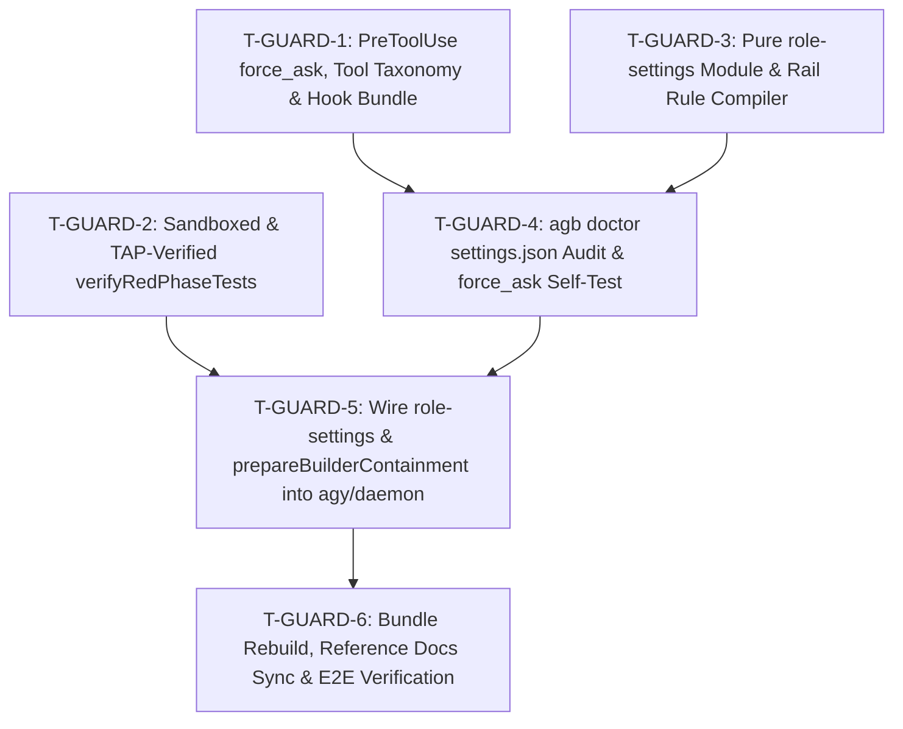

# Specification: Native Antigravity Guardrails & Verification Hardening

**Base:** `research/verification-and-guardrails` \
**Gate:** `{"test": "npm test"}`

--------------------------------------------------------------------------------

## 1. Overview & Objectives

This specification hardens `antigravity-booster` (`agb`) against Google Antigravity's normative **Verification and Guardrails** contracts (`permissions`, `sandbox`, `hooks`, and `https://antigravity.google/schemas/v1/settings.json`), resolving live security/correctness defects while preserving every existing ADLC containment invariant:

1.  **`PreToolUse` `force_ask` Escalation & `agy v1.5.17` Tool Taxonomy (`T-GUARD-1`)**:
    -   Preserves Appendix A D7 strictly: Booster **never** emits `"decision": "allow"` or `"auto_approve"` (neutral pass-through remains empty stdout `""` with exit `0`; `overwrite` is never emitted).
    -   Adds `force_ask` (`RANK = { pass: 0, ask: 1, force_ask: 2, deny: 3 }`) across `hooks/policy/verdict.mjs`, `hooks/pre-tool-use.mjs`, and `bin/hook-runner.sh` (converting any `ask` or `force_ask` to `deny` if `AGB_WORKER_TICKET` or `AGB_WORKER_MODE` is set), and rebuilds `dist/hooks/pre-tool-use.bundle.mjs` via `npm run build:hooks` so `test/plugin-layout.test.mjs` stays byte-identical.
    -   Upgrades interactive operator prompts in active-rail ADLC repos from `ask` to `force_ask` on `run_workflow`, third-party MCP calls, and `adlc ticket <verb> --authorize` so cached `"Always Allow"` grants (`command(git)`, `mcp(*)`) cannot bypass operator review.
    -   Updates tool schemas for zero-argument `list_permissions({})`, `ask_permission` (`Action`, `Target`, `Reason`), `find_by_name` (`SearchDirectory`), and `generate_image` (`Prompt`, `ImageName`, `ImagePaths`).
2.  **Sandboxed & Env-Sanitized Red-Phase Test Execution (`T-GUARD-2`)**:
    -   Replaces unsandboxed `execFileSync(process.execPath, ['--test', ...])` + `{ ...process.env }` in `verifyRedPhaseTests()` (`lib/tdd-split.mjs`) with synchronous `spawnSync` wrapped in `sandboxProfile` (macOS) or `linuxBwrapArgs` (Linux) imported from frozen rail `lib/gates.mjs`, sanitized child environment variables, strict worktree symlink/path containment, and `--test-reporter=tap` output verification so sandbox/spawn errors are never mistaken for legitimate red-phase test assertion failures.
3.  **Schema-Valid `--settings` Profiles & Ticket Rail Compilation (`T-GUARD-3`, `T-GUARD-5`)**:
    -   Creates pure module `lib/role-settings.mjs` defining canonical `PERMISSION_RULE_RE`, `isValidPermissionRule()`, `compileRailsToDenyRules()`, and `buildRoleSettingsProfile()`.
    -   Emits **only** `{ allowNonWorkspaceAccess: false, permissions: { deny: [...] } }` (explicitly omitting `enableTerminalSandbox`, `toolPermission`, and `agentMode` so Booster's outer Linux `bwrap` and macOS `sandbox-exec` wrappers never trigger nested `CLONE_NEWUSER`/`sandbox_init()` `EPERM` or headless `request-review` prompt stalls).
    -   Compiles literal/directory-prefix ticket `rails` and standing trust-root paths (`.git/`, `.adlc/`, `.booster/`) into `write_file(<target>)` `permissions.deny` rules enforced by `agy` in every execution mode.
4.  **`agb doctor` `settings.json` Audit & `force_ask` Policy Self-Test (`T-GUARD-4`)**:
    -   Adds advisory `checkCliSettings({ home, env })` (`lib/doctor-settings.mjs`) warning (exit `0`, never mutating `settings.json` on `--fix`) on `toolPermission: 'always-proceed'`, `allowNonWorkspaceAccess: true`, or unparseable `permissions` entries, and extends `checkPolicyGuard()` in `lib/doctor.mjs` to assert `force_ask` on active-rail `run_workflow`.
5.  **Contained `NdjsonWorkerDaemon` & Shipped Bundle Sync (`T-GUARD-5`, `T-GUARD-6`)**:
    -   Extracts a single concrete synchronous helper `prepareBuilderContainment()` in `lib/agy.mjs` shared by `runAgy()` and `NdjsonWorkerDaemon._spawnDaemon()` (with cleanup on `close()`), then rebuilds `dist/agb.mjs`, `dist/mcp-server.mjs`, and `website/generated/**` with end-to-end verification.

## Resolved Trade-Offs

-   **Nested Sandbox Avoidance (`F-001`):** `buildRoleSettingsProfile()` omits `enableTerminalSandbox`, `toolPermission`, and `agentMode`, emitting only `allowNonWorkspaceAccess: false` + `permissions.deny` (which `agy` enforces in every mode without conflicting with outer `bwrap` / Seatbelt containment).
-   **`force_ask` Version Policy (`F-002`):** Keep `MIN_AGY_VERSION = '1.2.6'`, emit `force_ask` directly on high-risk interactive prompts, and verify `force_ask` emission in `checkPolicyGuard()`.
-   **Appendix A D7 vs. `overwrite`:** Booster never emits `"decision": "allow"` or `"auto_approve"`; `overwrite` is omitted on silent pass-throughs.
-   **`agb doctor` `settings.json` Policy:** Findings in `~/.gemini/antigravity-cli/settings.json` are `WARN` (exit `0`) and are never modified by `agb doctor --fix`.

--------------------------------------------------------------------------------

## 2. Ticket Dependency DAG

--------------------------------------------------------------------------------

## 3. Ticket Specifications

### Ticket 1: `T-GUARD-1` — PreToolUse `force_ask` Escalation, Tool Taxonomy & Hook Bundle Rebuild

-   **Scope**: `hooks/policy/constants.mjs`, `hooks/policy/verdict.mjs`, `hooks/policy/evaluate.mjs`, `hooks/policy/shell.mjs`, `hooks/pre-tool-use.mjs`, `bin/hook-runner.sh`, `dist/hooks/pre-tool-use.bundle.mjs`, `test/hook-runner.test.mjs`, `test/pre-tool-use.test.mjs`, `test/audit-policy-and-supply.test.mjs`, `test/policy-1-5-9-readonly.test.mjs`, `test/policy-guardrails-1-5-17.test.mjs`
-   **Rails**: `lib/lock.mjs`, `lib/gates.mjs`, `vendor/cache/**`, `scripts/rails-guard-ci.mjs`
-   **Edges**: `T-GUARD-1 -> T-GUARD-4`
-   **Tier**: `frontier`
-   **Pool Hint**: `claude-gpt`
-   **Objectives**:
    1.  In `hooks/policy/verdict.mjs`, export `forceAsk = (reason) => ({ decision: 'force_ask', reason })` and set `RANK = { pass: 0, ask: 1, force_ask: 2, deny: 3 }` so `mostRestrictive()` enforces `deny > force_ask > ask > pass`. Preserve Appendix A D7 (`pass` outputs empty stdout; never emit `allow` or `auto_approve`).
    2.  In `hooks/pre-tool-use.mjs`, emit `{ decision: verdict.decision, reason: verdict.reason }` when `verdict.decision` is `'deny'`, `'ask'`, or `'force_ask'`.
    3.  In `bin/hook-runner.sh`:
        -   Accept `ask|force_ask|deny` in `--fallback` validation (`case "$FALLBACK_DECISION"`).
        -   In final `OUTPUT` validation, accept single-line `'{"decision":"force_ask"'*` and `'{"decision": "force_ask"'*` alongside `ask` and `deny`, **except** when `[ -n "$AGB_WORKER_TICKET" ] || [ -n "$AGB_WORKER_MODE" ]` is set—if a child ever emits `ask` or `force_ask` in headless worker mode, call `emit_fallback` (which emits `deny`). Continue converting `allow` / `auto_approve` to `emit_fallback`.
    4.  Upgrade three interactive active-rail operator prompts from `ask(...)` to `forceAsk(...)` (headless continues returning `deny`):
        -   `evaluateMcpTool` (`hooks/policy/evaluate.mjs`): third-party MCP call in an active-rail ADLC repo returns `forceAsk('Third-party MCP tool call in an active-rail ADLC repository requires operator confirmation')`.
        -   `evaluateWorkflowTool` (`hooks/policy/evaluate.mjs`): `run_workflow` in an active-rail ADLC repo returns `forceAsk('run_workflow executes Python outside PreToolUse file hooks in an active-rail ADLC repository; operator confirmation required')`.
        -   `classifySubcommand` (`hooks/policy/shell.mjs`): interactive `adlc ticket <verb> --authorize` in an ADLC repo returns `forceAsk('Authorized ticket lifecycle change requires operator confirmation')`.
    5.  Update tool taxonomy in `hooks/policy/constants.mjs` and `hooks/policy/evaluate.mjs`:
        -   `list_permissions`: remove `list_permissions` from `REQUIRED_READ_PATH_KEYS`; validate via `normalizeArgsCaseInsensitive` that only keys in `['paths', 'path', 'toolaction', 'toolsummary']` are present and any supplied `paths`/`path` is a non-empty string or non-empty string array, resolving supplied paths through `stepOne` (`boosterDataRoots` / `brainRoots` checks).
        -   `find_by_name`: add `'SearchDirectory'` to `READ_TOOL_PATH_SCHEMAS.find_by_name`.
        -   `ask_permission`: add dedicated `evaluateAskPermission(args, ctx)` dispatched from `evaluatePayload` (plus path extraction in `stepOne` when `action` is `read_file` or `write_file`). Normalize with `normalizeArgsCaseInsensitive(args)`; allow only keys `action`, `target`, `reason`, `toolaction`, `toolsummary`; require non-empty string `action` and `target` (and optional string `reason`). Deny in `ctx.headless`. Deny if `action.toLowerCase()` is `'unsandboxed'` or not in `['command', 'read_file', 'write_file', 'read_url', 'execute_url', 'download_url', 'mcp']`. Scan `args` via `scanPathLike` (skipping `Reason`/`reason`/`toolAction`/`toolSummary`) plus `toPath(target)` when `action` is `read_file`/`write_file` or `looksLikePath(target)`: deny if any candidate hits `boosterDataRoots`, `brainRoots`, `protectedRoots`, `containsProtected` (on `write_file`), or `gateOnePath` non-pass. If any anchor or resolved repo is an ADLC repo with `!r.store.ok`, deny; if `r.activeRail`, return `forceAsk('Permission request in an active-rail ADLC repository requires operator confirmation')`; otherwise `PASS`.
        -   `generate_image`: add dedicated `evaluateGenerateImage(args, ctx)` dispatched from `evaluatePayload`. Deny in `ctx.headless`. Normalize via `normalizeArgsCaseInsensitive(args)`; allow only keys `prompt`, `imagename`, `imagepaths`, `toolaction`, `toolsummary`; require non-empty string `prompt` and `imagename`, and optional `imagepaths` as an array (length $\le 20$) of non-empty strings. Do not path-scan `prompt`. Check `imagename` (if `looksLikePath(imagename)` or contains `..`) and every element of `imagepaths` via `resolveAll`: deny on `boosterDataRoots`, `brainRoots` (unless valid session brain artifact), `protectedRoots`, `containsProtected`, or `gateOnePath` non-pass; otherwise `PASS`.
    6.  Run `npm run build:hooks` to update `dist/hooks/pre-tool-use.bundle.mjs`, update `test/hook-runner.test.mjs`, `test/pre-tool-use.test.mjs`, `test/audit-policy-and-supply.test.mjs`, and `test/policy-1-5-9-readonly.test.mjs`, and add `test/policy-guardrails-1-5-17.test.mjs` (<350 lines).
-   **Acceptance Criteria**:
    -   `dist/hooks/pre-tool-use.bundle.mjs` matches fresh `npm run build:hooks` output (`node --test test/plugin-layout.test.mjs` exits `0`).
    -   0-arg `list_permissions({})` returns `pass`, `find_by_name` checks `SearchDirectory`, `ask_permission` and `generate_image` enforce all schema/path/headless/rail rules, and `bin/hook-runner.sh` blocks `ask`/`force_ask` in headless worker mode while passing `force_ask` interactively.
    -   `npm test` exits `0` with 0 failures.

--------------------------------------------------------------------------------

### Ticket 2: `T-GUARD-2` — Sandboxed, Env-Sanitized & TAP-Verified `verifyRedPhaseTests`

-   **Scope**: `lib/tdd-split.mjs`, `test/tdd-split.test.mjs`
-   **Rails**: `lib/lock.mjs`, `lib/gates.mjs`, `vendor/cache/**`, `scripts/rails-guard-ci.mjs`
-   **Edges**: `T-GUARD-2 -> T-GUARD-5`
-   **Tier**: `mid`
-   **Pool Hint**: `gemini`
-   **Objectives**:
    1.  Harden synchronous `verifyRedPhaseTests(testFiles = [], { worktree = process.cwd(), timeoutMs = 30_000, env = process.env, platform = process.platform } = {})` in `lib/tdd-split.mjs` (<320 lines) without modifying frozen rail `lib/gates.mjs`:
        -   Validate `wtRoot = resolve(worktree)` exists as a directory and compute `realWtRoot = realpathSync(wtRoot)`. For each entry in `testFiles`, reject control chars (`/[\0\r\n]/`), absolute paths, `..` segments, or paths not matching `isTestPathspec`. Verify via `lstatSync` and `realpathSync` that the file exists, is not a symlink, and `realFull.startsWith(realWtRoot + sep)` (rejecting symlinked parent directories escaping `realWtRoot`).
        -   Build sanitized `childEnv` via exported `sanitizeRedPhaseEnv(env, platform)`: copy only allowlisted keys (`PATH`, `HOME`, `USER`, `LANG`, `TERM`, `TMPDIR`, `TEMP`, `TMP`, `SYSTEMROOT`, `WINDIR`, `COMSPEC`, `PATHEXT`, `APPDATA`, `LOCALAPPDATA`), set `NODE_ENV = 'test'`, and omit `NODE_TEST_CONTEXT`, `NODE_OPTIONS`, `LD_PRELOAD`, `LD_LIBRARY_PATH`, `DYLD_INSERT_LIBRARIES`, `DYLD_LIBRARY_PATH`, and any key matching `/KEY|TOKEN|SECRET|PASSWORD|AUTH|CREDENTIAL|PRIVATE|CERT/i`.
        -   Syntax-check each file with `spawnSync(process.execPath, ['--check', full], { cwd: realWtRoot, env: childEnv, timeout: 10_000, encoding: 'utf8' })`.
        -   Import `gateSandboxAvailable`, `sandboxProfile`, and `linuxBwrapArgs` from `./gates.mjs`. When `env.AGB_SANDBOX_GATES !== '0'`:
            -   If `platform !== 'darwin' && platform !== 'linux'` or `!gateSandboxAvailable(env)` (evaluating `gateSandboxAvailable` when `platform === os.platform()`), fail closed returning `{ ok: false, reason: 'spec-test red-phase sandbox unavailable on ' + platform + ' (set AGB_SANDBOX_GATES=0 only in disposable containers)' }`.
            -   Execute `node --test --test-reporter=tap ...cleanFiles` via `spawnSync`:
                -   On `darwin`: write `sandboxProfile(realWtRoot)` to a temp dir (`mkdtempSync`) and run `spawnSync('sandbox-exec', ['-f', profileFile, process.execPath, '--test', '--test-reporter=tap', ...cleanFiles], { cwd: realWtRoot, env: childEnv, timeout: timeoutMs, encoding: 'utf8', maxBuffer: 8 * 1024 * 1024 })`.
                -   On `linux`: create `emptyRoDir = mkdtempSync(...)`, record whether `join(realWtRoot, '.git')` and `join(realWtRoot, 'node_modules')` existed beforehand, build shell-quoted `cmd = [process.execPath, '--test', '--test-reporter=tap', ...cleanFiles].map((s) => "'" + String(s).replace(/'/g, "'\\''") + "'").join(' ')`, run `spawnSync('bwrap', linuxBwrapArgs(realWtRoot, cmd, emptyRoDir), { cwd: realWtRoot, env: childEnv, timeout: timeoutMs, encoding: 'utf8', maxBuffer: 8 * 1024 * 1024 })`, and in `finally` remove `emptyRoDir` plus any empty `.git`/`node_modules` mountpoint directories created by `bwrap` that did not exist before the call.
            -   When `env.AGB_SANDBOX_GATES === '0'`, run `spawnSync(process.execPath, ['--test', '--test-reporter=tap', ...cleanFiles], { cwd: realWtRoot, env: childEnv, timeout: timeoutMs, encoding: 'utf8', maxBuffer: 8 * 1024 * 1024 })`.
        -   Distinguish genuine test failure from sandbox/spawn failure:
            -   If `res.error?.code === 'ETIMEDOUT'` or `res.signal === 'SIGTERM'` or `res.signal === 'SIGKILL'`, return `{ ok: false, reason: 'spec-test red-phase verification timed out' }`.
            -   If `res.status === 0`, return `{ ok: false, reason: 'tautological spec tests: tests passed on unimplemented base (red-phase failure required)' }`.
            -   Require `/^TAP version \d+/m.test(res.stdout ?? '')` and `/^not ok \d+/m.test(res.stdout ?? '')`; if absent (e.g. `bwrap` namespace EPERM, missing binary, or pre-runner crash), return `{ ok: false, reason: 'spec-test red-phase runner failed before executing TAP tests: ' + String(res.stderr || res.error?.message || 'unknown error').slice(0, 240) }`.
            -   Otherwise return `{ ok: true, verifiedFiles: cleanFiles, exitCode: res.status ?? 1 }`.
    2.  Expand `test/tdd-split.test.mjs` (<260 lines) covering red-phase failure (`ok: true`), tautological pass (`ok: false`), syntax error (`ok: false`), secret env stripping (`GITHUB_TOKEN`, `AWS_SECRET_ACCESS_KEY`, `ADLC_MASTER_KEY`, `NODE_OPTIONS` absent inside test), symlink escape rejection, pre-TAP crash/sandbox failure rejection, and fail-closed behavior when `AGB_SANDBOX_GATES !== '0'` and `bwrap` is absent from `PATH`.
-   **Acceptance Criteria**:
    -   `lib/tdd-split.mjs` is strictly under 320 lines, synchronous, and leaves `lib/gates.mjs` untouched.
    -   Host secrets and `NODE_OPTIONS` are stripped, symlink escapes fail closed, and sandbox/spawn failures without `TAP version` + `not ok` output return `ok: false`.
    -   `node --test test/tdd-split.test.mjs` and `npm test` exit `0`.

--------------------------------------------------------------------------------

### Ticket 3: `T-GUARD-3` — Pure `lib/role-settings.mjs` Permission Grammar & Rail Compiler

-   **Scope**: `lib/role-settings.mjs`, `test/role-settings.test.mjs`
-   **Rails**: `lib/lock.mjs`, `lib/gates.mjs`, `vendor/cache/**`, `scripts/rails-guard-ci.mjs`
-   **Edges**: `T-GUARD-3 -> T-GUARD-4`
-   **Tier**: `mid`
-   **Pool Hint**: `gemini`
-   **Objectives**:
    1.  Create pure zero-dependency module `lib/role-settings.mjs` (strictly under 200 lines) implementing:
        -   `PERMISSION_RULE_RE = /^(command|read_file|write_file|read_url|execute_url|download_url|mcp|unsandboxed)\(.+\)$/`: matches Antigravity's `action(target)` permission resource syntax (`https://antigravity.google/schemas/v1/settings.json` + `permissions` docs, supporting nested regex groups like `command(regex:npm run (build|lint|test))` while rejecting empty `command()` and bare tool names like `write_file`).
        -   `isValidPermissionRule(rule)`: returns `true` iff `typeof rule === 'string' && rule.length <= 1024 && !/[\r\n\0]/.test(rule) && rule.trim() === rule && PERMISSION_RULE_RE.test(rule)`.
        -   `compileRailsToDenyRules(rails = [])`: converts an array of ticket rail pathspecs into deduplicated `write_file(<target>)` strings:
            -   Trims, normalizes `\` to `/`, strips leading `./`.
            -   Skips empty strings, control chars, `..` traversal segments, leading `/`, `~`, or strings containing `(` or `)` (which could corrupt `action(target)` syntax).
            -   Converts trailing directory globs `/**` or `/*` (e.g. `vendor/cache/**`) into directory prefix `vendor/cache/` when the prefix itself contains no wildcard chars `[*?[\]{}]`.
            -   Skips any remaining entry containing wildcard chars `[*?[\]{}]` (e.g. `**/*.snap`, since Antigravity `write_file(...)` matches literal path prefixes and `*` only as `write_file(*)`).
            -   Wraps each surviving literal file or directory prefix as `write_file(<normalized>)` and filters with `isValidPermissionRule`.
        -   `buildRoleSettingsProfile(role = 'builder', { hasCodegraph = false, rails = [], extraSettings = {} } = {})`:
            -   Emits **only** `allowNonWorkspaceAccess: false` and `permissions: { deny: [...] }` by default (never emitting `enableTerminalSandbox`, `toolPermission`, or `agentMode`, avoiding nested `bwrap`/Seatbelt `EPERM` and headless `request-review` stalls).
            -   For `readonly` roles (`prosecutor`, `review`, `review-plan`, `coldstart`, `parallax`, `premortem`, `brain`, `arbiter`, `readonly`): base `deny` is `['write_file(*)', 'command(*)', 'read_url(*)', 'execute_url(*)', ...(hasCodegraph ? [] : ['mcp(*)'])]`.
            -   For `builder` (and any non-readonly role): base `deny` is deduplicated `['write_file(.git/)', 'write_file(.adlc/)', 'write_file(.booster/)', ...compileRailsToDenyRules(rails), 'command(sudo)', 'command(rm -rf)', 'command(git push)', 'read_url(*)', 'execute_url(*)', ...(hasCodegraph ? [] : ['mcp(*)'])]`.
            -   Merges `extraSettings` cleanly: if `extraSettings?.permissions` is a plain object, deduplicate-concatenates `extraSettings.permissions.deny` onto base `deny` (preserving `allow`/`ask` arrays if provided in `extraSettings.permissions`) so base `deny` rules can never be clobbered by shallow spread.
    2.  Create `test/role-settings.test.mjs` (<220 lines) testing `isValidPermissionRule` (accepting `command(regex:npm run (build|test))`, `write_file(.git/)`, `mcp(*)`; rejecting bare `write_file`, `command()`, newlines, NUL, leading spaces), `compileRailsToDenyRules` (`lib/lock.mjs` -> `write_file(lib/lock.mjs)`, `vendor/cache/**` -> `write_file(vendor/cache/)`, skipping `**/*.snap`, `../etc/passwd`, `foo)bar`), and `buildRoleSettingsProfile` across all roles and `extraSettings` merges.
-   **Acceptance Criteria**:
    -   `lib/role-settings.mjs` is strictly under 200 lines with zero external package imports.
    -   Every rule produced by `buildRoleSettingsProfile()` passes `isValidPermissionRule()`, and neither `enableTerminalSandbox` nor `toolPermission` is emitted unless explicitly supplied in `extraSettings`.
    -   `node --test test/role-settings.test.mjs` and `npm test` exit `0`.

--------------------------------------------------------------------------------

### Ticket 4: `T-GUARD-4` — `agb doctor` `settings.json` Audit & `force_ask` Policy Self-Test

-   **Scope**: `lib/doctor-settings.mjs`, `lib/doctor.mjs`, `test/doctor-settings.test.mjs`, `test/doctor-selftest.test.mjs`
-   **Rails**: `lib/lock.mjs`, `lib/gates.mjs`, `vendor/cache/**`, `scripts/rails-guard-ci.mjs`
-   **Edges**: `T-GUARD-4 -> T-GUARD-5`
-   **Tier**: `mid`
-   **Pool Hint**: `gemini`
-   **Objectives**:
    1.  Create `lib/doctor-settings.mjs` (strictly under 220 lines) importing `PERMISSION_RULE_RE` and `isValidPermissionRule` from `./role-settings.mjs`:
        -   Export `checkCliSettings({ home = homedir(), env = process.env } = {})`: resolves `<home>/.gemini/antigravity-cli/settings.json` (using `home || env.HOME || homedir()`).
        -   If absent (`ENOENT`), returns `{ name: 'CLI settings', level: 'pass', detail: 'defaults (no settings.json)', fix: null }`.
        -   Checks `lstatSync(settingsPath)` first: if symlink, non-regular file, or `size > 1024 * 1024`, returns `{ name: 'CLI settings', level: 'warn', detail: <reason>, fix: 'Ensure ~/.gemini/antigravity-cli/settings.json is a regular JSON file under 1 MiB.' }`.
        -   Strips JSONC `//` and `/* */` comments outside string literals, parses JSON (returning `level: 'warn'` on syntax error or non-plain-object root), and checks:
            1.  `parsed.toolPermission === 'always-proceed'`
            2.  `parsed.allowNonWorkspaceAccess === true`
            3.  `parsed.permissions !== undefined`: warns if not a plain object, or if any list in `['allow', 'ask', 'deny']` is defined and either not an array or contains any element failing `isValidPermissionRule(entry)` (reporting count of unparseable rules that `agy` silently ignores).
        -   Returns `{ name: 'CLI settings', level: 'pass', detail: 'guardrails intact', fix: null }` when clean, or `{ name: 'CLI settings', level: 'warn', detail: issues.join('; '), fix: 'Review ~/.gemini/antigravity-cli/settings.json permissions and toolPermission settings.', issues }`.
    2.  In `lib/doctor.mjs`:
        -   Import and re-export `checkCliSettings`, `isValidPermissionRule`, and `PERMISSION_RULE_RE` from `./doctor-settings.mjs` / `./role-settings.mjs`, and add `checkCliSettings(resolvedOpts)` to `checks` in `runDoctor()` (never mutating `settings.json` in `applyDoctorFixes()`).
        -   Extend `checkPolicyGuard()` in `lib/doctor.mjs`: generalize `runHook` (or add `runHookPayload(command, pluginRoot, home, payload)`) so after verifying `railVerdict` (`deny` on `lib/lock.mjs`) and `nonRailVerdict` (`""` on `lib/foo.mjs`), it also runs an interactive `run_workflow` payload `{ toolCall: { name: 'run_workflow', args: { Script: 'print(1)', Cwd: repo } }, workspacePaths: [repo] }` and verifies exit `0` + single JSON line with `out.decision === 'force_ask'`.
    3.  Add `test/doctor-settings.test.mjs` (<240 lines) covering missing/clean/warn/symlink/oversized/JSONC `settings.json` cases and `runDoctor()` exit `0` on `WARN`, and add a test in `test/doctor-selftest.test.mjs` verifying `checkPolicyGuard()` fails if a stub bundle returns `ask` instead of `force_ask` on `run_workflow`.
-   **Acceptance Criteria**:
    -   `lib/doctor-settings.mjs` is strictly under 220 lines and `applyDoctorFixes()` never touches `settings.json`.
    -   `checkPolicyGuard()` verifies `deny` on rail write, empty stdout on non-rail write, and `force_ask` on active-rail `run_workflow`.
    -   `node --test test/doctor-settings.test.mjs test/doctor-selftest.test.mjs test/doctor.test.mjs` and `npm test` exit `0`.

--------------------------------------------------------------------------------

### Ticket 5: `T-GUARD-5` — Wire `role-settings` & `prepareBuilderContainment` into `runAgy`, `NdjsonWorkerDaemon` & `scheduler`

-   **Scope**: `lib/ndjson-worker.mjs`, `lib/agy.mjs`, `lib/scheduler.mjs`, `test/ndjson-worker.test.mjs`, `test/v14-integration.test.mjs`
-   **Rails**: `lib/lock.mjs`, `lib/gates.mjs`, `vendor/cache/**`, `scripts/rails-guard-ci.mjs`
-   **Edges**: `T-GUARD-5 -> T-GUARD-6`
-   **Tier**: `frontier`
-   **Pool Hint**: `claude-gpt`
-   **Objectives**:
    1.  In `lib/ndjson-worker.mjs` (<520 lines):
        -   Replace the inline `READONLY_DENY_TOOLS` / `BUILDER_BASE_DENY_TOOLS` `buildRoleSettingsProfile` implementation by importing and re-exporting `buildRoleSettingsProfile`, `compileRailsToDenyRules`, `isValidPermissionRule`, and `PERMISSION_RULE_RE` from `./role-settings.mjs`.
        -   Add single concrete containment hook support on `NdjsonWorkerDaemon`: accept `role = 'builder'`, `containment = false`, and `prepareContainment = null` in `constructor(...)`. When `this.containment === true`:
            -   Require `typeof this.prepareContainment === 'function'` (failing closed in `_spawnDaemon()` by throwing an error caught by `sendTurn()` / returning `{ ok: false, kind: 'containment_unavailable', error: ... }` if `containment: true` is requested without `prepareContainment`).
            -   Invoke `const wrapped = this.prepareContainment({ agyBin: this.bin, args, cwd: this.cwd, env: spawnEnv })` in `_spawnDaemon()`: if `!wrapped.ok`, fail closed without spawning raw `this.bin`; otherwise spawn `wrapped.launchBin` with `wrapped.launchArgs` and store `this._containmentCleanup = wrapped.cleanup ?? null`.
            -   In `close()`, invoke and clear `this._containmentCleanup()` after process-tree termination so temporary `bwrap` / Seatbelt / Windows args directories are always cleaned up.
    2.  In `lib/agy.mjs` and `lib/scheduler.mjs`:
        -   Accept optional `rails` in `runAgy({ ..., rails })` and pass `{ hasCodegraph, rails }` into `buildRoleSettingsProfile(role, { hasCodegraph, rails })` when `useRoleSettings` is true and `settings === undefined`. Re-export `compileRailsToDenyRules`, `isValidPermissionRule`, and `PERMISSION_RULE_RE` from `lib/agy.mjs`.
        -   Pass `rails: t.rails` in `buildOnce()` in `lib/scheduler.mjs` (`line ~1982`).
        -   Export synchronous helper `prepareBuilderContainment({ agyBin, args, cwd, repo, env = process.env, userHome, allowCodegraph = false, platform = process.platform })` from `lib/agy.mjs` encapsulating the Linux `bwrap_pid` and macOS `seatbelt` launch-command + cleanup construction (returning `{ ok: true, launchBin, launchArgs, stagedBuilderHome, cleanup }` or `{ ok: false, kind: 'containment_unavailable', error }`), so `NdjsonWorkerDaemon` can pass `prepareContainment: (opts) => prepareBuilderContainment({ ...opts, repo, platform })` cleanly.
    3.  Update `test/ndjson-worker.test.mjs` and `test/v14-integration.test.mjs`:
        -   Update assertions on `buildRoleSettingsProfile()` and `runAgy({ useRoleSettings: true })` to verify `allowNonWorkspaceAccess: false` and valid `action(target)` `permissions.deny` rules (`write_file(*)`, `command(*)`, `mcp(*)`, `write_file(lib/lock.mjs)`, etc.) with zero bare tool names and zero `enableTerminalSandbox`/`toolPermission` keys.
        -   Test `NdjsonWorkerDaemon` with `containment: true` + `prepareContainment` (verifying wrapped launch binary/args, `cleanup()` execution on `close()`, and fail-closed rejection when `prepareContainment` is missing or returns `{ ok: false }`).
-   **Acceptance Criteria**:
    -   `runAgy({ useRoleSettings: true, role: 'builder', rails: ['lib/lock.mjs', 'vendor/cache/**'], ... })` passes `--settings` containing `allowNonWorkspaceAccess: false`, `write_file(lib/lock.mjs)`, and `write_file(vendor/cache/)`, and omits `enableTerminalSandbox` and `toolPermission`.
    -   `NdjsonWorkerDaemon` fails closed when `containment: true` cannot prepare containment and cleans up containment temp dirs on `close()`.
    -   `node --test test/ndjson-worker.test.mjs test/v14-integration.test.mjs` and `npm test` exit `0`.

--------------------------------------------------------------------------------

### Ticket 6: `T-GUARD-6` — Shipped Bundle Rebuild, Reference Docs Sync & End-to-End Guardrail Suite

-   **Scope**: `dist/agb.mjs`, `dist/mcp-server.mjs`, `website/generated/**`, `test/guardrails-e2e.test.mjs`
-   **Rails**: `lib/lock.mjs`, `lib/gates.mjs`, `vendor/cache/**`, `scripts/rails-guard-ci.mjs`
-   **Edges**: `(leaf — depends on T-GUARD-5)`
-   **Tier**: `mid`
-   **Pool Hint**: `gemini`
-   **Objectives**:
    1.  Rebuild `dist/agb.mjs` and `dist/mcp-server.mjs` via `npm run build:agb && npm run build:mcp` and verify all six bundles pass `node scripts/check-bundle-externals.mjs` (without dirtying `dist/hooks/pre-tool-use.bundle.mjs`, which is already up-to-date from `T-GUARD-1`).
    2.  Regenerate website reference documentation via `node website/scripts/gen-reference.mjs` so `lib/role-settings.mjs` and `lib/doctor-settings.mjs` are indexed in `website/generated/**`, and verify `node website/scripts/gen-reference.mjs --check` exits `0`.
    3.  Create `test/guardrails-e2e.test.mjs` (<220 lines) verifying end-to-end across shipped bundles and modules:
        -   `bin/hook-runner.sh` + `dist/hooks/pre-tool-use.bundle.mjs` emits `force_ask` interactively on active-rail `run_workflow` / `adlc ticket archive --authorize`, converts `force_ask` to `deny` when `AGB_WORKER_TICKET` is set, passes 0-arg `list_permissions({})` with empty stdout, and denies `ask_permission` on `unsandboxed` or frozen rails.
        -   `buildRoleSettingsProfile` + `checkCliSettings` agree 100% (`checkCliSettings` reports `level: 'pass'` when written to a temporary `settings.json`).
        -   `verifyRedPhaseTests` strips secrets and enforces TAP red-phase verification.
    4.  Verify `npm run plugin:validate` and `npm test` pass with 0 failures.
-   **Acceptance Criteria**:
    -   `node scripts/check-bundle-externals.mjs`, `node website/scripts/gen-reference.mjs --check`, `npm run plugin:validate`, and `npm test` all exit `0`.
    -   Writing `buildRoleSettingsProfile('builder', { rails: ['lib/lock.mjs'] })` and `buildRoleSettingsProfile('prosecutor')` to `<tmpHome>/.gemini/antigravity-cli/settings.json` passes `checkCliSettings({ home: tmpHome })` with `level: 'pass'`.
