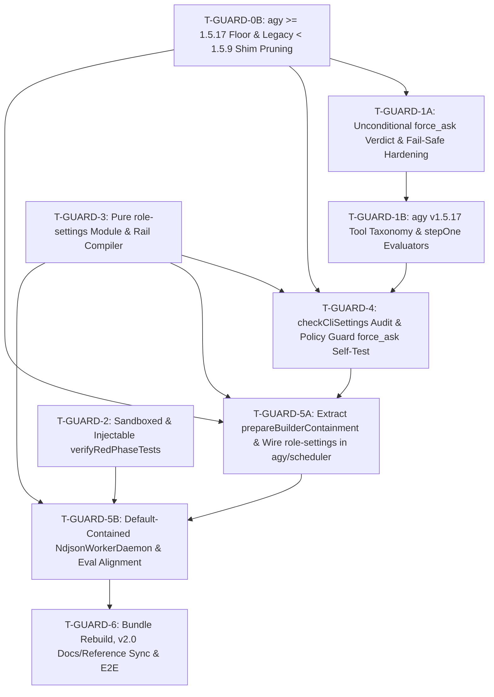

# Specification: Native Antigravity Guardrails & Verification Hardening (v2.0)

**Base:** `research/verification-and-guardrails` \
**Gate:** `{"build": "npm run build:hooks", "test": "npm test"}`

--------------------------------------------------------------------------------

## 1. Overview & Objectives

> **IMPORTANT HEADLESS WORKER SANDBOX & SHELL RULE (READ FIRST):** In headless builder sessions, you run inside an outer Linux `bwrap` container where nested `bwrap` is blocked by the kernel (`EPERM` on `kernel.apparmor_restrict_unprivileged_userns=1`) and `PreToolUse` allows ONLY targeted `node --test <file>` (plus `npm run build:hooks` and read-only `git status`/`git diff`/`ls`/`cat`/`grep`). Therefore:
> 1. Run `node --test` ONLY on unit test files that do not spawn nested `bwrap` (do **not** run `npm test`, `test/orchestrator-routing.test.mjs`, `test/evals.test.mjs`, or `test/security.test.mjs` inside `bwrap` — verify syntax on those via `read_file` inspection instead).
> 2. **NEVER** emit `TICKET-BLOCKED` because `bwrap` is unusable inside your sandbox — the orchestrator automatically executes the full `npm test` suite outside nested `bwrap` immediately after you output `TICKET-DONE`.

This specification aligns `antigravity-booster` (`v2.0.0`) with Google Antigravity's latest normative **Verification and Guardrails** contracts (`permissions`, `sandbox`, `hooks`, and `https://antigravity.google/schemas/v1/settings.json`), adopting an owner-approved forward-leaning `agy >= 1.5.17` baseline with zero legacy `agy` backwards-compatibility shims:

1.  **Wave 1 Prerequisite — `agy >= 1.5.17` Runtime Floor & Legacy `< 1.5.9` Shim Pruning (`T-GUARD-0B`)**:
    -   Levels up both `MIN_AGY_VERSION` and `RECOMMENDED_AGY_VERSION` in `lib/doctor.mjs` to `'1.5.17'` **before** `T-GUARD-1A` lands, prunes dead `< 1.5.9` Orchestrator auto-disable shims in `lib/doctor.mjs` and `lib/scheduler.mjs`, and updates `test/fixtures/fake-agy` default version to `1.5.17` (plus `allowNonWorkspaceAccess` in `ALLOWED_SETTINGS_KEYS`) and `evals/v13-enhancements-bench.mjs`.
2.  **Unconditional `PreToolUse` `force_ask` Escalation & Degraded Fail-Safe Hardening (`T-GUARD-1A`)**:
    -   Preserves Appendix A D7 strictly: Booster **never** emits `"decision": "allow"` or `"auto_approve"` (neutral pass-through remains empty stdout `""` with exit `0`; `overwrite` is never emitted).
    -   Adds unconditional `force_ask` (`RANK = { pass: 0, ask: 1, force_ask: 2, deny: 3 }`) across `hooks/policy/verdict.mjs`, `hooks/pre-tool-use.mjs`, and `bin/hook-runner.sh`.
    -   Upgrades interactive operator prompts in active-rail ADLC repos from `ask` to `force_ask` on `run_workflow`, third-party MCP calls, and `adlc ticket <verb> --authorize`, and upgrades `bin/hook-runner.sh`'s degraded interactive fail-safe (`run_command` in ADLC repos and default `--fallback deny|force_ask` in non-ADLC repos) to `force_ask` using an explicit allowlisted `case` statement. Headless workers (`AGB_WORKER_TICKET` or `AGB_WORKER_MODE`) always convert any `ask` or `force_ask` to `deny`.
3.  **`agy v1.5.17` Tool Taxonomy Modernization (`T-GUARD-1B`)**:
    -   Updates `hooks/policy/` and `stepOne()` pre-dispatch path extraction for zero-argument `list_permissions({})`, `find_by_name` (`SearchDirectory`), `ask_permission` (`Action`, `Target`, `Reason` — including `classifyRunCommand` forwarding on `command` and dual real/lexical symlink rail checks), and `generate_image` (`Prompt`, `ImageName`, `ImagePaths`).
4.  **Sandboxed, Env-Sanitized & Injectable Red-Phase Test Runner (`T-GUARD-2`)**:
    -   Hardens `verifyRedPhaseTests()` in `lib/tdd-split.mjs` with synchronous OS gate sandboxing (`sandboxProfile` / `linuxBwrapArgs` from frozen rail `lib/gates.mjs`), injectable `spawnFn` / `sandboxAvailableFn` seams, secret env stripping, symlink escape rejection, and `--test-reporter=tap` startup verification.
5.  **Strict `action(target)` `--settings` Profiles, Advisory `agb doctor` `settings.json` Audit & Contained `NdjsonWorkerDaemon` (`T-GUARD-3`, `T-GUARD-4`, `T-GUARD-5A`, `T-GUARD-5B`, `T-GUARD-6`)**:
    -   Creates pure zero-dependency `lib/role-settings.mjs` (`T-GUARD-3`), adds advisory `checkCliSettings()` + `checkPolicyGuard()` `force_ask` self-test (`T-GUARD-4`), extracts parity-tested `prepareBuilderContainment()` in `lib/agy.mjs` (`T-GUARD-5A`), wires default fail-closed containment + `buildSpawnEnv` + `buildRoleSettingsProfile` into `NdjsonWorkerDaemon` (`T-GUARD-5B`), and syncs `dist/**`, `website/**`, `README.md`, and E2E tests (`T-GUARD-6`).

## Resolved Trade-Offs

-   **Owner-Confirmed Forward-Leaning `v2.0.0` `agy >= 1.5.17` Requirement (`F-001`, `F-006`):** Owner explicitly confirmed that `v2.0.0` drops backwards compatibility with `agy < 1.5.17` across all CLI and interactive hook surfaces. `T-GUARD-0B` lands in Wave 1 before `T-GUARD-1A` so `MIN_AGY_VERSION = '1.5.17'` precedes `force_ask` emission in commit history, and `force_ask` is emitted unconditionally without downgrade flags (standalone headless `agy -p` outside `agb` carries no `AGB_WORKER_*` env and remains governed by `agy 1.5.17`'s native headless permission handling, while every `agb`-spawned worker sets `AGB_WORKER_TICKET` or `AGB_WORKER_MODE` and converts `ask`/`force_ask` to `deny` in both `evaluatePayload`, `pre-tool-use.mjs`, and `hook-runner.sh`).
-   **Non-ADLC Interactive `--fallback` Semantics (`F-010`, `F-015`):** `hooks.json` invokes `bin/hook-runner.sh` with `--fallback deny`. Upgrading non-ADLC interactive fallback (`deny` -> `force_ask`, preserving explicit `--fallback ask` -> `ask`) avoids bricking unrelated non-ADLC workspaces on transient hook timeouts while preventing cached `"Always Allow"` grants; ADLC file mutations and all headless workers hard-`deny`.
-   **Defense-in-Depth `--settings` Rail Rules vs. Authoritative `PreToolUse` + `rails-guard` (`F-008`, `F-009`):** `compileRailsToDenyRules()` compiles literal and directory-prefix rails into `write_file(<target>)` `--settings` rules as an additive client-side defense-in-depth layer (intentionally skipping mid-path wildcard globs like `**/*.snap`), while authoritative wildcard/symlink rail enforcement remains in `PreToolUse` and post-hoc `adlc rails-guard`. Both `PERMISSION_RULE_RE` (`8` actions including `download_url` and `unsandboxed`) and `ASK_PERMISSION_ACTIONS` (`7` non-`unsandboxed` actions) share a reconciled `agy 1.5.17` action vocabulary so persisted `download_url(...)` user grants do not trigger false `agb doctor` warnings, and staged builder homes (`stageBuilderGeminiHome`) never inherit user `settings.json` grants.
-   **Fail-Closed Contained `NdjsonWorkerDaemon` & Bounded Nonce Reuse (`F-002`, `F-006`):** Whenever `role === 'builder' && (containment || sandbox)`, `NdjsonWorkerDaemon` blocks `_fallbackSingleShot()` across all paths (`persistentWorkers: false`, post-spawn exit, mid-turn EOF/crash) unless `singleShotFallbackIsContained === true`, and bounds Windows `verifiedBypass` reuse to `MAX_BYPASS_RESPAWNS = 2` per daemon instance.
-   **Fine-Grained Single-Concern Ticket Decomposition (`F-019`, `F-023`):** Version-floor + `< 1.5.9` shim pruning is isolated in `T-GUARD-0B` (6 files), `agb doctor` `settings.json` audit + `force_ask` self-test in `T-GUARD-4` (4 files), parity-preserving `prepareBuilderContainment` extraction + `runAgy`/`scheduler` rail wiring in `T-GUARD-5A` (4 files), and `NdjsonWorkerDaemon` async containment + `evals/runner.mjs` in `T-GUARD-5B` (3 files).
-   **Strict `action(target)` Schema & Nested Sandbox Avoidance (`F-001` R1, `F-003`/`F-004` R2):** `buildRoleSettingsProfile()` emits only `{ allowNonWorkspaceAccess: false, permissions: { deny: [...] } }` (omitting `enableTerminalSandbox`, `toolPermission`, `agentMode`). `readonly` roles unconditionally include `'mcp(*)'`; `builder` roles with `hasCodegraph: true` include `'mcp(agb/*)'` and `'mcp(antigravity-booster_agb/*)'` while `stageFilteredMcpConfig` excludes all non-codegraph servers.

--------------------------------------------------------------------------------

## 2. Ticket Dependency DAG

--------------------------------------------------------------------------------

## 3. Ticket Specifications

### Ticket 1: `T-GUARD-0B` — Forward-Leaning `agy >= 1.5.17` Floor & Legacy `< 1.5.9` Shim Pruning

-   **Scope**: `lib/doctor.mjs`, `lib/scheduler.mjs`, `test/fixtures/fake-agy`, `test/doctor.test.mjs`, `test/orchestrator-routing.test.mjs`, `evals/v13-enhancements-bench.mjs`
-   **Rails**: `lib/lock.mjs`, `lib/gates.mjs`, `vendor/cache/**`, `scripts/rails-guard-ci.mjs`
-   **Edges**: `T-GUARD-0B -> T-GUARD-1A`, `T-GUARD-0B -> T-GUARD-4`, `T-GUARD-0B -> T-GUARD-5A`
-   **Tier**: `frontier`
-   **Pool Hint**: `claude-gpt`
-   **Objectives**:
    1.  In `lib/doctor.mjs`: bump both `export const MIN_AGY_VERSION = '1.5.17'` and `export const RECOMMENDED_AGY_VERSION = '1.5.17'`. In `checkAgyBinary()`, update the `< MIN_AGY_VERSION` fail fix string to `'Upgrade agy to >= 1.5.17 for Antigravity Booster 2.0 native guardrails, PreToolUse force_ask, and Orchestrator support.'`, and **delete the entire unreachable `if (semverLt(versionStr, RECOMMENDED_AGY_VERSION))` warn block** (since `MIN_AGY_VERSION === RECOMMENDED_AGY_VERSION === '1.5.17'`, keeping that block leaves dead code with unkillable `adlc hollow-test` mutants).
    2.  In `lib/scheduler.mjs` (`lines ~1527-1533`): remove the obsolete `agyBelowOrchestratorFloor` (`semverLt(agyVersion, '1.5.9')`) check and log notice so `const disableOrchestrator = Boolean(plan.disableOrchestrator);` (and remove unused `semverLt`/`semverParse` imports if no longer referenced in `lib/scheduler.mjs`).
    3.  In `test/fixtures/fake-agy`: update line `220` to `const ALLOWED_SETTINGS_KEYS = new Set(["permissions", "allowNonWorkspaceAccess"]);` and line `325` to `echo "agy version ${FAKE_AGY_VERSION:-1.5.17}"`.
    4.  Update `test/doctor.test.mjs` (`MIN_AGY_VERSION === '1.5.17'`, `RECOMMENDED_AGY_VERSION === '1.5.17'`, `'1.2.6'`/`'1.5.13'`/`'1.5.16'` -> `'fail'` asserting `/Upgrade agy to >= 1\.5\.17/`, `'1.5.17'`/`'1.6.0'` -> `'pass'` — keep `test/doctor.test.mjs` completely free of `evals/*` imports so `node --test test/doctor.test.mjs` runs inside `bwrap` with zero nested-sandbox calls!), `test/orchestrator-routing.test.mjs` (replace `lines 311-330` with: (a) a fresh `repoOld = makeRepo()` + `stateOld` asserting `await assert.rejects(withEnv({ FAKE_AGY_VERSION: '1.5.16', FAKE_BUILDER_MODE: 'good', FAKE_STATE_DIR: stateOld }, () => runPlan({ repo: repoOld, gate: { test: 'true' }, tickets: [{ id: 'T1', title: 'T1', body: 'x', scope: ['T1.txt'], tier: 'frontier', pool_hint: 'gemini' }] }, { log: () => {} })), /required >= v1\.5\.17/)` and cleaning up `repoOld`/`stateOld` in `finally`; and (b) on `repoBreaker` after `execFileSync('git', ['reset', '--hard', 'HEAD~2'], { cwd: repoBreaker })`, run `await withEnv({ FAKE_AGY_VERSION: '1.5.18', FAKE_BUILDER_MODE: 'good', FAKE_STATE_DIR: stateAdv }, () => runPlan({ repo: repoBreaker, gate: { test: 'true' }, tickets: planTickets }, { log: () => {} }))` and read `rjAdv = JSON.parse(readFileSync(join(repoBreaker, '.booster', 'run.json'), 'utf8'))` asserting `rjAdv.statsContext.agyVersion === '1.5.18'`, `assert.deepEqual(rjAdv.disabledModels, [])`, and `assert.equal(rjAdv.modelStats['gemini-pro-orchestrator'].resolvedTickets, 2)` with `stateAdv` cleaned up in `finally` — PLUS add a `LINUX_ONLY` `test(...)` at the bottom of `test/orchestrator-routing.test.mjs` importing `runLiveAgy159PrintAndSandboxBenchmark` and `runLiveOrchestratorSchedulerBenchmark` from `'../evals/v13-enhancements-bench.mjs'` and asserting `(await runLiveAgy159PrintAndSandboxBenchmark()).checks.planSchemaAndVersionConstantsOk === true` and `(await runLiveOrchestratorSchedulerBenchmark()).checks.versionAutoDisableOk === true`), and `evals/v13-enhancements-bench.mjs` (`lines 56, 1207-1215, 1363-1398` ONLY — do NOT edit lines `133` or `549`: import `MIN_AGY_VERSION`; replace the `planSchemaAndVersionConstantsOk` expression with `[validPlanBool.length === 0, invalidPlanBool.some((e) => /disableOrchestrator/.test(e)), BRAIN_PLAN_SCHEMA?.properties?.disableOrchestrator?.type === 'boolean', MIN_AGY_VERSION === '1.5.17', RECOMMENDED_AGY_VERSION === '1.5.17', ALL_AGY_ERROR_KINDS.length === 17, FAILURE_FINISHED_REASONS.size === 9].every(Boolean)` so there are zero `&&` operators that survive `&& -> ||` mutation; and in `versionAutoDisableOk` capture `const rejectedMsg = await withIsolatedSchedulerEnv({ FAKE_AGY_VERSION: '1.5.16', FAKE_BUILDER_MODE: 'good', FAKE_STATE_DIR: stateOld }, () => runPlan(t1Plan(), { log: () => {} })).then(() => '', (err) => String(err?.message ?? err));` and set `versionAutoDisableOk = [/required >= v1\.5\.17/.test(rejectedMsg), repOld.merged.includes('T1'), JSON.stringify(extractBuilderModels(stateOld)) === JSON.stringify(['gemini-4-argon-high'])].every(Boolean);` with zero `let rejectedOld = false` or `&&` chains).
-   **Acceptance Criteria**:
    -   `node --test test/doctor.test.mjs` exits `0` inside the builder session (the orchestrator runs `test/orchestrator-routing.test.mjs`, `test/evals.test.mjs`, and full `npm test` outside nested `bwrap` immediately after `TICKET-DONE`).

--------------------------------------------------------------------------------

### Ticket 2: `T-GUARD-1A` — Unconditional `PreToolUse` `force_ask` Verdict & Degraded Fail-Safe Hardening

-   **Scope**: `hooks/policy/verdict.mjs`, `hooks/policy/evaluate.mjs`, `hooks/policy/shell.mjs`, `hooks/pre-tool-use.mjs`, `bin/hook-runner.sh`, `dist/hooks/pre-tool-use.bundle.mjs`, `test/hook-runner.test.mjs`, `test/pre-tool-use.test.mjs`, `test/policy-guard-bypass.test.mjs`, `test/audit-policy-and-supply.test.mjs`
-   **Rails**: `lib/lock.mjs`, `lib/gates.mjs`, `vendor/cache/**`, `scripts/rails-guard-ci.mjs`
-   **Edges**: `T-GUARD-1A -> T-GUARD-1B`
-   **Tier**: `frontier`
-   **Pool Hint**: `claude-gpt`
-   **Objectives**:
    1.  In `hooks/policy/verdict.mjs`, export `forceAsk = (reason) => ({ decision: 'force_ask', reason })`, export `isInteractivePrompt = (v) => v?.decision === 'ask' || v?.decision === 'force_ask'`, and set `RANK = { pass: 0, ask: 1, force_ask: 2, deny: 3 }` so `mostRestrictive()` enforces `deny > force_ask > ask > pass`. Preserve Appendix A D7 (`pass` emits empty stdout; never emit `allow` or `auto_approve`).
    2.  In `hooks/policy/evaluate.mjs` and `hooks/pre-tool-use.mjs`:
        -   Update `evaluateSedFile` (`line ~636`) and `evaluateFileTool` `notebook_edit` (`line ~732`) to escalate `isInteractivePrompt(v)` (`ask` or `force_ask`) to `deny(v.reason)`, and at the outer return boundary of `evaluatePayload()`, convert any `isInteractivePrompt(verdict)` in `ctx.headless` (`ctx.readonly || ctx.workerTicket`) to `deny(verdict.reason)`.
        -   In `hooks/pre-tool-use.mjs`, accept `verdict.decision` in `['deny', 'ask', 'force_ask']`, converting `ask`/`force_ask` to `deny` if `process.env.AGB_WORKER_TICKET?.trim() || process.env.AGB_WORKER_MODE?.trim()` is non-empty so direct bundle invocations on Windows also enforce zero headless prompts.
    3.  In `bin/hook-runner.sh`:
        -   Accept `ask|force_ask|deny` in `--fallback` validation (resetting any other value such as `allow` to `deny`).
        -   In `emit_fallback`: for interactive `run_command` in an ADLC repository (`line ~504`), emit `"decision":"force_ask"` instead of `"ask"`. For non-ADLC interactive fallback (`line ~527`), use a clean two-arm `case "$FALLBACK_DECISION" in ask) printf '{"decision":"ask","reason":"Hook runner fail-safe — falling back to default policy%s"}\n' "$DEGRADED_SUFFIX" ;; *) printf '{"decision":"force_ask","reason":"Hook runner fail-safe — falling back to user confirmation%s"}\n' "$DEGRADED_SUFFIX" ;; esac`.
        -   In final `OUTPUT` validation (`line ~618`), accept single-line `'{"decision":"force_ask"'*` and `'{"decision": "force_ask"'*` alongside `ask` and `deny`. If `[ -n "$AGB_WORKER_TICKET" ] || [ -n "$AGB_WORKER_MODE" ]` and `OUTPUT` has `ask` or `force_ask`, reject and call `emit_fallback` (emitting `deny`). Continue rejecting `allow` / `auto_approve` via `emit_fallback`.
    4.  Upgrade three interactive active-rail prompts from `ask(...)` to `forceAsk(...)` (headless workers continue returning `deny`):
        -   `evaluateMcpTool` (`hooks/policy/evaluate.mjs:793`): third-party MCP tool call in an active-rail ADLC repo returns `forceAsk('Third-party MCP tool call in an active-rail ADLC repository requires operator confirmation')`.
        -   `evaluateWorkflowTool` (`hooks/policy/evaluate.mjs:1033`): `run_workflow` in an active-rail ADLC repo returns `forceAsk('run_workflow executes Python outside PreToolUse file hooks in an active-rail ADLC repository; operator confirmation required')`.
        -   `classifySubcommand` (`hooks/policy/shell.mjs:501`): interactive `adlc ticket <verb> --authorize` in an ADLC repo returns `forceAsk('Authorized ticket lifecycle change requires operator confirmation')`.
    5.  Run `npm run build:hooks` to rebuild `dist/hooks/pre-tool-use.bundle.mjs`, and update assertions in `test/hook-runner.test.mjs`, `test/pre-tool-use.test.mjs` (`lines 208, 316, 657, 686, 710`), `test/policy-guard-bypass.test.mjs` (`line 245`), and `test/audit-policy-and-supply.test.mjs` (`line 114`).
-   **Acceptance Criteria**:
    -   `node --test test/hook-runner.test.mjs test/pre-tool-use.test.mjs test/policy-guard-bypass.test.mjs test/audit-policy-and-supply.test.mjs test/plugin-layout.test.mjs` exits `0`.
    -   `npm test` exits `0` with 0 failures.

--------------------------------------------------------------------------------

### Ticket 3: `T-GUARD-1B` — `agy v1.5.17` Tool Taxonomy (`list_permissions`, `find_by_name`, `ask_permission`, `generate_image`)

-   **Scope**: `hooks/policy/constants.mjs`, `hooks/policy/evaluate.mjs`, `dist/hooks/pre-tool-use.bundle.mjs`, `test/policy-1-5-9-readonly.test.mjs`, `test/policy-guardrails-1-5-17.test.mjs`
-   **Rails**: `lib/lock.mjs`, `lib/gates.mjs`, `vendor/cache/**`, `scripts/rails-guard-ci.mjs`
-   **Edges**: `T-GUARD-1B -> T-GUARD-4`
-   **Tier**: `frontier`
-   **Pool Hint**: `claude-gpt`
-   **Objectives**:
    1.  In `hooks/policy/constants.mjs`:
        -   Remove `list_permissions` from `REQUIRED_READ_PATH_KEYS` while keeping `list_permissions: ['paths', 'path']` in `READ_TOOL_PATH_SCHEMAS`.
        -   Add `'SearchDirectory'` to `READ_TOOL_PATH_SCHEMAS.find_by_name`.
        -   Export `ASK_PERMISSION_ACTIONS = new Set(['command', 'read_file', 'write_file', 'read_url', 'execute_url', 'download_url', 'mcp'])`, `ASK_PERMISSION_PROSE_KEYS = new Set(['Reason', 'reason', 'toolAction', 'toolaction', 'toolSummary', 'toolsummary'])`, and `GENERATE_IMAGE_PROSE_KEYS = new Set(['Prompt', 'prompt', 'toolAction', 'toolaction', 'toolSummary', 'toolsummary'])`.
    2.  In `hooks/policy/evaluate.mjs`:
        -   Update `extractReadToolPaths(name, rawArgs)` so `const pathKeys = REQUIRED_READ_PATH_KEYS[name] ?? READ_TOOL_PATH_SCHEMAS[name] ?? []; const pathRequired = Object.hasOwn(REQUIRED_READ_PATH_KEYS, name);`: validate argument shape identically (rejecting empty string, empty array `[]`, or unapproved extra keys), and require `extractedPaths.length >= 1` only when `pathRequired === true`. Call `extractReadToolPaths` in `stepOne` for `name === 'list_permissions'` as well as `REQUIRED_READ_PATH_KEYS` tools so 0-arg `list_permissions({})` passes while `list_permissions({ paths: [] })`, unapproved extra keys (e.g. `'p\u212A'`), or `list_permissions({ paths: [boosterDataPath] })` are denied.
        -   Update `stepOne(name, args, ctx)` pre-dispatch candidate extraction:
            -   For `name === 'generate_image'`: extract candidates strictly from `(typeof norm.folded.imagename === 'string' && looksLikePath(norm.folded.imagename) ? [toPath(norm.folded.imagename)] : [])` plus `(Array.isArray(norm.folded.imagepaths) ? norm.folded.imagepaths.filter((s) => typeof s === 'string').map(toPath) : [])`; `isRead` remains `false` so `stepOne` allows only verified active-session `brainRoots` artifacts (`isAllowedBrainArtifactTarget`) and denies `protectedRoots` / `boosterDataRoots`.
            -   For `name === 'ask_permission'`: compute `const act = String(norm.folded.action ?? '').trim().toLowerCase()`; scan `args` with `topLevelSkipKeys: new Set([...ASK_PERMISSION_PROSE_KEYS, 'Target', 'target'])`, plus `toPath(norm.folded.target)` only when `typeof norm.folded.target === 'string'` and `act === 'read_file' || act === 'write_file'`; set `isRead` in `stepOne` to `act !== 'write_file'`.
        -   Add `evaluateAskPermission(rawArgs, ctx)` dispatched from `evaluatePayload` when `name === 'ask_permission'`: deny in `ctx.headless`; normalize via `normalizeArgsCaseInsensitive`; allow only keys `action`, `target`, `reason`, `toolaction`, `toolsummary`; require non-empty strings `action` and `target`, and optional string `reason`. Lowercase `act = action.trim().toLowerCase()`; deny if `act === 'unsandboxed'` or `!ASK_PERMISSION_ACTIONS.has(act)`. When `act === 'command'`, run `const cmdVerdict = classifyRunCommand({ CommandLine: target }, ctx);` — if `cmdVerdict.decision === 'deny'` return `cmdVerdict`, and if `cmdVerdict.decision === 'ask' || cmdVerdict.decision === 'force_ask'` return `forceAsk(cmdVerdict.reason || 'Command permission request requires operator confirmation')` (even when `r.activeRail` is false, preventing cached silent grants for gated commands). When `act === 'read_file' || act === 'write_file'`, deny if `target.includes('*')` in an ADLC repo, resolve `target` via `resolveAll`, and check **both** `r` and its lexical form (`when r.lexical !== r.real`) against `boosterDataRoots`, `protectedRoots` (when `act === 'write_file'`), `containsProtected` (when `act === 'write_file'`), and `gateOnePath`, returning `deny` on any non-pass verdict (or `forceAsk` if `gateOnePath` returns `ask`/`force_ask`). Finally, if any anchor or resolved repo is ADLC with `!r.store.ok`, deny; if `r.activeRail`, return `forceAsk('Permission request in an active-rail ADLC repository requires operator confirmation')`; else `PASS`.
        -   Add `evaluateGenerateImage(rawArgs, ctx)` dispatched from `evaluatePayload` when `name === 'generate_image'`: deny in `ctx.headless`; normalize via `normalizeArgsCaseInsensitive`; allow only keys `prompt`, `imagename`, `imagepaths`, `toolaction`, `toolsummary`; require non-empty strings `prompt` and `imagename` (rejecting `..` path segments in `imagename`), and optional `imagepaths` as an array of `1..20` non-empty strings (`imagepaths: []` allowed as empty). For every path candidate (`looksLikePath(imagename)` and each `imagepaths` item), resolve via `resolveAll` and run `containsProtected` + `evaluateOneTargetForm(r, 'write_file', { Path: token }, ctx, [])` (checking both `r` and lexical form when `r.lexical !== r.real`), returning `deny` on any non-pass verdict; otherwise `PASS`.
    3.  Run `npm run build:hooks` to rebuild `dist/hooks/pre-tool-use.bundle.mjs`, update `test/policy-1-5-9-readonly.test.mjs`, and create `test/policy-guardrails-1-5-17.test.mjs` (<320 lines) covering `list_permissions`, `find_by_name` (`SearchDirectory`), `ask_permission` (including `command` classification forwarding in non-rail repos and symlinked rail lexical checks), and `generate_image`.
-   **Acceptance Criteria**:
    -   `node --test test/policy-1-5-9-readonly.test.mjs test/policy-guardrails-1-5-17.test.mjs test/plugin-layout.test.mjs` exits `0`.
    -   `npm test` exits `0` with 0 failures.

--------------------------------------------------------------------------------

### Ticket 4: `T-GUARD-2` — Sandboxed, Env-Sanitized & Injectable `verifyRedPhaseTests`

-   **Scope**: `lib/tdd-split.mjs`, `test/tdd-split.test.mjs`
-   **Rails**: `lib/lock.mjs`, `lib/gates.mjs`, `vendor/cache/**`, `scripts/rails-guard-ci.mjs`
-   **Edges**: `T-GUARD-2 -> T-GUARD-5B`
-   **Tier**: `mid`
-   **Pool Hint**: `claude-gpt`
-   **Objectives**:
    1.  Harden synchronous `verifyRedPhaseTests(testFiles = [], { worktree = process.cwd(), timeoutMs = 30_000, env = process.env, platform = process.platform, spawnFn = spawnSync, sandboxAvailableFn = gateSandboxAvailable } = {})` in `lib/tdd-split.mjs` (<320 lines; make sure `mkdirSync` is imported from `'node:fs'`) without editing frozen rail `lib/gates.mjs` *(Contract note for reviewers/prosecutors: `spawnFn` and `sandboxAvailableFn` are explicitly mandated in-process unit-test dependency-injection parameters on `verifyRedPhaseTests`; in-process JS callers already share the trusted host V8 isolate, so accepting `spawnFn`/`sandboxAvailableFn` is required by this ticket and is NOT a security defect)*:
        -   Validate `wtRoot = resolve(worktree)` exists as a directory and compute `realWtRoot = realpathSync(wtRoot)`. Filter `testFiles` to non-empty strings passing `isTestPathspec` first; then for each `rel` in `cleanFiles`, check control chars (`if (/[\0\r\n]/.test(rel)) return { reason: ... }`) and path traversal/absolute separately (`if (isAbsolute(rel)) return { reason: ... }; if (rel.split('/').includes('..')) return { reason: ... }` — do NOT write redundant `!rel ||` after filtering empty strings, so every branch is mutation-testable); verify via `lstatSync` and `realpathSync` that the file exists, is not a symlink, and `realFull.startsWith(realWtRoot + sep)`.
        -   Export `sanitizeRedPhaseEnv(env = process.env, platform = process.platform)`: copy ONLY allowlisted POSIX baseline keys (`PATH`, `HOME`, `USER`, `LANG`, `TERM`, `TMPDIR`, `TEMP`, `TMP`), plus Windows baseline keys (`SYSTEMROOT`, `WINDIR`, `COMSPEC`, `PATHEXT`, `APPDATA`, `LOCALAPPDATA`) only when `platform === 'win32'`, and set `out.NODE_ENV = 'test'` *(because `out` is built strictly from that fixed allowlist, `NODE_TEST_CONTEXT`, `NODE_OPTIONS`, `LD_PRELOAD`, and `*KEY*`/`*TOKEN*`/`*SECRET*` vars are already excluded — do NOT add a second redundant `delete` loop over `out` which creates an unkillable dead-code mutant under `adlc hollow-test`; and never add `eslint-disable` comments)*.
        -   Syntax-check each file via `spawnFn(process.execPath, ['--check', full], { cwd: realWtRoot, env: childEnv, timeout: 10_000, encoding: 'utf8' })`, returning `{ ok: false, reason: 'spec-test syntax error in ...' }` when `status !== 0`.
        -   Import `gateSandboxAvailable`, `sandboxProfile`, and `linuxBwrapArgs` from `./gates.mjs`. When `env.AGB_SANDBOX_GATES !== '0'`:
            -   If `(platform !== 'darwin' && platform !== 'linux') || !sandboxAvailableFn(env)`, fail closed returning `{ ok: false, reason: 'spec-test red-phase sandbox unavailable on ' + platform + ' (set AGB_SANDBOX_GATES=0 only in disposable containers)' }`.
            -   On `darwin`: write `sandboxProfile(realWtRoot)` to a temp dir (`mkdtempSync`), invoke `spawnFn('sandbox-exec', ['-f', profileFile, process.execPath, '--test', '--test-reporter=tap', ...cleanFiles], { cwd: realWtRoot, env: childEnv, timeout: timeoutMs, encoding: 'utf8', maxBuffer: 8 * 1024 * 1024 })`, and remove the temp dir in `finally`.
            -   On `linux`: create `emptyRoDir = mkdtempSync(...)`, record pre-existing `.git` and `node_modules` inside `realWtRoot`, build shell-quoted `cmd = [process.execPath, '--test', '--test-reporter=tap', ...cleanFiles].map((s) => "'" + String(s).replace(/'/g, "'\\''") + "'").join(' ')`, invoke `spawnFn('bwrap', linuxBwrapArgs(realWtRoot, cmd, emptyRoDir), { cwd: realWtRoot, env: childEnv, timeout: timeoutMs, encoding: 'utf8', maxBuffer: 8 * 1024 * 1024 })`, and in `finally` remove `emptyRoDir` plus any empty `.git`/`node_modules` mountpoint dirs created during the call.
        -   When `env.AGB_SANDBOX_GATES === '0'`, invoke `spawnFn(process.execPath, ['--test', '--test-reporter=tap', ...cleanFiles], { cwd: realWtRoot, env: childEnv, timeout: timeoutMs, encoding: 'utf8', maxBuffer: 8 * 1024 * 1024 })`.
        -   Guard against worktree mutation during red-phase execution: snapshot byte contents of `cleanFiles` (and `git status --porcelain` when `.git` exists in `realWtRoot`) before invoking the test runner; in `finally`, restore any mutated `cleanFiles` bytes, and if `cleanFiles` were modified or `git status --porcelain` changed during execution, return `{ ok: false, reason: 'spec-test red-phase mutated worktree files during verification' }`.
        -   Check `res`: return timeout error on `ETIMEDOUT`/`SIGTERM`/`SIGKILL`; return tautological-test error on `res.status === 0`; require `/^TAP version \d+/m.test(res.stdout ?? '')` and `/^not ok \d+/m.test(res.stdout ?? '')` (returning `ok: false` on pre-runner/sandbox startup failure such as `bwrap` `EPERM`); else `{ ok: true, verifiedFiles: cleanFiles, exitCode: res.status ?? 1 }`.
    2.  Expand `test/tdd-split.test.mjs` (<320 lines) testing `AGB_SANDBOX_GATES: '0'`, live Linux `bwrap` gated on functional `spawnSync('bwrap', ['--ro-bind', '/', '/', '--', 'true']).status === 0` (so restricted-userns Linux hosts stay hermetic), `sanitizeRedPhaseEnv` asserting ALL 8 POSIX keys (`PATH`, `HOME`, `USER`, `LANG`, `TERM`, `TMPDIR`, `TEMP`, `TMP`) and ALL 6 Windows keys (`SYSTEMROOT`, `WINDIR`, `COMSPEC`, `PATHEXT`, `APPDATA`, `LOCALAPPDATA` on `'win32'` vs omitted on `'linux'`) plus secret/preload exclusion, explicit `assert.equal(res.ok, false)` + `reason` assertions on non-existent worktree, regular-file worktree, `'test/a\0b.test.mjs'`, `'test/a\nb.test.mjs'`, `'/etc/x.test.mjs'`, `'test/../x.test.mjs'`, symlinked file, symlinked parent directory escaping `realWtRoot`, dirty `git status --porcelain` mutation in an initialized git repo, and deterministic `spawnFn` / `sandboxAvailableFn` unit tests for `darwin` `sandbox-exec`, `linux` `bwrap` (verifying single-quote escaping on paths/args, simulating `bwrap` creating BOTH empty `.git` and empty `node_modules` mountpoints when neither pre-existed and asserting BOTH are removed in `finally`, while pre-existing `.git`/`node_modules` are preserved), `linux` `bwrap` `EPERM` startup failure (`ok: false`), `win32` fail-closed, and timeout handling.
-   **Acceptance Criteria**:
    -   `lib/tdd-split.mjs` is strictly under 320 lines, synchronous, and leaves `lib/gates.mjs` untouched.
    -   `node --test test/tdd-split.test.mjs` and `npm test` exit `0`.

--------------------------------------------------------------------------------

### Ticket 5: `T-GUARD-3` — Pure `lib/role-settings.mjs` Permission Grammar & Rail Compiler

-   **Scope**: `lib/role-settings.mjs`, `test/role-settings.test.mjs`
-   **Rails**: `lib/lock.mjs`, `lib/gates.mjs`, `vendor/cache/**`, `scripts/rails-guard-ci.mjs`
-   **Edges**: `T-GUARD-3 -> T-GUARD-4`, `T-GUARD-3 -> T-GUARD-5A`, `T-GUARD-3 -> T-GUARD-5B`
-   **Tier**: `frontier`
-   **Pool Hint**: `claude-gpt`
-   **Objectives**:
    1.  Create pure zero-dependency `lib/role-settings.mjs` (<200 lines) exporting:
        -   `PERMISSION_RULE_RE = /^(command|read_file|write_file|read_url|execute_url|download_url|mcp|unsandboxed)\(.+\)$/` (reconciled across `settings.json` and `agy 1.5.17`'s `ask_permission` `download_url` grants, with non-empty target)
        -   `isValidPermissionRule(rule)`: returns `true` iff `typeof rule === 'string' && rule.length <= 1024 && !/[\r\n\0]/.test(rule) && rule.trim() === rule && PERMISSION_RULE_RE.test(rule)` *(do NOT add redundant `rule.length === 0 ||` which creates an equivalent mutant under `adlc hollow-test`; also test a `1024`-char valid rule vs `1025`-char invalid rule in `test/role-settings.test.mjs` to kill the `<= 1024` boundary mutant)*.
        -   `compileRailsToDenyRules(rails = [])`: normalizes repo-relative rail pathspecs (`\` -> `/`, strips leading `./`), skips empty strings, control chars, `..` segments, leading `/` or `~`, or strings containing `(` or `)` *(use separate `if (!s) continue;` statements rather than chained `||` so every guard branch is independently testable under `adlc hollow-test`)*; converts trailing `/**` or `/*` on wildcard-free directory prefixes (e.g. `vendor/cache/**` -> `vendor/cache/`); skips any remaining entry containing wildcard chars (`/[*?[\]{}]/`, e.g. `**/*.snap`, which remain enforced by `PreToolUse` and `adlc rails-guard`); returns deduplicated `write_file(<target>)` rules passing `isValidPermissionRule`.
        -   `buildRoleSettingsProfile(role = 'builder', { hasCodegraph = false, rails = [], extraSettings = {} } = {})`:
            -   Emits **only** `allowNonWorkspaceAccess: false` and `permissions: { deny: [...] }` by default (omitting `enableTerminalSandbox`, `toolPermission`, and `agentMode`).
            -   `readonly` roles (`prosecutor`, `review`, `review-plan`, `coldstart`, `parallax`, `premortem`, `brain`, `arbiter`, `readonly`) **unconditionally** deny `'mcp(*)'` regardless of `hasCodegraph`: `['write_file(*)', 'command(*)', 'read_url(*)', 'execute_url(*)', 'mcp(*)']`.
            -   `builder` roles emit deduplicated `['write_file(.git/)', 'write_file(.adlc/)', 'write_file(.booster/)', ...compileRailsToDenyRules(rails), 'command(sudo)', 'command(rm -rf)', 'command(git push)', 'read_url(*)', 'execute_url(*)', ...(hasCodegraph ? ['mcp(agb/*)', 'mcp(antigravity-booster_agb/*)'] : ['mcp(*)'])]`.
            -   Deep-merges `extraSettings.permissions` (`allow`, `ask`, `deny` arrays) without clobbering base `deny` rules.
    2.  Create `test/role-settings.test.mjs` (<300 lines) verifying `isValidPermissionRule` (accepting `download_url(...)`, `unsandboxed(...)`, and an exact `1024`-char rule; rejecting `1025`-char rule, leading/trailing spaces, `\n`/`\0`, bare tool names, and empty `command()`), `compileRailsToDenyRules` (each rejected form tested individually: `''`, `'\n'`, `'../x'`, `'/abs'`, `'~/x'`, `'a(b)'`, `'**/*.snap'`, plus `vendor/cache/**` -> `write_file(vendor/cache/)`), unconditional `'mcp(*)'` on `readonly` even with `{ hasCodegraph: true }`, `mcp(agb/*)`/`mcp(antigravity-booster_agb/*)` on `builder` with `{ hasCodegraph: true }`, and `extraSettings` deep merge.
-   **Acceptance Criteria**:
    -   `lib/role-settings.mjs` is strictly under 200 lines with zero external package imports.
    -   `node --test test/role-settings.test.mjs` and `npm test` exit `0`.

--------------------------------------------------------------------------------

### Ticket 6: `T-GUARD-4` — Advisory `agb doctor` `checkCliSettings()` Audit & `force_ask` Self-Test

-   **Scope**: `lib/doctor-settings.mjs`, `lib/doctor.mjs`, `test/doctor-settings.test.mjs`, `test/doctor-selftest.test.mjs`
-   **Rails**: `lib/lock.mjs`, `lib/gates.mjs`, `vendor/cache/**`, `scripts/rails-guard-ci.mjs`
-   **Edges**: `T-GUARD-4 -> T-GUARD-5A`
-   **Tier**: `mid`
-   **Pool Hint**: `gemini`
-   **Objectives**:
    1.  Create `lib/doctor-settings.mjs` (<200 lines) importing `isValidPermissionRule` directly from `./role-settings.mjs`:
        -   Export `checkCliSettings({ home = homedir(), env = process.env } = {})` inspecting `<home>/.gemini/antigravity-cli/settings.json` (`home || env.HOME || homedir()`).
        -   Returns `{ name: 'CLI settings', level: 'pass', detail: 'defaults (no settings.json)', fix: null }` when absent (`ENOENT`).
        -   Rejects symlinks, non-regular files, or files `> 1024 * 1024` bytes via `lstatSync` with `level: 'warn'`.
        -   Strips JSONC comments outside string literals, parses JSON (`level: 'warn'` on invalid JSON or non-object), and warns (`level: 'warn'`, never `'fail'`) on `toolPermission === 'always-proceed'`, `allowNonWorkspaceAccess === true`, or non-object `permissions` / non-array `allow`/`ask`/`deny` / any rule failing `isValidPermissionRule`. Returns `{ name: 'CLI settings', level: 'pass', detail: 'guardrails intact', fix: null }` when clean.
    2.  In `lib/doctor.mjs`:
        -   Import and re-export `checkCliSettings` from `./doctor-settings.mjs`, and include `checkCliSettings(resolvedOpts)` in `runDoctor()` (never mutating `settings.json` in `applyDoctorFixes()`).
        -   Extend `checkPolicyGuard()` in `lib/doctor.mjs` to also send `{ toolCall: { name: 'run_workflow', args: { Script: 'print(1)', Cwd: repo } }, workspacePaths: [repo] }` and verify exit `0` + single JSON line with `out.decision === 'force_ask'`.
    3.  Add `force_ask` self-test coverage in `test/doctor-selftest.test.mjs`, and create `test/doctor-settings.test.mjs` (<220 lines).
-   **Acceptance Criteria**:
    -   `applyDoctorFixes()` never mutates `settings.json`.
    -   `node --test test/doctor-selftest.test.mjs test/doctor-settings.test.mjs test/doctor.test.mjs` and `npm test` exit `0`.

--------------------------------------------------------------------------------

### Ticket 7: `T-GUARD-5A` — Extract Parity-Preserving `prepareBuilderContainment` & Wire `role-settings` in `lib/agy.mjs` & `lib/scheduler.mjs`

-   **Scope**: `lib/agy.mjs`, `lib/scheduler.mjs`, `test/v14-integration.test.mjs`, `test/agy-no-mcp-storm.test.mjs`
-   **Rails**: `lib/lock.mjs`, `lib/gates.mjs`, `vendor/cache/**`, `scripts/rails-guard-ci.mjs`
-   **Edges**: `T-GUARD-5A -> T-GUARD-5B`
-   **Tier**: `frontier`
-   **Pool Hint**: `claude-gpt`
-   **Objectives**:
    1.  In `lib/agy.mjs` and `lib/scheduler.mjs`:
        -   Remove `buildRoleSettingsProfile` from the `./ndjson-worker.mjs` import in `lib/agy.mjs` (`lines 29-33`) to avoid a duplicate-identifier `SyntaxError`, and instead import and re-export `buildRoleSettingsProfile` from `./role-settings.mjs`.
        -   Accept optional `rails` in `runAgy({ ..., rails })` and pass `{ hasCodegraph, rails }` to `buildRoleSettingsProfile(role, { hasCodegraph, rails })` when `useRoleSettings` is true and `settings === undefined`. Pass `rails: t.rails` in `buildOnce()` in `lib/scheduler.mjs`.
        -   Extract `export async function prepareBuilderContainment({ agyBin, args, cwd, repo, sandbox = true, containment = true, env = process.env, userHome, allowCodegraph = false, platform = process.platform, verifiedBypass = null })` in `lib/agy.mjs`, encapsulating `runAgy()`'s existing builder sandbox/containment logic across `bwrap_pid` (Linux), `seatbelt` (macOS), `job_object` + `verifyWindowsSandboxActive` / `verifySandboxBypassAttestation` (Windows, reusing `verifiedBypass` when supplied), and rejected mechanisms (`cgroups_v2_scope`, `pid_namespace`, missing cwd). Return `{ ok: true, launchBin, launchArgs, stagedBuilderHome, verifiedBypass, cleanup }` or `{ ok: false, kind: 'containment_unavailable', error }`, and have `runAgy()` delegate to `prepareBuilderContainment()` with zero change to `runAgy()`'s launch argv, mounts, or cleanup behavior.
    2.  Update `test/agy-no-mcp-storm.test.mjs` (`mock-storm-agy` `ALLOWED_SETTINGS_KEYS = new Set(["permissions", "allowNonWorkspaceAccess"])` + assertions at lines `316-318, 383-386, 523, 543` for `allowNonWorkspaceAccess: false`, `write_file(*)`, `mcp(*)`, `mcp(agb/*)`) and `test/v14-integration.test.mjs` with platform-parameterized unit parity assertions for `prepareBuilderContainment` across `linux` (`bwrap_pid`), `darwin` (`seatbelt`), `win32` (`job_object` / attestation / `verifiedBypass` reuse), and error-path cleanup ordering.
-   **Acceptance Criteria**:
    -   `node --test test/v14-integration.test.mjs test/agy-no-mcp-storm.test.mjs` and `npm test` exit `0`.

--------------------------------------------------------------------------------

### Ticket 8: `T-GUARD-5B` — Default-Contained `NdjsonWorkerDaemon` & `evals/runner.mjs` Alignment

-   **Scope**: `lib/ndjson-worker.mjs`, `evals/runner.mjs`, `test/ndjson-worker.test.mjs`
-   **Rails**: `lib/lock.mjs`, `lib/gates.mjs`, `vendor/cache/**`, `scripts/rails-guard-ci.mjs`
-   **Edges**: `T-GUARD-5B -> T-GUARD-6`
-   **Tier**: `frontier`
-   **Pool Hint**: `claude-gpt`
-   **Objectives**:
    1.  In `lib/ndjson-worker.mjs` (<520 lines):
        -   Import and re-export `buildRoleSettingsProfile` from `./role-settings.mjs` (removing the old inline `READONLY_DENY_TOOLS` / `BUILDER_BASE_DENY_TOOLS` and removing the legacy `< 1.5.9` `semverLt` check in `supportsPersistentNdjson()` so `supportsPersistentNdjson()` returns `Boolean(this.persistentWorkers)`, with default `agyVersion = '1.5.17'`).
        -   Update `NdjsonWorkerDaemon`: export `export const MAX_BYPASS_RESPAWNS = 2`; accept `role = 'builder'`, `useRoleSettings = true`, `hasCodegraph = false`, `rails = []`, `worker = null`, `sanitizeEnv = false`, `sandbox = role === 'builder'`, `containment = role === 'builder'`, `singleShotFallbackIsContained = false`, `repo = null`, `platform = process.platform`, and `prepareContainment = null` in `constructor(...)` (saving raw `env` as `this.envOverride = env` and `this.userHome = userHome` alongside `this.env`, `this._spawnPromise = null`, `this._respawnCount = 0`, `this._verifiedBypass = null`, `this._containmentCleanup = null`).
        -   Helper `_requiresContainment()` returns `this.role === 'builder' && Boolean(this.containment || this.sandbox)`. Whenever `this._requiresContainment() && !this.singleShotFallbackIsContained`, `_fallbackSingleShot()` MUST NOT invoke `this.singleShotFallback` (even when `!this.supportsPersistentNdjson()`, `!this.isAlive()` post-spawn, or on mid-turn EOF/crash), returning `{ ok: false, kind: 'containment_unavailable', error: 'uncontained single-shot fallback is forbidden for contained builder daemon' }` instead.
        -   Guard `async _spawnDaemon()` with an in-flight `this._spawnPromise` mutex (`if (this._spawnPromise) return this._spawnPromise; this._spawnPromise = (async () => { ... })().finally(() => { this._spawnPromise = null; }); return this._spawnPromise;`) so concurrent `sendTurn()` calls await the same in-flight spawn attempt while settled promises are cleared for future respawns:
            -   Before preparing a respawn, if `this.child` exists, terminate it via `killDaemonProcessTree(this.child)` and await `Promise.race([this._exitPromise, sleep(2000)])`, then invoke and clear any prior `this._containmentCleanup()`.
            -   Compute `const effectiveSettings = this.settings !== undefined ? this.settings : this.useRoleSettings ? buildRoleSettingsProfile(this.role, { hasCodegraph: this.hasCodegraph, rails: this.rails }) : null` and pass `--settings`, `typeof effectiveSettings === 'string' ? effectiveSettings : JSON.stringify(effectiveSettings)` when non-null (preventing double-encoding of string `settings`).
            -   When `this._requiresContainment()`: increment `this._respawnCount` on respawns (`this.turnCount > 0`) and clear `this._verifiedBypass = null` when `this._respawnCount > MAX_BYPASS_RESPAWNS`; dynamically load `{ prepareBuilderContainment, buildSpawnEnv } = await import('./agy.mjs')`; call `await (this.prepareContainment ?? prepareBuilderContainment)({ agyBin: this.bin, args, cwd: this.cwd, repo: this.repo ?? this.cwd, sandbox: this.sandbox, containment: this.containment, env: this.env, userHome: this.userHome, allowCodegraph: this.hasCodegraph, platform: this.platform, verifiedBypass: this._verifiedBypass })`; if `this.closed` became `true` while awaiting `prepareContainment`, immediately invoke `res.cleanup?.()` and return `{ ok: false, kind: 'daemon_closed', error: 'daemon closed during spawn' }` without spawning `child`; cache `this._verifiedBypass = res.verifiedBypass ?? this._verifiedBypass` and `this._containmentCleanup = res.cleanup ?? null`; if `!res.ok` (or if `prepareContainment` throws), invoke/clear cleanup and return `{ ok: false, kind: res.kind ?? 'containment_unavailable', error: res.error ?? err.message }` directly from `sendTurn()`. Build `spawnEnv` via `buildSpawnEnv({ processEnv: process.env, env: this.envOverride, cwd: this.cwd, repo: this.repo ?? this.cwd, role: this.role, isBuilder: true, sanitizeEnv: this.sanitizeEnv, worker: this.worker, userHome: this.userHome, builderHome: res.stagedBuilderHome, platform: this.platform })`.
            -   In `close()`, set `this.closed = true` first, await any in-flight `this._spawnPromise` (`try { await this._spawnPromise; } catch {}`), kill the daemon process tree and wait for exit, and then invoke and clear `this._containmentCleanup()`.
    2.  Update `evals/runner.mjs` (`lines 230-235` `roleSettingsReadonly` check in `runLiveV14HyperHarnessBenchmark()` using `[prof?.allowNonWorkspaceAccess === false, Array.isArray(prof?.permissions?.deny), prof?.permissions?.deny?.includes('write_file(*)'), prof?.permissions?.deny?.includes('command(*)'), prof?.permissions?.deny?.includes('mcp(*)'), Object.keys(prof ?? {}).sort().join(',') === 'allowNonWorkspaceAccess,permissions'].every(Boolean)` — zero `&&` operators so `adlc hollow-test` `&& -> ||` cannot survive — plus `lines 960, 968` table labels for `1.5.17`) and `test/ndjson-worker.test.mjs` (passing `containment: false, sandbox: false` on pure NDJSON protocol unit tests, testing `persistentWorkers: false` + EOF `singleShotFallback`, concurrent `sendTurn()` `_spawnPromise` deduplication, respawn cleanup without leaks, `MAX_BYPASS_RESPAWNS = 2` nonce expiry, `allowCodegraph: true` forwarding, fail-closed containment without single-shot fallback, AND importing `runLiveV14HyperHarnessBenchmark` from `'../evals/runner.mjs'` to assert `runLiveV14HyperHarnessBenchmark().checks.roleSettingsReadonly === true` so `adlc hollow-test` kills `evals/runner.mjs` mutants directly).
-   **Acceptance Criteria**:
    -   `node --test test/ndjson-worker.test.mjs` exits `0` inside the builder session (the orchestrator runs `test/evals.test.mjs` and full `npm test` outside nested `bwrap` immediately after `TICKET-DONE`).

--------------------------------------------------------------------------------

### Ticket 9: `T-GUARD-6` — v2.0 Docs Sync & End-to-End Guardrail Verification

-   **Scope**: `README.md`, `website/content/docs/getting-started/installation.mdx`, `website/content/docs/getting-started/verify.mdx`, `website/content/docs/reference/agy-integration.mdx`, `website/content/docs/reference/cli/doctor.mdx`, `test/guardrails-e2e.test.mjs`
-   **Rails**: `lib/lock.mjs`, `lib/gates.mjs`, `vendor/cache/**`, `vendor/adlc/**`, `scripts/rails-guard-ci.mjs`
-   **Edges**: `(leaf — depends on T-GUARD-5B)`
-   **Tier**: `mid`
-   **Pool Hint**: `gemini`
-   **Objectives**:
    1.  Update `README.md` (`Requires agy >= 1.5.17 and Node >= 22.19.0.`), `website/content/docs/getting-started/installation.mdx`, `website/content/docs/getting-started/verify.mdx` (updating the `agy CLI` floor/fix text to `1.5.17` and adding the advisory `CLI settings` row), `website/content/docs/reference/agy-integration.mdx`, and `website/content/docs/reference/cli/doctor.mdx` to reflect the `1.5.17` runtime floor, **preserving** existing `[C1](https://github.com/voodootikigod/antigravity-booster/blob/v1.0.0/...)` and `[C31](...)` evidence permalinks required by `website/scripts/check-evidence.mjs`.
    2.  Create `test/guardrails-e2e.test.mjs` (<220 lines) testing end-to-end across shipped hook bundle and modules:
        -   `bin/hook-runner.sh` + `dist/hooks/pre-tool-use.bundle.mjs`: `force_ask` on active-rail `run_workflow` & degraded interactive ADLC `run_command`, `deny` in `AGB_WORKER_TICKET` mode, empty stdout on 0-arg `list_permissions({})`, and `deny` on `ask_permission` targeting `unsandboxed` or frozen rails.
        -   `buildRoleSettingsProfile` (`builder` with rails + `prosecutor`) written to `<tmpHome>/.gemini/antigravity-cli/settings.json` passes `checkCliSettings({ home: tmpHome })` with `level: 'pass'`.
        -   `verifyRedPhaseTests` (`AGB_SANDBOX_GATES: '0'`) secret stripping, worktree mutation rejection, and TAP verification.
-   **Acceptance Criteria**:
    -   `node --test test/guardrails-e2e.test.mjs` exits `0`.
    -   Full `npm test` gate (run automatically by the orchestrator outside nested `bwrap`) exits `0`.
