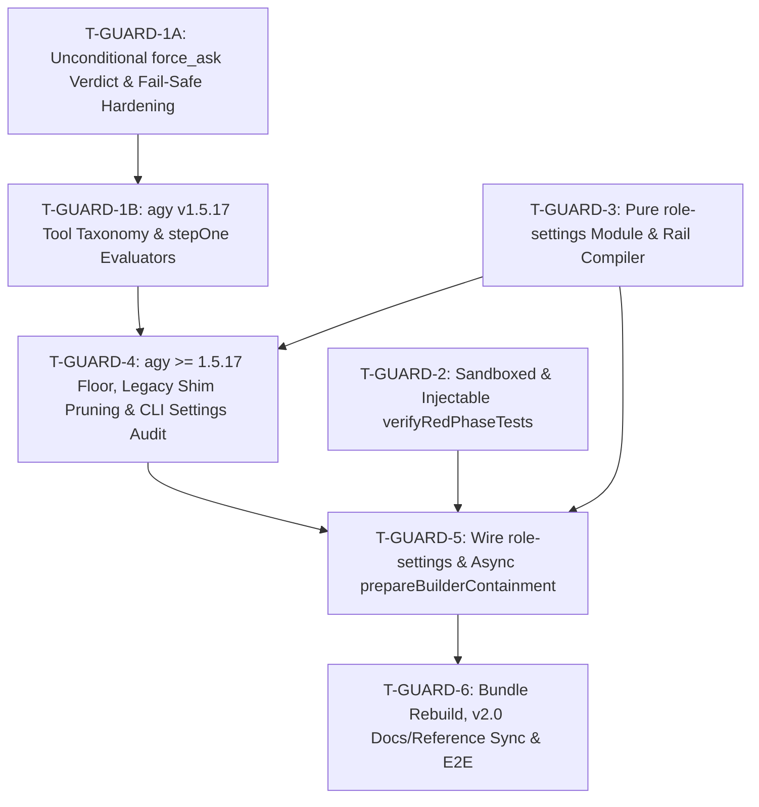

# Specification: Native Antigravity Guardrails & Verification Hardening (v2.0)

**Base:** `research/verification-and-guardrails` \
**Gate:** `{"test": "npm test"}`

--------------------------------------------------------------------------------

## 1. Overview & Objectives

This specification aligns `antigravity-booster` (`v2.0.0`) with Google Antigravity's latest normative **Verification and Guardrails** contracts (`permissions`, `sandbox`, `hooks`, and `https://antigravity.google/schemas/v1/settings.json`), adopting a clean forward-leaning `agy >= 1.5.17` baseline with zero legacy `agy` backwards-compatibility shims:

1.  **Unconditional `PreToolUse` `force_ask` Escalation & Degraded Fail-Safe Hardening (`T-GUARD-1A`)**:
    -   Preserves Appendix A D7 strictly: Booster **never** emits `"decision": "allow"` or `"auto_approve"` (neutral pass-through remains empty stdout `""` with exit `0`; `overwrite` is never emitted).
    -   Adds `force_ask` (`RANK = { pass: 0, ask: 1, force_ask: 2, deny: 3 }`) across `hooks/policy/verdict.mjs`, `hooks/pre-tool-use.mjs`, and `bin/hook-runner.sh` with **no** legacy downgrade/rollback env flags.
    -   Upgrades interactive operator prompts in active-rail ADLC repos from `ask` to `force_ask` on `run_workflow`, third-party MCP calls, and `adlc ticket <verb> --authorize`, **and** upgrades `bin/hook-runner.sh`'s degraded interactive fail-safe (`run_command` in ADLC repos and `--fallback deny|force_ask` in non-ADLC repos) from `ask` to `force_ask` so a hook timeout/crash can never downgrade `force_ask` to a cached `"Always Allow"` grant. Headless workers (`AGB_WORKER_TICKET` or `AGB_WORKER_MODE`) always convert any `ask` or `force_ask` to `deny`.
2.  **`agy v1.5.17` Tool Taxonomy Modernization (`T-GUARD-1B`)**:
    -   Updates `hooks/policy/` and `stepOne()` pre-dispatch path extraction for zero-argument `list_permissions({})`, `find_by_name` (`SearchDirectory`), `ask_permission` (`Action`, `Target`, `Reason`), and `generate_image` (`Prompt`, `ImageName`, `ImagePaths`).
3.  **Sandboxed, Env-Sanitized & Injectable Red-Phase Test Runner (`T-GUARD-2`)**:
    -   Hardens `verifyRedPhaseTests()` in `lib/tdd-split.mjs` with synchronous OS gate sandboxing (`sandboxProfile` / `linuxBwrapArgs` from frozen rail `lib/gates.mjs`), injectable `spawnFn` / `sandboxAvailableFn` execution seams for deterministic cross-platform testing, secret environment stripping, symlink escape rejection, and `--test-reporter=tap` startup verification so pre-runner/sandbox startup crashes return `ok: false`.
4.  **Strict `action(target)` `--settings` Profiles & Rail Compilation (`T-GUARD-3`, `T-GUARD-5`)**:
    -   Creates pure zero-dependency `lib/role-settings.mjs` (`PERMISSION_RULE_RE`, `isValidPermissionRule`, `compileRailsToDenyRules`, `buildRoleSettingsProfile`) emitting **only** `{ allowNonWorkspaceAccess: false, permissions: { deny: [...] } }`.
    -   `readonly` roles **unconditionally** deny `'mcp(*)'` regardless of `hasCodegraph`; `builder` roles deny `'mcp(*)'` when `!hasCodegraph` and deny `['mcp(agb/*)', 'mcp(antigravity-booster_agb/*)']` when `hasCodegraph === true` (while `stageFilteredMcpConfig` strips all non-codegraph servers from staged `mcp_config.json`), plus compiled `write_file(<rail>)` rules.
5.  **Forward-Leaning `agy >= 1.5.17` Floor, Legacy `< 1.5.9` Shim Pruning, `agb doctor` `settings.json` Audit & `force_ask` Self-Test (`T-GUARD-4`)**:
    -   Levels up both `MIN_AGY_VERSION` and `RECOMMENDED_AGY_VERSION` in `lib/doctor.mjs` to `'1.5.17'`, prunes dead `< 1.5.9` Orchestrator auto-disable shims in `lib/doctor.mjs` and `lib/scheduler.mjs`, updates `test/fixtures/fake-agy` default version to `1.5.17` (plus `allowNonWorkspaceAccess` in `ALLOWED_SETTINGS_KEYS`), adds advisory `checkCliSettings()` (`lib/doctor-settings.mjs`), and extends `checkPolicyGuard()` to verify `force_ask`.
6.  **Default-Contained `NdjsonWorkerDaemon`, `< 1.5.9` NDJSON Shim Removal & Bundle/Docs Sync (`T-GUARD-5`, `T-GUARD-6`)**:
    -   Extracts async `prepareBuilderContainment()` in `lib/agy.mjs` preserving 100% `runAgy()` launch argv/mount/nonce parity, defaults `NdjsonWorkerDaemon` (`agyVersion = '1.5.17'`, `< 1.5.9` shim removed) to `containment = (role === 'builder')` using `prepareBuilderContainment`, rebuilds `dist/{agb,mcp-server}.mjs`, updates `README.md` + `website/content/docs/**` + `website/generated/**` to `agy >= 1.5.17`, and verifies `website/scripts/check-all.mjs` + E2E guardrails.

## Resolved Trade-Offs

-   **Forward-Leaning `2.0` `agy >= 1.5.17` Requirement (Owner Guidance):** Because `2.0.0` is a clean major release where legacy `agy` backwards compatibility is explicitly a non-goal, both `MIN_AGY_VERSION` and `RECOMMENDED_AGY_VERSION` are set to `'1.5.17'`, legacy `< 1.5.9` shims (`belowOrchestrator` in `lib/doctor.mjs`, `agyBelowOrchestratorFloor` in `lib/scheduler.mjs`, and `semverLt(agyVersion, '1.5.9')` in `lib/ndjson-worker.mjs`) are pruned, and `force_ask` is emitted unconditionally without any `AGB_DISABLE_FORCE_ASK` downgrade flag.
-   **Strict `action(target)` Schema vs. Legacy Bare Tool Names (`F-003`, `F-004`):** Antigravity's official `https://antigravity.google/schemas/v1/settings.json` (`permissionRule`) specifies that `agy` ignores rules outside `^(command|read_file|write_file|read_url|execute_url|mcp|unsandboxed)\(.*\)$`; live `agy 1.5.17` probing confirmed `allowNonWorkspaceAccess: false` + `action(target)` rules are accepted natively while `PreToolUse` (`stageHooksOnlyBoosterPlugin`) blocks orchestration tools (`invoke_subagent`, `swarm`, `run_workflow`) in every headless worker. `readonly` roles unconditionally include `'mcp(*)'` in `permissions.deny`; `builder` roles with `hasCodegraph: true` include `'mcp(agb/*)'` and `'mcp(antigravity-booster_agb/*)'` while `stageFilteredMcpConfig` excludes all non-codegraph servers.
-   **Nested Sandbox Avoidance (`F-001` Round 1):** `buildRoleSettingsProfile()` omits `enableTerminalSandbox`, `toolPermission`, and `agentMode` so outer `bwrap` / Seatbelt containment never hits nested `CLONE_NEWUSER` / `sandbox_init()` `EPERM`.
-   **Why `T-GUARD-4 -> T-GUARD-5` and `T-GUARD-2 -> T-GUARD-5` Edges Exist (`F-023`, `F-001`):** `lib/agy.mjs` (`T-GUARD-5`) directly imports `./doctor.mjs` (`T-GUARD-4`), both touch `lib/scheduler.mjs`, and `evals/runner.mjs` (`T-GUARD-5`, which tests `buildRoleSettingsProfile` in `runLiveV14HyperHarnessBenchmark()`) directly imports `lib/tdd-split.mjs` (`T-GUARD-2`), so `agb shape --strict` requires serializing edges from `T-GUARD-2` and `T-GUARD-4` into `T-GUARD-5` while `T-GUARD-2` runs completely in parallel with Waves 1 and 2.

--------------------------------------------------------------------------------

## 2. Ticket Dependency DAG

--------------------------------------------------------------------------------

## 3. Ticket Specifications

### Ticket 1: `T-GUARD-1A` — Unconditional `PreToolUse` `force_ask` Verdict & Degraded Fail-Safe Hardening

-   **Scope**: `hooks/policy/verdict.mjs`, `hooks/policy/evaluate.mjs`, `hooks/policy/shell.mjs`, `hooks/pre-tool-use.mjs`, `bin/hook-runner.sh`, `dist/hooks/pre-tool-use.bundle.mjs`, `test/hook-runner.test.mjs`, `test/pre-tool-use.test.mjs`, `test/policy-guard-bypass.test.mjs`, `test/audit-policy-and-supply.test.mjs`
-   **Rails**: `lib/lock.mjs`, `lib/gates.mjs`, `vendor/cache/**`, `scripts/rails-guard-ci.mjs`
-   **Edges**: `T-GUARD-1A -> T-GUARD-1B`
-   **Tier**: `frontier`
-   **Pool Hint**: `claude-gpt`
-   **Objectives**:
    1.  In `hooks/policy/verdict.mjs`, export `forceAsk = (reason) => ({ decision: 'force_ask', reason })` and set `RANK = { pass: 0, ask: 1, force_ask: 2, deny: 3 }` so `mostRestrictive()` enforces `deny > force_ask > ask > pass`. Preserve Appendix A D7 (`pass` emits empty stdout; never emit `allow` or `auto_approve`).
    2.  In `hooks/pre-tool-use.mjs`, accept `verdict.decision` in `['deny', 'ask', 'force_ask']` and emit `{ decision: verdict.decision, reason: verdict.reason }` (with no downgrade env flags).
    3.  In `bin/hook-runner.sh`:
        -   Accept `ask|force_ask|deny` in `--fallback` validation.
        -   In `emit_fallback`: for interactive `run_command` in an ADLC repository (`line ~504`) and for non-ADLC `deny|force_ask` fallback (`line ~528`), emit `"decision":"force_ask"` instead of `"ask"` so a crashed or timed-out hook cannot downgrade `force_ask` to a cached `"Always Allow"` grant (preserve `"decision":"ask"` only when `--fallback ask` is explicitly passed in a non-ADLC repo).
        -   In final `OUTPUT` validation (`line ~618`), accept single-line `'{"decision":"force_ask"'*` and `'{"decision": "force_ask"'*` alongside `ask` and `deny`. If `[ -n "$AGB_WORKER_TICKET" ] || [ -n "$AGB_WORKER_MODE" ]` and `OUTPUT` has `ask` or `force_ask`, reject and call `emit_fallback` (emitting `deny`). Continue rejecting `allow` / `auto_approve` via `emit_fallback`.
    4.  Upgrade three interactive active-rail prompts from `ask(...)` to `forceAsk(...)` (headless workers continue returning `deny`):
        -   `evaluateMcpTool` (`hooks/policy/evaluate.mjs:793`): third-party MCP tool call in an active-rail ADLC repo returns `forceAsk('Third-party MCP tool call in an active-rail ADLC repository requires operator confirmation')`.
        -   `evaluateWorkflowTool` (`hooks/policy/evaluate.mjs:1033`): `run_workflow` in an active-rail ADLC repo returns `forceAsk('run_workflow executes Python outside PreToolUse file hooks in an active-rail ADLC repository; operator confirmation required')`.
        -   `classifySubcommand` (`hooks/policy/shell.mjs:501`): interactive `adlc ticket <verb> --authorize` in an ADLC repo returns `forceAsk('Authorized ticket lifecycle change requires operator confirmation')`.
    5.  Run `npm run build:hooks` to rebuild `dist/hooks/pre-tool-use.bundle.mjs`, and update assertions in `test/hook-runner.test.mjs` (degraded interactive ADLC `run_command` and non-ADLC `--fallback deny|force_ask` emit `force_ask`, explicit `--fallback ask` emits `ask`, headless `ask`/`force_ask` -> `deny`), `test/pre-tool-use.test.mjs` (`lines 208, 316, 657, 686, 710`), `test/policy-guard-bypass.test.mjs` (`line 245`), and `test/audit-policy-and-supply.test.mjs` (`line 114`).
-   **Acceptance Criteria**:
    -   `node --test test/hook-runner.test.mjs test/pre-tool-use.test.mjs test/policy-guard-bypass.test.mjs test/audit-policy-and-supply.test.mjs test/plugin-layout.test.mjs` exits `0`.
    -   `npm test` exits `0` with 0 failures.

--------------------------------------------------------------------------------

### Ticket 2: `T-GUARD-1B` — `agy v1.5.17` Tool Taxonomy (`list_permissions`, `find_by_name`, `ask_permission`, `generate_image`)

-   **Scope**: `hooks/policy/constants.mjs`, `hooks/policy/evaluate.mjs`, `dist/hooks/pre-tool-use.bundle.mjs`, `test/policy-1-5-9-readonly.test.mjs`, `test/policy-guardrails-1-5-17.test.mjs`
-   **Rails**: `lib/lock.mjs`, `lib/gates.mjs`, `vendor/cache/**`, `scripts/rails-guard-ci.mjs`
-   **Edges**: `T-GUARD-1B -> T-GUARD-4`
-   **Tier**: `frontier`
-   **Pool Hint**: `claude-gpt`
-   **Objectives**:
    1.  In `hooks/policy/constants.mjs`:
        -   Remove `list_permissions` from `REQUIRED_READ_PATH_KEYS` while keeping `list_permissions: ['paths', 'path']` in `READ_TOOL_PATH_SCHEMAS`.
        -   Add `'SearchDirectory'` to `READ_TOOL_PATH_SCHEMAS.find_by_name`.
        -   Export `ASK_PERMISSION_ACTIONS = new Set(['command', 'read_file', 'write_file', 'read_url', 'execute_url', 'download_url', 'mcp'])`, `ASK_PERMISSION_PROSE_KEYS = new Set(['Reason', 'reason', 'toolAction', 'toolaction', 'toolSummary', 'toolsummary'])`, and `GENERATE_IMAGE_PROSE_KEYS = new Set(['Prompt', 'prompt', 'toolAction', 'toolaction', 'toolSummary', 'toolsummary'])`.
    2.  In `hooks/policy/evaluate.mjs`:
        -   Update `extractReadToolPaths(name, rawArgs)` so `const pathKeys = REQUIRED_READ_PATH_KEYS[name] ?? READ_TOOL_PATH_SCHEMAS[name] ?? []; const pathRequired = Object.hasOwn(REQUIRED_READ_PATH_KEYS, name);`: validate argument shape identically (rejecting empty string, empty array `[]`, or unapproved extra keys), and require `extractedPaths.length >= 1` only when `pathRequired === true`. Call `extractReadToolPaths` in `stepOne` for `name === 'list_permissions'` as well as `REQUIRED_READ_PATH_KEYS` tools so 0-arg `list_permissions({})` passes while `list_permissions({ paths: [] })`, unapproved extra keys (e.g. Go Kelvin-fold `'p\u212A'`), or `list_permissions({ paths: [boosterDataPath] })` are denied.
        -   Update `stepOne(name, args, ctx)` pre-dispatch candidate extraction so `generate_image` and `ask_permission` do not fall into the generic `scanPathLike(args)` branch that scans `Prompt` prose or misclassifies `read_file` brain targets:
            -   For `name === 'generate_image'`: extract candidates strictly from `(typeof norm.folded.imagename === 'string' && looksLikePath(norm.folded.imagename) ? [toPath(norm.folded.imagename)] : [])` plus `(Array.isArray(norm.folded.imagepaths) ? norm.folded.imagepaths.filter((s) => typeof s === 'string').map(toPath) : [])`; `isRead` remains `false` so `stepOne` allows only verified active-session `brainRoots` artifacts (`isAllowedBrainArtifactTarget`) and denies `protectedRoots` / `boosterDataRoots`.
            -   For `name === 'ask_permission'`: compute `const act = String(norm.folded.action ?? '').trim().toLowerCase()`; scan `args` with `topLevelSkipKeys: new Set([...ASK_PERMISSION_PROSE_KEYS, 'Target', 'target'])`, plus `toPath(norm.folded.target)` only when `typeof norm.folded.target === 'string'` and `act === 'read_file' || act === 'write_file'`; set `isRead` in `stepOne` to `act !== 'write_file'` so `Action: 'command'` / `'mcp'` / URL requests referencing paths under `protectedRoots` (e.g. `~/.local/bin/agb`) are not falsely blocked as direct file writes before `evaluateAskPermission` runs.
        -   Add `evaluateAskPermission(rawArgs, ctx)` dispatched from `evaluatePayload` when `name === 'ask_permission'`: deny in `ctx.headless`; normalize via `normalizeArgsCaseInsensitive`; allow only keys `action`, `target`, `reason`, `toolaction`, `toolsummary`; require non-empty strings `action` and `target`, and optional string `reason`. Lowercase `act = action.trim().toLowerCase()`; deny if `act === 'unsandboxed'` or `!ASK_PERMISSION_ACTIONS.has(act)`. When `act === 'command'`, run `classifyRunCommand({ CommandLine: target }, ctx)` and return `deny` if its decision is `'deny'`. Resolve file path candidates (`act === 'read_file' || act === 'write_file'`) via `resolveAll` (denying unanchorable relative paths, `boosterDataRoots`, `protectedRoots` on `write_file`, `containsProtected` on `write_file`, `gateOnePath` non-pass, or any `write_file`/`read_file` target containing `*` when an anchor or resolved path is in an ADLC repo). If any anchor or resolved repo is ADLC with `!r.store.ok`, deny; if `r.activeRail`, return `forceAsk('Permission request in an active-rail ADLC repository requires operator confirmation')`; else `PASS`.
        -   Add `evaluateGenerateImage(rawArgs, ctx)` dispatched from `evaluatePayload` when `name === 'generate_image'`: deny in `ctx.headless` (`ctx.readonly || ctx.workerTicket`); normalize via `normalizeArgsCaseInsensitive`; allow only keys `prompt`, `imagename`, `imagepaths`, `toolaction`, `toolsummary`; require non-empty strings `prompt` and `imagename` (rejecting `..` path segments in `imagename`), and optional `imagepaths` as an array of `1..20` non-empty strings (`imagepaths: []` allowed as empty). For every path candidate (`looksLikePath(imagename)` and each `imagepaths` item), resolve via `resolveAll` and run `containsProtected` + `evaluateOneTargetForm(r, 'write_file', { Path: token }, ctx, [])` (checking both `r` and lexical form when `r.lexical !== r.real`), returning `deny` on any non-pass verdict; otherwise `PASS`.
    3.  Run `npm run build:hooks` to rebuild `dist/hooks/pre-tool-use.bundle.mjs`, update `test/policy-1-5-9-readonly.test.mjs` for 0-arg `list_permissions({})` (9 required-path read tools + optional-path `list_permissions`), and create `test/policy-guardrails-1-5-17.test.mjs` (<320 lines) covering `list_permissions`, `find_by_name` (`SearchDirectory`), `ask_permission`, and `generate_image` (including `Prompt` prose mentioning `lib/lock.mjs` and `~/.ssh` without false-positive denial, session brain artifact target pass, and rail/protected target denial).
-   **Acceptance Criteria**:
    -   `node --test test/policy-1-5-9-readonly.test.mjs test/policy-guardrails-1-5-17.test.mjs test/plugin-layout.test.mjs` exits `0`.
    -   `npm test` exits `0` with 0 failures.

--------------------------------------------------------------------------------

### Ticket 3: `T-GUARD-2` — Sandboxed, Env-Sanitized & Injectable `verifyRedPhaseTests`

-   **Scope**: `lib/tdd-split.mjs`, `test/tdd-split.test.mjs`
-   **Rails**: `lib/lock.mjs`, `lib/gates.mjs`, `vendor/cache/**`, `scripts/rails-guard-ci.mjs`
-   **Edges**: `T-GUARD-2 -> T-GUARD-5`
-   **Tier**: `mid`
-   **Pool Hint**: `gemini`
-   **Objectives**:
    1.  Harden synchronous `verifyRedPhaseTests(testFiles = [], { worktree = process.cwd(), timeoutMs = 30_000, env = process.env, platform = process.platform, spawnFn = spawnSync, sandboxAvailableFn = gateSandboxAvailable } = {})` in `lib/tdd-split.mjs` (<320 lines) without editing frozen rail `lib/gates.mjs`:
        -   Validate `wtRoot = resolve(worktree)` exists as a directory and compute `realWtRoot = realpathSync(wtRoot)`. For each entry in `testFiles`, reject control chars (`/[\0\r\n]/`), absolute paths, `..` segments, or paths failing `isTestPathspec`; verify via `lstatSync` and `realpathSync` that the file exists, is not a symlink, and `realFull.startsWith(realWtRoot + sep)`.
        -   Export `sanitizeRedPhaseEnv(env = process.env, platform = process.platform)`: copy only allowlisted baseline keys (`PATH`, `HOME`, `USER`, `LANG`, `TERM`, `TMPDIR`, `TEMP`, `TMP`, `SYSTEMROOT`, `WINDIR`, `COMSPEC`, `PATHEXT`, `APPDATA`, `LOCALAPPDATA`), set `NODE_ENV = 'test'`, and strip `NODE_TEST_CONTEXT`, `NODE_OPTIONS`, `LD_PRELOAD`, `LD_LIBRARY_PATH`, `DYLD_INSERT_LIBRARIES`, `DYLD_LIBRARY_PATH`, and any key matching `/KEY|TOKEN|SECRET|PASSWORD|AUTH|CREDENTIAL|PRIVATE|CERT/i`.
        -   Syntax-check each file via `spawnFn(process.execPath, ['--check', full], { cwd: realWtRoot, env: childEnv, timeout: 10_000, encoding: 'utf8' })`, returning `{ ok: false, reason: 'spec-test syntax error in ...' }` when `status !== 0`.
        -   Import `gateSandboxAvailable`, `sandboxProfile`, and `linuxBwrapArgs` from `./gates.mjs`. When `env.AGB_SANDBOX_GATES !== '0'`:
            -   If `(platform !== 'darwin' && platform !== 'linux') || !sandboxAvailableFn(env)`, fail closed returning `{ ok: false, reason: 'spec-test red-phase sandbox unavailable on ' + platform + ' (set AGB_SANDBOX_GATES=0 only in disposable containers)' }`.
            -   On `darwin`: write `sandboxProfile(realWtRoot)` to a temp dir (`mkdtempSync`), invoke `spawnFn('sandbox-exec', ['-f', profileFile, process.execPath, '--test', '--test-reporter=tap', ...cleanFiles], { cwd: realWtRoot, env: childEnv, timeout: timeoutMs, encoding: 'utf8', maxBuffer: 8 * 1024 * 1024 })`, and remove the temp dir in `finally`.
            -   On `linux`: create `emptyRoDir = mkdtempSync(...)`, record pre-existing `.git` and `node_modules` inside `realWtRoot`, build shell-quoted `cmd = [process.execPath, '--test', '--test-reporter=tap', ...cleanFiles].map((s) => "'" + String(s).replace(/'/g, "'\\''") + "'").join(' ')`, invoke `spawnFn('bwrap', linuxBwrapArgs(realWtRoot, cmd, emptyRoDir), { cwd: realWtRoot, env: childEnv, timeout: timeoutMs, encoding: 'utf8', maxBuffer: 8 * 1024 * 1024 })`, and in `finally` remove `emptyRoDir` plus any empty `.git`/`node_modules` mountpoint dirs created during the call.
        -   When `env.AGB_SANDBOX_GATES === '0'`, invoke `spawnFn(process.execPath, ['--test', '--test-reporter=tap', ...cleanFiles], { cwd: realWtRoot, env: childEnv, timeout: timeoutMs, encoding: 'utf8', maxBuffer: 8 * 1024 * 1024 })`.
        -   Check `res`:
            -   If `res.error?.code === 'ETIMEDOUT' || res.signal === 'SIGTERM' || res.signal === 'SIGKILL'`, return `{ ok: false, reason: 'spec-test red-phase verification timed out' }`.
            -   If `res.status === 0`, return `{ ok: false, reason: 'tautological spec tests: tests passed on unimplemented base (red-phase failure required)' }`.
            -   Catch pre-runner / sandbox startup failures: require `/^TAP version \d+/m.test(res.stdout ?? '')` and `/^not ok \d+/m.test(res.stdout ?? '')`; if absent, return `{ ok: false, reason: 'spec-test red-phase runner failed before executing TAP tests: ' + String(res.stderr || res.error?.message || 'unknown error').slice(0, 240) }`.
            -   Otherwise return `{ ok: true, verifiedFiles: cleanFiles, exitCode: res.status ?? 1 }`.
    2.  Expand `test/tdd-split.test.mjs` (<280 lines) testing real execution (`AGB_SANDBOX_GATES: '0'` and live Linux `bwrap` when `gateSandboxAvailable()` is true), secret env stripping, symlink/traversal rejection, and deterministic `spawnFn` / `sandboxAvailableFn` unit tests for `darwin` `sandbox-exec`, `linux` `bwrap` EPERM startup failure (`ok: false`), `win32` fail-closed, and timeout handling.
-   **Acceptance Criteria**:
    -   `lib/tdd-split.mjs` is strictly under 320 lines, synchronous, and leaves `lib/gates.mjs` untouched.
    -   `node --test test/tdd-split.test.mjs` and `npm test` exit `0`.

--------------------------------------------------------------------------------

### Ticket 4: `T-GUARD-3` — Pure `lib/role-settings.mjs` Permission Grammar & Rail Compiler

-   **Scope**: `lib/role-settings.mjs`, `test/role-settings.test.mjs`
-   **Rails**: `lib/lock.mjs`, `lib/gates.mjs`, `vendor/cache/**`, `scripts/rails-guard-ci.mjs`
-   **Edges**: `T-GUARD-3 -> T-GUARD-4`, `T-GUARD-3 -> T-GUARD-5`
-   **Tier**: `mid`
-   **Pool Hint**: `gemini`
-   **Objectives**:
    1.  Create pure zero-dependency `lib/role-settings.mjs` (<200 lines) exporting:
        -   `PERMISSION_RULE_RE = /^(command|read_file|write_file|read_url|execute_url|mcp|unsandboxed)\(.+\)$/` (matching the 7 actions in `https://antigravity.google/schemas/v1/settings.json` with non-empty target)
        -   `isValidPermissionRule(rule)`: returns `true` iff `typeof rule === 'string' && rule.length <= 1024 && !/[\r\n\0]/.test(rule) && rule.trim() === rule && PERMISSION_RULE_RE.test(rule)`.
        -   `compileRailsToDenyRules(rails = [])`: normalizes repo-relative rail pathspecs (`\` -> `/`, strips leading `./`), skips empty strings, control chars, `..` segments, leading `/` or `~`, or strings containing `(` or `)`; converts trailing `/**` or `/*` on wildcard-free directory prefixes (e.g. `vendor/cache/**` -> `vendor/cache/`); skips any remaining entry containing wildcard chars `[*?[\]{}]` (e.g. `**/*.snap`); returns deduplicated `write_file(<target>)` rules passing `isValidPermissionRule`.
        -   `buildRoleSettingsProfile(role = 'builder', { hasCodegraph = false, rails = [], extraSettings = {} } = {})`:
            -   Emits **only** `allowNonWorkspaceAccess: false` and `permissions: { deny: [...] }` by default (omitting `enableTerminalSandbox`, `toolPermission`, and `agentMode`).
            -   `readonly` roles (`prosecutor`, `review`, `review-plan`, `coldstart`, `parallax`, `premortem`, `brain`, `arbiter`, `readonly`) **unconditionally** deny `'mcp(*)'` regardless of `hasCodegraph`: `['write_file(*)', 'command(*)', 'read_url(*)', 'execute_url(*)', 'mcp(*)']`.
            -   `builder` roles emit deduplicated `['write_file(.git/)', 'write_file(.adlc/)', 'write_file(.booster/)', ...compileRailsToDenyRules(rails), 'command(sudo)', 'command(rm -rf)', 'command(git push)', 'read_url(*)', 'execute_url(*)', ...(hasCodegraph ? ['mcp(agb/*)', 'mcp(antigravity-booster_agb/*)'] : ['mcp(*)'])]`.
            -   Deep-merges `extraSettings.permissions` (`allow`, `ask`, `deny` arrays) without clobbering base `deny` rules.
    2.  Create `test/role-settings.test.mjs` (<220 lines) verifying `isValidPermissionRule`, `compileRailsToDenyRules`, unconditional `'mcp(*)'` on `readonly` even with `{ hasCodegraph: true }`, `mcp(agb/*)`/`mcp(antigravity-booster_agb/*)` on `builder` with `{ hasCodegraph: true }`, and `extraSettings` deep merge.
-   **Acceptance Criteria**:
    -   `lib/role-settings.mjs` is strictly under 200 lines with zero external package imports.
    -   `node --test test/role-settings.test.mjs` and `npm test` exit `0`.

--------------------------------------------------------------------------------

### Ticket 5: `T-GUARD-4` — Forward-Leaning `agy >= 1.5.17` Floor, Legacy `< 1.5.9` Shim Pruning, `checkCliSettings` & `force_ask` Self-Test

-   **Scope**: `lib/doctor-settings.mjs`, `lib/doctor.mjs`, `lib/scheduler.mjs`, `test/fixtures/fake-agy`, `test/doctor-settings.test.mjs`, `test/doctor-selftest.test.mjs`, `test/doctor.test.mjs`, `test/orchestrator-routing.test.mjs`, `evals/v13-enhancements-bench.mjs`
-   **Rails**: `lib/lock.mjs`, `lib/gates.mjs`, `vendor/cache/**`, `scripts/rails-guard-ci.mjs`
-   **Edges**: `T-GUARD-4 -> T-GUARD-5`
-   **Tier**: `frontier`
-   **Pool Hint**: `claude-gpt`
-   **Objectives**:
    1.  Create `lib/doctor-settings.mjs` (<200 lines) importing `isValidPermissionRule` directly from `./role-settings.mjs` (no barrel re-export churn):
        -   Export `checkCliSettings({ home = homedir(), env = process.env } = {})` inspecting `<home>/.gemini/antigravity-cli/settings.json` (`home || env.HOME || homedir()`).
        -   Returns `{ name: 'CLI settings', level: 'pass', detail: 'defaults (no settings.json)', fix: null }` when absent (`ENOENT`).
        -   Rejects symlinks, non-regular files, or files `> 1024 * 1024` bytes via `lstatSync` with `level: 'warn'`.
        -   Strips JSONC comments outside string literals, parses JSON (`level: 'warn'` on invalid JSON or non-object), and warns (`level: 'warn'`, never `'fail'`) on `toolPermission === 'always-proceed'`, `allowNonWorkspaceAccess === true`, or non-object `permissions` / non-array `allow`/`ask`/`deny` / any rule failing `isValidPermissionRule`. Returns `{ name: 'CLI settings', level: 'pass', detail: 'guardrails intact', fix: null }` when clean.
    2.  In `lib/doctor.mjs` and `lib/scheduler.mjs`:
        -   Bump both `export const MIN_AGY_VERSION = '1.5.17'` and `export const RECOMMENDED_AGY_VERSION = '1.5.17'`. In `checkAgyBinary()`, update the `< MIN_AGY_VERSION` fail fix string to `'Upgrade agy to >= 1.5.17 for Antigravity Booster 2.0 native guardrails, PreToolUse force_ask, and Orchestrator support.'`, and remove the obsolete `belowOrchestrator = semverLt(versionStr, '1.5.9')` conditional inside the `semverLt(versionStr, RECOMMENDED_AGY_VERSION)` warn branch.
        -   In `lib/scheduler.mjs` (`lines ~1527-1533`), remove the obsolete `agyBelowOrchestratorFloor` (`semverLt(agyVersion, '1.5.9')`) check and log notice so `const disableOrchestrator = Boolean(plan.disableOrchestrator);` (clean up unused `semverLt`/`semverParse` imports in `lib/scheduler.mjs` if no longer referenced there).
        -   Import and re-export `checkCliSettings` from `./doctor-settings.mjs` in `lib/doctor.mjs`, include `checkCliSettings(resolvedOpts)` in `runDoctor()` (never mutating `settings.json` in `applyDoctorFixes()`), and extend `checkPolicyGuard()` to send `{ toolCall: { name: 'run_workflow', args: { Script: 'print(1)', Cwd: repo } }, workspacePaths: [repo] }` and verify exit `0` + single JSON line with `out.decision === 'force_ask'`.
    3.  Update fixtures, tests, and live eval benchmarks for `1.5.17`:
        -   In `test/fixtures/fake-agy`: update line `220` to `const ALLOWED_SETTINGS_KEYS = new Set(["permissions", "allowNonWorkspaceAccess"]);` and line `325` to `echo "agy version ${FAKE_AGY_VERSION:-1.5.17}"`.
        -   In `test/doctor.test.mjs`: assert `MIN_AGY_VERSION === '1.5.17'` and `RECOMMENDED_AGY_VERSION === '1.5.17'`, test `'1.2.6'`, `'1.5.13'`, and `'1.5.16'` as `level: 'fail'`, and `'1.5.17'` and `'1.6.0'` as `level: 'pass'`.
        -   Add `force_ask` self-test coverage in `test/doctor-selftest.test.mjs`, and create `test/doctor-settings.test.mjs` (<220 lines).
        -   In `test/orchestrator-routing.test.mjs` (`lines 311-330`): replace the legacy `< 1.5.9` auto-disable test with verification that `runPlan` rejects `FAKE_AGY_VERSION: '1.5.16'` (`/required >= v1\.5\.17/`) and resets `modelStats` when `FAKE_AGY_VERSION` advances from `'1.5.17'` to `'1.5.18'`.
        -   In `evals/v13-enhancements-bench.mjs` (`lines 56, 1212, 1363-1398`): check `MIN_AGY_VERSION === '1.5.17' && RECOMMENDED_AGY_VERSION === '1.5.17'`, and update Check 3 (`versionAutoDisableOk` — preserving the `checks.versionAutoDisableOk` key name) to verify that `runPlan` rejects `FAKE_AGY_VERSION: '1.5.16'` (`/required >= v1\.5\.17/`) while `disableOrchestrator: true` routes `T1` (`tier: 'frontier', pool_hint: 'gemini'`) to `['gemini-4-argon-high']`.
-   **Acceptance Criteria**:
    -   `MIN_AGY_VERSION` and `RECOMMENDED_AGY_VERSION` both equal `'1.5.17'`, and `applyDoctorFixes()` never mutates `settings.json`.
    -   `node --test test/doctor.test.mjs test/doctor-selftest.test.mjs test/doctor-settings.test.mjs test/orchestrator-routing.test.mjs test/evals.test.mjs` and `npm test` exit `0`.

--------------------------------------------------------------------------------

### Ticket 6: `T-GUARD-5` — Wire `role-settings` & Async `prepareBuilderContainment` into `runAgy`, `NdjsonWorkerDaemon` & `scheduler`

-   **Scope**: `lib/ndjson-worker.mjs`, `lib/agy.mjs`, `lib/scheduler.mjs`, `evals/runner.mjs`, `test/ndjson-worker.test.mjs`, `test/v14-integration.test.mjs`, `test/agy-no-mcp-storm.test.mjs`
-   **Rails**: `lib/lock.mjs`, `lib/gates.mjs`, `vendor/cache/**`, `scripts/rails-guard-ci.mjs`
-   **Edges**: `T-GUARD-5 -> T-GUARD-6`
-   **Tier**: `frontier`
-   **Pool Hint**: `claude-gpt`
-   **Objectives**:
    1.  In `lib/agy.mjs` and `lib/scheduler.mjs`:
        -   Import and re-export `buildRoleSettingsProfile` from `./role-settings.mjs`. Accept optional `rails` in `runAgy({ ..., rails })` and pass `{ hasCodegraph, rails }` to `buildRoleSettingsProfile(role, { hasCodegraph, rails })` when `useRoleSettings` is true and `settings === undefined`. Pass `rails: t.rails` in `buildOnce()` in `lib/scheduler.mjs`.
        -   Extract `export async function prepareBuilderContainment({ agyBin, args, cwd, repo, sandbox = true, containment = true, env = process.env, userHome, allowCodegraph = false, platform = process.platform, verifiedBypass = null })` in `lib/agy.mjs`, encapsulating `runAgy()`'s existing builder sandbox/containment logic across `bwrap_pid` (Linux), `seatbelt` (macOS), `job_object` + `verifyWindowsSandboxActive` / `verifySandboxBypassAttestation` (Windows, reusing `verifiedBypass` when supplied so daemon respawns never double-consume a single-use nonce), and rejected mechanisms (`cgroups_v2_scope`, `pid_namespace`, missing cwd). Return `{ ok: true, launchBin, launchArgs, stagedBuilderHome, verifiedBypass, cleanup }` or `{ ok: false, kind: 'containment_unavailable', error }`, and have `runAgy()` delegate to `prepareBuilderContainment()` with zero change to `runAgy()`'s launch argv, mounts, or cleanup behavior.
    2.  In `lib/ndjson-worker.mjs` (<520 lines):
        -   Import and re-export `buildRoleSettingsProfile` from `./role-settings.mjs` (removing the old inline `READONLY_DENY_TOOLS` / `BUILDER_BASE_DENY_TOOLS` and removing the legacy `< 1.5.9` `semverLt` check in `supportsPersistentNdjson()` so `supportsPersistentNdjson()` returns `Boolean(this.persistentWorkers)`, with default `agyVersion = '1.5.17'`).
        -   Update `NdjsonWorkerDaemon`: accept `role = 'builder'`, `useRoleSettings = true`, `hasCodegraph = false`, `rails = []`, `worker = null`, `sanitizeEnv = false`, `sandbox = role === 'builder'`, `containment = role === 'builder'`, `repo = null`, `platform = process.platform`, and `prepareContainment = null` in `constructor(...)` (saving raw `env` as `this.envOverride = env` alongside `this.env`). Make `_spawnDaemon()` `async` (awaited inside `sendTurn()`):
            -   Compute `const effectiveSettings = this.settings !== undefined ? this.settings : this.useRoleSettings ? buildRoleSettingsProfile(this.role, { hasCodegraph: this.hasCodegraph, rails: this.rails }) : null` and pass `--settings JSON.stringify(effectiveSettings)` when non-null.
            -   When `this.role === 'builder' && (this.containment || this.sandbox)`: dynamically load `{ prepareBuilderContainment, buildSpawnEnv } = await import('./agy.mjs')`, call `await (this.prepareContainment ?? prepareBuilderContainment)({ agyBin: this.bin, args, cwd: this.cwd, repo: this.repo ?? this.cwd, sandbox: this.sandbox, containment: this.containment, env: this.env, platform: this.platform, verifiedBypass: this._verifiedBypass })`, cache `this._verifiedBypass = res.verifiedBypass ?? this._verifiedBypass`, store `this._containmentCleanup = res.cleanup ?? null`, and if `!res.ok` return `{ ok: false, kind: res.kind ?? 'containment_unavailable', error: res.error }` from `sendTurn()` without spawning raw `this.bin` (and without falling back to uncontained single-shot). Build `spawnEnv` via `buildSpawnEnv({ processEnv: process.env, env: this.envOverride, cwd: this.cwd, repo: this.repo ?? this.cwd, role: this.role, isBuilder: true, sanitizeEnv: this.sanitizeEnv, worker: this.worker, builderHome: res.stagedBuilderHome, platform: this.platform })`.
            -   In `close()`, invoke and clear `this._containmentCleanup()` after killing the daemon process tree.
    3.  Update `evals/runner.mjs` (`lines 230-235` `roleSettingsReadonly` check in `runLiveV14HyperHarnessBenchmark()` to assert `prof?.allowNonWorkspaceAccess === false && prof.permissions.deny.includes('write_file(*)') && prof.permissions.deny.includes('command(*)') && prof.permissions.deny.includes('mcp(*)') && Object.keys(prof).sort().join(',') === 'allowNonWorkspaceAccess,permissions'`, plus `lines 960, 968` table labels for `1.5.17`), `test/agy-no-mcp-storm.test.mjs` (`mock-storm-agy` `ALLOWED_SETTINGS_KEYS` + assertions at lines `316-318, 383-386, 523, 543` for `allowNonWorkspaceAccess: false`, `write_file(*)`, `mcp(*)`, `mcp(agb/*)`), `test/ndjson-worker.test.mjs` (passing `containment: false, sandbox: false` on pure NDJSON protocol unit tests, testing `persistentWorkers: false` + EOF `singleShotFallback`, default `useRoleSettings`, and builder containment / env sanitization / respawn nonce preservation / cleanup), and `test/v14-integration.test.mjs` (including `runAgy()` builder launch argv/mount parity assertions).
-   **Acceptance Criteria**:
    -   `node --test test/ndjson-worker.test.mjs test/v14-integration.test.mjs test/agy-no-mcp-storm.test.mjs test/evals.test.mjs` exits `0`.
    -   `npm test` exits `0` with 0 failures.

--------------------------------------------------------------------------------

### Ticket 7: `T-GUARD-6` — Bundle Rebuild, v2.0 Docs / Reference Sync & End-to-End Guardrail Verification

-   **Scope**: `dist/agb.mjs`, `dist/mcp-server.mjs`, `website/generated/**`, `README.md`, `website/content/docs/getting-started/installation.mdx`, `website/content/docs/getting-started/verify.mdx`, `website/content/docs/reference/agy-integration.mdx`, `website/content/docs/reference/cli/doctor.mdx`, `test/guardrails-e2e.test.mjs`
-   **Rails**: `lib/lock.mjs`, `lib/gates.mjs`, `vendor/cache/**`, `vendor/adlc/**`, `dist/hooks/pre-tool-use.bundle.mjs`, `scripts/rails-guard-ci.mjs`
-   **Edges**: `(leaf — depends on T-GUARD-5)`
-   **Tier**: `mid`
-   **Pool Hint**: `gemini`
-   **Objectives**:
    1.  Rebuild `dist/agb.mjs` and `dist/mcp-server.mjs` via `npm run build:agb && npm run build:mcp` (keeping `dist/hooks/pre-tool-use.bundle.mjs` and `vendor/adlc/**` frozen in `Rails`) and verify `node scripts/check-bundle-externals.mjs` exits `0`.
    2.  Sync `website/generated/**` and v2.0 `agy >= 1.5.17` documentation:
        -   Run `node website/scripts/gen-reference.mjs` to update `website/generated/**` (including `modules.mdx` for `lib/role-settings.mjs` and `lib/doctor-settings.mjs`).
        -   Update `README.md` (`Requires agy >= 1.5.17 and Node >= 22.19.0.`), `website/content/docs/getting-started/installation.mdx`, `website/content/docs/getting-started/verify.mdx` (updating the `agy CLI` floor/fix text to `1.5.17` and adding the advisory `CLI settings` row), `website/content/docs/reference/agy-integration.mdx`, and `website/content/docs/reference/cli/doctor.mdx` to reflect the `1.5.17` runtime floor, **preserving** existing `[C1](https://github.com/voodootikigod/antigravity-booster/blob/v1.0.0/...)` and `[C31](...)` evidence permalinks required by `website/scripts/check-evidence.mjs`.
        -   Verify `node website/scripts/check-all.mjs` exits `0`.
    3.  Create `test/guardrails-e2e.test.mjs` (<220 lines) testing end-to-end across shipped bundles and modules:
        -   `bin/hook-runner.sh` + `dist/hooks/pre-tool-use.bundle.mjs`: `force_ask` on active-rail `run_workflow` & degraded interactive ADLC `run_command`, `deny` in `AGB_WORKER_TICKET` mode, empty stdout on 0-arg `list_permissions({})`, and `deny` on `ask_permission` targeting `unsandboxed` or frozen rails.
        -   `buildRoleSettingsProfile` (`builder` with rails + `prosecutor`) written to `<tmpHome>/.gemini/antigravity-cli/settings.json` passes `checkCliSettings({ home: tmpHome })` with `level: 'pass'`.
        -   `verifyRedPhaseTests` secret stripping and TAP verification.
    4.  Run `npm run plugin:validate` and `npm test` to confirm full marketplace validation and suite greenness.
-   **Acceptance Criteria**:
    -   `node --test test/guardrails-e2e.test.mjs` exits `0`.
    -   `node scripts/check-bundle-externals.mjs`, `node website/scripts/check-all.mjs`, `npm run plugin:validate`, and `npm test` all exit `0`.
