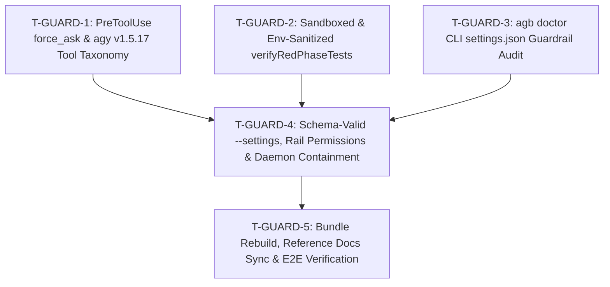

# Specification: Native Antigravity Guardrails & Verification Hardening

**Base:** `research/verification-and-guardrails` \
**Gate:** `{"test": "npm test"}`

--------------------------------------------------------------------------------

## 1. Overview & Objectives

This specification aligns `antigravity-booster` (`agb`) with Google Antigravity's normative **Verification and Guardrails** architecture (`permissions`, `sandbox`, `hooks`, and `https://antigravity.google/schemas/v1/settings.json`), closing three live security/correctness gaps and adopting upstream machine-enforced guardrail primitives:

1.  **Schema-Valid Ephemeral `--settings` Profiles & Rail-to-Permission Compilation (`lib/ndjson-worker.mjs`, `lib/agy.mjs`, `lib/scheduler.mjs`)**:
    -   Replaces bare Cortex tool names in `buildRoleSettingsProfile()` (which Antigravity CLI silently ignores because they violate `^(command|read_file|write_file|read_url|execute_url|mcp|unsandboxed)\(.*\)$`) with schema-valid `action(target)` permission rules (`write_file(*)`, `command(*)`, `read_url(*)`, `execute_url(*)`, `mcp(*)`), explicit `allowNonWorkspaceAccess: false`, `enableTerminalSandbox: true`, `toolPermission: 'proceed-in-sandbox'`, and builder `agentMode: 'accept-edits'` (preventing `agy v1.5.7+` default `auto` mode from auto-evaluating unsandboxed host command retries).
    -   Compiles literal ticket `rails` (e.g. `lib/lock.mjs`, `lib/gates.mjs`) and standing trust-root paths (`.git/`, `.adlc/`, `.booster/`) into `write_file(<target>)` `permissions.deny` entries so Antigravity's native permission engine and OS terminal sandbox block writes at the platform layer.
    -   Shares `runAgy()`'s kernel containment launcher (`bwrap` on Linux, `sandbox-exec` Seatbelt on macOS, Job Object + active AppContainer check on Windows) with `NdjsonWorkerDaemon` via an exported helper in `lib/agy.mjs` / `lib/ndjson-worker.mjs` so persistent multi-turn daemons never spawn unsandboxed.
2.  **Sandboxed & Env-Sanitized Red-Phase Test Execution (`lib/tdd-split.mjs`)**:
    -   Closes the host RCE and secret-exfiltration gap in `verifyRedPhaseTests()`, which previously ran LLM-authored spec tests directly via unsandboxed `execFileSync(process.execPath, ['--test', ...])` with `{ ...process.env }`.
    -   Wraps red-phase `node --test` execution synchronously via `spawnSync` inside the platform gate sandbox (`sandboxProfile` on macOS, `linuxBwrapArgs` on Linux imported from frozen rail `lib/gates.mjs`), failing closed when `AGB_SANDBOX_GATES !== '0'` and `!gateSandboxAvailable(env)`, and strips sensitive/dangerous host environment variables before spawning.
3.  **`PreToolUse` `force_ask` Escalation & `agy v1.5.17` Tool Taxonomy (`hooks/policy/*`, `hooks/pre-tool-use.mjs`, `bin/hook-runner.sh`)**:
    -   Preserves Appendix A D7 strictly: Booster **never** emits `"decision": "allow"` or `"auto_approve"` (neutral pass-through remains empty stdout `""` with exit `0`; `overwrite` is omitted on silent pass-throughs).
    -   Adds `force_ask` (`RANK = { pass: 0, ask: 1, force_ask: 2, deny: 3 }`) across `verdict.mjs`, `pre-tool-use.mjs`, and `bin/hook-runner.sh` (`{"decision":"force_ask",...}`), upgrading high-blast-radius interactive operator prompts in active-rail ADLC repos (`run_workflow`, third-party MCP calls, and `adlc ticket <verb> --authorize`) from `ask` to `force_ask` so cached `"Always Allow"` grants (`command(git)`, `mcp(*)`) cannot silently bypass operator review.
    -   Aligns `hooks/policy/` with current `agy` tool schemas: allows 0-arg `list_permissions({})` (removing `list_permissions` from `REQUIRED_READ_PATH_KEYS` while keeping optional path checks in `READ_TOOL_PATH_SCHEMAS`), explicitly gates `ask_permission` (`Action`, `Target`, `Reason`), adds `SearchDirectory` to `find_by_name`, and explicitly classifies `generate_image` (`Prompt`, `ImageName`, `ImagePaths`).
4.  **Advisory `agb doctor` `settings.json` Guardrail Audit (`lib/doctor-settings.mjs`, `lib/doctor.mjs`)**:
    -   Adds `checkCliSettings({ home, env })` to `runDoctor()` inspecting `<home>/.gemini/antigravity-cli/settings.json` (read-only; never mutated by `--fix`). Reports `PASS` when absent or clean, and `WARN` (advisory, exit `0`) when `"toolPermission": "always-proceed"`, `"allowNonWorkspaceAccess": true`, or unparseable `permissions.{allow,ask,deny}` entries (violating `PERMISSION_RULE_RE`) are present.

## Resolved Trade-Offs

-   **Appendix A D7 vs. `PreToolUse` `overwrite`:** Because `overwrite` requires emitting a JSON `decision` (e.g. `"allow"`), we preserve Appendix A D7 (empty stdout for pass-through; never emit `allow`) and adopt `force_ask` only.
-   **`agb doctor` `settings.json` Severity & `--fix` Boundary:** User `settings.json` findings report `WARN` (exit `0`) and are never auto-modified under `agb doctor --fix`.
-   **Repository Scope:** This specification covers `antigravity-booster` only; upstream `@adlc/gemini` hook contract fixes are tracked separately for the `adlc` repository.

--------------------------------------------------------------------------------

## 2. Ticket Dependency DAG

--------------------------------------------------------------------------------

## 3. Ticket Specifications

### Ticket 1: `T-GUARD-1` — PreToolUse `force_ask` Escalation & Antigravity v1.5.17 Tool Taxonomy Modernization

-   **Scope**: `hooks/policy/constants.mjs`, `hooks/policy/verdict.mjs`, `hooks/policy/evaluate.mjs`, `hooks/policy/shell.mjs`, `hooks/pre-tool-use.mjs`, `bin/hook-runner.sh`, `test/hook-runner.test.mjs`, `test/pre-tool-use.test.mjs`, `test/audit-policy-and-supply.test.mjs`, `test/policy-1-5-9-readonly.test.mjs`, `test/policy-guardrails-1-5-17.test.mjs`
-   **Rails**: `lib/lock.mjs`, `lib/gates.mjs`, `vendor/cache/**`, `scripts/rails-guard-ci.mjs`
-   **Edges**: `T-GUARD-1 -> T-GUARD-4`
-   **Tier**: `frontier`
-   **Pool Hint**: `claude-gpt`
-   **Objectives**:
    1.  Update `hooks/policy/verdict.mjs` to export `forceAsk = (reason) => ({ decision: 'force_ask', reason })` and set `RANK = { pass: 0, ask: 1, force_ask: 2, deny: 3 }` so `mostRestrictive()` enforces `deny > force_ask > ask > pass`. Preserve Appendix A D7 (`pass` emits empty stdout; never emit `allow` or `auto_approve`).
    2.  Update `hooks/pre-tool-use.mjs` to write `{ decision: verdict.decision, reason: verdict.reason }` when `verdict.decision` is `'deny'`, `'ask'`, or `'force_ask'`.
    3.  Update `bin/hook-runner.sh` so `--fallback` validation accepts `ask|force_ask|deny` and output validation (`case "$OUTPUT"`) passes through single-line `'{"decision":"force_ask"'*` and `'{"decision": "force_ask"'*` alongside `ask` and `deny`, while continuing to reject `allow` / `auto_approve` by converting them to fallback.
    4.  Upgrade high-risk interactive prompts in active-rail ADLC repositories from `ask(...)` to `forceAsk(...)` (headless workers continue returning `deny`):
        -   `evaluateMcpTool` (`hooks/policy/evaluate.mjs`): third-party MCP tool calls in an active-rail ADLC repository return `forceAsk('Third-party MCP tool call in an active-rail ADLC repository requires operator confirmation')`.
        -   `evaluateWorkflowTool` (`hooks/policy/evaluate.mjs`): `run_workflow` in an active-rail ADLC repository returns `forceAsk('run_workflow executes Python outside PreToolUse file hooks in an active-rail ADLC repository; operator confirmation required')`.
        -   `classifySubcommand` (`hooks/policy/shell.mjs`): interactive `adlc ticket <verb> --authorize` in an ADLC repository returns `forceAsk('Authorized ticket lifecycle change requires operator confirmation')`.
    5.  Modernize tool taxonomy in `hooks/policy/constants.mjs` and `hooks/policy/evaluate.mjs`:
        -   Remove `list_permissions` from `REQUIRED_READ_PATH_KEYS` so zero-argument `list_permissions({})` passes cleanly; retain `list_permissions: ['paths', 'path']` in `READ_TOOL_PATH_SCHEMAS` (and validate non-empty string/string-array if `paths`/`path` is supplied) so protected roots (`boosterDataRoots`, foreign `brainRoots`) remain blocked when paths are provided.
        -   Add `'SearchDirectory'` to `READ_TOOL_PATH_SCHEMAS.find_by_name`.
        -   Classify `ask_permission` (`Action`, `Target`, `Reason`): deny unconditionally in `ctx.headless` (`ctx.workerTicket || ctx.readonly`) and whenever `Action` (case-insensitive) is `'unsandboxed'`. Validate `Action`, `Target`, and optional `Reason` as strings; scan/resolve `Target` (and any path-like tokens) against `boosterDataRoots`, `brainRoots`, `protectedRoots`, and `gateOnePath` (`deny` on any non-pass or rail match); in an active-rail ADLC repo, return `forceAsk` interactively if not denied.
        -   Classify `generate_image` (`Prompt`, `ImageName`, `ImagePaths`): deny in `ctx.readonly` or `ctx.workerTicket`; ignore prose `Prompt` (`EXCLUDED_CONTENT_KEYS` or dedicated evaluator) while validating `ImageName` and optional `ImagePaths` (array of non-empty strings) against `boosterDataRoots`, `brainRoots`, `protectedRoots`, and `gateOnePath` (`deny` if any path hits an implicit or declared rail).
    6.  Update existing assertions in `test/hook-runner.test.mjs`, `test/pre-tool-use.test.mjs`, `test/audit-policy-and-supply.test.mjs`, and `test/policy-1-5-9-readonly.test.mjs` for the `force_ask` upgrades and 0-arg `list_permissions`, and add comprehensive tests in `test/policy-guardrails-1-5-17.test.mjs` (<400 lines).
-   **Acceptance Criteria**:
    -   `evaluatePayload({ toolCall: { name: 'list_permissions', args: {} }, workspacePaths: ['/tmp'] })` returns `{ decision: 'pass' }`, while `list_permissions` targeting `boosterDataRoots` returns `{ decision: 'deny' }`.
    -   `ask_permission` is denied in headless sessions, denied on `Action: 'unsandboxed'` or protected/rail targets, and returns `force_ask` interactively in active-rail ADLC repos.
    -   `generate_image`, `find_by_name` (`SearchDirectory`), `run_workflow` (`force_ask`), third-party MCP (`force_ask`), and `adlc ticket archive --authorize` (`force_ask`) behave as specified while `bin/hook-runner.sh` still converts any `"decision":"allow"` output to fallback.
    -   `npm test` exits `0` with 0 failures.

--------------------------------------------------------------------------------

### Ticket 2: `T-GUARD-2` — Sandboxed & Env-Sanitized Red-Phase Test Execution in `lib/tdd-split.mjs`

-   **Scope**: `lib/tdd-split.mjs`, `test/tdd-split.test.mjs`
-   **Rails**: `lib/lock.mjs`, `lib/gates.mjs`, `vendor/cache/**`, `scripts/rails-guard-ci.mjs`
-   **Edges**: `T-GUARD-2 -> T-GUARD-4`
-   **Tier**: `mid`
-   **Pool Hint**: `gemini`
-   **Objectives**:
    1.  Update `lib/tdd-split.mjs` (keeping it strictly under 350 lines and preserving synchronous `verifyRedPhaseTests(testFiles, { worktree, timeoutMs, env, platform })` signature) so LLM-authored red-phase test files are never executed unsandboxed on the host or exposed to host secrets:
        -   Reject any entry in `testFiles` that escapes `wtRoot` (lexical `..`, absolute path, or `lstatSync`/`realpathSync` escape outside `realpathSync(wtRoot)`).
        -   Construct a sanitized child environment (`sanitizeRedPhaseEnv(env, platform)`): allow only safe baseline keys (`PATH`, `HOME`, `USER`, `LANG`, `TERM`, `TMPDIR`, `TEMP`, `TMP`, `SYSTEMROOT`, `WINDIR`, `COMSPEC`, `PATHEXT`, `APPDATA`, `LOCALAPPDATA`, `NODE_ENV='test'`), explicitly strip `NODE_TEST_CONTEXT`, `NODE_OPTIONS`, `LD_PRELOAD`, `DYLD_INSERT_LIBRARIES`, and any key matching `/KEY|TOKEN|SECRET|PASSWORD|AUTH|CREDENTIAL|PRIVATE|CERT/i`.
        -   Import `gateSandboxAvailable`, `sandboxProfile`, and `linuxBwrapArgs` from `./gates.mjs` (read-only rail — do NOT edit `lib/gates.mjs`).
        -   When `effectiveEnv.AGB_SANDBOX_GATES !== '0'`:
            -   If `!gateSandboxAvailable(effectiveEnv)`, fail closed returning `{ ok: false, reason: 'spec-test red-phase sandbox unavailable on <platform> (set AGB_SANDBOX_GATES=0 only in disposable containers)' }`.
            -   On `darwin`, write `sandboxProfile(wtRoot)` to a temporary directory (`mkdtempSync`) and invoke `spawnSync('sandbox-exec', ['-f', profilePath, process.execPath, '--test', ...cleanFiles], ...)` (cleaning up the temp directory in `finally`).
            -   On `linux`, create an empty read-only temp dir (`mkdtempSync`), build args via `linuxBwrapArgs(wtRoot, cmdString, emptyRoDir)` using shell-quoted `[process.execPath, '--test', ...cleanFiles]`, invoke `spawnSync('bwrap', bwrapArgs, ...)`, clean up `emptyRoDir` and any empty `node_modules`/`.git` mountpoint placeholders created by `bwrap` when absent prior to the run, and if `bwrap` fails due to namespace restrictions (`unprivileged user namespaces` / `Operation not permitted` / `Clone failed` with no TAP test execution), return `{ ok: false, reason: 'spec-test red-phase bwrap sandbox failed: ...' }` rather than mistaking a sandbox launch error for a legitimate red-phase test failure!
            -   Verify genuine test-runner failure vs. spawn/sandbox crash: when sandboxed, require TAP/node:test output markers (or exit code `1` without `bwrap:`/`sandbox-exec:` startup failure on stderr) so a broken sandbox binary cannot falsely pass red-phase verification.
    2.  Expand `test/tdd-split.test.mjs` to test:
        -   Red-phase failing test passes (`ok: true`), tautological passing test is rejected (`ok: false`), syntax error is rejected (`ok: false`).
        -   Host secrets in `env` (e.g. `GITHUB_TOKEN`, `AWS_SECRET_ACCESS_KEY`, `ADLC_MASTER_KEY`, `NODE_OPTIONS`) are stripped before running the spec test.
        -   Path traversal / symlinked test file escaping `worktree` is rejected (`ok: false`).
        -   Fail-closed behavior when `AGB_SANDBOX_GATES !== '0'` and sandbox is unavailable (e.g. simulated empty `PATH` on Linux so `which bwrap` fails).
-   **Acceptance Criteria**:
    -   `lib/tdd-split.mjs` remains synchronous, strictly under 350 lines, and does not modify `lib/gates.mjs`.
    -   Secret env vars are never visible inside a spec test executed by `verifyRedPhaseTests()`, and missing OS sandboxes fail closed unless `AGB_SANDBOX_GATES === '0'`.
    -   `node --test test/tdd-split.test.mjs` and `npm test` exit `0`.

--------------------------------------------------------------------------------

### Ticket 3: `T-GUARD-3` — Advisory `agb doctor` CLI `settings.json` Guardrail Audit

-   **Scope**: `lib/doctor-settings.mjs`, `lib/doctor.mjs`, `test/doctor-settings.test.mjs`
-   **Rails**: `lib/lock.mjs`, `lib/gates.mjs`, `vendor/cache/**`, `scripts/rails-guard-ci.mjs`
-   **Edges**: `T-GUARD-3 -> T-GUARD-4`
-   **Tier**: `mid`
-   **Pool Hint**: `gemini`
-   **Objectives**:
    1.  Create `lib/doctor-settings.mjs` (strictly under 220 lines, zero external dependencies beyond Node built-ins) implementing:
        -   `PERMISSION_RULE_RE = /^(command|read_file|write_file|read_url|execute_url|download_url|mcp|unsandboxed)\(.+\)$/s` matching Antigravity's `action(target)` permission resource grammar (`https://antigravity.google/schemas/v1/settings.json` + `permissions` docs; rejects empty target `action()` and bare tool names like `write_file`).
        -   `isValidPermissionRule(rule)`: returns `true` iff `typeof rule === 'string' && !/[\r\n\0]/.test(rule) && PERMISSION_RULE_RE.test(rule.trim()) && rule.trim() === rule`.
        -   `checkCliSettings({ home = homedir(), env = process.env } = {})`: inspects `<home>/.gemini/antigravity-cli/settings.json` safely (`lstatSync` rejects symlinks with `level: 'warn'`; missing file returns `{ name: 'CLI settings', level: 'pass', detail: 'defaults (no settings.json)', fix: null }`). Strips JSONC comments safely before `JSON.parse` (returning `level: 'warn'` on invalid JSON). Collects advisory warnings (`level: 'warn'`, never `'fail'`) when:
            1.  `parsed.toolPermission === 'always-proceed'`
            2.  `parsed.allowNonWorkspaceAccess === true`
            3.  `parsed.permissions` is not a plain object (when defined) or any entry in `parsed.permissions.allow`, `parsed.permissions.ask`, or `parsed.permissions.deny` fails `isValidPermissionRule` (noting `agy` silently ignores unparseable rules).
            Returns `{ name: 'CLI settings', level: 'pass', detail: 'guardrails intact', fix: null }` when no issues exist, or `{ name: 'CLI settings', level: 'warn', detail: <concise summary>, fix: <actionable guidance>, issues }`.
    2.  Wire `checkCliSettings(resolvedOpts)` into `runDoctor()` in `lib/doctor.mjs` (re-exporting `checkCliSettings`, `isValidPermissionRule`, and `PERMISSION_RULE_RE` from `lib/doctor.mjs`), without modifying user `settings.json` in `applyDoctorFixes()`.
    3.  Create `test/doctor-settings.test.mjs` (<250 lines) verifying missing `settings.json` (`pass`), clean `action(target)` rules (`pass`), bare tool names in `permissions.deny` (`warn`), `toolPermission: 'always-proceed'` (`warn`), `allowNonWorkspaceAccess: true` (`warn`), symlinked/corrupt `settings.json` (`warn`), and `runDoctor()` exit code `0` (advisory `WARN`) forwarding `{ home, env }`.
-   **Acceptance Criteria**:
    -   `lib/doctor-settings.mjs` is strictly under 220 lines and `applyDoctorFixes()` never mutates `settings.json`.
    -   `runDoctor()` includes `CLI settings`, exits `0` on `WARN` findings, and all existing `test/doctor*.test.mjs` suites continue to pass unchanged.
    -   `node --test test/doctor-settings.test.mjs test/doctor.test.mjs` and `npm test` exit `0`.

--------------------------------------------------------------------------------

### Ticket 4: `T-GUARD-4` — Schema-Valid `action(target)` `--settings` Profiles, Ticket Rail Compilation & Contained `NdjsonWorkerDaemon`

-   **Scope**: `lib/ndjson-worker.mjs`, `lib/agy.mjs`, `lib/scheduler.mjs`, `test/ndjson-worker.test.mjs`, `test/v14-integration.test.mjs`
-   **Rails**: `lib/lock.mjs`, `lib/gates.mjs`, `vendor/cache/**`, `scripts/rails-guard-ci.mjs`
-   **Edges**: `T-GUARD-4 -> T-GUARD-5`
-   **Tier**: `frontier`
-   **Pool Hint**: `claude-gpt`
-   **Objectives**:
    1.  Rewrite `buildRoleSettingsProfile(role = 'builder', { hasCodegraph = false, rails = [], extraSettings = {} } = {})` in `lib/ndjson-worker.mjs` (<550 lines) so every generated `permissions.{allow,ask,deny}` rule conforms to Antigravity's `PERMISSION_RULE_RE` (`action(target)` syntax from `https://antigravity.google/schemas/v1/settings.json`):
        -   Add helper `compileRailsToDenyRules(rails = [])`: normalizes repo-relative rail pathspecs (stripping leading `./`, rejecting traversal `..`, control chars, or unbalanced parens; converting trailing `/**` or `/*` directory globs like `vendor/cache/**` to directory prefix `vendor/cache/`, while skipping non-prefix mid-path globs like `**/*.snap` that `write_file(...)` path-prefix matching cannot express literally) into deduplicated `write_file(<target>)` rules.
        -   **Read-only roles** (`prosecutor`, `review`, `review-plan`, `coldstart`, `parallax`, `premortem`, `brain`, `arbiter`, `readonly`): emit `{ allowNonWorkspaceAccess: false, enableTerminalSandbox: true, toolPermission: 'proceed-in-sandbox', permissions: { deny: ['write_file(*)', 'command(*)', 'read_url(*)', 'execute_url(*)', ...(hasCodegraph ? [] : ['mcp(*)'])] }, ...extraSettings }` (deep-merging `extraSettings.permissions` arrays if provided without losing base `deny` rules).
        -   **Builder role**: emit `{ agentMode: 'accept-edits', allowNonWorkspaceAccess: false, enableTerminalSandbox: true, toolPermission: 'proceed-in-sandbox', permissions: { deny: unique(['write_file(.git/)', 'write_file(.adlc/)', 'write_file(.booster/)', ...compileRailsToDenyRules(rails), 'command(sudo)', 'command(rm -rf)', 'command(git push)', 'read_url(*)', 'execute_url(*)', ...(hasCodegraph ? [] : ['mcp(*)'])]) }, ...extraSettings }`.
    2.  Update `runAgy()` in `lib/agy.mjs` and `buildOnce()` in `lib/scheduler.mjs`:
        -   Accept optional `rails` in `runAgy({ ..., rails })` and pass `{ hasCodegraph, rails }` to `buildRoleSettingsProfile(role, { hasCodegraph, rails })`; pass `rails: t.rails` from `buildOnce()` in `lib/scheduler.mjs`.
        -   Expose a reusable containment launcher or `spawnWrapper` callback so `NdjsonWorkerDaemon` (`lib/ndjson-worker.mjs`) enforces builder containment (`sandbox = true` / custom `spawnLauncher` / `--sandbox` flag when not wrapped by outer `bwrap` or `sandbox-exec`, plus cleaning up any temporary `bwrap` / Seatbelt profile directories on daemon `close()`), refusing uncontained non-test builder daemon launches on non-Windows platforms when `role === 'builder'` and `containment: true` is requested.
    3.  Update `test/ndjson-worker.test.mjs` and `test/v14-integration.test.mjs`:
        -   Validate every rule in `buildRoleSettingsProfile()` across all roles (with/without `hasCodegraph` and with `rails: ['lib/lock.mjs', 'vendor/cache/**', '**/*.snap']`) against `PERMISSION_RULE_RE` (`isValidPermissionRule` from `lib/doctor-settings.mjs`).
        -   Verify `runAgy()` with `useRoleSettings: true` and `rails: ['lib/lock.mjs']` passes `write_file(lib/lock.mjs)` and `allowNonWorkspaceAccess: false` in `--settings`.
        -   Verify `NdjsonWorkerDaemon` passes `--sandbox` (or invokes `spawnLauncher` containment) and cleans up resources on `close()`.
-   **Acceptance Criteria**:
    -   100% of `permissions` rules emitted by `buildRoleSettingsProfile()` pass `isValidPermissionRule()` (`^(command|read_file|write_file|read_url|execute_url|download_url|mcp|unsandboxed)\(.+\)$`).
    -   Builder `--settings` includes `agentMode: 'accept-edits'`, `allowNonWorkspaceAccess: false`, `enableTerminalSandbox: true`, `toolPermission: 'proceed-in-sandbox'`, standing `.git/`/`.adlc/`/`.booster/` write denials, and compiled `write_file(<rail>)` rules.
    -   `node --test test/ndjson-worker.test.mjs test/v14-integration.test.mjs` and `npm test` exit `0`.

--------------------------------------------------------------------------------

### Ticket 5: `T-GUARD-5` — Bundle Rebuild, Generated Reference Docs Sync & End-to-End Guardrail Verification

-   **Scope**: `dist/agb.mjs`, `dist/mcp-server.mjs`, `dist/hooks/pre-tool-use.bundle.mjs`, `website/generated/**`, `test/guardrails-e2e.test.mjs`
-   **Rails**: `lib/lock.mjs`, `lib/gates.mjs`, `vendor/cache/**`, `scripts/rails-guard-ci.mjs`
-   **Edges**: `(leaf — depends on T-GUARD-4)`
-   **Tier**: `mid`
-   **Pool Hint**: `gemini`
-   **Objectives**:
    1.  Rebuild all shipped bundles via `npm run build` (`dist/agb.mjs`, `dist/mcp-server.mjs`, `dist/hooks/pre-tool-use.bundle.mjs`) and verify zero external specifiers via `node scripts/check-bundle-externals.mjs`.
    2.  Regenerate website reference partials via `node website/scripts/gen-reference.mjs` (so `lib/doctor-settings.mjs` and any new exports are reflected cleanly in `website/generated/**`) and verify `node website/scripts/gen-reference.mjs --check` exits `0`.
    3.  Create `test/guardrails-e2e.test.mjs` (<200 lines) testing end-to-end integration across the bundled `dist/hooks/pre-tool-use.bundle.mjs` + `bin/hook-runner.sh` (`force_ask` emitted on `run_workflow` in active-rail repo, `pass` empty stdout on 0-arg `list_permissions`, `deny` on `ask_permission` targeting `unsandboxed` or frozen rail), `buildRoleSettingsProfile` rail compilation, `verifyRedPhaseTests` secret stripping, and `checkCliSettings` warning detection.
    4.  Run `npm run plugin:validate` and `npm test` to confirm full marketplace staging and suite greenness.
-   **Acceptance Criteria**:
    -   `npm run build`, `node scripts/check-bundle-externals.mjs`, `node website/scripts/gen-reference.mjs --check`, `npm run plugin:validate`, and `npm test` all exit `0`.
    -   Bundled `dist/hooks/pre-tool-use.bundle.mjs` invoked via `bin/hook-runner.sh` emits `force_ask` on active-rail `run_workflow` and passes 0-arg `list_permissions` with empty stdout.
