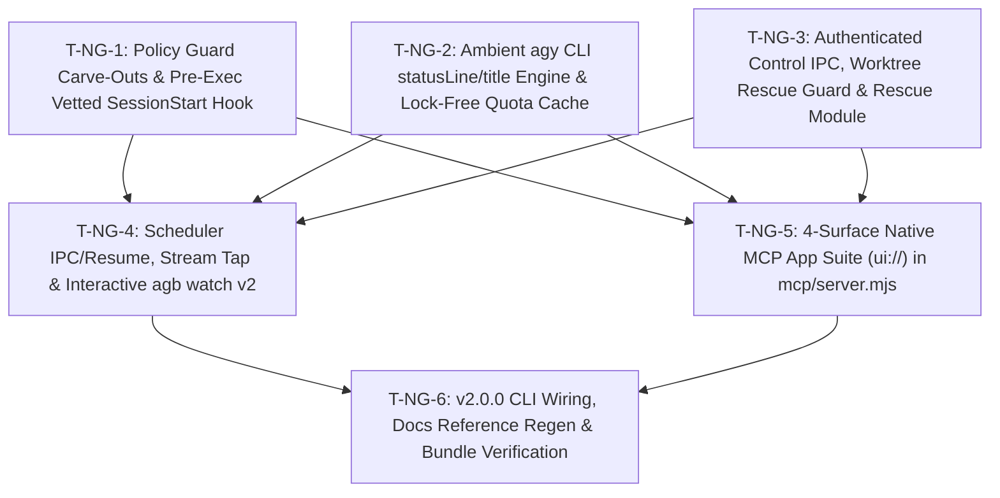

# Feature Specification: Next-Gen Antigravity Cockpit, Interactive Rescue & Native MCP Apps (v2.0)

**Base:** `explore-advancements` \
**Gate:** `{"test": "npm test"}`

--------------------------------------------------------------------------------

## 1. Overview & Objectives

Evolve `antigravity-booster` (`agb` v2.0.0, rebased atop `origin/main` `7090e18` PR `#188` v1.3.0 release-readiness hardening) from an external CLI batch wrapper into a native, bi-modal Antigravity 2.0 (`agy` CLI `1.5.14+` + Antigravity App `v2.34+`) harness accelerator implementing the Top 3 prioritized architecture advancements and Day-0 harness fixes:

1. **Day-0 Harness Alignment & Pre-Exec Vetted `SessionStart` (`T-NG-1`):**
   - Carve out the active session's physical `artifactDirectoryPath` (`<home>/.gemini/{antigravity,antigravity-cli,antigravity-ide,jetski}/brain/<conversationId>/`, excluding `.system_generated/**` and symlinks) in `PreToolUse` strictly for interactive sessions (`!ctx.headless`), keeping headless/readonly workers fail-closed and preserving all `T-RA-1` (`7090e18`) guards (`CODEGRAPH_READ_TOOLS`, `agb_distill` readonly deny, case-folded `newShardVerdict`, headless `schedule`/`send_message`/`swarm` denies, macOS `fnm` `protectedRoots`).
   - Protect `.booster/control.json`, `.booster/control.sock`, `.booster/rescue-locks/**`, and `<tmpdir>/agb-ctrl-*` from all headless/readonly worker reads, writes, and shell invocations, and register `agb_flight_deck`, `agb_mission_control`, `agb_plan_viewer`, and `agb_control` in `BOOSTER_MCP_TOOLS`.
   - Retain `bin/node-launcher.sh` in `mcp_config.json` and register `SessionStart` in `hooks.json` via `/bin/sh bin/node-launcher.sh hooks/session-start.mjs` using detached `--worker` self-locking (ignoring `AGB_HOME_DIR` when bundled, and requiring zero `lib/` or `node_modules/` imports so clean clones work out-of-the-box).
2. **Priority #1 — Ambient `agy` CLI `statusLine` + `title` HUD & Lock-Free Live Quota Cache (`T-NG-2`):**
   - Ship a `<15ms` zero-subprocess ANSI `statusLine` (`stack_with_default: true`) and plain-text terminal `title` engine (`lib/cli-statusline.mjs`) consuming `agy`'s 300ms stdin JSON payload alongside `.adlc/tickets/` and `.booster/run.json` (ignoring `AGB_HOME_DIR` and `AGB_STATUSLINE_QUOTA_FILE` when `typeof __AGB_BUNDLED__ !== 'undefined' && __AGB_BUNDLED__`, matching `T-RA-4A`/`T-RA-5`).
   - Persist complete 4-window `stdin.quota` snapshots (`gemini-{5h,weekly}` + `3p-{5h,weekly}` / `claude-{5h,weekly}` / `claude-gpt-{5h,weekly}`) to a standalone lock-free throttled file (`agb_statusline_quota.json`, `0o600`, throttled to `15s` or `>= 2%` delta). `PoolSet.refreshQuota(bin, { allowStatusCache: true })` hydrates in-memory pool caps in `<1ms` with **zero `getLockFile()` acquisitions** and bypasses the cache whenever `v2.quotaState?.circuitBreakerTripped === true` or `(v2.quotaState?.quotaRefreshFailures ?? 0) > 0`.
3. **Priority #2 — Authenticated Control IPC, All-Runs Protected `agb rescue`, `--resume`, & Interactive `agb watch` v2 (`T-NG-3`, `T-NG-4`):**
   - Build 256-bit token-authenticated control IPC (`lib/control-ipc.mjs`) and pure-FS zero-git-object surgical rescue (`lib/rescue.mjs` + guard in `lib/worktrees.mjs`).
   - `saveRescueSnapshot` captures modified, deleted, and newly created untracked in-scope files via pure `node:fs` (writing zero loose objects to `.git/objects` so `verifyRootGitIntegrity` stays untouched) while stripping all harness customization vectors (`AGENTS.md`, `GEMINI.md`, `CLAUDE.md`, `.agents/**`, `.gemini/**`, `.claude/**`, `.vscode/**`, `.adlc/**`, `.agb_home/**`, `node_modules/**`).
   - Enforce `.booster/rescue-locks/<ticketId>.json` across **both** `createWorktree` (`lib/worktrees.mjs`) AND `runPlan` startup cleanup (`lib/scheduler.mjs` — on *all* runs, preserving `T-RA-3`'s `reconcileIntegrationJournal`-first startup order) so neither `agb run` nor `agb run --resume` can clobber a live or preserved human rescue worktree unless `--reset-rescue` is passed.
   - `runInteractiveRescue` uses two short `acquireRepoLock` critical sections (`assertStillHeld()` before setup and merge; unlocked during interactive `agy -i`), runs the complete `T-RA-2`/`T-RA-3`-aligned P3/P5 oracle (`verifyGateScriptIntegrity` + `verifyScopeAndAntiNoOp` + `discardProjection` before `checkRailsGuard` + `runSymbolScopeVerification` + sandboxed `runGates` + sandboxed `hollow-test` + normalized-severity `prosecute()` + `recordGate` + journaled integration-worktree merge), and preserves `.worktrees/agb-<id>` on failure.
4. **Priority #3 — 4-Surface Native MCP App Suite (`ui://`), Clean-Break `2.0.0` CLI & Generated Docs Parity (`T-NG-5`, `T-NG-6`):**
   - Upgrade `mcp/server.mjs` (preserving `T-RA-4B`'s `concurrency` parameter on `agb_run` and keeping `const TOOLS = [...]` a pure static JS literal for `website/scripts/gen-reference.mjs`) with zero-external-dependency bundled `ui://` HTML resources (`mcp/ui-views.mjs`, `text/html;profile=mcp-app`, default-deny CSP, host CSS tokens, vanilla JSON-RPC 2.0 `postMessage` bridge) across all 4 Antigravity App entrypoints (`inline`, `aux_pane`, `global`, `file`).
   - Wire `statusline`/`rescue`/`--resume`/`--reset-rescue`/clean `sidecar` in `bin/agb.mjs` (keeping `const COMMANDS = {...}` a pure static object literal and preserving single/double-dash `rejectUnknownFlags`), wire non-clobbering statusline setup in `lib/bootstrap.mjs`, register all new `AGB_*` env tokens in `website/env-docs.json`, regenerate `website/generated/**` via `website/scripts/gen-reference.mjs` (`check-all.mjs` green), bump version to `2.0.0`, and rebuild all bundles.

## Resolved Trade-Offs

- **`F-001` Resolved (Owner-Confirmed):** Retain `bin/node-launcher.sh` in `mcp_config.json` and `hooks.json` for pre-exec Node binary vetting while removing `agb sidecar`'s temporary plugin installer in `2.0.0`.
- **`F-002` Resolved:** Protect live and preserved `.worktrees/agb-<id>` rescue worktrees across **all** `runPlan` invocations and `createWorktree` via `.booster/rescue-locks/<ticketId>.json`, cleared only on successful rescue merge or explicit `--reset-rescue`.
- **`F-003` Resolved:** `PoolSet.refreshQuota(..., { allowStatusCache: true })` hydrates in-memory `this.quota` and `this.caps` without calling `withLockSync(getLockFile())`, and falls back to `agyBin` whenever `circuitBreakerTripped === true` or `quotaRefreshFailures > 0`.
- **Docs Generator & Bundled Isolation Parity (`origin/main` `7090e18`):** `const TOOLS` (`mcp/server.mjs`) and `const COMMANDS` (`bin/agb.mjs`) remain static literals parseable by `website/scripts/lib/jslit.mjs`; all new env vars are registered in `website/env-docs.json`; all home/path env overrides honor `typeof __AGB_BUNDLED__ !== 'undefined' && __AGB_BUNDLED__`.

--------------------------------------------------------------------------------

## 2. Architecture & Ticket DAG

--------------------------------------------------------------------------------

## 3. Component Details & Ticket Specifications

### Ticket 1: `T-NG-1` — Policy Guard Carve-Outs & Pre-Exec Vetted `SessionStart` Hook

- **Scope**: `hooks/session-start.mjs`, `hooks/policy/constants.mjs`, `hooks/policy/paths.mjs`, `hooks/policy/evaluate.mjs`, `hooks.json`, `dist/hooks/pre-tool-use.bundle.mjs`, `test/pre-tool-use.test.mjs`, `test/plugin-layout.test.mjs`, `test/session-start-hook.test.mjs`
- **Rails**: `lib/lock.mjs`, `lib/gates.mjs`, `vendor/cache/**`, `scripts/rails-guard-ci.mjs`
- **Edges**: `T-NG-1 -> T-NG-4, T-NG-5`
- **Tier**: `mid`
- **Pool Hint**: `gemini`
- **Objectives**:
  1. In `hooks/policy/constants.mjs`, `hooks/policy/paths.mjs`, and `hooks/policy/evaluate.mjs` (never containing the string `decision: "allow"`, and preserving all `T-RA-1` guards including `CODEGRAPH_READ_TOOLS`, `tool === 'agb_distill'` readonly deny, case-folded `newShardVerdict`, headless `schedule`/`send_message`/`swarm` denies, and `~/Library/Application Support/fnm` in `protectedRoots`):
     - Add `'agb_flight_deck'`, `'agb_mission_control'`, `'agb_plan_viewer'`, and `'agb_control'` to `BOOSTER_MCP_TOOLS` (denying all Booster MCP tools when `ctx.workerTicket` is set, and denying mutating `agb_control` actions `pause`/`resume`/`abort`/`drain` when `ctx.readonly` is set).
     - Deny headless/readonly workers (`ctx.headless`) from reading, writing, or shelling against `<repo>/.booster/control.json`, `<repo>/.booster/control.sock`, `<repo>/.booster/rescue-locks`, `<repo>/.booster/rescue-locks/**`, or `<tmpdir>/agb-ctrl-*` across `stepOne`, `evaluateFileTool`, `scanStdinPaths`, and shell checks.
     - Exempt active Brain Artifact paths ONLY when `!ctx.headless`, `payload.conversationId` matches `/^[A-Za-z0-9_-]{8,128}$/`, and `payload.artifactDirectoryPath` resolves physically with zero symlink components along `<home>/.gemini/{antigravity,antigravity-cli,antigravity-ide,jetski}/brain/<conversationId>`, while strictly denying `.system_generated` and `.system_generated/**`.
  2. Keep `mcp_config.json` unchanged (`bin/node-launcher.sh`), create self-contained `hooks/session-start.mjs` (pure Node built-ins ONLY; zero `lib/` or `node_modules/` imports; using `process.env.PLUGIN_DATA` or `os.homedir()` without introducing undocumented `AGB_*` env vars, except honoring `AGB_SKIP_SESSION_BOOTSTRAP === '1'` in unbundled test runs), and register `"SessionStart": [{ "type": "command", "command": "/bin/sh bin/node-launcher.sh hooks/session-start.mjs", "timeout": 10 }]` inside `"agb-policy-guard"` in `hooks.json`:
     - Normal hook mode (`!process.argv.includes('--worker')`): if stamp `<pluginData>/bootstrapped-<pkg.version>.json` exists, `AGB_SKIP_SESSION_BOOTSTRAP === '1'`, headless worker env (`AGB_WORKER_TICKET` / `AGB_WORKER_MODE`) is set, or `<pluginData>/session-bootstrap.lock` holds a live PID, prints `{}` and exits `0` in `<10ms`. Otherwise spawns detached `process.execPath [selfPath, '--worker', pluginRoot, pluginDataDir, pkgVersion]` (`detached: true, stdio: 'ignore'`, `.unref()`) and prints `{"injectSteps":[{"systemMessage":{"systemMessage":"","metadata":{"user_markdown":"> **AGB:** Running one-time background bootstrap..."}}}]}` with exit `0`.
     - Detached `--worker` mode: acquires `<pluginData>/session-bootstrap.lock` (`wx` with **its own** `process.pid` + `startTime`; exits `0` immediately on `EEXIST` with live holder), runs `execFileSync(process.execPath, [join(pluginRoot, 'dist', 'agb.mjs'), 'bootstrap'], { stdio: 'ignore', timeout: 120_000 })`, writes `<pluginData>/bootstrapped-<pkg.version>.json` atomically (`tmp` + `rename`) ONLY if `bootstrap` exits `0`, and unlinks `session-bootstrap.lock` in `finally`.
  3. Run `npm run build:hooks` to refresh `dist/hooks/pre-tool-use.bundle.mjs`, update `test/plugin-layout.test.mjs` (`hooks.json` assertion) and `test/pre-tool-use.test.mjs`, and add `test/session-start-hook.test.mjs`.
- **Acceptance Criteria**:
  - Interactive writes to matching `<home>/.gemini/antigravity-cli/brain/<convId>/implementation_plan.md` pass while `.system_generated/**`, symlinks, headless workers, and `.booster/control.json` / `.booster/rescue-locks/**` worker accesses are `deny`, and all `T-RA-1` policy tests plus `test/no-allow.test.mjs` + `test/plugin-layout.test.mjs` pass. Verify: `npm run build:hooks && node --test test/pre-tool-use.test.mjs test/no-allow.test.mjs test/plugin-layout.test.mjs`
  - `hooks/session-start.mjs` runs via `bin/node-launcher.sh`, prevents concurrent bootstrap races via detached `--worker` self-locking, writes stamps only on exit `0`, and requires zero `node_modules`. Verify: `node --test test/session-start-hook.test.mjs && npm test`

--------------------------------------------------------------------------------

### Ticket 2: `T-NG-2` — Ambient `agy` CLI `statusLine` + `title` Engine & Lock-Free Live Quota Cache

- **Scope**: `lib/cli-statusline.mjs`, `lib/pools.mjs`, `test/cli-statusline.test.mjs`, `test/pools.test.mjs`
- **Rails**: `lib/lock.mjs`, `lib/gates.mjs`, `vendor/cache/**`, `scripts/rails-guard-ci.mjs`
- **Edges**: `T-NG-2 -> T-NG-4, T-NG-5`
- **Tier**: `mid`
- **Pool Hint**: `claude-gpt`
- **Objectives**:
  1. In `lib/pools.mjs`:
     - Export `getStatusLineQuotaFile()` returning `(!isBundled && process.env.AGB_STATUSLINE_QUOTA_FILE) ? process.env.AGB_STATUSLINE_QUOTA_FILE : join(dirname(getV2StateFile()), 'agb_statusline_quota.json')` (where `isBundled = typeof __AGB_BUNDLED__ !== 'undefined' && __AGB_BUNDLED__ === true`).
     - Export `writeStatusLineQuotaCache(normalizedQuota, { nowMs = Date.now(), minWriteIntervalMs = 15_000 } = {})`: validates all 4 windows (`gemini` + `claude_gpt` 5h and weekly percentages in `[0, 100]` and future RFC3339 UTC `resetTime`), skips writing when existing `agb_statusline_quota.json` is `< minWriteIntervalMs` old AND all 4 percentages changed by `< 2.0`, and writes `agb_statusline_quota.json` atomically (`0o600` temp + rename, rejecting symlinks) with **zero touches to `getLockFile()`**.
     - Export `readFreshStatusLineQuotaCache({ maxAgeMs = 60_000, nowMs = Date.now() } = {})` and update `PoolSet.refreshQuota(agyBin = 'agy', { allowStatusCache = false } = {})`:
       - When `allowStatusCache === true` and `process.env.AGB_IGNORE_STATUS_QUOTA_CACHE !== '1'`, first inspect `readV2State().quotaState` read-only (no lock): if `circuitBreakerTripped === true` or `(quotaRefreshFailures ?? 0) > 0`, **bypass** the statusline cache and run the real `agyBin` probe so a cached statusline file can never clear a tripped circuit breaker.
       - Otherwise, if `readFreshStatusLineQuotaCache()` returns a valid `< maxAgeMs` entry, hydrate in-memory `this.quota` and scaled `this.caps` directly **without calling `withLockSync(getLockFile())`** and return `{ ok: true, quota: this.quota, fromStatusCache: true }`; fall back to spawning `agyBin` when stale, partial, or `allowStatusCache === false`.
  2. Create `lib/cli-statusline.mjs` (`<15ms`, zero child processes; ignoring `AGB_HOME_DIR` when `typeof __AGB_BUNDLED__ !== 'undefined' && __AGB_BUNDLED__`):
     - `parseAgyStatusPayload(rawStdin)` & `extractQuotaFromStatusPayload(payload, nowMs)`: maps `gemini-5h`/`gemini-five-hour`/`gemini_5h`, `gemini-weekly`/`gemini_weekly`, and `3p-5h`/`3p-five-hour`/`claude-5h`/`claude-gpt-5h`/`claude_gpt-5h`, `3p-weekly`/`claude-weekly`/`claude-gpt-weekly`/`claude_gpt-weekly` into `{ display, fullNormalized }`, calling `writeStatusLineQuotaCache` only when all 4 windows are complete and valid.
     - `renderCliStatusLine(payload, { home, now })` & `renderCliWindowTitle(payload)`: renders active ADLC ticket ID, frozen rail count, pool gauges (`G:xx% C:yy%`), context-rot cliff gauge (`exceeds_200k_tokens` / `used_percentage`), and `.booster/run.json` fleet progress (`renderCliWindowTitle` strips all ANSI and control bytes `[\x00-\x1f\x7f]`).
     - `installCliStatusLineSettings({ home, agbCommand, force = false })` & `uninstallCliStatusLineSettings({ home })`: non-clobbering atomic (`0o600`, symlink-safe) management of `<home>/.gemini/antigravity-cli/settings.json` (`stack_with_default: true`).
- **Acceptance Criteria**:
  - `writeStatusLineQuotaCache` and `PoolSet.refreshQuota(bin, { allowStatusCache: true })` never touch `agb_pools_shared.lock`, ignore `AGB_STATUSLINE_QUOTA_FILE`/`AGB_HOME_DIR` when bundled, hydrate in `<1ms` with 0 subprocess spawns when healthy, and bypass the cache when `circuitBreakerTripped` or `quotaRefreshFailures > 0`. Verify: `node --test test/cli-statusline.test.mjs test/pools.test.mjs`
  - `renderCliStatusLine`, `renderCliWindowTitle`, `3p-*`/`claude-*` bucket parsing, and non-clobbering `installCliStatusLineSettings`/`uninstallCliStatusLineSettings` pass all unit tests. Verify: `node --test test/cli-statusline.test.mjs && npm test`

--------------------------------------------------------------------------------

### Ticket 3: `T-NG-3` — Authenticated Control IPC (`lib/control-ipc.mjs`), All-Runs Worktree Guard & Pure-FS Rescue (`lib/rescue.mjs`)

- **Scope**: `lib/control-ipc.mjs`, `lib/rescue.mjs`, `lib/worktrees.mjs`, `test/control-ipc.test.mjs`
- **Rails**: `lib/lock.mjs`, `lib/gates.mjs`, `vendor/cache/**`, `scripts/rails-guard-ci.mjs`
- **Edges**: `T-NG-3 -> T-NG-4, T-NG-5`
- **Tier**: `mid`
- **Pool Hint**: `gemini`
- **Objectives**:
  1. Create `lib/control-ipc.mjs`:
     - `resolveControlEndpoint(repo)` (`win32` named pipe `\\\\.\\pipe\\agb-control-${hash}`; POSIX `<repo>/.booster/control.sock` if `<= 96` bytes else `<tmpdir>/agb-ctrl-${uid}-${hash}.sock`).
     - `startControlServer(repo, handlers, { runId })`: mints 256-bit `token`, binds `0o600` socket, writes `{ endpoint, token, pid: process.pid, startTime, runId }` to `<repo>/.booster/control.json` (`0o600`, `O_NOFOLLOW`, rejecting symlinked `.booster`), enforces `timingSafeEqual` token auth and 64 KiB line cap on `ping`/`status`/`pause`/`resume`/`abort`/`diff`/`stream`, and unlinks socket + `control.json` on `close()`.
     - `sendControlCommand(repo, command, { timeoutMs = 3000 })`: verifies live PID in `control.json` (`isProcessAlive`), attaches `token`, and exchanges one NDJSON command (`{ ok: false, offline: true }` when inactive).
  2. In `lib/worktrees.mjs` and `lib/rescue.mjs`:
     - Manage `<repo>/.booster/rescue-locks/<ticketId>.json` (`0o600`, symlink-checked): written when `runInteractiveRescue` enters Phase A (`state: "active"`) or preserves a worktree on failure (`state: "preserved"`), and removed ONLY when rescue merge succeeds or `clearRescueWorktreeLock(repo, ticketId)` is called under `--reset-rescue`.
     - Export `hasProtectedRescueWorktree(repo, ticketId)` and enforce it inside `createWorktree(repo, ticketId, base, { allowResetRescue = false } = {})` in `lib/worktrees.mjs`: if `hasProtectedRescueWorktree(repo, ticketId)` is true and `allowResetRescue !== true`, throw `Error("Refusing to clobber active or preserved rescue worktree for ticket ...")` BEFORE running `git worktree remove` or `git branch -D`!
     - `FORBIDDEN_RESCUE_CUSTOMIZATION_PREFIXES` (`AGENTS.md`, `GEMINI.md`, `CLAUDE.md`, `.agents`, `.agent`, `_agents`, `_agent`, `.gemini`, `.claude`, `.cursor`, `.vscode`, `.git`, `.adlc`, `.agb_home`, `node_modules`): `saveRescueSnapshot` walks `worktreePath` using **pure `node:fs` only** (writing **zero** loose objects into `.git/objects`), recording base64 contents + mode of modified/untracked in-scope files (`<= 2 MiB` each, `<= 10 MiB` total, skipping symlinks and forbidden prefixes) plus deleted baseline paths in `<repo>/.booster/logs/<safeRunId>/rescue/<ticketId>.json` (`0o600`) and a plain diff preview string (`<= 64 KiB`).
     - `runInteractiveRescue(repo, ticketId, options)` using **Two-Phase Repo Locking**:
       1. **Phase A (Short Setup Lock):** Acquire `const lockA = acquireRepoLock(repo)`, call `lockA.assertStillHeld()`, write `.booster/rescue-locks/<ticketId>.json` (`state: "active"`), create `.worktrees/agb-<id>` from `baseBranch` if not already preserved (`{ allowResetRescue: true }` only on fresh creation), restore `saveRescueSnapshot` files after re-verifying `matchesScope`, `!matchDeclaredRail`, and `!isForbiddenRescuePath`, materialize `node_modules`, and **call `lockA()` immediately before spawning `agy -i`**.
       2. **Interactive Phase (Unlocked):** Spawn clean host `agy -i "<Structured Rescue Brief>"` inside `.worktrees/agb-<id>`.
       3. **Phase B (Short Verify & Merge Lock):** If `agy` exits `0`, acquire `const lockB = acquireRepoLock(repo)` (releasing in `finally`), call `lockB.assertStillHeld()`, create disposable integration worktree (`createIntegrationWorktree`) rebased onto current `baseBranch` `HEAD`, and run the complete `T-RA-2`/`T-RA-3`-aligned P3/P5 oracle (all injectable for offline tests): `verifyGateScriptIntegrity` -> `verifyScopeAndAntiNoOp` + `!isForbiddenRescuePath` -> `discardProjection` -> `runSymbolScopeVerification` -> `checkRailsGuard` -> sandboxed `runGates` -> sandboxed `runHollowTest` (when changed files touch `lib/` and `hollowTest !== false`) -> normalized-severity `prosecute()` (`blockingFindings` empty) -> `recordGate` -> `lockB.assertStillHeld()` -> `writeIntegrationJournal` ref advance -> remove `.worktrees/agb-<id>` + unlink `.booster/rescue-locks/<ticketId>.json`!
       4. **Non-destructive failure recovery:** On non-zero exit, lock contention, or any P3/P5 failure, **preserve `.worktrees/agb-<id>`**, update `.booster/rescue-locks/<ticketId>.json` (`state: "preserved"`) + `rescue/<ticketId>.json`, and return `{ ok: false, merged: false, preservedWorktree: worktreePath, error }`.
- **Acceptance Criteria**:
  - `control-ipc` enforces 256-bit `timingSafeEqual` token auth, handles `>96`-byte `tmpdir` socket fallback, and cleans up on `close()`. Verify: `node --test test/control-ipc.test.mjs`
  - `createWorktree` refuses to clobber `.worktrees/agb-<id>` when `.booster/rescue-locks/<id>.json` exists unless `allowResetRescue: true`; `saveRescueSnapshot` writes zero `.git/objects` and strips `.agents`/`.gemini`/`GEMINI.md`; `runInteractiveRescue` uses two-phase `acquireRepoLock` + `assertStillHeld()`, runs `discardProjection` before `checkRailsGuard` + full P3/P5 gates, and preserves `.worktrees/agb-<id>` on failure. Verify: `node --test test/control-ipc.test.mjs && npm test`

--------------------------------------------------------------------------------

### Ticket 4: `T-NG-4` — Scheduler IPC/Resume Wiring, `agy.mjs` Stream Tap & Interactive `agb watch` v2 Cockpit

- **Scope**: `lib/agy.mjs`, `lib/scheduler.mjs`, `lib/status.mjs`, `lib/tui.mjs`, `test/watch-v2-rescue.test.mjs`, `test/tui-hud.test.mjs`
- **Rails**: `lib/lock.mjs`, `lib/gates.mjs`, `vendor/cache/**`, `scripts/rails-guard-ci.mjs`
- **Edges**: `Depends on T-NG-1, T-NG-2, T-NG-3`; `T-NG-4 -> T-NG-6`
- **Tier**: `frontier`
- **Pool Hint**: `claude-gpt`
- **Objectives**:
  1. In `lib/agy.mjs` (`runAgy`): accept optional `onStep` callback and invoke it on parsed `step_update` events in `stream-json` mode (preserving all `T-RA-4A` bundled `AGB_HOME_DIR` and `win32` `Path`/`USERPROFILE` guards).
  2. In `lib/scheduler.mjs` (`runPlan(plan, options)`), preserving all `T-RA-3` startup ordering (`reconcileIntegrationJournal` before `ensureGitignore`) and root integrity checks:
     - On **every** `runPlan` invocation (both normal `agb run` and `options.resume === true`), check `hasProtectedRescueWorktree(repo, t.id)` for every ticket **before** startup worktree/branch cleanup: if any ticket has an active or preserved rescue lock and `options.resetRescue !== true`, throw `"Refusing to clobber active or preserved rescue worktree .worktrees/agb-<id>; complete 'agb rescue <id>' or pass '--reset-rescue' first"`; when `options.resetRescue === true`, call `clearRescueWorktreeLock(repo, t.id)` before cleanup.
     - When `options.resume === true`, verify already-merged tickets from `.booster/run.json` / `.booster/report.json` against git ancestry on `base` (or `.adlc/manifest.jsonl`), pre-populating `merged` and skipping startup cleanup for merged tickets so only the unmerged subgraph runs.
     - Track per-ticket live worker handles + 40-line `streamBuffer` (fed via `onStep`), start `startControlServer(repo, handlers, { runId })` (`pause`, `resume`, `abort`, `diff`, `stream`, `status`), and call `saveRescueSnapshot(...)` before cleaning up failed attempt worktrees (`verifyRootGitIntegrity` remains 100% green).
  3. In `lib/tui.mjs` and `lib/status.mjs` (`watchStatus`, preserving `T-RA-4A` `.booster` symlink check in `RunStatus`):
     - Add multi-pane Flight Deck rendering (`selectedTicketId`, `activeTab`: `'activity' | 'stream' | 'diff' | 'prosecutor'`, `filterText`, `controlNotice`) while keeping `renderTUIDashboard` 100% compatible with existing callers.
     - Wire TTY keys: `j`/`↓`, `k`/`↑`, `1`–`4`/`Tab`, `p` (scheduler pause/resume IPC), `x` (abort ticket IPC), `/` (filter), and `Enter` on a failed ticket (queuing `queuedRescueTicketId` with inline notice while `!state.done`, and launching `onRescue` as soon as `state.done === true`).
- **Acceptance Criteria**:
  - Both normal `runPlan(plan)` and `runPlan(plan, { resume: true })` refuse to clobber a protected `.worktrees/agb-<id>` rescue worktree unless `resetRescue: true`; `resume: true` skips verified merged upstream tickets; failed runs save rescue snapshots while passing `verifyRootGitIntegrity`. Verify: `node --test test/watch-v2-rescue.test.mjs test/scheduler-integrity.test.mjs`
  - Live IPC (`pause`, `resume`, `abort`, `diff`, `stream`) and `watchStatus` (`j`/`k`, `1`–`4`, `p`, `x`, queued/immediate `Enter` rescue) pass all unit/integration tests alongside `test/tui-hud.test.mjs` and `test/status.test.mjs`. Verify: `node --test test/tui-hud.test.mjs test/status.test.mjs test/watch-v2-rescue.test.mjs && npm test`

--------------------------------------------------------------------------------

### Ticket 5: `T-NG-5` — 4-Surface Native MCP App Suite (`ui://`) in `mcp/server.mjs`

- **Scope**: `mcp/server.mjs`, `mcp/ui-views.mjs`, `dist/mcp-server.mjs`, `test/mcp-apps.test.mjs`
- **Rails**: `lib/lock.mjs`, `lib/gates.mjs`, `vendor/cache/**`, `scripts/rails-guard-ci.mjs`
- **Edges**: `Depends on T-NG-1, T-NG-2, T-NG-3`; `T-NG-5 -> T-NG-6`
- **Tier**: `frontier`
- **Pool Hint**: `gemini`
- **Objectives**:
  1. Create `mcp/ui-views.mjs` exporting zero-dependency single-file HTML builders (strict HTML escaping, zero external scripts, `var(--agy-*)` theme tokens with dark/light fallbacks, inline SVG DAGs, vanilla JSON-RPC 2.0 `postMessage` bridge with `ui/initialize`, `<50ms` `ResizeObserver` `ui/notifications/size-changed`, `<= 4` concurrent `tools/call` semaphore, `ui/message`, `ui/update-model-context`, `com.google.antigravity/toggle-aux-pane`, `resources/read`, and `com.google.antigravity/resources/write`) for `ui://agb/plan-card.html`, `ui://agb/review-card.html`, `ui://agb/flight-deck.html`, `ui://agb/mission-control.html`, and `ui://agb/plan-viewer.html`.
  2. Upgrade `mcp/server.mjs` (keeping `const TOOLS = [...]` a **pure static array literal** with no spreads or identifier references so `website/scripts/gen-reference.mjs`'s `jslit.mjs` parser succeeds, and preserving `T-RA-4B`'s `concurrency` parameter on `agb_run` while adding optional `resume` and `resetRescue` booleans):
     - Advertise `capabilities: { tools: {}, resources: {} }` (and `io.modelcontextprotocol/ui` extension support when client advertises it), serve `resources/list` and `resources/read` (`mimeType: "text/html;profile=mcp-app"`, `_meta: { ui: { csp: { resourceDomains: [], connectDomains: [] } } }`), attach `_meta.ui.resourceUri` to `agb_shape`, `agb_plan`, `agb_preflight`, and `agb_review`, and expose `agb_flight_deck` (`aux_pane`), `agb_mission_control` (`global`), `agb_plan_viewer` (`file`, `extensions: [".agbplan"]`), and `agb_control` (in-process handler querying `sendControlCommand`, `.booster/run.json`, `readFreshStatusLineQuotaCache`, and `model_stats.jsonl`), always returning clear plain-text `content` + bounded `structuredContent` (`< 512 KiB`).
  3. Run `npm run build:mcp && node scripts/check-bundle-externals.mjs dist/mcp-server.mjs` and add thorough tests in `test/mcp-apps.test.mjs`.
- **Acceptance Criteria**:
  - `mcp/server.mjs` and `dist/mcp-server.mjs` preserve `agb_run` `concurrency` (`-c <n>`), keep `const TOOLS` parseable by `website/scripts/gen-reference.mjs --only modules`, and pass full JSON-RPC tests for `initialize`, `tools/list`, `resources/list`, `resources/read`, and `tools/call` across all 4 MCP App surfaces (`inline`, `aux_pane`, `global`, `file`) and `agb_control` with default-deny CSP and XSS escaping. Verify: `npm run build:mcp && node --test test/mcp-apps.test.mjs`
  - `dist/mcp-server.mjs` has zero external dependencies and passes `test/asset-paths.test.mjs` and `test/commands.test.mjs`. Verify: `node scripts/check-bundle-externals.mjs dist/mcp-server.mjs && node --test test/asset-paths.test.mjs test/commands.test.mjs && npm test`

--------------------------------------------------------------------------------

### Ticket 6: `T-NG-6` — v2.0.0 CLI Wiring (`statusline`, `rescue`, `--resume`, Clean `sidecar`), Docs Reference Regen & Bundle Verification

- **Scope**: `bin/agb.mjs`, `lib/bootstrap.mjs`, `package.json`, `plugin.json`, `website/env-docs.json`, `website/scripts/gen-reference.mjs`, `website/generated/**`, `dist/**`, `vendor/adlc/dist/**`, `test/sidecar.test.mjs`, `test/audit-cli-and-doctor.test.mjs`, `test/cli-nextgen.test.mjs`
- **Rails**: `lib/lock.mjs`, `lib/gates.mjs`, `vendor/cache/**`, `scripts/rails-guard-ci.mjs`
- **Edges**: `Depends on T-NG-4, T-NG-5`
- **Tier**: `mid`
- **Pool Hint**: `gemini`
- **Objectives**:
  1. Bump `version` to `"2.0.0"` in `package.json` and `plugin.json`.
  2. In `lib/bootstrap.mjs`, invoke `installCliStatusLineSettings({ home, force: false })` safely after installing `~/.local/bin/agb` (degrading with a warning on malformed `settings.json` and never overwriting existing user commands).
  3. In `bin/agb.mjs` (keeping `const COMMANDS = {...}` a **pure static object literal** for `website/scripts/gen-reference.mjs` and preserving `T-RA-4B`'s single/double-dash `rejectUnknownFlags`):
     - Pass `{ allowStatusCache: !process.env.AGB_AGY_BIN }` to `pools.refreshQuota(...)` in CLI commands (`review`, `preflight`, `plan`, `import-brain`).
     - Add `statusline` (`agb statusline [render|title|install|uninstall] [--force]`), `rescue` (`agb rescue <ticket-id> [repo] [--continue] [--plan <plan.json>]`), and `--resume` / `--reset-rescue` on `agb run` (`agb run <plan.json> [-c <n>] [--resume] [--reset-rescue]`), all registered in `COMMANDS` (`--help` exits `0` with zero `$HOME` side-effects) and guarded by `rejectUnknownFlags`.
     - Delete all `agb-sidecar-plugin-*` temporary plugin manifest creation and `agy plugin install`/`uninstall` calls from `agb sidecar`, keeping `agb sidecar [repo] [--port <port>]` as a clean localhost HTTP server (`serveSidecar`).
  4. Update `website/env-docs.json` to document all new `AGB_*` tokens (`AGB_SKIP_SESSION_BOOTSTRAP`, `AGB_STATUSLINE_QUOTA_FILE`, `AGB_IGNORE_STATUS_QUOTA_CACHE`), update `genLayout` in `website/scripts/gen-reference.mjs` so flat `SessionStart` hook entries (`e.command`) render in `plugin-layout.mdx` alongside grouped `PreToolUse` entries (`e.hooks`), run `node website/scripts/gen-reference.mjs` to regenerate `website/generated/**`, update `test/sidecar.test.mjs` and `test/audit-cli-and-doctor.test.mjs`, add end-to-end tests in `test/cli-nextgen.test.mjs`, and run full `npm run build` (`dist/**` + `vendor/adlc/dist/**`).
- **Acceptance Criteria**:
  - `agb --version` reports `2.0.0`, every `agb <subcommand> --help` exits `0` cleanly (`test/clean-clone.test.mjs`), `bootstrap()` safely wires non-clobbering `statusLine` + `title`, and unknown `-*`/`--*` flags exit `1` across all subcommands. Verify: `npm run build && node --test test/clean-clone.test.mjs test/audit-cli-and-doctor.test.mjs test/cli-nextgen.test.mjs`
  - `agb sidecar` serves localhost with zero `~/.gemini/agb-sidecar-plugin-*` side-effects, and `agb rescue` + `agb run --resume` (`--reset-rescue`) pass end-to-end tests. Verify: `node --test test/sidecar.test.mjs test/cli-nextgen.test.mjs`
  - `node website/scripts/gen-reference.mjs --check` and `node website/scripts/check-all.mjs` exit `0`, `npm run plugin:validate` passes (`0` errors, `0` warnings), and full `npm test` passes 100%. Verify: `npm run build && node website/scripts/check-all.mjs && npm run plugin:validate && npm test`
