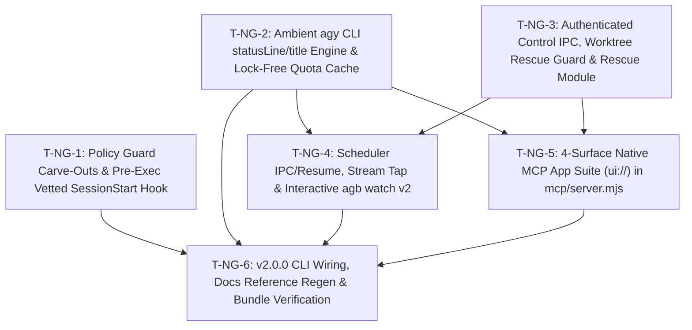

# Feature Specification: Next-Gen Antigravity Cockpit, Interactive Rescue & Native MCP Apps (v2.0)

**Base:** `explore-advancements` \
**Gate:** `{"test": "npm test"}`

--------------------------------------------------------------------------------

## 1. Overview & Objectives

Evolve `antigravity-booster` (`agb` v2.0.0, rebased atop `origin/main` `7090e18` PR `#188` v1.3.0 release-readiness hardening) from an external CLI batch wrapper into a native, bi-modal Antigravity 2.0 (`agy` CLI `1.5.14+` + Antigravity App `v2.34+`) harness accelerator implementing the Top 3 prioritized architecture advancements and Day-0 harness fixes:

1. **Day-0 Harness Alignment & Pre-Exec Vetted `SessionStart` (`T-NG-1`):**
   - Carve out the active session's physical `artifactDirectoryPath` (`<home>/.gemini/{antigravity,antigravity-cli,antigravity-ide,jetski}/brain/<conversationId>/`, excluding `.system_generated/**` and symlinks) in `PreToolUse` strictly for interactive sessions (`!ctx.headless`), keeping headless/readonly workers fail-closed and preserving all `T-RA-1` (`7090e18`) guards (`CODEGRAPH_READ_TOOLS`, `agb_distill` readonly deny, case-folded `newShardVerdict`, headless `schedule`/`send_message`/`swarm` denies, macOS `fnm` `protectedRoots`).
   - Protect `.booster/control.json`, `.booster/control.sock`, `.booster/rescue-locks/**`, `.booster/rescue-latest/**`, and `<tmpdir>/agb-ctrl-*` from all headless/readonly worker reads, writes, and shell invocations, and register `agb_flight_deck`, `agb_mission_control`, `agb_plan_viewer`, and `agb_control` in `BOOSTER_MCP_TOOLS`.
   - Retain `bin/node-launcher.sh` in `mcp_config.json` and register `SessionStart` in `hooks.json` via `/bin/sh bin/node-launcher.sh hooks/session-start.mjs` using detached `--worker` self-locking (ignoring `AGB_HOME_DIR` when bundled, and requiring zero `lib/` or `node_modules/` imports so clean clones work out-of-the-box).
2. **Priority #1 — Ambient `agy` CLI `statusLine` + `title` HUD & Lock-Free Live Quota Cache (`T-NG-2`):**
   - Ship a `<15ms` zero-subprocess synchronous ANSI `statusLine` (`stack_with_default: true`) and plain-text terminal `title` engine (`lib/cli-statusline.mjs`) consuming `agy`'s 300ms stdin JSON payload alongside `.adlc/tickets/` and `.booster/run.json` (ignoring `AGB_HOME_DIR` and `AGB_STATUSLINE_QUOTA_FILE` when `typeof __AGB_BUNDLED__ !== 'undefined' && __AGB_BUNDLED__`, matching `T-RA-4A`/`T-RA-5`).
   - Persist complete 4-window `stdin.quota` snapshots (`gemini-{5h,weekly}` + `3p-{5h,weekly}` / `claude-{5h,weekly}` / `claude-gpt-{5h,weekly}`) to a standalone lock-free throttled file (`agb_statusline_quota.json`, `0o600`, throttled to `15s` or `>= 2%` delta). `PoolSet.refreshQuota(bin, { allowStatusCache: true })` hydrates in-memory pool caps in `<1ms` with **zero `getLockFile()` acquisitions** and bypasses the cache whenever `v2.quotaState?.circuitBreakerTripped === true` or `(v2.quotaState?.quotaRefreshFailures ?? 0) > 0`.
3. **Priority #2 — Authenticated Control IPC, All-Runs Protected `agb rescue`, `--resume`, & Interactive `agb watch` v2 (`T-NG-3`, `T-NG-4`):**
   - Build 256-bit token-authenticated control IPC (`lib/control-ipc.mjs`) and pure-FS zero-git-object surgical rescue (`lib/rescue.mjs` + rescue lock helpers in `lib/worktrees.mjs`).
   - `saveRescueSnapshot` captures modified, deleted, and newly created untracked in-scope files via pure `node:fs` byte comparison against `baselineRoot` (writing zero loose objects to `.git/objects` so `verifyRootGitIntegrity` stays untouched) while stripping all harness customization vectors (`AGENTS.md`, `GEMINI.md`, `CLAUDE.md`, `.agents/**`, `.gemini/**`, `.claude/**`, `.vscode/**`, `.adlc/**`, `.agb_home/**`, `node_modules/**`).
   - Enforce `.booster/rescue-locks/<ticketId>.json` across **both** `createWorktree` (`lib/worktrees.mjs`) AND `runPlan` startup cleanup (`lib/scheduler.mjs` — on *all* runs, preserving `T-RA-3`'s `reconcileIntegrationJournal`-first startup order) so neither `agb run` nor `agb run --resume` can clobber a live or preserved human rescue worktree unless `--reset-rescue` is passed.
   - `runInteractiveRescue` uses two short `acquireRepoLock` critical sections (`assertStillHeld()` before setup and merge; unlocked during interactive `agy -i`), runs the complete `T-RA-2`/`T-RA-3`-aligned P3/P5 oracle, and preserves `.worktrees/agb-<id>` on failure.
4. **Priority #3 — 4-Surface Native MCP App Suite (`ui://`), Clean-Break `2.0.0` CLI & Generated Docs Parity (`T-NG-5`, `T-NG-6`):**
   - Upgrade `mcp/server.mjs` (preserving `T-RA-4B`'s `concurrency` parameter on `agb_run` and keeping `const TOOLS = [...]` a pure static JS literal for `website/scripts/gen-reference.mjs`) with zero-external-dependency bundled `ui://` HTML resources (`mcp/ui-views.mjs`, `text/html;profile=mcp-app`, default-deny CSP, host CSS tokens, vanilla JSON-RPC 2.0 `postMessage` bridge) across all 4 Antigravity App entrypoints (`inline`, `aux_pane`, `global`, `file`).
   - Wire `statusline`/`rescue`/`--resume`/`--reset-rescue`/clean `sidecar` in `bin/agb.mjs` (keeping `const COMMANDS = {...}` a pure static object literal and preserving single/double-dash `rejectUnknownFlags`), wire non-clobbering statusline setup in `lib/bootstrap.mjs`, register all new `AGB_*` env tokens in `website/env-docs.json`, regenerate `website/generated/**` via `website/scripts/gen-reference.mjs` (`check-all.mjs` green), bump version to `2.0.0`, and rebuild all bundles.

## Resolved Trade-Offs

- **`F-001` Resolved (Owner-Confirmed):** Retain `bin/node-launcher.sh` in `mcp_config.json` and `hooks.json` for pre-exec Node binary vetting while removing `agb sidecar`'s temporary plugin installer in `2.0.0`.
- **`F-002` Resolved:** Protect live and preserved `.worktrees/agb-<id>` rescue worktrees across **all** `runPlan` invocations and `createWorktree` via `.booster/rescue-locks/<ticketId>.json`, cleared only on successful rescue merge or explicit `--reset-rescue`.
- **`F-003` Resolved:** `PoolSet.refreshQuota(..., { allowStatusCache: true })` hydrates in-memory `this.quota` and `this.caps` without calling `withLockSync(getLockFile())`, and falls back to `agyBin` whenever `circuitBreakerTripped === true` or `quotaRefreshFailures > 0`.
- **Docs Generator & Bundled Isolation Parity (`origin/main` `7090e18`):** `const TOOLS` (`mcp/server.mjs`) and `const COMMANDS` (`bin/agb.mjs`) remain static literals parseable by `website/scripts/lib/jslit.mjs`; all new env vars are registered in `website/env-docs.json`; all home/path env overrides honor `typeof __AGB_BUNDLED__ !== 'undefined' && __AGB_BUNDLED__`.

--------------------------------------------------------------------------------

## 2. Architecture & Ticket DAG

--------------------------------------------------------------------------------

## 3. Component Details & Ticket Specifications

### Ticket 1: `T-NG-1` — Policy Guard Carve-Outs & Pre-Exec Vetted `SessionStart` Hook

- **Scope**: `hooks/session-start.mjs`, `hooks/policy/constants.mjs`, `hooks/policy/paths.mjs`, `hooks/policy/evaluate.mjs`, `hooks.json`, `dist/hooks/pre-tool-use.bundle.mjs`, `test/pre-tool-use.test.mjs`, `test/plugin-layout.test.mjs`, `test/session-start-hook.test.mjs`
- **Rails**: `lib/lock.mjs`, `lib/gates.mjs`, `vendor/cache/**`, `scripts/rails-guard-ci.mjs`
- **Edges**: `T-NG-1 -> T-NG-6`
- **Tier**: `mid`
- **Pool Hint**: `gemini`
- **Objectives**:
  1. In `hooks/policy/constants.mjs`, `hooks/policy/paths.mjs`, and `hooks/policy/evaluate.mjs` (never containing the string `decision: "allow"`, and preserving all `T-RA-1` guards including `CODEGRAPH_READ_TOOLS`, `tool === 'agb_distill'` readonly deny, case-folded `newShardVerdict`, headless `schedule`/`send_message`/`swarm` denies, and `~/Library/Application Support/fnm` in `protectedRoots`):
     - Add `'agb_flight_deck'`, `'agb_mission_control'`, `'agb_plan_viewer'`, and `'agb_control'` to `BOOSTER_MCP_TOOLS` (denying all Booster MCP tools when `ctx.workerTicket` is set, and denying mutating `agb_control` actions `pause`/`resume`/`abort` when `ctx.readonly` is set while passing `action === 'snapshot'`, `'diff'`, `'stream'`).
     - Deny headless/readonly workers (`ctx.headless`) from reading, writing, or shelling against `<repo>/.booster/control.json`, `<repo>/.booster/control.sock`, `<repo>/.booster/rescue-locks`, `<repo>/.booster/rescue-locks/**`, `<repo>/.booster/rescue-latest`, `<repo>/.booster/rescue-latest/**`, or `<tmpdir>/agb-ctrl-*` across `stepOne`, `evaluateFileTool`, `scanStdinPaths`, and shell checks.
     - Exempt active Brain Artifact paths ONLY when `!ctx.headless`, `payload.conversationId` matches `/^[A-Za-z0-9_-]{8,128}$/`, and `payload.artifactDirectoryPath` resolves physically with zero symlink components along `<home>/.gemini/{antigravity,antigravity-cli,antigravity-ide,jetski}/brain/<conversationId>`, while strictly denying `.system_generated` and `.system_generated/**`.
  2. Keep `mcp_config.json` unchanged (`bin/node-launcher.sh`), create self-contained `hooks/session-start.mjs` (pure Node built-ins ONLY; zero `lib/` or `node_modules/` imports; using `process.env.PLUGIN_DATA` or `join(os.homedir(), '.gemini', 'antigravity-cli', 'plugin_data', 'antigravity-booster')` without introducing undocumented `AGB_*` env vars, except honoring `AGB_SKIP_SESSION_BOOTSTRAP === '1'` in unbundled test runs), and register `"SessionStart": [{ "type": "command", "command": "/bin/sh bin/node-launcher.sh hooks/session-start.mjs", "timeout": 10 }]` inside `"agb-policy-guard"` in `hooks.json`:
     - Normal hook mode (`!process.argv.includes('--worker')`): if stamp `<pluginData>/bootstrapped-<pkg.version>.json` exists, `AGB_SKIP_SESSION_BOOTSTRAP === '1'`, headless worker env (`AGB_WORKER_TICKET` / `AGB_WORKER_MODE`) is set, or `<pluginData>/session-bootstrap.lock` holds a live PID, prints `{}` and exits `0` in `<10ms`. Otherwise spawns detached `process.execPath [selfPath, '--worker', pluginRoot, pluginDataDir, pkgVersion]` (`detached: true, stdio: 'ignore'`, `.unref()`) and prints `{"injectSteps":[{"systemMessage":{"systemMessage":"","metadata":{"user_markdown":"> **AGB:** Running one-time background bootstrap..."}}}]}` with exit `0`.
     - Detached `--worker` mode: acquires `<pluginData>/session-bootstrap.lock` (`wx` with **its own** `process.pid` + `startTime`; exits `0` immediately on `EEXIST` with live holder), runs `execFileSync(process.execPath, [join(pluginRoot, 'dist', 'agb.mjs'), 'bootstrap'], { stdio: 'ignore', timeout: 120_000 })`, writes `<pluginData>/bootstrapped-<pkg.version>.json` atomically (`tmp` + `rename`) ONLY if `bootstrap` exits `0`, and unlinks `session-bootstrap.lock` in `finally`.
  3. Run `npm run build:hooks` to refresh `dist/hooks/pre-tool-use.bundle.mjs`, update `test/plugin-layout.test.mjs` (`hooks.json` assertion) and `test/pre-tool-use.test.mjs`, and add `test/session-start-hook.test.mjs`.
  4. **Downstream Contract (`T-NG-1 -> T-NG-6`):** `hooks.json` exposes `hooks['agb-policy-guard'].PreToolUse` (grouped `{ matcher, hooks: [...] }` entries) and `hooks['agb-policy-guard'].SessionStart` (`[{ type: 'command', command: '/bin/sh bin/node-launcher.sh hooks/session-start.mjs', timeout: 10 }]`); `hooks/session-start.mjs` references only `AGB_SKIP_SESSION_BOOTSTRAP`, `AGB_WORKER_TICKET`, `AGB_WORKER_MODE`, and `PLUGIN_ROOT`.
- **Acceptance Criteria**:
  - Interactive writes to matching `<home>/.gemini/antigravity-cli/brain/<convId>/implementation_plan.md` pass while `.system_generated/**`, symlinks, headless workers, and `.booster/control.json` / `.booster/rescue-locks/**` worker accesses are `deny`, and all `T-RA-1` policy tests plus `test/no-allow.test.mjs` + `test/plugin-layout.test.mjs` pass. Verify: `npm run build:hooks && node --test test/pre-tool-use.test.mjs test/no-allow.test.mjs test/plugin-layout.test.mjs`
  - `hooks/session-start.mjs` runs via `bin/node-launcher.sh`, prevents concurrent bootstrap races via detached `--worker` self-locking, writes stamps only on exit `0`, and requires zero `node_modules`. Verify: `node --test test/session-start-hook.test.mjs && npm test`

--------------------------------------------------------------------------------

### Ticket 2: `T-NG-2` — Ambient `agy` CLI `statusLine` + `title` Engine & Lock-Free Live Quota Cache

- **Scope**: `lib/cli-statusline.mjs`, `lib/pools.mjs`, `test/cli-statusline.test.mjs`, `test/pools.test.mjs`
- **Rails**: `lib/lock.mjs`, `lib/gates.mjs`, `vendor/cache/**`, `scripts/rails-guard-ci.mjs`
- **Edges**: `T-NG-2 -> T-NG-4, T-NG-5, T-NG-6`
- **Tier**: `mid`
- **Pool Hint**: `claude-gpt`
- **Objectives**:
  1. In `lib/pools.mjs`, export exact synchronous cache functions and update `PoolSet.refreshQuota`:
     - `export function getStatusLineQuotaFile()`: returns `(!isBundled && process.env.AGB_STATUSLINE_QUOTA_FILE) ? process.env.AGB_STATUSLINE_QUOTA_FILE : join(dirname(getV2StateFile()), 'agb_statusline_quota.json')`, where `isBundled = typeof __AGB_BUNDLED__ !== 'undefined' && __AGB_BUNDLED__ === true`.
     - `export function writeStatusLineQuotaCache(normalizedQuota, { nowMs = Date.now(), minWriteIntervalMs = 15_000 } = {}): boolean` (synchronous): validates `normalizedQuota` matches `{ gemini: { fiveHourRemainingPercent, fiveHourResetTime, weeklyRemainingPercent, weeklyResetTime }, claude_gpt: { fiveHourRemainingPercent, fiveHourResetTime, weeklyRemainingPercent, weeklyResetTime } }` with all 4 percentages finite in `[0, 100]` and all 4 reset times matching `RFC3339_UTC_RE` with `Date.parse(rt) >= nowMs - 10_000` (returning `false` if invalid). Reads existing `getStatusLineQuotaFile()` if present: returns `false` when `nowMs - existing.updatedAt < minWriteIntervalMs` AND all 4 percentages changed by `< 2.0`. Otherwise writes `JSON.stringify({ updatedAt: nowMs, quota: { gemini: normalizedQuota.gemini, claude_gpt: normalizedQuota.claude_gpt, 'claude-gpt': normalizedQuota.claude_gpt } })` atomically (`0o600` temp + rename, rejecting symlinks, **zero touches to `getLockFile()`**) and returns `true`.
     - `export function readFreshStatusLineQuotaCache({ maxAgeMs = 60_000, nowMs = Date.now() } = {}): { updatedAt: number, quota: object } | null` (synchronous): reads `getStatusLineQuotaFile()` (rejecting symlinks), validates `nowMs - data.updatedAt <= maxAgeMs` and all 4 quota windows, and returns `{ updatedAt: data.updatedAt, quota: data.quota }` or `null`.
     - `async refreshQuota(agyBin = defaultAgyBin(), { allowStatusCache = false } = {})` on `PoolSet`: when `allowStatusCache === true` and `process.env.AGB_IGNORE_STATUS_QUOTA_CACHE !== '1'`, inspects `readV2State().quotaState` read-only (no lock): if `circuitBreakerTripped === true` or `(quotaRefreshFailures ?? 0) > 0`, **bypasses** the statusline cache and probes `agyBin`. Otherwise calls `readFreshStatusLineQuotaCache()`: when non-null, computes `geminiEff`, `claudeEff`, `geminiScaled`, `claudeScaled`, updates `this.caps` and `this.quota` in-memory **without calling `withLockSync(getLockFile())`**, and returns `{ ok: true, quota: this.quota, fromStatusCache: true }`; falls back to `probeQuota(agyBin)` when `null` or `allowStatusCache === false`.
  2. Create `lib/cli-statusline.mjs` (`<15ms`, zero child processes; all exports synchronous; resolving `home` via `(!isBundled && (opts.home || process.env.AGB_HOME_DIR)) || homedir()`):
     - **Stdin JSON schema (`agy` 300ms payload):** plain object `{ cwd?: string, workspace?: { current_dir?: string, project_dir?: string }, model?: string | { id?: string, display_name?: string }, context_window?: { used_percentage?: number, exceeds_200k_tokens?: boolean }, quota?: Record<string, { remaining_fraction?: number, remaining_percentage?: number, reset_time?: string }> | { buckets?: Array<{ name?: string, id?: string, remaining_fraction?: number, remaining_percentage?: number, reset_time?: string }> } }`.
     - `export function parseAgyStatusPayload(rawStdin): object | null`: parses JSON string, returning plain object or `null` on empty/malformed/non-object input.
     - `export function extractQuotaFromStatusPayload(payload, nowMs = Date.now()): { display: { geminiPct: number | null, claudePct: number | null }, fullNormalized: object | null }`: maps window keys `gemini-5h`/`gemini-five-hour`/`gemini_5h`, `gemini-weekly`/`gemini_weekly`, and `3p-5h`/`3p-five-hour`/`claude-5h`/`claude-gpt-5h`/`claude_gpt-5h`, `3p-weekly`/`claude-weekly`/`claude-gpt-weekly`/`claude_gpt-weekly` (converting `remaining_fraction` in `[0,1]` via `* 100`, else `remaining_percentage` in `[0,100]`). Sets `display.geminiPct` and `display.claudePct` to `Math.round(Math.min(...availableWindowPcts))` (or `null` if none). When all 4 windows have valid `[0,100]` percentages and future RFC3339 UTC `reset_time`, populates `fullNormalized = { gemini: { fiveHourRemainingPercent, fiveHourResetTime, weeklyRemainingPercent, weeklyResetTime }, claude_gpt: { ... }, 'claude-gpt': <same> }` and calls `writeStatusLineQuotaCache(fullNormalized, { nowMs })`; otherwise `fullNormalized = null`.
     - `export function renderCliStatusLine(payload, { home, cwd, now = Date.now() } = {}): string`: resolves `targetDir = payload?.workspace?.current_dir || payload?.workspace?.project_dir || payload?.cwd || cwd || process.cwd()`, walks upward to nearest `.adlc` directory (stopping at resolved `home`), reads `.adlc/tickets/*.json` (excluding `.store.json`) sorted lexicographically by `id` to determine active ticket (`firstId` + `(+N)` when `>1`, or `'idle'`) and unique rail count across active shards (`🔒<railCount> rails`), and reads `<repoRoot>/.booster/run.json` when `!done` (`⚡<merged>/<total>`). Formats ` | `-delimited single-line ANSI string: `[AGB] <ticketSeg> | 🔒<railCount> rails` + optional ` | G:<geminiPct|-- >% C:<claudePct|-- >%` + optional ` | ctx:<Math.round(used_percentage)>%` (with ` !ROT` in bright red when `exceeds_200k_tokens === true` or `used_percentage >= 80`) + optional ` | ⚡<merged>/<total>`. Returns `''` if `payload === null` and no `.adlc` root exists.
     - `export function renderCliWindowTitle(payload, { home, cwd } = {}): string`: strips all ANSI escapes and ASCII control bytes (`[\x00-\x1f\x7f]`), returning plain text `AGB · <repoBasename> · <activeTicketIdOrIdle>` (plus ` · ⚡<merged>/<total>` when `.booster/run.json` has an active `!done` run).
     - `export function installCliStatusLineSettings({ home, agbCommand = '~/.local/bin/agb', force = false } = {}): { ok: boolean, changed: boolean, skipped: boolean, settingsPath: string, warning?: string }`: synchronous atomic (`0o600` temp + rename, symlink-safe) writer for `<resolvedHome>/.gemini/antigravity-cli/settings.json` setting top-level `"statusLine": { "type": "command", "command": "${agbCommand} statusline render", "stack_with_default": true }` and `"title": { "type": "command", "command": "${agbCommand} statusline title" }`. Preserves all other keys; if `statusLine` or `title` already exists with a command not containing `'statusline'` and `!force`, skips overwriting that key (`skipped: true`); on malformed JSON in existing `settings.json`, returns `{ ok: false, changed: false, skipped: true, settingsPath, warning }` without throwing.
     - `export function uninstallCliStatusLineSettings({ home } = {}): { ok: boolean, changed: boolean, settingsPath: string }`: synchronous; removes top-level `statusLine` and `title` from `<resolvedHome>/.gemini/antigravity-cli/settings.json` ONLY when their `command` contains `'statusline'`, preserving all other keys.
  3. **Downstream Contracts (`T-NG-2 -> T-NG-4, T-NG-5, T-NG-6`):**
     - `T-NG-4` (`lib/agy.mjs`, `lib/scheduler.mjs`) is serialized after `T-NG-2` strictly because `lib/agy.mjs` imports `{ isProcessAlive, getProcessStartTime }` and `lib/scheduler.mjs` imports `{ PoolSet, reconcileLeases, tierCandidates, poolOf, upstreamPoolOf }` from `./pools.mjs` (all unchanged existing signatures; `T-NG-4` does NOT import `lib/cli-statusline.mjs` or call `writeStatusLineQuotaCache`, `installCliStatusLineSettings`, or `uninstallCliStatusLineSettings`).
     - `T-NG-5` (`mcp/server.mjs`) imports `readFreshStatusLineQuotaCache({ maxAgeMs, nowMs })` (synchronous, returning `{ updatedAt, quota } | null`) from `../lib/pools.mjs`.
     - `T-NG-6` (`bin/agb.mjs`, `lib/bootstrap.mjs`) imports synchronous `{ parseAgyStatusPayload, renderCliStatusLine, renderCliWindowTitle, installCliStatusLineSettings, uninstallCliStatusLineSettings }` from `../lib/cli-statusline.mjs` and calls `await pools.refreshQuota(bin, { allowStatusCache })` on `PoolSet` from `../lib/pools.mjs`.
- **Acceptance Criteria**:
  - `writeStatusLineQuotaCache` and `PoolSet.refreshQuota(bin, { allowStatusCache: true })` never touch `agb_pools_shared.lock`, ignore `AGB_STATUSLINE_QUOTA_FILE`/`AGB_HOME_DIR` when bundled, hydrate in `<1ms` with 0 subprocess spawns when healthy, and bypass the cache when `circuitBreakerTripped` or `quotaRefreshFailures > 0`. Verify: `node --test test/cli-statusline.test.mjs test/pools.test.mjs`
  - `renderCliStatusLine`, `renderCliWindowTitle`, `3p-*`/`claude-*` bucket parsing, and non-clobbering `installCliStatusLineSettings`/`uninstallCliStatusLineSettings` pass all unit tests. Verify: `node --test test/cli-statusline.test.mjs && npm test`

--------------------------------------------------------------------------------

### Ticket 3: `T-NG-3` — Authenticated Control IPC (`lib/control-ipc.mjs`), All-Runs Worktree Guard & Pure-FS Rescue (`lib/rescue.mjs`)

- **Scope**: `lib/control-ipc.mjs`, `lib/rescue.mjs`, `lib/worktrees.mjs`, `test/control-ipc.test.mjs`
- **Rails**: `lib/lock.mjs`, `lib/gates.mjs`, `vendor/cache/**`, `scripts/rails-guard-ci.mjs`
- **Edges**: `T-NG-3 -> T-NG-4, T-NG-5`
- **Tier**: `mid`
- **Pool Hint**: `gemini`
- **Objectives**:
  1. Create `lib/control-ipc.mjs` with exact exports and NDJSON protocol:
     - `export function resolveControlEndpoint(repo): string` (synchronous): resolves `canonicalRepo` via `realpathSync(resolve(repo))` (falling back to `resolve(repo)`), computes `hash = crypto.createHash('sha256').update(canonicalRepo).digest('hex').slice(0, 16)`. On `win32`, returns `\\\\.\\pipe\\agb-control-${hash}`. On POSIX, computes `primary = join(canonicalRepo, '.booster', 'control.sock')`; returns `primary` if `Buffer.byteLength(primary, 'utf8') <= 96`, else `join(tmpdir(), \`agb-ctrl-\${typeof process.getuid === 'function' ? process.getuid() : 0}-\${hash}.sock\`)`.
     - `export async function startControlServer(repo, handlers = {}, { runId = null } = {}): Promise<{ endpoint: string, token: string, controlFile: string, close: () => Promise<void> }>`: mints 64-hex-char 256-bit `token = crypto.randomBytes(32).toString('hex')`, binds `0o600` Unix socket / Windows pipe, writes `{ endpoint, token, pid: process.pid, startTime: getProcessStartTime(process.pid), runId }` atomically (`0o600`, rejecting symlinks on `.booster`) to `<repo>/.booster/control.json`, and handles single-line NDJSON requests (`<= 64 KiB` line cap):
       - Request envelope: `{ token: string, action: 'ping' | 'status' | 'pause' | 'resume' | 'abort' | 'diff' | 'stream', ticketId?: string, lines?: number }`.
       - Verifies `req.token` against `token` via `crypto.timingSafeEqual` on equal-length UTF-8 buffers (returning `{ ok: false, error: 'unauthorized' }` on mismatch).
       - Built-in `'ping'` returns `{ ok: true, pid: process.pid, runId }`; otherwise awaits `handlers[req.action](req)` and writes one NDJSON response line `{ ok: true, ...res }` (or `{ ok: false, error: err.message }`). `close()` closes the server and unlinks `endpoint` (on POSIX) + `control.json`.
     - `export async function sendControlCommand(repo, command, { timeoutMs = 3000 } = {}): Promise<object>`: reads `<repo>/.booster/control.json` (rejecting symlinks); if missing or `!isProcessAlive(ctrl.pid, ctrl.startTime ?? null)`, returns `{ ok: false, offline: true, error: 'no active run control server' }`. Connects to `ctrl.endpoint`, sends `JSON.stringify({ ...command, token: ctrl.token }) + '\n'`, parses and returns the single JSON response object.
  2. In `lib/worktrees.mjs`, implement and export rescue lock helpers and enforce them in `createWorktree`:
     - `export function writeRescueWorktreeLock(repo, ticketId, { state = 'active', runId = null } = {}): string` (synchronous): writes `{ ticketId, state, pid: process.pid, startTime: getProcessStartTime(process.pid), runId, updatedAt: new Date().toISOString() }` atomically (`0o600`, rejecting symlinks on `.booster` and `.booster/rescue-locks`) to `<repo>/.booster/rescue-locks/<ticketId.toLowerCase()>.json`.
     - `export function hasProtectedRescueWorktree(repo, ticketId): boolean` (synchronous): returns `true` iff `<repo>/.booster/rescue-locks/<ticketId.toLowerCase()>.json` exists as a non-symlink file and (`data.state === 'preserved'` || `isProcessAlive(data.pid, data.startTime ?? null)` || `existsSync(join(repo, '.worktrees', \`agb-\${ticketId.toLowerCase()}\`))`).
     - `export function clearRescueWorktreeLock(repo, ticketId): boolean` (synchronous): unlinks `<repo>/.booster/rescue-locks/<ticketId.toLowerCase()>.json` if present, returning `true` when unlinked (`false` if absent).
     - Update `export function createWorktree(repo, ticketId, base = 'main', { allowResetRescue = false } = {})`: if `!allowResetRescue && hasProtectedRescueWorktree(repo, ticketId)`, throw `new Error(\`Refusing to clobber active or preserved rescue worktree for ticket \${ticketId}\`)` BEFORE any `git worktree remove`, `rmSync`, or `git branch -D`.
  3. Create `lib/rescue.mjs` (re-exporting `{ writeRescueWorktreeLock, hasProtectedRescueWorktree, clearRescueWorktreeLock }` from `./worktrees.mjs` so both modules export identical helpers):
     - `export const FORBIDDEN_RESCUE_CUSTOMIZATION_PREFIXES = Object.freeze(['AGENTS.md', 'GEMINI.md', 'CLAUDE.md', '.agents', '.agent', '_agents', '_agent', '.gemini', '.claude', '.cursor', '.vscode', '.git', '.adlc', '.agb_home', 'node_modules', '.worktrees', '.booster'])` and `export function isForbiddenRescuePath(relPath): boolean`.
     - `export function saveRescueSnapshot(repo, ticketOrId, worktreePath, { runId = 'manual', baselineRoot = repo, diffPreview = '', scope, rails } = {}): { ok: boolean, snapshotPath: string | null, latestPath: string | null, fileCount: number, deletedCount: number, truncated: boolean }` (synchronous): extracts `ticketId` (`typeof ticketOrId === 'string' ? ticketOrId : ticketOrId.id`), `ticketScope = scope ?? ticketOrId?.scope ?? []`, `ticketRails = rails ?? ticketOrId?.rails ?? []`. Walks `worktreePath` using **pure `node:fs` only** (zero `git` commands that write to `.git/objects`), skipping symlinks and `isForbiddenRescuePath(rel)`, filtering by `(ticketScope.length === 0 || matchesScope(rel, ticketScope))` and `!matchDeclaredRail(rel, ticketRails)`, comparing bytes/mode against `join(baselineRoot, rel)` via `readFileSync` (`<= 2 MiB` per file, `<= 10 MiB` total), and walking matching static-prefix dirs in `baselineRoot` to record missing in-scope files in `deletedPaths: string[]`. Builds a plain diff summary string (`<= 64 KiB`) if `diffPreview` is empty, and writes `{ ticketId, runId: sanitizeRunId(runId), savedAt: new Date().toISOString(), files, deletedPaths, diff }` atomically (`0o600`) to BOTH `<repo>/.booster/logs/<safeRunId>/rescue/<ticketId.toLowerCase()>.json` and `<repo>/.booster/rescue-latest/<ticketId.toLowerCase()>.json`.
     - `export async function runInteractiveRescue(repo, ticketId, options = {}): Promise<{ ok: boolean, merged: boolean, ticketId: string, preservedWorktree?: string, error?: string }>`:
       - Accepted `options`: `{ planPath, ticket, gate, baseBranch, runId, continueExisting = false, agyBin, spawnInteractive, hollowTest = true, verifyGateIntegrityFn, verifyScopeFn, verifySymbolsFn, railsGuardFn, runGatesFn, runHollowTestFn, prosecuteFn, recordGateFn }` (all verification callbacks default to real implementations from `./plan-integrity.mjs`, `./scheduler-verify.mjs`, `./gates.mjs`, `./prosecute.mjs`, `./adlc-tool.mjs`; `ticket`/`gate` resolve from `options.ticket` -> `options.planPath` -> `<repo>/.booster/plan.json` -> `<repo>/.adlc/tickets/` shard + `{ test: 'npm test' }`).
       - **Phase A (Short Setup Lock):** `const lockA = acquireRepoLock(repo)`; `lockA.assertStillHeld()`; `writeRescueWorktreeLock(repo, ticketId, { state: 'active', runId })`; reuse existing `.worktrees/agb-<id>` if present and (`continueExisting` or preserved), else `createWorktree(repo, ticketId, baseBranch, { allowResetRescue: true })` and restore latest rescue snapshot files after re-checking `matchesScope`, `!matchDeclaredRail`, and `!isForbiddenRescuePath` (and applying `deletedPaths`); call `materializeWorktreeNodeModules`; **release `lockA()` in `finally` BEFORE spawning `agy -i`**.
       - **Interactive Phase (Unlocked):** invoke `spawnInteractive` (defaulting to spawning clean host `[agyBin, '-i', rescueBrief]` with `stdio: 'inherit'` in `worktreePath`).
       - **Phase B (Short Verify & Merge Lock):** if `exitCode === 0`, acquire `const lockB = acquireRepoLock(repo)` (`try/finally`), `lockB.assertStillHeld()`, commit worktree changes (`commitAll`), create disposable integration worktree (`createIntegrationWorktree`) rebased onto `baseBranch` `HEAD`, and run in order: `verifyGateIntegrityFn` -> `verifyScopeFn` + `!isForbiddenRescuePath` -> `discardProjection` -> `verifySymbolsFn` -> `railsGuardFn` -> `runGatesFn` -> `runHollowTestFn` (when changed files touch `lib/` and `hollowTest !== false`) -> `prosecuteFn` (`blockingFindings` empty) -> `recordGateFn` -> `lockB.assertStillHeld()` -> `writeIntegrationJournal` + `git update-ref` / fast-forward `baseBranch` -> `removeWorktree(repo, worktreePath, { force: true })` + `deleteBranch(repo, ticketId)` + `clearRescueWorktreeLock(repo, ticketId)`.
       - **Non-destructive failure recovery:** on non-zero exit, lock contention, or any Phase B failure, preserve `.worktrees/agb-<id>`, call `writeRescueWorktreeLock(repo, ticketId, { state: 'preserved', runId })` + `saveRescueSnapshot(repo, resolvedTicket, worktreePath, { runId })`, and return `{ ok: false, merged: false, ticketId, preservedWorktree: worktreePath, error }`.
  4. **Downstream Contracts (`T-NG-3 -> T-NG-4, T-NG-5`):**
     - `T-NG-4` imports `{ startControlServer, sendControlCommand }` from `./control-ipc.mjs` and `{ saveRescueSnapshot, hasProtectedRescueWorktree, clearRescueWorktreeLock }` from `./rescue.mjs` (also re-exported by `./worktrees.mjs`).
     - `T-NG-5` (`mcp/server.mjs`) imports ONLY `{ sendControlCommand }` from `../lib/control-ipc.mjs` (it does NOT import `startControlServer` or `lib/rescue.mjs`).
- **Acceptance Criteria**:
  - `control-ipc` enforces 256-bit `timingSafeEqual` token auth, handles `>96`-byte `tmpdir` socket fallback, and cleans up on `close()`. Verify: `node --test test/control-ipc.test.mjs`
  - `createWorktree` refuses to clobber `.worktrees/agb-<id>` when `.booster/rescue-locks/<id>.json` exists unless `allowResetRescue: true`; `saveRescueSnapshot` writes zero `.git/objects` and strips `.agents`/`.gemini`/`GEMINI.md`; `runInteractiveRescue` uses two-phase `acquireRepoLock` + `assertStillHeld()`, runs `discardProjection` before `checkRailsGuard` + full P3/P5 gates, and preserves `.worktrees/agb-<id>` on failure. Verify: `node --test test/control-ipc.test.mjs && npm test`

--------------------------------------------------------------------------------

### Ticket 4: `T-NG-4` — Scheduler IPC/Resume Wiring, `agy.mjs` Stream Tap & Interactive `agb watch` v2 Cockpit

- **Scope**: `lib/agy.mjs`, `lib/scheduler.mjs`, `lib/status.mjs`, `lib/tui.mjs`, `test/watch-v2-rescue.test.mjs`, `test/tui-hud.test.mjs`
- **Rails**: `lib/lock.mjs`, `lib/gates.mjs`, `vendor/cache/**`, `scripts/rails-guard-ci.mjs`
- **Edges**: `Depends on T-NG-2, T-NG-3`; `T-NG-4 -> T-NG-6`
- **Tier**: `frontier`
- **Pool Hint**: `claude-gpt`
- **Objectives**:
  1. Consumes from `T-NG-2` and `T-NG-3`: `lib/agy.mjs` and `lib/scheduler.mjs` retain their unchanged `./pools.mjs` imports (`{ isProcessAlive, getProcessStartTime }` and `{ PoolSet, reconcileLeases, tierCandidates, poolOf, upstreamPoolOf }`; `T-NG-4` does NOT import `./cli-statusline.mjs`), and import `{ startControlServer, sendControlCommand }` from `./control-ipc.mjs` plus `{ saveRescueSnapshot, hasProtectedRescueWorktree, clearRescueWorktreeLock }` from `./rescue.mjs`.
  2. In `lib/agy.mjs` (`runAgy`): accept optional `onStep?: (step: { ts: string, toolName: string, summary: string, raw: object }) => void` in `opts`. In `stream-json` stdout parsing, whenever a parsed JSON event has `event.type === 'step_update'` (or `event.step`), invoke `opts.onStep({ ts: new Date().toISOString(), toolName: String(event.tool_name ?? event.step?.tool_name ?? event.name ?? 'step'), summary: String(event.summary ?? event.tool_summary ?? event.message ?? event.status ?? '').slice(0, 240), raw: event })` inside `try { ... } catch {}` (preserving all `T-RA-4A` bundled `AGB_HOME_DIR` and `win32` `Path`/`USERPROFILE` guards).
  3. In `lib/scheduler.mjs` (`runPlan(plan, options = {})`), preserving `T-RA-3` startup ordering (`reconcileIntegrationJournal` before `ensureGitignore`) and `verifyRootGitIntegrity`:
     - Accept `options.resume = false` and `options.resetRescue = false`.
     - **All-runs rescue lock check:** On EVERY `runPlan` call (before startup worktree/branch cleanup), iterate `plan.tickets`: if `hasProtectedRescueWorktree(repo, t.id)` is `true`, call `clearRescueWorktreeLock(repo, t.id)` when `options.resetRescue === true`, else throw `new Error(\`Refusing to clobber active or preserved rescue worktree .worktrees/agb-\${t.id.toLowerCase()}; complete 'agb rescue \${t.id}' or pass '--reset-rescue' first\`)`.
     - **`resume: true` verification:** Before `new RunStatus(repo, runId)` clears `.booster/report.json`, read prior `.booster/report.json` (`report.merged`) and `.booster/run.json` (`tickets[id].phase === 'merged'`). Verify each candidate ticket ID against git history on `base` (`git log --grep="merge: <id> (agb)" -n 1 <base>`, falling back to checking `<repo>/.adlc/manifest.jsonl` lines for a recorded gate/merge entry with `"ticket":"<id>"`): add verified IDs to `merged`, record `status.ticket(id, { phase: 'merged', detail: 'resumed (already merged)' })`, and skip startup cleanup + dispatch for them.
     - **Control IPC server & rescue snapshots:** Maintain per-ticket 40-line `streamBuffers` (`"[HH:MM:SS] <toolName>: 
"` from `onStep`), active worker child handles, and `schedulerPaused` boolean. Start `await startControlServer(repo, handlers, { runId })` (closing in `finally`) with handlers: `pause` (sets `schedulerPaused = true`, suspends new ticket dispatch while in-flight steps finish, returns `{ paused: true }`), `resume` (sets `schedulerPaused = false`, resumes dispatch, returns `{ paused: false }`), `abort` (`{ ticketId }` -> terminates active child via `terminateProcessTree`, saves snapshot, marks ticket failed, returns `{ ticketId, aborted: true }`), `status` (`{ paused: schedulerPaused, runId, activeTickets }`), `diff` (`{ ticketId }` -> live worktree `git diff <base>` capped at `64 KiB`, falling back to `.booster/rescue-latest/<id>.json` `diff`), and `stream` (`{ ticketId, lines = 40 }` -> `{ ticketId, lines: streamBuffers.get(ticketId)?.slice(-lines) ?? [] }`). Call `saveRescueSnapshot(repo, ticket, worktreePath, { runId, baselineRoot: repo, diffPreview })` before removing failed attempt worktrees.
  4. In `lib/tui.mjs` and `lib/status.mjs` (preserving `T-RA-4A` `.booster` symlink checks):
     - `export function renderTUIDashboard(state, { cols = (process.stdout.columns || 100), spinnerIndex = 0, compact = false, now = Date.now(), selectedTicketId = null, activeTab = 'activity', filterText = '', streamLines = [], diffText = '', prosecutorFindings = [], controlNotice = '' } = {}): string[]` — **returns `string[]` (array of formatted lines)** preserving `{ cols, spinnerIndex, compact, now }` compatibility for existing callers while rendering row cursor (`▸`), tab bar (`[1] Activity [2] Stream [3] Diff [4] Prosecutor`), active pane body, filter badge, and `controlNotice` when cockpit props are supplied.
     - `export async function watchStatus(repo, optionsOrInterval = 200): Promise<number>` in `lib/status.mjs` — preserves `{ intervalMs, interactive, follow, compact, stream, stdout, stdin, silent }` and adds optional `onRescue?: (ticketId: string, repo: string) => Promise<unknown> | unknown` and `sendCommandFn = sendControlCommand`. Supports `j`/`↓`, `k`/`↑`, `1`–`4`/`Tab` (`stream`/`diff` fetched asynchronously via `sendCommandFn`), `p` (`pause`/`resume` IPC), `x` (`abort` IPC), `/` (inline filter mode), and `Enter` on a failed ticket (sets `queuedRescueTicketId` + `controlNotice` while `!state.done`; once `state.done === true`, calls `cleanup()`, awaits `onRescue(ticketId, repo)` if provided, and resolves exit code `0` or `2` when `onRescue` returns `{ ok: false }`).
  5. **Downstream Contract (`T-NG-4 -> T-NG-6`):** `runPlan(plan, { concurrency, project, resume, resetRescue })` in `lib/scheduler.mjs`; `renderTUIDashboard(state, opts): string[]` in `lib/tui.mjs`; `watchStatus(repo, { intervalMs, interactive, follow, compact, stream, stdin, onRescue }): Promise<number>` in `lib/status.mjs`.
- **Acceptance Criteria**:
  - Both normal `runPlan(plan)` and `runPlan(plan, { resume: true })` refuse to clobber a protected `.worktrees/agb-<id>` rescue worktree unless `resetRescue: true`; `resume: true` skips verified merged upstream tickets; failed runs save rescue snapshots while passing `verifyRootGitIntegrity`. Verify: `node --test test/watch-v2-rescue.test.mjs test/scheduler-integrity.test.mjs`
  - Live IPC (`pause`, `resume`, `abort`, `diff`, `stream`) and `watchStatus` (`j`/`k`, `1`–`4`, `p`, `x`, queued/immediate `Enter` rescue) pass all unit/integration tests alongside `test/tui-hud.test.mjs` and `test/status.test.mjs`. Verify: `node --test test/tui-hud.test.mjs test/status.test.mjs test/watch-v2-rescue.test.mjs && npm test`

--------------------------------------------------------------------------------

### Ticket 5: `T-NG-5` — 4-Surface Native MCP App Suite (`ui://`) in `mcp/server.mjs`

- **Scope**: `mcp/server.mjs`, `mcp/ui-views.mjs`, `dist/mcp-server.mjs`, `test/mcp-apps.test.mjs`
- **Rails**: `lib/lock.mjs`, `lib/gates.mjs`, `vendor/cache/**`, `scripts/rails-guard-ci.mjs`
- **Edges**: `Depends on T-NG-2, T-NG-3`; `T-NG-5 -> T-NG-6`
- **Tier**: `frontier`
- **Pool Hint**: `gemini`
- **Objectives**:
  1. Consumes from `T-NG-2` and `T-NG-3`: `import { readFreshStatusLineQuotaCache } from '../lib/pools.mjs'` and `import { sendControlCommand } from '../lib/control-ipc.mjs'`.
  2. Create `mcp/ui-views.mjs` exporting `UI_RESOURCES` array and `renderUiResource(uri): { uri: string, name: string, description: string, mimeType: 'text/html;profile=mcp-app', text: string, _meta: { ui: { csp: { resourceDomains: [], connectDomains: [] } } } } | null` plus static zero-arg HTML shell builders `buildPlanCardHtml()`, `buildReviewCardHtml()`, `buildFlightDeckHtml()`, `buildMissionControlHtml()`, and `buildPlanViewerHtml()`:
     - Data delivery contract: every builder returns a deterministic, self-contained single-file HTML shell (`var(--agy-*)` CSS custom properties with dark/light fallbacks, strict `escapeHtml` sanitizer before any DOM insertion, inline SVG DAG renderer, zero external scripts/imports) that receives initial payloads via MCP Apps `ui/notifications/tool-result` / `ui/initialize` and polls/dispatches actions via `window.parent.postMessage` JSON-RPC 2.0 (`tools/call` with `<= 4` in-flight semaphore against `agb_control`/`agb_status`/`agb_plan`/`agb_run`/`agb_review`, `resources/read`, `com.google.antigravity/resources/write`, `ui/message`, `ui/update-model-context`, `com.google.antigravity/toggle-aux-pane`, and `<50ms` `ResizeObserver` `ui/notifications/size-changed`).
     - Exact resource URIs: `ui://agb/plan-card.html`, `ui://agb/review-card.html`, `ui://agb/flight-deck.html`, `ui://agb/mission-control.html`, `ui://agb/plan-viewer.html`.
  3. Upgrade `mcp/server.mjs` keeping `const TOOLS = [...]` a **pure static array literal** (no spreads, helper calls, or variable references so `website/scripts/gen-reference.mjs`'s `jslit.mjs` parses it):
     - Existing tools in `const TOOLS`: attach `_meta: { ui: { resourceUri: 'ui://agb/plan-card.html' } }` to `agb_shape`, `agb_plan`, and `agb_preflight`; attach `_meta: { ui: { resourceUri: 'ui://agb/review-card.html' } }` to `agb_review`; preserve `concurrency` (`type: 'integer', minimum: 1`) on `agb_run` and add `resume: { type: 'boolean', description: 'Resume from previously merged tickets' }` and `resetRescue: { type: 'boolean', description: 'Clear active or preserved rescue locks before running' }` (passing `--resume` and `--reset-rescue` to CLI `run`).
     - Four new tools in `const TOOLS`:
       1. `agb_flight_deck`: `inputSchema: { type: 'object', properties: { repo: { type: 'string', description: 'Path to target repository (defaults to cwd)' } } }`, `_meta: { ui: { resourceUri: 'ui://agb/flight-deck.html', surface: 'aux_pane', visibility: ['model', 'app'] } }`.
       2. `agb_mission_control`: `inputSchema: { type: 'object', properties: { repo: { type: 'string', description: 'Optional path to target repository' } } }`, `_meta: { ui: { resourceUri: 'ui://agb/mission-control.html', surface: 'global', visibility: ['model', 'app'] } }`.
       3. `agb_plan_viewer`: `inputSchema: { type: 'object', properties: { path: { type: 'string', description: 'Path to .agbplan or plan.json file' }, repo: { type: 'string', description: 'Optional repository path' } }, required: ['path'] }`, `_meta: { ui: { resourceUri: 'ui://agb/plan-viewer.html', surface: 'file', extensions: ['.agbplan'], visibility: ['model', 'app'] } }`.
       4. `agb_control`: `inputSchema: { type: 'object', properties: { repo: { type: 'string', description: 'Path to target repository (defaults to cwd)' }, action: { type: 'string', enum: ['snapshot', 'pause', 'resume', 'abort', 'diff', 'stream'], description: 'Control or telemetry action' }, ticketId: { type: 'string', description: 'Target ticket ID for abort, diff, or stream' }, lines: { type: 'integer', minimum: 1, maximum: 200, description: 'Max stream lines to return (default 40)' } }, required: ['action'] }`, `_meta: { ui: { visibility: ['model', 'app'] } }`.
     - Advertise `capabilities: { tools: {}, resources: {} }` (plus `extensions: { 'io.modelcontextprotocol/ui': {} }` when `params?.capabilities?.extensions?.['io.modelcontextprotocol/ui']` is present), implement `resources/list` and `resources/read`, and handle `agb_control`, `agb_flight_deck`, `agb_mission_control`, and `agb_plan_viewer` in-process (for `'snapshot'`, combining `.booster/run.json`, `.booster/report.json`, `readFreshStatusLineQuotaCache()`, `.booster/model_stats.jsonl`, and `await sendControlCommand(repo, { action: 'status' })`; for `'pause'|'resume'|'abort'|'diff'|'stream'`, forwarding to `sendControlCommand` with `.booster/rescue-latest/<id>.json` offline fallback on `'diff'`), always returning plain-text `content` + bounded `structuredContent` (`< 512 KiB`).
  4. Run `npm run build:mcp && node scripts/check-bundle-externals.mjs dist/mcp-server.mjs` and add thorough tests in `test/mcp-apps.test.mjs`.
  5. **Downstream Contract (`T-NG-5 -> T-NG-6`):** `mcp/server.mjs` defines all 13 MCP tools in a static `const TOOLS = [...]` literal parseable by `node website/scripts/gen-reference.mjs --only modules`, and `npm run build:mcp` compiles `dist/mcp-server.mjs` cleanly.
- **Acceptance Criteria**:
  - `mcp/server.mjs` and `dist/mcp-server.mjs` preserve `agb_run` `concurrency` (`-c <n>`), keep `const TOOLS` parseable by `website/scripts/gen-reference.mjs --only modules`, and pass full JSON-RPC tests for `initialize`, `tools/list`, `resources/list`, `resources/read`, and `tools/call` across all 4 MCP App surfaces (`inline`, `aux_pane`, `global`, `file`) and `agb_control` with default-deny CSP and XSS escaping. Verify: `npm run build:mcp && node --test test/mcp-apps.test.mjs`
  - `dist/mcp-server.mjs` has zero external dependencies and passes `test/asset-paths.test.mjs` and `test/commands.test.mjs`. Verify: `node scripts/check-bundle-externals.mjs dist/mcp-server.mjs && node --test test/asset-paths.test.mjs test/commands.test.mjs && npm test`

--------------------------------------------------------------------------------

### Ticket 6: `T-NG-6` — v2.0.0 CLI Wiring (`statusline`, `rescue`, `--resume`, Clean `sidecar`), Docs Reference Regen & Bundle Verification

- **Scope**: `bin/agb.mjs`, `lib/bootstrap.mjs`, `package.json`, `plugin.json`, `website/env-docs.json`, `website/scripts/gen-reference.mjs`, `website/generated/**`, `dist/**`, `vendor/adlc/dist/**`, `test/sidecar.test.mjs`, `test/audit-cli-and-doctor.test.mjs`, `test/cli-nextgen.test.mjs`
- **Rails**: `lib/lock.mjs`, `lib/gates.mjs`, `vendor/cache/**`, `scripts/rails-guard-ci.mjs`
- **Edges**: `Depends on T-NG-1, T-NG-2, T-NG-4, T-NG-5`
- **Tier**: `mid`
- **Pool Hint**: `gemini`
- **Objectives**:
  1. Bump `version` to `"2.0.0"` in `package.json` and `plugin.json`.
  2. In `lib/bootstrap.mjs`, import synchronous `{ installCliStatusLineSettings }` from `./cli-statusline.mjs` (`T-NG-2`) and invoke `installCliStatusLineSettings({ home, force: false })` after installing `~/.local/bin/agb` (logging `res.warning` on malformed `settings.json` without failing bootstrap, and never overwriting existing user commands).
  3. In `bin/agb.mjs` (keeping `const COMMANDS = {...}` a **pure static object literal** for `website/scripts/gen-reference.mjs` and preserving `T-RA-4B`'s single/double-dash `rejectUnknownFlags`):
     - Pass `{ allowStatusCache: !process.env.AGB_AGY_BIN }` to `await pools.refreshQuota(...)` (`T-NG-2`) in CLI commands (`review`, `preflight`, `plan`, `import-brain`).
     - Register `statusline` (`args: '[render|title|install|uninstall]'`, `flags: '[--force]'`) calling `parseAgyStatusPayload`, `renderCliStatusLine`, `renderCliWindowTitle`, `installCliStatusLineSettings`, and `uninstallCliStatusLineSettings` from `../lib/cli-statusline.mjs`.
     - Register `rescue` (`args: '<ticket-id> [repo]'`, `flags: '[--continue] [--plan <plan.json>]'`) calling `await runInteractiveRescue(repo, ticketId, { continueExisting, planPath })` from `../lib/rescue.mjs` (exiting `0` when `res.merged === true`, `2` when `res.ok === false`).
     - Update `run` (`flags: '[-c <n> (cap concurrent workers)] [--resume (skip already-merged tickets)] [--reset-rescue (clear rescue locks)]'`) passing `{ concurrency, project, resume, resetRescue }` to `runPlan` (`T-NG-4`), and pass `onRescue: (ticketId, targetRepo) => runInteractiveRescue(targetRepo, ticketId, { continueExisting: true })` to `watchStatus` in `agb watch` (`T-NG-4`).
     - Delete all `agb-sidecar-plugin-*` temporary plugin manifest creation and `agy plugin install`/`uninstall` calls from `agb sidecar`, keeping `agb sidecar [repo] [--port <port>]` as a clean localhost HTTP server (`serveSidecar`).
  4. Add `AGB_SKIP_SESSION_BOOTSTRAP`, `AGB_STATUSLINE_QUOTA_FILE`, and `AGB_IGNORE_STATUS_QUOTA_CACHE` (and any other new `AGB_*` token) to `website/env-docs.json`, update `genLayout` in `website/scripts/gen-reference.mjs` (`const handlers = Array.isArray(e.hooks) ? e.hooks : (e.command ? [e] : []);`) so flat `SessionStart` hook entries (`T-NG-1`) render in `plugin-layout.mdx`, run `node website/scripts/gen-reference.mjs` to update `website/generated/**`, update `test/sidecar.test.mjs` and `test/audit-cli-and-doctor.test.mjs`, add end-to-end tests in `test/cli-nextgen.test.mjs`, and run full `npm run build` (`dist/**` + `vendor/adlc/dist/**`).
- **Acceptance Criteria**:
  - `agb --version` reports `2.0.0`, every `agb <subcommand> --help` exits `0` cleanly (`test/clean-clone.test.mjs`), `bootstrap()` safely wires non-clobbering `statusLine` + `title`, and unknown `-*`/`--*` flags exit `1` across all subcommands. Verify: `npm run build && node --test test/clean-clone.test.mjs test/audit-cli-and-doctor.test.mjs test/cli-nextgen.test.mjs`
  - `agb sidecar` serves localhost with zero `~/.gemini/agb-sidecar-plugin-*` side-effects, and `agb rescue` + `agb run --resume` (`--reset-rescue`) pass end-to-end tests. Verify: `node --test test/sidecar.test.mjs test/cli-nextgen.test.mjs`
  - `node website/scripts/gen-reference.mjs --check` and `node website/scripts/check-all.mjs` exit `0`, `npm run plugin:validate` passes (`0` errors, `0` warnings), and full `npm test` passes 100%. Verify: `npm run build && node website/scripts/check-all.mjs && npm run plugin:validate && npm test`
