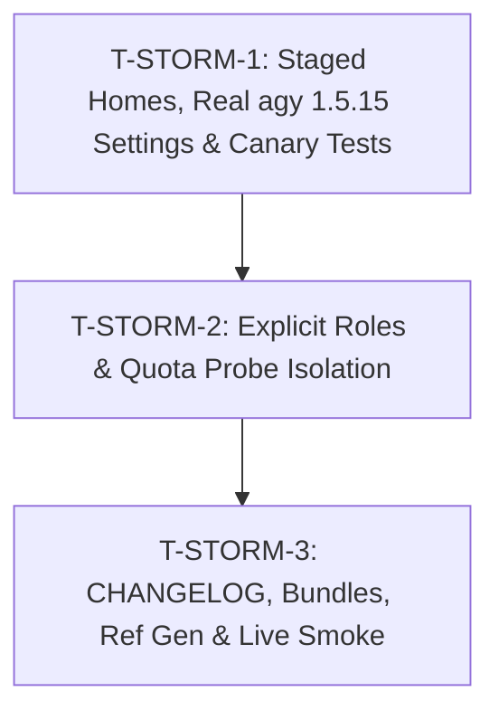

# Antigravity Booster v1.3.0: Eliminate Headless `agy` MCP & Plugin Process Storm

Resolves the P0 production telemetry finding in `~/agb-storm.md` (`dev-one`, `agy 1.5.15`): every headless `agy` subprocess (`coldstart`, `parallax`, `premortem`, `brain`, `review`, `arbiter`, `prosecutor`, `agb probe`, `probeQuota`, and leaf `builder` workers) was booting up to 4 unneeded Node.js MCP servers (`3` `codegraph serve --mcp` processes + `1` recursive self-spawned `antigravity-booster/dist/mcp-server.mjs`, ~223 MiB RSS per probe) and loading orchestrator `rules/AGENTS.md` / `skills/` bloat.

Hardened through a 5-Lens Plan Adversarial Review verified live against `agy 1.5.15`.

## Architecture & Security Invariants

1. **Deterministic Isolation Over Unverified Flags:** Suppress MCP and plugin spawning mechanically via staged `.agb_home` directories unified behind one symlink-safe staging helper (`stageIsolatedGeminiHome`), backed by empirically verified `agy 1.5.15` `--settings` keys (`{ permissions: { deny: [...] } }`).
2. **Both Global MCP Config Paths + Extensions:** Exclude `mcp_config.json` from **both** `~/.gemini/` and `~/.gemini/config/` (and `extensions` from `~/.gemini/`). Write `{"mcpServers":{}}` to both `<targetGemini>/mcp_config.json` and `<targetConfig>/mcp_config.json` by default. Only when **both** `AGB_ALLOW_CODEGRAPH_MCP === '1'` AND `existsSync(join(repoRoot, '.codegraph'))` is true, read `<userHome>/.gemini/config/mcp_config.json` (fallback `<userHome>/.gemini/mcp_config.json`, BOM/JSONC-tolerant), extract ONLY the `codegraph` server entry, and write `{ mcpServers: { codegraph } }`.
3. **Preserve `PreToolUse` Defense-in-Depth (`agb-policy-guard`):** Both builders and readonly/schema probes receive a **hooks-only projection** of `antigravity-booster` inside `.agb_home/.gemini/config/plugins/antigravity-booster/` containing ONLY `plugin.json`, `hooks.json`, `bin/` (symlinked on POSIX so `bin/node-launcher.sh` and `hooks/policy/evaluate.mjs` continue deriving host `USER_HOME`, copied on `win32`), and `dist/hooks/` (created under a real `dist/` dir so `dist/mcp-server.mjs` and `dist/agb.mjs` are excluded) — strictly omitting `mcp_config.json`, `rules/`, `skills/`, `commands/`, and `agents/`. Builders additionally retain `adlc-antigravity` and `adlc-gemini` (when present) and exclude `agb-dynamic-sidecar` and unrelated third-party plugins.
4. **Symlink-Safe Reused Worktrees & Per-Invocation Ephemeral Readonly Homes:**
   - Before writing or creating directories in `.agb_home`, unlink any pre-existing symlinks at `.agb_home/.gemini`, `.agb_home/.gemini/config`, `.agb_home/.gemini/config/plugins`, `.agb_home/.gemini/mcp_config.json`, and `.agb_home/.gemini/config/mcp_config.json` (`lstatSync` + `rmSync`) so reused worktrees can never follow a symlink into the user's real `~/.gemini/`.
   - Readonly workers use a **per-invocation ephemeral** `mkdtempSync(join(tmpdir(), 'agb-ro-')) + '/.agb_home'` (`0o700`), cleaned up in `runAgy()`'s / `probeQuota()`'s `finally` block — zero SQLite/lockfile contention across parallel `Promise.all` probes and zero temp leaks in long-lived `dist/mcp-server.mjs`.
5. **Live-Verified `agy 1.5.15 --settings` Contract:** `buildRoleSettingsProfile()` emits ONLY real `agy 1.5.15` `settings.json` keys (`{ permissions: { deny: [...] } }`), zero unknown/synthetic keys (which `agy 1.5.15` hard-rejects with `Error: --settings: unknown setting`). `test/fixtures/fake-agy` enforces the same top-level `--settings` key allowlist offline.

## Tickets

### T-STORM-1: Staged Isolated Homes, Real `agy 1.5.15` Role Settings & Behavioral Canary Suite

- **Scope**: `lib/ndjson-worker.mjs`, `lib/agy.mjs`, `evals/runner.mjs`, `test/fixtures/fake-agy`, `test/ndjson-worker.test.mjs`, `test/agy.test.mjs`, `test/agy-no-mcp-storm.test.mjs`, `test/v14-integration.test.mjs`
- **Rails**: `lib/lock.mjs`, `lib/gates.mjs`, `vendor/cache/**`, `scripts/rails-guard-ci.mjs`
- **Edges**: none
- **Tier**: `frontier`
- **Pool Hint**: `claude-gpt`

#### Objectives
1. **Unify Symlink-Safe Isolated Home Staging (`lib/agy.mjs`)**:
   - Implement `stageHooksOnlyBoosterPlugin(srcPluginDir, dstPluginDir, platform)` creating a real directory with ONLY `plugin.json`, `hooks.json`, `bin/` (symlink on POSIX, copy on `win32`), and `dist/hooks/` (real `dist/` dir containing only `hooks` symlink/copy), strictly omitting `mcp_config.json`, `dist/mcp-server.mjs`, `rules/`, `skills/`, `commands/`, and `agents/`.
   - Implement `stageFilteredMcpConfig(userHome, targetGemini, targetConfig, { allowCodegraph, repoRoot })` unlinking any pre-existing symlinks at both `targetGemini/mcp_config.json` and `targetConfig/mcp_config.json`, writing `{"mcpServers":{}}` by default, and extracting ONLY the `codegraph` entry (reading `<userHome>/.gemini/config/mcp_config.json` with fallback to `<userHome>/.gemini/mcp_config.json`, BOM/JSONC-tolerant) ONLY when BOTH `allowCodegraph === true` AND `repoRoot && existsSync(join(repoRoot, '.codegraph'))`.
   - Implement shared `stageIsolatedGeminiHome(agbHome, userHome, { mode, platform, allowCodegraph, repoRoot })` that unlinks any pre-existing symlinks at `.gemini`, `.gemini/config`, `.gemini/config/plugins`, and both `mcp_config.json` paths, creates all writable runtime subdirs (`config/projects`, `antigravity-cli/{bin,brain,conversations,crashes,log,presence,scratch,cache,plugin_data/antigravity-booster/logs}`), excludes `WRITABLE_GEMINI_RUNTIME_DIRS`, `mcp_config.json`, `extensions`, and `agb-sidecar-plugin-*` from `.gemini`, excludes `projects`, `plugins`, and `mcp_config.json` from `.gemini/config`, stages hooks-only `antigravity-booster` (plus `adlc-antigravity` and `adlc-gemini` when `mode === 'builder'`), and writes filtered `mcp_config.json`.
   - Refactor `stageBuilderGeminiHome(cwd, userHome, platform, opts)` to delegate to `stageIsolatedGeminiHome(..., { mode: 'builder', ... })`, and add `stageReadonlyGeminiHome(userHome, opts)` creating a per-invocation ephemeral `join(mkdtempSync(join(tmpdir(), 'agb-ro-')), '.agb_home')` (`0o700`) returning `{ agbHome, cleanup }`.
2. **Wire Readonly Staging & Windows/Linux Consistency in `buildSpawnEnv()` and `runAgy()` (`lib/agy.mjs`)**:
   - Accept `role`, `repoRoot`, and `readonlyHome` in `buildSpawnEnv()`; stage an ephemeral readonly `.agb_home` whenever `!isBuilder && spawnEnv.AGB_WORKER_MODE === 'readonly'` (covering fail-closed callers without explicit `worker`/`role`).
   - Set `HOME`, `USERPROFILE` (on `win32`, stripping case-variant duplicates even when `sanitizeEnv === false`), `XDG_CONFIG_HOME`, and `AGB_USER_HOME = resolvedUserHome` for BOTH builders and readonly workers.
   - Deduplicate `stageBuilderGeminiHome()` at `lib/agy.mjs:1102` so Linux `bwrap_pid` uses identical staging options, pass `{ hasCodegraph }` to `buildRoleSettingsProfile(role, { hasCodegraph })`, and invoke `readonlyCleanup()` in `runAgy()`'s `finally` block.
3. **Redesign `buildRoleSettingsProfile()` (`lib/ndjson-worker.mjs`) for Live `agy 1.5.15`**:
   - Add `'review-plan'` to `READONLY_ROLES`.
   - Return ONLY empirically verified `agy 1.5.15` `--settings` keys (`{ permissions: { deny: [...] } }`): denying all mutating/shell/orchestration/MCP tools on readonly roles, and denying orchestration tools (plus `call_mcp_tool` when `!hasCodegraph`) on builder roles. Zero unknown keys.
   - Support staged builder `HOME` inside `NdjsonWorkerDaemon._spawnDaemon()` when `cwd` is provided and `AGB_WORKER_TICKET` / builder env is configured.
   - Add strict `--settings` top-level key validation in `test/fixtures/fake-agy` rejecting unknown settings keys with `Error: --settings: unknown setting "<key>"` (mirroring `agy 1.5.15`).
4. **Update Existing Tests & Add Behavioral Canary Suite**:
   - Update `test/agy.test.mjs:257` (assert `config/plugins` is a real dir with hooks-only `antigravity-booster`), `test/ndjson-worker.test.mjs`, `test/v14-integration.test.mjs`, and `evals/runner.mjs` to assert the real `permissions.deny` profile.
   - Create `test/agy-no-mcp-storm.test.mjs` with an end-to-end mock `agy` binary that discovers & spawns MCP servers from `$HOME/.gemini/{config/,}mcp_config.json` and `$HOME/.gemini/config/plugins/*/{mcp_config,mcp}.json`, proving:
     - 0 canary MCP spawns across readonly probes, builders (default), Linux `bwrap`, and reused worktrees with pre-existing `.agb_home` symlinks (verifying host `~/.gemini` is never clobbered).
     - `codegraph` IS staged ONLY when BOTH `AGB_ALLOW_CODEGRAPH_MCP=1` AND `<repo>/.codegraph` exist.
     - Real `hooks.json` (`bin/hook-runner.sh` -> `bin/node-launcher.sh` -> `dist/hooks/pre-tool-use.bundle.mjs`) executes and enforces `deny` from inside the staged hooks-only `.agb_home`.

#### Acceptance Criteria
- 0 canary MCP spawns in `test/agy-no-mcp-storm.test.mjs` (readonly, builder default, reused worktree symlink safety).
- `PreToolUse` hook executes and denies frozen-rail / readonly mutations from inside staged `.agb_home`.
- `buildRoleSettingsProfile()` produces JSON accepted verbatim by live `agy 1.5.15 --settings` and validated by `test/fixtures/fake-agy`.
- `test/agy-no-mcp-storm.test.mjs`, `test/agy.test.mjs`, `test/ndjson-worker.test.mjs`, `test/v14-integration.test.mjs`, and `test/evals.test.mjs` pass with 0 failures.

---

### T-STORM-2: Explicit Roles, `useRoleSettings` & `probeQuota` Isolation Across All Callers

- **Scope**: `bin/agb.mjs`, `lib/brain.mjs`, `lib/plan.mjs`, `lib/preflight.mjs`, `lib/review.mjs`, `lib/prosecute.mjs`, `lib/scheduler.mjs`, `lib/pools.mjs`, `test/agy-worker-env.test.mjs`, `test/pools.test.mjs`, `test/plan.test.mjs`, `test/review-arl.test.mjs`
- **Rails**: `lib/lock.mjs`, `lib/gates.mjs`, `vendor/cache/**`, `scripts/rails-guard-ci.mjs`
- **Edges**: `T-STORM-1`
- **Tier**: `mid`
- **Pool Hint**: `gemini`

#### Objectives
1. Pass explicit `role`, `useRoleSettings: true`, and `worker: { mode: 'readonly' }` on every non-builder `runAgy()` call site (plus `repo` where repo-scoped):
   - `bin/agb.mjs` (`agb probe` at `cmd === 'probe'`) -> `role: 'readonly'`, `useRoleSettings: true`, `worker: { mode: 'readonly' }`
   - `lib/brain.mjs` (`brainToPlan`) -> `role: 'brain'`, `useRoleSettings: true`, `worker: { mode: 'readonly' }`
   - `lib/plan.mjs` (`premortemPlan`) -> `role: 'premortem'`, `useRoleSettings: true`, `worker: { mode: 'readonly' }`
   - `lib/plan.mjs` (`parallaxEdges` contracts & divergence) -> `role: 'parallax'`, `useRoleSettings: true`, `worker: { mode: 'readonly' }`
   - `lib/preflight.mjs` (`coldstartTickets`) -> `role: 'coldstart'`, `useRoleSettings: true`, `worker: { mode: 'readonly' }`
   - `lib/review.mjs` (`triageFindings` arbiter) -> `role: 'arbiter'`, `useRoleSettings: true`, `worker: { mode: 'readonly' }`
   - `lib/review.mjs` (`reviewPlan` 5-lens plan ARL) -> `role: 'review-plan'`, `useRoleSettings: true`, `worker: { mode: 'readonly' }`
   - `lib/review.mjs` (`reviewFleet` code lenses) -> `role: 'review'`, `useRoleSettings: true`, `worker: { mode: 'readonly' }`, `repo`
   - `lib/prosecute.mjs` (`prosecute`) -> `role: 'prosecutor'`, `useRoleSettings: true`, `worker: { mode: 'readonly' }`, `repo: worktree`
   - `lib/scheduler.mjs` (`buildOnce`) -> `role: 'builder'`, `useRoleSettings: true`
2. **Isolate `probeQuota()` (`lib/pools.mjs:1306`)**:
   - Stage an ephemeral readonly `.agb_home` via `stageReadonlyGeminiHome()` around `execFile(bin, ['-p', '/quota', '--output-format', 'json'], ...)` and clean it up in `finally` so `agy -p /quota` never boots `codegraph` or `dist/mcp-server.mjs` either.
3. **Dynamic Call-Site Guard (`test/agy-worker-env.test.mjs`)**:
   - Dynamically scan all `.mjs` files in `lib/` and `bin/` asserting every production `runAgy({...})` call site specifies an explicit `role` and `useRoleSettings: true`.
   - Add a `probeQuota` isolation test in `test/pools.test.mjs`.

#### Acceptance Criteria
- Every production `runAgy({...})` call site in `lib/` and `bin/` specifies an explicit `role` and `useRoleSettings: true`.
- `probeQuota()` runs against a staged ephemeral `.agb_home` with `{"mcpServers":{}}` and cleans up its temp directory.
- `test/agy-worker-env.test.mjs`, `test/pools.test.mjs`, `test/plan.test.mjs`, `test/review-arl.test.mjs`, `test/prosecute.test.mjs`, `test/scheduler.test.mjs`, and `test/cli.test.mjs` pass with 0 failures.

---

### T-STORM-3: CHANGELOG, Bundles, Reference Regeneration & Live `agy 1.5.15` Verification

- **Scope**: `CHANGELOG.md`, `website/generated/**`, `dist/**`, `vendor/adlc/dist/**`
- **Rails**: `lib/lock.mjs`, `lib/gates.mjs`, `vendor/cache/**`, `scripts/rails-guard-ci.mjs`
- **Edges**: `T-STORM-2`
- **Tier**: `mid`
- **Pool Hint**: `claude-gpt`

#### Objectives
1. Document the P0 Headless MCP & Plugin Process Storm elimination in `CHANGELOG.md` `[Unreleased]`.
2. Run `npm run build`, `node website/scripts/gen-reference.mjs`, `node website/scripts/check-all.mjs`, `npm run plugin:validate`, `npm test`, and `npm run coverage:check`.
3. Run a live `agy 1.5.15` smoke probe (`AGB_LIVE_AGY=1`) sampling `/proc` descendants during a readonly `runAgy` probe and `probeQuota`, confirming **`0` `codegraph serve --mcp`** and **`0` `dist/mcp-server.mjs`** child processes are spawned.

#### Acceptance Criteria
- `npm run build`, `node website/scripts/check-all.mjs`, `npm run plugin:validate`, `npm test`, and `npm run coverage:check` all pass with 0 errors/failures.
- Live `agy 1.5.15` smoke probe confirms `0` MCP child processes spawned.
