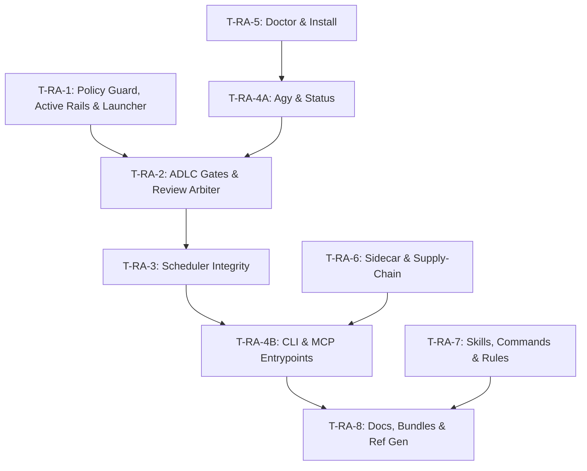

# Antigravity Booster v1.3.0 Release-Readiness Remediation Spec

This specification resolves all **3 verified BLOCKER findings** (2 distinct root causes) and all actionable **SHOULD-FIX findings** from the full 13-surface `/release-audit` of `antigravity-booster@1.3.0` (`main@171ba2d5`, baseline `v1.2.0`), incorporating all 15 findings from the 5-Lens Plan Adversarial Review (`CODEOWNERS` excluded per immutable `TRUST_ROOTS` rail; `--follow` aligned to keep-watching behavior; `scripts/check-bundle-externals.mjs` already narrowed).

## Architecture & DAG Topology

Nine dependency-layered tickets eliminate all static import coupling and concurrent file overlap across waves, converging into `T-RA-8` which aligns documentation (`CHANGELOG.md`, `website/content/docs/**`, `website/env-docs.json`), rebuilds all committed esbuild bundles (`dist/**`), and regenerates all website reference partials (`website/generated/**`).

Standing rails (`lib/lock.mjs`, `lib/gates.mjs`, `vendor/cache/**`, `scripts/rails-guard-ci.mjs`) remain strictly frozen across every ticket.

## Tickets

### T-RA-1: Policy Guard, Active Rails & Node Launcher Security Hardening

- **Scope**: `hooks/policy/constants.mjs`, `hooks/policy/evaluate.mjs`, `hooks/policy/paths.mjs`, `lib/active-rails.mjs`, `bin/node-launcher.sh`, `dist/hooks/pre-tool-use.bundle.mjs`, `test/pre-tool-use.test.mjs`, `test/active-rails.test.mjs`, `test/node-launcher.test.mjs`, `test/v14-integration.test.mjs`
- **Rails**: `lib/lock.mjs`, `lib/gates.mjs`, `vendor/cache/**`, `scripts/rails-guard-ci.mjs`
- **Edges**: none
- **Tier**: `frontier`
- **Pool Hint**: `claude-gpt`

#### Objectives
1. **Fix BLOCKER (`hooks/policy/evaluate.mjs:721`)**: Add `tool === 'agb_distill'` unconditionally to the `ctx.readonly` deny guard inside `evaluateMcpTool()` so `AGB_WORKER_MODE=readonly` sessions cannot invoke `mcp__agb__agb_distill` or `call_mcp_tool(agb, agb_distill)` (regardless of `apply`).
2. **Fix SHOULD-FIX (`hooks/policy/constants.mjs:11`)**: Remove `codegraph_explore`, `mcp_codegraph_codegraph_explore`, and `mcp__codegraph__codegraph_explore` from unconditional `READ_ONLY_TOOLS`. Introduce a dedicated `CODEGRAPH_READ_TOOLS` set handled inside `evaluatePayload()` that:
   - Permits CodeGraph queries in **interactive** sessions when supplied path parameters (`projectPath`, `path`, `DirectoryPath`) resolve strictly inside declared `workspaceRealPaths` and outside `boosterDataRoots`.
   - Denies CodeGraph queries in `ctx.headless` / `ctx.readonly` sessions unless explicitly opted in via `env.AGB_ALLOW_CODEGRAPH_MCP === '1'` (still enforcing workspace containment and `boosterDataRoots` checks).
3. **Fix SHOULD-FIX (`hooks/policy/evaluate.mjs:363`)**: In `newShardVerdict()`, inspect case-folded argument keys via `normalizeArgsCaseInsensitive(args)` (`codecontent`, `content`) rather than exact-case `args?.[k]` so Go case-fold aliases cannot bypass new-shard validation.
4. **Fix SHOULD-FIX (`hooks/policy/evaluate.mjs:864`)**: In `evaluateOrchestrationTool()`:
   - Deny `schedule` and `send_message` when `ctx.headless` is true.
   - Normalize `swarm` arguments with `normalizeArgsCaseInsensitive(args)` when validating `workspace` (`inherit`, `share`, `branch`).
   - Deny `swarm` when any anchor repository has `!r.store.ok` (corrupt/unreadable ticket store).
5. **Fix SHOULD-FIX (`bin/node-launcher.sh:106` & `hooks/policy/paths.mjs`)**: Extend trusted Node binary path allowlist in `bin/node-launcher.sh` to permit default macOS `fnm` (`$HOME/Library/Application Support/fnm/...`) and NixOS store Node paths (`/nix/store/.../bin/node`), and add `join(home, 'Library', 'Application Support', 'fnm')` to `protectedRoots(home)` in `hooks/policy/paths.mjs` so agents cannot tamper with trusted macOS `fnm` runtimes.
6. **Fix SHOULD-FIX (`lib/active-rails.mjs:127`, #170)**: Wrap `lstatSync()` calls in `unionActiveRails()` and `resolveTicket()` inside `try/catch` so filesystem permission/missing errors return `{ ok: false, error }` instead of throwing uncaught exceptions.
7. Rebuild `dist/hooks/pre-tool-use.bundle.mjs` via `npm run build:hooks` and update `test/pre-tool-use.test.mjs`, `test/active-rails.test.mjs`, `test/node-launcher.test.mjs`, and `test/v14-integration.test.mjs`.

#### Acceptance Criteria
- `evaluatePayload` returns `{ decision: 'deny' }` for `mcp__agb__agb_distill` and `call_mcp_tool(agb, agb_distill)` in both `AGB_WORKER_MODE=readonly` and `AGB_WORKER_TICKET=...` modes, while allowing interactive calls (`env: {}`).
- `evaluatePayload` allows `codegraph_explore` / `mcp_codegraph_codegraph_explore` / `mcp__codegraph__codegraph_explore` in interactive sessions for in-workspace paths, denies out-of-workspace / `boosterDataRoots` paths, and denies headless/readonly sessions unless `AGB_ALLOW_CODEGRAPH_MCP=1`.
- `newShardVerdict` denies lowercase `codecontent` / `content` payloads that are invalid shards.
- `evaluateOrchestrationTool` denies `schedule`/`send_message` in headless mode, rejects case-folded invalid `Workspace` on `swarm`, and denies `swarm` on corrupt ADLC stores.
- `bin/node-launcher.sh` accepts macOS `fnm` and NixOS `/nix/store/*/bin/node` paths, and `protectedRoots()` protects `~/Library/Application Support/fnm`.
- `unionActiveRails()` and `resolveTicket()` degrade cleanly to `{ ok: false, error }` on `lstatSync` errors.
- `dist/hooks/pre-tool-use.bundle.mjs` matches a fresh `npm run build:hooks` build.

---

### T-RA-5: Doctor & Install Hardening

- **Scope**: `lib/doctor.mjs`, `lib/doctor-models.mjs`, `test/doctor.test.mjs`, `test/doctor-selftest.test.mjs`, `test/windows-sandbox-doctor.test.mjs`, `test/sync-models.test.mjs`
- **Rails**: `lib/lock.mjs`, `lib/gates.mjs`, `vendor/cache/**`, `scripts/rails-guard-ci.mjs`
- **Edges**: none
- **Tier**: `mid`
- **Pool Hint**: `claude-gpt`

#### Objectives
1. **Fix SHOULD-FIX (`lib/doctor.mjs:486`)**: In `verifyWindowsSandboxAttestation()`, ignore `AGB_HOME_DIR` when `typeof __AGB_BUNDLED__ !== 'undefined' && __AGB_BUNDLED__`.
2. **Fix SHOULD-FIX (`lib/doctor.mjs:1545` & `lib/doctor-models.mjs:88-92`)**: In `checkModelCatalog()` and `runDoctor()`, honor `env.AGB_SYNC_MODELS_OFFLINE === '1'` so offline runs report an explicit offline/info status rather than a false-green `'models match'` claim; update `test/sync-models.test.mjs` and `test/doctor.test.mjs` to match.
3. **Fix SHOULD-FIX (`lib/doctor.mjs:1535`, #173)**: In `runDoctor()` (`--fix`), catch `LEGACY_TICKET_STORE` cleanly and record a structured diagnostic finding recommending `adlc ticket store migrate` rather than crashing before printing diagnostics.
4. **Fix SHOULD-FIX (`lib/doctor.mjs:1547`, #174)**: Forward the resolved `{ ...opts, home, env }` object to all 6 home-scoped checks inside `runDoctor()`.

#### Acceptance Criteria
- `verifyWindowsSandboxAttestation()` ignores `AGB_HOME_DIR` when bundled.
- `checkModelCatalog()` / `runDoctor()` under `AGB_SYNC_MODELS_OFFLINE=1` report an explicit offline/skipped diagnostic instead of claiming live `'models match'`.
- `runDoctor({ fix: true })` against a repo with legacy `.adlc/tickets.json` prints diagnostics without throwing uncaught `LEGACY_TICKET_STORE`.
- All 6 home-scoped checks in `runDoctor()` receive the resolved `home` and `env`.
- `test/doctor.test.mjs`, `test/doctor-selftest.test.mjs`, `test/windows-sandbox-doctor.test.mjs`, and `test/sync-models.test.mjs` pass.

---

### T-RA-6: Sidecar Security, Supply-Chain Scripts & Publish Workflow

- **Scope**: `sidecars/jetski-launcher.mjs`, `sidecars/server.mjs`, `scripts/update-adlc-digests.mjs`, `.github/workflows/publish.yml`, `test/sidecar.test.mjs`, `test/update-adlc-digests.test.mjs`
- **Rails**: `lib/lock.mjs`, `lib/gates.mjs`, `vendor/cache/**`, `scripts/rails-guard-ci.mjs`
- **Edges**: none
- **Tier**: `mid`
- **Pool Hint**: `gemini`

#### Objectives
1. **Fix SHOULD-FIX (`sidecars/jetski-launcher.mjs:153`)**: Reject symlinks on `.booster` and `.booster/token` before writing/chmodding `.booster/token`, and surface write errors cleanly.
2. **Fix SHOULD-FIX (`sidecars/server.mjs:55` & `sidecars/jetski-launcher.mjs:45-66`)**: Reject empty/whitespace `runId` and reject symlinked `.booster/`, `.booster/logs/`, or log files in BOTH `/events` readers (`sidecars/server.mjs` and `sidecars/jetski-launcher.mjs`).
3. **Fix SHOULD-FIX (`sidecars/jetski-launcher.mjs:8`)**: Validate `ANTIGRAVITY_SIDECAR_WEB_PORT` as a strict integer in `1..65535` so values like `"0"`, `"false"`, or `"abc"` do not disable token authentication.
4. **Fix SHOULD-FIX (`scripts/update-adlc-digests.mjs:173`)**: Use `realpathSync` on both `process.argv[1]` and `fileURLToPath(import.meta.url)` in the direct-invocation guard so symlinked invocations execute instead of silently exiting 0.
5. **Fix SHOULD-FIX (`.github/workflows/publish.yml:54`)**: Remove stale `registry-url: 'https://registry.npmjs.org'` from `actions/setup-node` in `.github/workflows/publish.yml` so OIDC trusted publishing does not leave an unexpanded `_authToken` stub in `.npmrc`.

#### Acceptance Criteria
- Both sidecar `/events` readers reject symlinked `.booster`/logs/event files and empty `runId`, `.booster/token` writer refuses symlinks, and non-port `ANTIGRAVITY_SIDECAR_WEB_PORT` values (`"0"`, `"false"`) do not disable token auth.
- `scripts/update-adlc-digests.mjs` runs when invoked through a symlink.
- `.github/workflows/publish.yml` has no stale `registry-url` token stub.
- `test/sidecar.test.mjs` and `test/update-adlc-digests.test.mjs` pass.

---

### T-RA-7: Skills, Commands & Rules Documentation Alignment

- **Scope**: `commands/*.md`, `rules/AGENTS.md`, `skills/*/SKILL.md`, `skills/adversarial-review/personas/code_evidence_runner.md`, `test/skills-cross-harness.test.mjs`, `test/commands.test.mjs`
- **Rails**: `lib/lock.mjs`, `lib/gates.mjs`, `vendor/cache/**`, `scripts/rails-guard-ci.mjs`
- **Edges**: none
- **Tier**: `cheap`
- **Pool Hint**: `gemini`

#### Objectives
1. **Fix SHOULD-FIX (`skills/agb/SKILL.md:99` & `commands/agb.md`)**: Update Phase 5 in both `skills/agb/SKILL.md` and `commands/agb.md` to capture `<pre-run-base-sha>` before Phase 4 `agb run` and run `agb review . <pre-run-base-sha> --five-lens --loop` (not `agb review . main` after merging onto `main`, which diffs nothing and false-greens).
2. **Fix SHOULD-FIX (`skills/implement-and-review/SKILL.md:17` & `commands/implement-and-review.md`)**: Update both files to review against `main` (noting that untracked files must be staged/committed or inspected explicitly) instead of `agb review . HEAD`.
3. **Fix SHOULD-FIX (`skills/adversarial-review/SKILL.md:65` & `skills/adversarial-review/personas/code_evidence_runner.md`, #177)**: Clarify that `agb review` routes lenses from `lib/models.mjs` at runtime (`references/models.json` is an offline reference snapshot) and align `personas/code_evidence_runner.md` with `AGB_WORKER_MODE=readonly` constraints.
4. **Fix SHOULD-FIX (`commands/agb-run.md:15`, `skills/agb-run/SKILL.md:15`, #165)**: Document `[-c <n>]` concurrency cap flag in `commands/agb-run.md` and `skills/agb-run/SKILL.md`.
5. **Fix SHOULD-FIX (`commands/agb.md`, `commands/agb-plan.md`, `rules/AGENTS.md`, `skills/agb/SKILL.md`, `skills/agb-plan/SKILL.md`)**: Document `agb distill`, `agb_distill`, and `--emit-workflow` / `emitWorkflow`.
6. **Fix SHOULD-FIX (`skills/agb-shape/SKILL.md:76`, #176)**: State the exact filenames written by `agb shape --sync-brain`: `implementation_plan.md` in the active brain directory and `.booster/agb_plan_artifact.md` in the repository.

#### Acceptance Criteria
- Every command, skill, and rule file matches the live CLI/MCP surface (`distill`, `agb_distill`, `--emit-workflow`, `-c <n>`, `implementation_plan.md` in brain dir / `.booster/agb_plan_artifact.md` in repo).
- Neither `/agb` nor `/implement-and-review` instructs a false-green empty diff review.
- `test/skills-cross-harness.test.mjs` and `test/commands.test.mjs` pass.

---

### T-RA-4A: Worker Environment & RunStatus Security Hardening

- **Scope**: `lib/agy.mjs`, `lib/status.mjs`, `test/agy.test.mjs`, `test/status.test.mjs`
- **Rails**: `lib/lock.mjs`, `lib/gates.mjs`, `vendor/cache/**`, `scripts/rails-guard-ci.mjs`
- **Edges**: `T-RA-5`
- **Tier**: `mid`
- **Pool Hint**: `gemini`

#### Objectives
1. **Fix SHOULD-FIX (`lib/agy.mjs:446` & `suite:drift #1`)**: Guard all `process.env.AGB_HOME_DIR` reads in `lib/agy.mjs` so `AGB_HOME_DIR` is ignored when `typeof __AGB_BUNDLED__ !== 'undefined' && __AGB_BUNDLED__` (falling back to `os.homedir()`), matching the bundled integrity checks.
2. **Fix SHOULD-FIX (`lib/agy.mjs:75,1157-1183`)**: During builder env sanitization on `win32`, preserve case-insensitive Windows `Path`/`PATH` (normalized without key collision) and essential Windows system variables (`PATHEXT`, `COMSPEC`, `SYSTEMROOT`, `WINDIR`, `APPDATA`, `LOCALAPPDATA`, `TEMP`, `TMP`), AND inside `if (isBuilder)` explicitly overwrite `spawnEnv.USERPROFILE = agbHome` (stripping case variants of `USERPROFILE`) so host `USERPROFILE` never leaks into sandboxed builders.
3. **Fix SHOULD-FIX (`lib/status.mjs:137`)**: In `RunStatus` constructor, check `assertNotSymlink` on `.booster` BEFORE removing stale `.booster/report.json`.

#### Acceptance Criteria
- Bundled builds ignore `AGB_HOME_DIR` in `lib/agy.mjs`.
- On `win32`, `Path` and core system variables survive builder env sanitization without `Path`/`PATH` collision, and `USERPROFILE` is pinned to `agbHome` inside `if (isBuilder)`.
- `RunStatus` refuses to unlink `.booster/report.json` when `.booster` is a symlink.
- `test/agy.test.mjs` and `test/status.test.mjs` pass.

---

### T-RA-2: ADLC Gates, Prosecutor & Review Arbiter Hardening

- **Scope**: `lib/review.mjs`, `lib/prosecute.mjs`, `lib/adlc-tool.mjs`, `test/review.test.mjs`, `test/review-arl.test.mjs`, `test/prosecute.test.mjs`, `test/adlc-tool.test.mjs`, `test/agy-worker-env.test.mjs`
- **Rails**: `lib/lock.mjs`, `lib/gates.mjs`, `vendor/cache/**`, `scripts/rails-guard-ci.mjs`
- **Edges**: `T-RA-1`, `T-RA-4A`
- **Tier**: `frontier`
- **Pool Hint**: `gemini`

#### Objectives
1. **Fix BLOCKER (`lib/review.mjs:178`)**: Sort findings deterministically by severity priority (`critical` -> `high` -> `medium` -> `low`, prioritizing `blast_radius === true` and `SHAPE-*` IDs) before slicing the first 60 for `arbiterPrompt()` in `triageFindings()`. For any overflow findings beyond index 60 that were never sent to the arbiter, run them through `deterministicTriage()` and merge them into the triaged result so no `critical` or `high` finding is ever dropped or causes a false-green `SHIP` (computing `gateVerdict` across the merged findings using the existing `'SHIP' | 'AUTO-FIX' | 'ESCALATE'` contract).
2. **Fix SHOULD-FIX (`lib/review.mjs:694`, #169)**: In `reviewPlan({ loop: true })`, when `specPath` is re-read on round > 1, recompute `shapeReport = preAnalyzeSpec(currentSpecText, ...)` so subsequent rounds evaluate the updated spec's DAG analysis and never carry stale Round 1 `SHAPE-*` findings forward.
3. **Fix SHOULD-FIX (`lib/prosecute.mjs:36` & `lib/adlc-tool.mjs`)**: In `runHollowTest()`, pass `wrapCommand` (built via `buildSandboxCommandWrapper` when `process.env.AGB_SANDBOX_GATES !== '0'`) into `runAdlcTool()` / `execFileAuthenticatedAdlc()`, failing closed if the OS sandbox is unavailable (matching `lib/scheduler.mjs` Pass 2).
4. **Fix SHOULD-FIX (`lib/prosecute.mjs:31`)**: In `runHollowTest()`, only apply the `fastHollowTest` (`node --test <impacted>`) substitution when `testCmd` is a compatible Node test command (`npm test` or `node --test`) and impacted test files are resolved; otherwise execute `testCmd` directly.
5. **Fix SHOULD-FIX (`lib/prosecute.mjs:121,162-164`)**: Normalize finding `severity` (`String(f.severity || '').toLowerCase()`) inside both `blockingFindings()` and `prosecute()` so mixed-case severities (`"HIGH"`, `"Critical"`) never flip a `block` verdict to `ship`.

#### Acceptance Criteria
- A review with 65 `low` findings followed by 2 `critical`/`high` findings produces a non-`SHIP` `gateVerdict` (`'AUTO-FIX'` or `'ESCALATE'`) and preserves both `critical`/`high` findings in `triageFindings()`.
- `reviewPlan({ loop: true })` recomputes `shapeReport` after spec edits between rounds.
- `runHollowTest()` enforces OS sandboxing unless `AGB_SANDBOX_GATES=0` and only uses `fastHollowTest` for compatible Node test runners.
- `blockingFindings()` and `prosecute()` treat `"HIGH"` and `"Critical"` as blocking severities.
- `test/review.test.mjs`, `test/review-arl.test.mjs`, `test/prosecute.test.mjs`, `test/adlc-tool.test.mjs`, and `test/agy-worker-env.test.mjs` pass.

---

### T-RA-3: Scheduler Integrity, Consensus-Fix & Journal Ordering Hardening

- **Scope**: `lib/scheduler.mjs`, `test/scheduler.test.mjs`, `test/scheduler-consensus-fix.test.mjs`, `test/scheduler-integrity.test.mjs`
- **Rails**: `lib/lock.mjs`, `lib/gates.mjs`, `vendor/cache/**`, `scripts/rails-guard-ci.mjs`
- **Edges**: `T-RA-2`
- **Tier**: `frontier`
- **Pool Hint**: `claude-gpt`

#### Objectives
1. **Fix SHOULD-FIX (`lib/scheduler.mjs:2065`)**: In the `consensus-fix` post-apply verification path, run `runSymbolScopeVerification()` when `t.symbol_scope` or `t.symbol_rails` are declared and reject the consensus-fix candidate if it violates symbol constraints.
2. **Fix SHOULD-FIX (`lib/scheduler.mjs:440,512`)**: Fix BOTH quarantine ref regexes in `lib/scheduler.mjs` (`refs/quarantine/agb-<id>-failed-...`) so hyphenated ticket IDs (e.g., `refs/quarantine/agb-t-v14-1-failed-conflict`) match `knownTickets` without truncating at the first hyphen.
3. **Fix SHOULD-FIX (`lib/scheduler.mjs:1955`)**: Call `discardProjection(worktree, 'HEAD')` before `checkRailsGuard()` so orchestrator-authored `AGENTS.md` / `.adlc/tickets` projections cannot trip `rails-guard` if a ticket declares rails matching them.
4. **Fix SHOULD-FIX (`lib/scheduler.mjs:1772`)**: When `verifyRootGitIntegrity()` fails and calls `abortFleet()`, also call `compromiseRun(strikeError)` so `report.compromised` is set to `true`.
5. **Fix SHOULD-FIX (`lib/scheduler.mjs:321`, #166)**: In `verifyRootGitIntegrity()`, when `AGB_ALLOW_DIRTY=1`, still detect newly dirtied/untracked root paths introduced during worker execution while safely exempting pre-existing dirty paths from `preSnapshot` and files intentionally changed by a concurrent merge (`headMovedByMerge`).
6. **Fix SHOULD-FIX (`lib/scheduler.mjs:1246`, #167)**: Reorder startup in `runPlan()` so `reconcileIntegrationJournal()` executes BEFORE `ensureGitignore(repo)` creates any `.gitignore` commit on the base branch.

#### Acceptance Criteria
- Consensus-fix rejects candidates violating `symbol_rails` or `symbol_scope`.
- `verifyRootGitIntegrity()` accepts quarantine refs for hyphenated ticket IDs like `T-V14-1`, detects newly dirtied root files even under `AGB_ALLOW_DIRTY=1` without false-positiving on concurrent merges, and marks `report.compromised = true` on root integrity violations.
- `checkRailsGuard()` runs on the post-`discardProjection` worktree.
- `reconcileIntegrationJournal()` runs prior to `ensureGitignore()`.
- `test/scheduler.test.mjs`, `test/scheduler-consensus-fix.test.mjs`, and `test/scheduler-integrity.test.mjs` pass.

---

### T-RA-4B: CLI & MCP Entrypoint Hardening

- **Scope**: `bin/agb.mjs`, `mcp/server.mjs`, `test/cli.test.mjs`, `test/cli-fixes.test.mjs`
- **Rails**: `lib/lock.mjs`, `lib/gates.mjs`, `vendor/cache/**`, `scripts/rails-guard-ci.mjs`
- **Edges**: `T-RA-3`, `T-RA-6`
- **Tier**: `mid`
- **Pool Hint**: `gemini`

#### Objectives
1. **Fix SHOULD-FIX (`bin/agb.mjs:84`)**: Align `--follow` help text in `bin/agb.mjs` with its actual keep-watching behavior (keeps polling after run completion instead of claiming to tail worker logs).
2. **Fix SHOULD-FIX (`bin/agb.mjs:449`)**: Check whether `--emit-workflow <path>` already exists BEFORE calling `compilePlan()` and require `--force` to overwrite; fail closed with an actionable error message if the target exists and `--force` is omitted.
3. **Fix SHOULD-FIX (`bin/agb.mjs:549`)**: Add strict unknown-flag validation to `init`, `sweep`, `brains`, `import-brain`, `probe`, and `pool` subcommands so unsupported flags (e.g., `agb init --dry-run`) exit non-zero without mutating the repository.
4. **Fix SHOULD-FIX (`mcp/server.mjs:359`, #172)**: Add `concurrency` to `agb_run`'s MCP `inputSchema`, remove the stale `"agb run has no concurrency flag"` error text, and forward validated `concurrency` as `-c <n>` to `agb run`.

#### Acceptance Criteria
- `bin/agb.mjs --help` accurately describes `--follow`.
- `agb plan --emit-workflow` refuses to overwrite existing files without `--force` prior to running `compilePlan()`.
- `agb init --dry-run` exits 1 with an unknown-flag error and does not modify `cwd`.
- `mcp/server.mjs` exposes `concurrency` in `agb_run`'s schema and forwards `-c <n>`.
- `test/cli.test.mjs` and `test/cli-fixes.test.mjs` pass.

---

### T-RA-8: Website Docs, CHANGELOG, Bundle Rebuild & Reference Generation

- **Scope**: `CHANGELOG.md`, `website/content/docs/**`, `website/env-docs.json`, `website/scripts/gen-reference.mjs`, `website/generated/**`, `dist/**`, `vendor/adlc/dist/**`
- **Rails**: `lib/lock.mjs`, `lib/gates.mjs`, `vendor/cache/**`, `scripts/rails-guard-ci.mjs`
- **Edges**: `T-RA-4B`, `T-RA-7`
- **Tier**: `mid`
- **Pool Hint**: `claude-gpt`

#### Objectives
1. **Fix SHOULD-FIX (`CHANGELOG.md`, `suite:drift #3`, `suite:docs #1`)**: Update `CHANGELOG.md` `[Unreleased]` to document PRs `#182` (`agy 1.5.13` / 27 models), `#184` (v1.4 Hyper-Tuned Harness, `agb distill`, `agb_distill`, `--emit-workflow`), `#186` (dogfood hardening), and all v1.3.0 release-readiness fixes, updating stale `agy 1.5.9` / `22-model` / `8-MCP-tool` figures.
2. **Fix SHOULD-FIX (`website/content/docs/internals/policy-guard.mdx`)**: Align `policy-guard.mdx` with v1.3/v1.4 MCP (`agb_distill` denied in readonly/headless; `codegraph_explore` interactive-only in-workspace unless `AGB_ALLOW_CODEGRAPH_MCP=1`), orchestration (`swarm`/`schedule`/`send_message`), and shell policy behavior.
3. **Fix SHOULD-FIX (`website/content/docs/guides/headless-and-mcp.mdx`, `website/content/docs/reference/mcp-tools.mdx`)**: Update MCP docs to 9 tools (adding `agb_distill`), `agb_run`'s `concurrency`, and `agb_plan`'s `emitWorkflow`.
4. **Fix SHOULD-FIX (`website/content/docs/internals/build-and-bundle.mdx`)**: Document `syntax-check-typescript.mjs` and `watchdog.mjs` in `vendor:bundle` and `check-bundle-externals`.
5. **Fix SHOULD-FIX (`website/content/docs/getting-started/installation.mdx`)**: Add the `--out` flag to the `stage-marketplace-plugin.mjs` custom marketplace snippet.
6. **Fix SHOULD-FIX (`website/content/docs/reference/cli/migrate.mdx`, `shape.mdx`, `init.mdx`, `status.mdx`)**: Fix `migrate.mdx` (`agb migrate --rollback --force-rollback`), `shape.mdx` (`implementation_plan.md` in active brain directory + `.booster/agb_plan_artifact.md` in repo), `init.mdx` (align with real `agb init` behavior without fictional `created`/`skipped` JSON keys), and `status.mdx` (`--follow` keep-watching behavior).
7. **Fix SHOULD-FIX (`website/content/docs/reference/exit-and-error-codes.mdx`, `plan-schema.mdx`)**: Document `agb distill` (exit 0/1) and `agb review` exit-2 conditions in `exit-and-error-codes.mdx`, and document `disableOrchestrator`, `contextSlice`, `overviewPane`, `symbol_scope`, and `symbol_rails` in `plan-schema.mdx`.
8. **Fix SHOULD-FIX (`suite:drift #2`, `website/env-docs.json`, `dist/**`, `website/generated/**`)**: Add `AGB_ALLOW_CODEGRAPH_MCP` to `website/env-docs.json`, accurately describe `AGB_MODEL_STATS_FILE` / `AGB_ROUTER_STATIC` as opt-in library env vars in `website/env-docs.json`, run `npm run build` (`dist/**` + `vendor/adlc/dist/**`), run `node website/scripts/gen-reference.mjs`, and verify `node website/scripts/check-all.mjs`, `npm run plugin:validate`, and `npm test`.

#### Acceptance Criteria
- `npm run build` succeeds with zero external dependencies in `dist/**` and `vendor/adlc/dist/**`.
- `node website/scripts/gen-reference.mjs --check` exits 0 (`up to date`) and `node website/scripts/check-all.mjs` passes.
- `npm run plugin:validate` passes with `errors: 0, warnings: 0`.
- `npm test` passes 100% (`0` failures).
