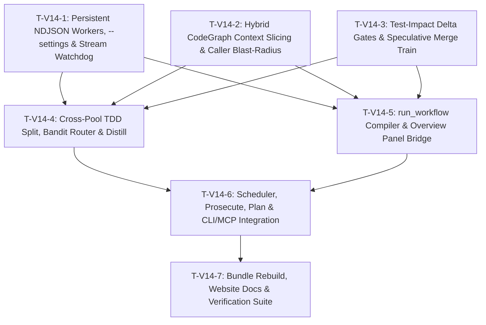

# Specification: Antigravity Booster v1.4 Hyper-Tuned Harness & ADLC Accelerator (`v1.4.0`)

**Base:** `main` \
**Gate:** `{"test": "npm test"}`

--------------------------------------------------------------------------------

## 1. Overview & Objectives

This specification defines the **v1.4.0 Hyper-Tuned Harness & ADLC Accelerator** architecture for `antigravity-booster` (`agb`), evolving it from a batch subprocess wrapper (`agy --print` per strike/phase over file-glob scopes) into a live, semantically aware, harness-native ADLC execution engine tailored for Google Antigravity (`agy` $\ge$ `1.5.13`).

### Seven Architectural Pillars & Precision Contracts

1.  **Pillar 1 — Persistent NDJSON Builder Daemons & Ephemeral `--settings` Profiles (`lib/ndjson-worker.mjs`)**:
    -   Default-on persistent `--input-format stream-json --output-format stream-json` **builder** worker sessions that stay alive and paused on `stdin` after Strike-0 `building` while `gating` and cross-model `prosecuting` run in separate processes.
    -   **Cross-Model Prosecution Isolation Invariant:** `NdjsonWorkerDaemon` is strictly scoped to a single builder ticket's build and Strike-1 fix turns. Cross-model prosecution (`prosecute()`) and 5-lens reviews (`review()`) **never** reuse the builder daemon; they always run as separate `readonly` processes on the opposite model family.
    -   **Quiescence, Lease & Cleanup Contract:** When a builder turn completes and the daemon pauses on `stdin`:
        1.  Reap any lingering background child processes spawned by the worker (`pgrep -P <daemonPid>` excluding the `agy` process itself) so the worktree is guaranteed quiescent before `runGates()` or `prosecute()` reads it.
        2.  Release the builder's `PoolSet` quota lease while paused during `gating`/`prosecuting`, and re-acquire a builder lease before sending the Strike-1 fix turn via `sendTurn()`.
        3.  Before falling back to single-shot `--print` (on timeout, watchdog abort, or broken pipe) or on `close()`, terminate the daemon process group via `terminateProcessTree(child, 'SIGKILL')` and await exit so two `agy` processes never write to the same worktree concurrently.
    -   **Role-Tailored `--settings <inline-json>` Profiles:** Strip unnecessary MCP servers, subagents, and interactive skills from headless `readonly` (`prosecutor`, `review`, `coldstart`, `parallax`, `premortem`) and `builder` invocations.
2.  **Pillar 2 — Hybrid CodeGraph & Static-AST Context Slicing + Caller Blast-Radius Prosecution (`lib/context-slice.mjs`)**:
    -   Pre-bakes a compact, line-numbered `.booster/context-slice.md` containing target symbols and 1-hop callers/callees/types (invoking `codegraph explore` via `execFile` with `--` argument separator, `10s` timeout, and `2 MiB` maxBuffer when `.codegraph/` exists as a non-symlink directory, and falling back deterministically to static JS/TS import/export analysis when absent).
    -   Extracts modified exported symbols from a ticket diff and attaches out-of-scope external callers wrapped in sanitized `<<UNTRUSTED:CALLERS:${tag}>>` boundary markers (stripping any inner marker substrings from source snippets) to the P5 prosecution prompt.
    -   **Additive Symbol-Level Scope & Rail Verification:** Standard `ticket.scope` and `ticket.rails` remain pure file/glob pathspecs so `PreToolUse` hooks and `adlc rails-guard` never fail-open. Optional symbol-level constraints are declared via additive `ticket.symbol_scope` and `ticket.symbol_rails` arrays (`["lib/models.mjs#resolveModelSlug"]`) and verified post-turn by `verifySymbolScopeDiff()` in `lib/scheduler-verify.mjs`.
3.  **Pillar 3 — Hybrid In-Harness `run_workflow` Compiler & Native Overview Panel Telemetry Bridge (`lib/workflow-emit.mjs`, `lib/overview-pane.mjs`)**:
    -   Adds `agb plan --emit-workflow <file.py>` to compile a validated `plan.json` DAG into a deterministic Python script for `agy`'s native `run_workflow` tool (`parallel()`, `pipeline()`, `phase()`, `agent(..., workspace="share")`) that calls back into `agb` CLI primitives for leases, gates, prosecution, and merges. All ticket metadata is serialized via `JSON.stringify` into Python data literals (zero raw string interpolation) and syntax-checked via `python3 -m py_compile` when `python3` is available.
    -   Emits native Antigravity Overview Panel (`swarm_pane`) telemetry (`.booster/overview_pane.json` and `.booster/overview_pane.md`) during both CLI and workflow runs.
4.  **Pillar 4 — Cross-Pool Adversarial TDD Split (`lib/tdd-split.mjs`)**:
    -   Automatically activates on `frontier`-tier tickets (and any ticket with `tdd_split: true`) whose `scope` contains both implementation files and `test/*.test.mjs` files, while keeping single-builder execution on `cheap`/`mid` tickets.
    -   Dispatches a **Spec-Test Author** (scoped strictly to the ticket's `test/**` paths on the opposite quota pool, with implementation paths frozen in `rails`) to commit failing black-box contract tests against `base`, verifies the new tests fail on unimplemented `base` (anti-tautology gate) and pass syntax checks, and then promotes those test files into the **Implementation Builder's** frozen `rails` (including `.adlc/tickets/` shard projection so `PreToolUse` enforces the rail in-session).
5.  **Pillar 5 — Sub-Turn `stream-json` Watchdog & Dynamic `--effort` Precedence (`lib/stream-watchdog.mjs`)**:
    -   Taps live `stream-json` `step_update` events inside a turn to detect rail-bounce spirals ($\ge 2$ `PreToolUse` policy denials) and in-turn command flailing (3 consecutive identical command failures by normalized command + stderr hash).
    -   **Precedence Between Warm NDJSON Resume and `--effort` Escalation:**
        -   **Healthy Daemon (Gate or Prosecutor Rejection):** Keep the warm `NdjsonWorkerDaemon` alive and send the Strike-1 fix prompt via `sendTurn()` (`<100ms` resume with hot KV cache).
        -   **Aborted / Crashed Daemon (Watchdog Flail Abort, Timeout, or Process Exit):** Kill the daemon process tree and spawn a fresh Strike-1 process with escalated effort from `resolveDynamicEffort(ticket, { strike: 1, aborted: true })` (`--effort xhigh` or `-xhigh` model slug, plus `--conversation <id>` when available).
6.  **Pillar 6 — Test-Impact Delta Gates & Speculative Merge Trains (`lib/test-impact.mjs`)**:
    -   Derives the transitive `test/*.test.mjs` consumer closure for a ticket's changed files (via `.codegraph/` or static import graph). Validates all discovered test paths against `PATHSPEC_RE` and `<repo>/test/` containment. Runs the fast delta slice (`node --test <files...>`) during Strike-0 builder gating and `adlc hollow-test`, while **always running the full `plan.gate.test` suite before final merge** (and falling back to full `plan.gate.test` whenever global config files or unmapped files change).
    -   Groups prosecution-passed tickets that are ready in the merge queue with pairwise-disjoint `scope` and `changedFiles` and zero cross-ticket import coupling into speculative merge batches inside disposable integration worktrees, running full `plan.gate.build` + `plan.gate.test` once per batch and bisecting via `bisectFailedBatch()` in $O(\log k)$ runs if a batch gate fails.
7.  **Pillar 7 — Closed-Loop Empirical Model Router & Defense Distillation (`lib/bandit-router.mjs`, `lib/distill.mjs`)**:
    -   Persists per-model, per-role empirical outcomes (`strike0Pass`, `hollowTestKilled`, `prosecutorPrecision`, `latencyMs`) in `<plugin_data>/model_stats.jsonl` under an atomic file lock (`withLockSync`) and ranks same-tier candidates via seeded Beta-Bernoulli / EWMA scoring (bypassed when `AGB_ROUTER_STATIC=1` or no history exists).
    -   Adds `agb distill [repo] [--apply] [--json]` (and `agb_distill` MCP tool) to scan `.adlc/manifest.jsonl` and `.booster/` review/prosecution artifacts for recurring finding fingerprints ($\ge 2$ occurrences), staging proposals in `.booster/distilled-defenses.md` and writing compacted rules to `.gemini/rules/adlc-learned.md` (bounded under `12,000` bytes) only when `--apply` is explicitly passed.

--------------------------------------------------------------------------------

## 2. Ticket Dependency DAG

--------------------------------------------------------------------------------

## 3. Ticket Specifications

### Ticket 1: `T-V14-1` — Persistent NDJSON Worker Daemons, Role `--settings` Profiles & Sub-Turn `stream-json` Watchdog

-   **Scope**: `lib/ndjson-worker.mjs`, `lib/stream-watchdog.mjs`, `test/fixtures/fake-agy`, `test/ndjson-worker.test.mjs`, `test/stream-watchdog.test.mjs`
-   **Rails**: `lib/lock.mjs`, `lib/gates.mjs`, `vendor/cache/**`, `scripts/rails-guard-ci.mjs`
-   **Edges**: `T-V14-1 -> T-V14-4`, `T-V14-1 -> T-V14-5`
-   **Gate**: `node --test test/ndjson-worker.test.mjs test/stream-watchdog.test.mjs`
-   **Tier**: `frontier`
-   **Pool Hint**: `gemini`
-   **Objectives**:
    1.  Create `lib/ndjson-worker.mjs` (strictly under 800 lines) implementing:
        -   `buildRoleSettingsProfile(role, { hasCodegraph = false, extraSettings = {} } = {})`: returns a JSON-serializable object for `agy --settings <inline-json>` that disables non-essential MCP servers, subagents, and interactive skills for `readonly` roles (`prosecutor`, `review`, `coldstart`, `parallax`, `premortem`) and scopes `builder` sessions to core file/shell tools plus `codegraph` when available.
        -   `NdjsonWorkerDaemon`: manages a persistent builder `agy --input-format stream-json --output-format stream-json` child process across Strike-0 build and Strike-1 fix turns, exposing `sendTurn(prompt, { timeoutMs, onStep })`, `quiesceChildren()`, `isAlive()`, and `close()`.
        -   Enforce the process-cleanup contract: `quiesceChildren()` reaps any background descendant processes of the worker PID before gates run; `close()` and any error/timeout fallback call `terminateProcessTree(child, 'SIGKILL')` and await process exit before allowing single-shot `--print` fallback so two `agy` processes never run concurrently in the same worktree.
    2.  Create `lib/stream-watchdog.mjs` (strictly under 800 lines) implementing:
        -   `StreamWatchdog`: inspects live `stream-json` `step_update` events during a turn, counting consecutive `PreToolUse` policy denials (`maxRailBounces = 2`) and repeated identical tool command failures (`maxIdenticalFailures = 3` by normalized command + stderr SHA-256). Emits `{ action: 'continue' | 'steer' | 'abort', reason, steeringPrompt }`.
        -   `resolveDynamicEffort(ticket, { strike = 0, aborted = false, deadlock = false } = {})`: returns `'medium'` or `'high'` on Strike 0 (`strike === 0 && !deadlock`), keeps the warm daemon's effort when resuming via `NdjsonWorkerDaemon.sendTurn()`, and escalates to `'xhigh'` (or `'max'` when supported) when spawning a fresh Strike-1 process after a watchdog abort, timeout, or arbiter deadlock (`strike >= 1 && (aborted || deadlock)`).
    3.  Update `test/fixtures/fake-agy` to accept `--settings <json>` in its flag allowlist (recording `FAKE_AGY_SETTINGS` when requested) and to support line-delimited multi-turn reading when `--input-format stream-json` is passed so persistent daemon turns do not block waiting for stdin EOF.
    4.  Create `test/ndjson-worker.test.mjs` and `test/stream-watchdog.test.mjs` testing multi-turn NDJSON resume against `test/fixtures/fake-agy`, descendant process quiescence, SIGKILL cleanup before `--print` fallback, `--settings` profile generation, rail-bounce steering, 3-strike in-turn flail abort, and dynamic `--effort` precedence.
-   **Acceptance Criteria**:
    -   `lib/ndjson-worker.mjs` and `lib/stream-watchdog.mjs` are each strictly under 800 lines.
    -   `test/fixtures/fake-agy` accepts `--settings` and line-delimited `--input-format stream-json` without breaking any existing tests.
    -   `node --test test/ndjson-worker.test.mjs test/stream-watchdog.test.mjs` passes with 0 failures.

--------------------------------------------------------------------------------

### Ticket 2: `T-V14-2` — Hybrid CodeGraph & Static-AST Context Slicing + Caller Blast-Radius Engine

-   **Scope**: `lib/context-slice.mjs`, `test/context-slice.test.mjs`
-   **Rails**: `lib/lock.mjs`, `lib/gates.mjs`, `vendor/cache/**`, `scripts/rails-guard-ci.mjs`
-   **Edges**: `T-V14-2 -> T-V14-4`, `T-V14-2 -> T-V14-5`
-   **Gate**: `node --test test/context-slice.test.mjs`
-   **Tier**: `frontier`
-   **Pool Hint**: `claude-gpt`
-   **Objectives**:
    1.  Create `lib/context-slice.mjs` (strictly under 800 lines) implementing:
        -   `hasCodegraphIndex(repo)`: verifies `<repo>/.codegraph` exists and `lstatSync` confirms it is a real directory (not a symlink).
        -   `buildContextSlice(ticket, { repo, maxBytes = 32768, codegraphBin = 'codegraph', timeoutMs = 10000 } = {})`: extracts target files/symbols from `ticket.scope`, `ticket.symbol_scope`, and `ticket.body`. When `hasCodegraphIndex(repo)` is true, invokes `execFileSync(codegraphBin, ['explore', '--', query], { cwd: repo, timeout: timeoutMs, maxBuffer: 2 * 1024 * 1024 })` (never shell) and falls back deterministically on any error or when `.codegraph/` is absent to static JS/TS export/import symbol extraction across `repo`. Writes `<repo>/.booster/context-slice.md` atomically and returns `{ ok, source: 'codegraph' | 'static-ast', markdown, symbols, files }`.
        -   `discoverExternalCallers(diffText, { repo, scope = [], maxBytes = 16384 } = {})`: parses modified exported symbols from a unified git diff, locates caller sites in `repo` outside `ticket.scope` (via `.codegraph/` or static import scan), sanitizes any embedded `<<UNTRUSTED:` or `>>` sequences in source snippets, and returns `{ symbols, callers, promptBlock }` wrapped in `<<UNTRUSTED:CALLERS:${tag}>>` markers for P5 prosecution.
        -   `parseSymbolAnchor(anchorSpec)` and `verifySymbolScopeDiff(diffText, { symbolScope = [], symbolRails = [], repo } = {})`: parses additive `path/to/file.mjs#SymbolName` entries (from `ticket.symbol_scope` / `ticket.symbol_rails`, keeping `ticket.scope` and `ticket.rails` as pure file pathspecs) and checks that modified line hunks in `diffText` fall within `symbolScope` spans and do not intersect `symbolRails` spans.
    2.  Create `test/context-slice.test.mjs` covering `.codegraph/` `execFile` invocation, offline `static-ast` fallback, boundary-marker injection sanitization in `discoverExternalCallers()`, and additive `verifySymbolScopeDiff()` verification.
-   **Acceptance Criteria**:
    -   `lib/context-slice.mjs` is strictly under 800 lines and degrades cleanly to `source: 'static-ast'` when `.codegraph/` is absent or fails.
    -   `node --test test/context-slice.test.mjs` passes with 0 failures.

--------------------------------------------------------------------------------

### Ticket 3: `T-V14-3` — Test-Impact Delta Gate Slicer & Speculative Merge-Train Planner

-   **Scope**: `lib/test-impact.mjs`, `test/test-impact.test.mjs`
-   **Rails**: `lib/lock.mjs`, `lib/gates.mjs`, `vendor/cache/**`, `scripts/rails-guard-ci.mjs`
-   **Edges**: `T-V14-3 -> T-V14-4`, `T-V14-3 -> T-V14-5`
-   **Gate**: `node --test test/test-impact.test.mjs`
-   **Tier**: `mid`
-   **Pool Hint**: `gemini`
-   **Objectives**:
    1.  Create `lib/test-impact.mjs` (strictly under 800 lines) implementing:
        -   `deriveImpactedTests(changedFiles, { repo, fallbackTestCmd = 'npm test', maxSliceFiles = 20 } = {})`: computes transitive `test/*.test.mjs` consumers of `changedFiles` via static ES/CJS import graph traversal (and `.codegraph/` when present). Validates every candidate test path against `PATHSPEC_RE` and confirms `realpathSync` containment inside `<repo>/test/`. Falls back to `{ fast: false, testFiles: [], testCmd: fallbackTestCmd }` if any global file (`package.json`, `package-lock.json`, `scripts/**`, `test/fixtures/**`) changed, if `testFiles.length === 0`, or if `testFiles.length > maxSliceFiles`; otherwise returns `{ fast: true, testFiles, testCmd: 'node --test ' + testFiles.join(' ') }`.
        -   `planSpeculativeMergeBatches(readyTickets, { repo } = {})`: groups prosecution-passed tickets currently ready in the merge queue into ordered conflict-free batches where all tickets in a batch have pairwise-disjoint `scope` globs, pairwise-disjoint `changedFiles`, and zero cross-ticket static import coupling.
        -   `bisectFailedBatch(batch)`: deterministically splits a failed speculative merge batch of size $k > 1$ into `[batch.slice(0, mid), batch.slice(mid)]` down to single-ticket batches so a failing ticket is isolated in $O(\log k)$ gate runs without losing healthy sibling tickets.
    2.  Create `test/test-impact.test.mjs` testing transitive import closure, path traversal / shell metacharacter rejection, global-config fallback to full `npm test`, disjoint batch grouping, and $O(\log k)$ bisection.
-   **Acceptance Criteria**:
    -   `lib/test-impact.mjs` is strictly under 800 lines.
    -   `node --test test/test-impact.test.mjs` passes with 0 failures.

--------------------------------------------------------------------------------

### Ticket 4: `T-V14-4` — Cross-Pool Adversarial TDD Split, Empirical Bandit Router & Defense Distiller

-   **Scope**: `lib/tdd-split.mjs`, `lib/bandit-router.mjs`, `lib/distill.mjs`, `test/tdd-split.test.mjs`, `test/bandit-distill.test.mjs`
-   **Rails**: `lib/lock.mjs`, `lib/gates.mjs`, `vendor/cache/**`, `scripts/rails-guard-ci.mjs`
-   **Edges**: `T-V14-4 -> T-V14-6`
-   **Gate**: `node --test test/tdd-split.test.mjs test/bandit-distill.test.mjs`
-   **Tier**: `frontier`
-   **Pool Hint**: `claude-gpt`
-   **Objectives**:
    1.  Create `lib/tdd-split.mjs` (strictly under 800 lines) implementing:
        -   `shouldRunTddSplit(ticket, plan = {})`: returns `true` when `ticket.tdd_split === true` or (`ticket.tdd_split !== false && plan.tddSplit !== false && ticket.tier === 'frontier'`) and `ticket.scope` contains both `test/**` paths and non-test implementation paths.
        -   `partitionTddScopes(ticket)`: partitions `ticket.scope` into `testScope` (`test/**`) and `implScope` (non-test paths), producing:
            1.  `specAuthorSubTicket`: scoped strictly to `testScope`, with `implScope` added to `rails`, routed to the opposite quota pool via `selectOppositePoolHint(ticket.pool_hint, builderModel)`.
            2.  `verifyRedPhaseTests(testFiles, { worktree, testCmd })`: verifies the Spec-Test Author's committed tests parse cleanly (`node --check`) and fail against unimplemented `base` (`exitCode !== 0`, anti-tautology check); if the Spec-Test Author fails or produces tautological passing tests on `base`, discards the spec-test commit and degrades cleanly to standard single-builder execution.
            3.  `promoteTestsToBuilderRails(ticket, committedTestFiles)`: appends `committedTestFiles` to the Implementation Builder's `rails` array so `PreToolUse` and `adlc rails-guard` mechanically block the builder from weakening or deleting the spec tests.
    2.  Create `lib/bandit-router.mjs` (strictly under 800 lines) implementing:
        -   `BanditModelRouter`: persists empirical outcome records (`{ ts, model, role, tier, strike0Pass, hollowTestKilled, prosecutorPrecision, latencyMs }`) in `<plugin_data>/model_stats.jsonl` protected by `withLockSync` from `./pools.mjs` and bounded to `MAX_STATS_ENTRIES = 2000`.
        -   `rankCandidates(candidates, { role = 'builder', tier = 'mid', seed = null, staticMode = process.env.AGB_ROUTER_STATIC === '1' } = {})`: returns `candidates` in original order when `staticMode` is true or no history exists, and otherwise ranks same-tier candidates using a deterministic seeded EWMA / Beta-Bernoulli score.
    3.  Create `lib/distill.mjs` (strictly under 800 lines) implementing:
        -   `distillRunDefenses({ repo, apply = false, maxRuleBytes = 12000 } = {})`: scans `<repo>/.adlc/manifest.jsonl` and `<repo>/.booster/` review/prosecution JSON artifacts for recurring finding fingerprints ($\ge 2$ occurrences), stages human-reviewable defenses at `<repo>/.booster/distilled-defenses.md`, and when `apply === true`, writes compacted guidance to `<repo>/.gemini/rules/adlc-learned.md` within `maxRuleBytes`.
    4.  Create `test/tdd-split.test.mjs` and `test/bandit-distill.test.mjs` covering frontier auto-activation, red-phase anti-tautology verification, graceful fallback on spec-author failure, rail promotion, locked JSONL stats persistence, seeded bandit ranking, and `--apply` rule compaction.
-   **Acceptance Criteria**:
    -   `lib/tdd-split.mjs`, `lib/bandit-router.mjs`, and `lib/distill.mjs` are each strictly under 800 lines.
    -   `node --test test/tdd-split.test.mjs test/bandit-distill.test.mjs` passes with 0 failures.

--------------------------------------------------------------------------------

### Ticket 5: `T-V14-5` — Hybrid In-Harness `run_workflow` Compiler & Native Overview Panel Telemetry Bridge

-   **Scope**: `lib/workflow-emit.mjs`, `lib/overview-pane.mjs`, `test/workflow-emit.test.mjs`
-   **Rails**: `lib/lock.mjs`, `lib/gates.mjs`, `vendor/cache/**`, `scripts/rails-guard-ci.mjs`
-   **Edges**: `T-V14-5 -> T-V14-6`
-   **Gate**: `node --test test/workflow-emit.test.mjs`
-   **Tier**: `mid`
-   **Pool Hint**: `gemini`
-   **Objectives**:
    1.  Create `lib/workflow-emit.mjs` (strictly under 800 lines) implementing:
        -   `compilePlanToWorkflow(plan, { outPath, agbBin = 'agb' } = {})`: compiles a validated `plan.json` DAG into a deterministic Python script for `agy`'s `run_workflow` tool (`phase()`, `parallel()`, `pipeline()`, `agent(..., workspace="share")`).
        -   Serializes all ticket IDs, titles, bodies, scopes, rails, and gate commands via `JSON.stringify` into a static Python `PLAN_DATA` dictionary (never interpolating untrusted strings into Python syntax or shell commands) and invokes `subprocess.run([BOOSTER_BIN, ...], check=True)` with list arguments (`shell=False`, using Python identifier `BOOSTER_BIN` so `website/scripts/gen-reference.mjs`'s `ENV_TOKEN` scanner is not false-triggered) for lease acquisition, gate execution, cross-model prosecution, and rebase-merge. Validates generated Python syntax with `python3 -m py_compile` when `python3` is available.
    2.  Create `lib/overview-pane.mjs` (strictly under 800 lines) implementing:
        -   `syncOverviewPaneState(statusSnapshot, { repo, brainDir } = {})`: writes Antigravity Overview Panel (`swarm_pane`) telemetry atomically to `<repo>/.booster/overview_pane.json` and `<repo>/.booster/overview_pane.md` (and mirrors to the active brain session directory when present).
    3.  Create `test/workflow-emit.test.mjs` verifying topological wave generation, adversarial quote/backtick/newline injection resistance in ticket metadata, `py_compile` validation, and Overview Panel file generation.
-   **Acceptance Criteria**:
    -   `lib/workflow-emit.mjs` and `lib/overview-pane.mjs` are each strictly under 800 lines.
    -   `node --test test/workflow-emit.test.mjs` passes with 0 failures.

--------------------------------------------------------------------------------

### Ticket 6: `T-V14-6` — Wire v1.4 Hyper-Harness Engines into Runtime, Scheduler, Plan & CLI/MCP Surface

-   **Scope**: `lib/agy.mjs`, `lib/prosecute.mjs`, `lib/scheduler.mjs`, `lib/scheduler-verify.mjs`, `lib/plan.mjs`, `bin/agb.mjs`, `mcp/server.mjs`, `test/v14-integration.test.mjs`
-   **Rails**: `lib/lock.mjs`, `lib/gates.mjs`, `vendor/cache/**`, `scripts/rails-guard-ci.mjs`
-   **Edges**: `T-V14-6 -> T-V14-7`
-   **Gate**: `node --test test/v14-integration.test.mjs test/agy.test.mjs test/prosecute.test.mjs test/scheduler.test.mjs test/plan.test.mjs test/cli.test.mjs`
-   **Tier**: `frontier`
-   **Pool Hint**: `auto`
-   **Objectives**:
    1.  Update `lib/agy.mjs` (via thin delegation hooks to `./ndjson-worker.mjs` and `./stream-watchdog.mjs`):
        -   Pass `--settings` from `buildRoleSettingsProfile(role)` when `useRoleSettings !== false`, hook `StreamWatchdog` into `stream-json` `step_update` processing, apply `resolveDynamicEffort()`, and re-export `NdjsonWorkerDaemon`, `buildRoleSettingsProfile`, `StreamWatchdog`, and `resolveDynamicEffort`.
    2.  Update `lib/prosecute.mjs`:
        -   In `runHollowTest()`, use `deriveImpactedTests()` from `./test-impact.mjs` when `fastHollowTest !== false` so mutation testing runs against the fast impacted test slice when available.
        -   In `prosecute()`, call `discoverExternalCallers(diff, { repo: worktree, scope: ticket.scope })` from `./context-slice.mjs` and include any discovered external caller block in the prosecution prompt.
    3.  Update `lib/scheduler-verify.mjs` (keeping `lib/scheduler-verify.mjs` strictly under 800 lines) and `lib/scheduler.mjs`:
        -   In `lib/scheduler-verify.mjs`, implement and export orchestration delegation wrappers (`runSymbolScopeVerification`, `prepareTicketContextAndTdd`, `resolveTicketGateConfig`, `executeSpeculativeMergeBatch`) that call into `lib/context-slice.mjs`, `lib/tdd-split.mjs`, and `lib/test-impact.mjs`.
        -   In `lib/scheduler.mjs`, add only thin delegation call sites to those wrappers plus persistent `NdjsonWorkerDaemon` reuse across Strike-0 build -> Strike-1 fix (with `quiesceChildren()` and builder lease release during gates/prosecution), `BanditModelRouter` outcome recording, and `syncOverviewPaneState()`.
    4.  Update `lib/plan.mjs`, `bin/agb.mjs`, and `mcp/server.mjs`:
        -   Add `--emit-workflow <file.py>` to `agb plan` (`bin/agb.mjs`) and `emitWorkflow` to `agb_plan` (`mcp/server.mjs`) calling `compilePlanToWorkflow()`.
        -   Add `agb distill [repo] [--apply] [--json]` to `bin/agb.mjs` and `agb_distill` to `mcp/server.mjs` calling `distillRunDefenses()`.
    5.  Create `test/v14-integration.test.mjs` testing end-to-end orchestration across all 7 pillars.
-   **Acceptance Criteria**:
    -   `lib/scheduler-verify.mjs` remains strictly under 800 lines.
    -   `node --test test/v14-integration.test.mjs test/agy.test.mjs test/prosecute.test.mjs test/scheduler.test.mjs test/plan.test.mjs test/cli.test.mjs` passes with 0 failures.
    -   100% backward compatibility with existing `plan.json` files and CLI invocations.

--------------------------------------------------------------------------------

### Ticket 7: `T-V14-7` — Rebuild Bundles, Reference Docs & End-to-End Verification Gate

-   **Scope**: `dist/**`, `website/env-docs.json`, `website/content/docs/**`, `website/generated/**`
-   **Rails**: `lib/lock.mjs`, `lib/gates.mjs`, `vendor/cache/**`, `scripts/rails-guard-ci.mjs`
-   **Edges**: `(none)`
-   **Gate**: `npm run build && npm --prefix website run gen && npm test`
-   **Tier**: `cheap`
-   **Pool Hint**: `gemini`
-   **Objectives**:
    1.  Run `npm run build` to rebuild `dist/agb.mjs`, `dist/mcp-server.mjs`, and `dist/hooks/pre-tool-use.bundle.mjs` and verify zero external dependencies via `scripts/check-bundle-externals.mjs`.
    2.  Register `AGB_ROUTER_STATIC` (and any new `AGB_*` environment variables introduced by v1.4 modules) in `website/env-docs.json` so `website/scripts/gen-reference.mjs`'s `ENV_TOKEN` audit passes cleanly.
    3.  Update `website/content/docs/**` to document `agb plan --emit-workflow`, `agb distill`, Persistent NDJSON Builder Daemons, Hybrid CodeGraph Context Slicing & Caller Prosecution, Cross-Pool Adversarial TDD Split, Test-Impact Delta Gates, and Sub-Turn Stream Watchdog.
    4.  Run `npm --prefix website run gen` to regenerate `website/generated/**` reference partials cleanly.
-   **Acceptance Criteria**:
    -   `npm run build && git diff --exit-code dist/ vendor/adlc/dist/` exits 0.
    -   `npm --prefix website run gen` succeeds with zero drift and zero undocumented env-token errors.
    -   Full `npm test` suite passes with 0 failures.
