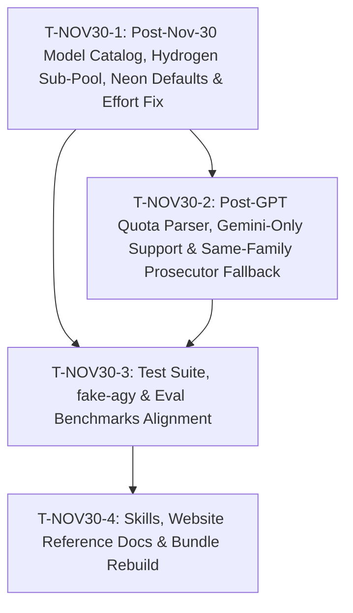

# Specification: November 30, 2026 Model Survival, Post-GPT Quota Resilience & Same-Family Prosecutor Fallback (Wave 0 — PR 1)

**Base:** `origin/main` \
**Gate:** `{"build": "npm run build", "test": "npm test"}`

--------------------------------------------------------------------------------

## 1. Overview & Objectives

On **November 30, 2026**, Google Antigravity removes **Gemini 4 Argon (`gemini-4-argon-*`, `gemini-pro-orchestrator-argon`), Gemini 3.8 Flash (`gemini-3.8-flash-*`), GPT-OSS-120b (`gpt-oss-120b-medium`), and Claude 4.6** (`https://antigravity.google/docs/models/`), establishing **Gemini 4 Neon** (`512K` context, `#1` Coding Agent Index, `32%` lower cost per task than Carbon), **Gemini 4 Hydrogen** (available across Free, Plus, Pro Trial, Pro Paid, Ultra, and Enterprise), **Orchestrator (Neon / Carbon)**, and **Claude 5.5 (Sonnet / Opus)** as the live platform catalog (with `gemini-3.7-flash`, `gemini-3.6-flash`, and `gemini-3.1-pro` remaining live on Gemini Enterprise).

This specification executes **Wave 0 — PR 1** of the owner-approved `/grill-me` roadmap:

1. **Catalog Migration, `Hydrogen` Fast Sub-Pool, `Neon` Frontier Priority & Enterprise Pass-Through (`T-NOV30-1`)**:
   - Retires `gemini-3.8-flash-*`, `gemini-4-argon-*`, `gemini-pro-orchestrator-argon`, and `gpt-oss-120b-medium` from active `MODELS` / `MODEL_ALIASES` / `ORCHESTRATOR_MODELS` into `RETIRED_MODEL_MAP` (`3.8-flash -> 4-hydrogen`, `4-argon -> 4-neon`, `orchestrator-argon -> orchestrator-neon`, `gpt-oss-120b -> claude-sonnet-5-5-medium`).
   - Moves `gemini-4-hydrogen-{low,medium,high,xhigh}` into `MODELS['gemini-flash']` (preserving two-lane Gemini sub-pool concurrency) and promotes `gemini-pro-orchestrator-neon` and `gemini-4-neon-*` ahead of `Carbon` across `TIER_CANDIDATES.frontier`, `FRONTIER_NO_ORCHESTRATOR`, `ARL_LENS_MODELS`, and `ROLE_MODELS`.
   - Removes Enterprise-live `gemini-3.7-flash-*`, `gemini-3.6-flash-*`, and `gemini-3.1-pro-*` from `RETIRED_MODEL_MAP` so Enterprise users can invoke them without spurious retirement remapping, while retaining case-insensitive display-name normalization (`ENTERPRISE_LEGACY_ALIASES`) and `poolOf` routing.
   - Fixes `selectCliEffortFlag()` in `lib/models.mjs` so `ORCHESTRATOR_MODELS` unconditionally return `null` (per `docs/models/`: Orchestrator in the CLI uses a fixed reasoning budget where `--effort` does not apply), while unsuffixed dynamic-effort base slugs (`gemini-4-neon`, `gemini-4-hydrogen`) receive Strike-0 / Strike-1 `--effort`.
2. **Post-GPT Quota Group Tolerance, Gemini-Only Single-Pool Support & Same-Family Prosecutor Fallback (`T-NOV30-2`)**:
   - Hardens `parseQuotaProbeOutput()` (`lib/pools.mjs`) to accept post-GPT group names (`'Claude Models'`, `'Claude and GPT models'`, `'Anthropic Models'`) and single-group `'Gemini Models'` `agy -p /quota --output-format json` envelopes returned on Free/Plus/Pro-Trial accounts (synthesizing `claude_gpt` with `0%` remaining and `unavailable: true` so `claude` cap scales to `0` without tripping `ambiguous_quota_pools`).
   - Adds `sameFamilyProsecutorsFor(builderModel)` in `lib/models.mjs` and wires automatic fallback in `PoolSet.prosecutorsFor` / `PoolSet.prosecutorFor` (`lib/pools.mjs`), `acquireWithQuotaHandling` / `prosecuteBranch` (`lib/scheduler.mjs`), `prosecute` (`lib/prosecute.mjs`), and `runInteractiveRescue` (`lib/rescue.mjs`): prefers `Claude 5.5` when `claude` pool capacity `> 0` (`prosecutionMode: 'cross-family'`), and falls back cleanly to a distinct fresh-context Gemini model (`Carbon-High` prosecuting `Neon`/`Orchestrator-Neon`; `Neon-High` prosecuting `Hydrogen`/`Carbon`/`Orchestrator`) with `prosecutionMode: 'same-family-fallback'` recorded in the verdict and `.adlc/manifest.jsonl` when `claude` capacity is `0`.
3. **Fixtures, Evals, Reference Docs & Bundle Synchronization (`T-NOV30-3`, `T-NOV30-4`)**:
   - Aligns `test/fixtures/fake-agy`, scheduler/ARL/orchestrator tests, `evals/`, `skills/adversarial-review/references/models.json`, `skills/{code-review,plan-review}/SKILL.md`, `website/` docs + generated reference pages, and rebuilds `dist/` bundles with zero bundle or doc drift.

## Resolved Trade-Offs (from `/grill-me`)

- **Cross-Family Invariant Preserved on Static Tables, Explicit Fallback Function for Zero-Claude Capacity (`A2`):** `PROSECUTORS` and `PROSECUTOR_CANDIDATES` remain strictly cross-family (`gemini <-> claude`) so cross-family routing invariants hold whenever both pools have quota. `sameFamilyProsecutorsFor(builderModel)` is consulted only when `claude` pool capacity is `0` (or after all cross-family candidates fail transiently), stamping `prosecutionMode: 'same-family-fallback'` into `.adlc/manifest.jsonl`.
- **Two-Lane Gemini Sub-Pool Continuity (`A3`):** Placing `gemini-4-hydrogen-*` in `MODELS['gemini-flash']` keeps both `'gemini-flash'` (fast/cheap/mid lane) and `'gemini-pro'` (`Neon`/`Carbon`/`Orchestrator` lane) populated under the upstream `'gemini'` quota family without breaking `PoolSet` schema keys in `agb_pools_v2.json`.
- **Orchestrator Fixed Reasoning Budget (`docs/models/`):** `selectCliEffortFlag` checks `ORCHESTRATOR_MODELS.has(slug)` before `explicitEffort`/`defaultEffort` and returns `null` so `runAgy` and `NdjsonWorkerDaemon` never pass an unsupported `--effort` flag to Orchestrator slugs.

--------------------------------------------------------------------------------

## 2. Ticket Dependency DAG

--------------------------------------------------------------------------------

## 3. Ticket Specifications

### Ticket 1: `T-NOV30-1` — Post-Nov-30 Model Catalog, Hydrogen Sub-Pool, Neon Defaults & Effort Fix

- **Scope**: `lib/models.mjs`, `lib/doctor-models.mjs`, `test/models-live-catalog.test.mjs`, `test/models-registry.test.mjs`, `test/agy-json-schema.test.mjs`
- **Rails**: `lib/lock.mjs`, `lib/gates.mjs`, `vendor/cache/**`, `scripts/rails-guard-ci.mjs`
- **Edges**: `T-NOV30-1 -> T-NOV30-2`, `T-NOV30-1 -> T-NOV30-3`
- **Tier**: `frontier`
- **Pool Hint**: `gemini`
- **Objectives**:
  1. Update `MODELS`, `MODEL_ALIASES`, and `ORCHESTRATOR_MODELS` in `lib/models.mjs` to the 19-slug post-Nov-30 Antigravity catalog (`'gemini-flash'`: `gemini-4-hydrogen-{low,medium,high,xhigh}`; `'gemini-pro'`: `gemini-4-neon-{low,medium,high,xhigh}`, `gemini-4-carbon-{low,medium,high}`, `gemini-pro-orchestrator-neon`, `gemini-pro-orchestrator`; `'claude'`: `claude-sonnet-5-5-{low,medium,high}`, `claude-opus-5-5-{low,medium,high}`).
  2. Update `RETIRED_MODEL_MAP` so retiring `gemini-3.8-flash-{low,medium,high}` and `gemini-3.5-flash-{low,medium,high}` map to `gemini-4-hydrogen-{low,medium,high}`, `gemini-4-argon-{low,medium,high}` maps to `gemini-4-neon-{low,medium,high}`, `gemini-pro-orchestrator-argon` (`orchestrator (argon)`) maps to `gemini-pro-orchestrator-neon`, `gpt-oss-120b-medium` (`gpt-oss 120b (medium)`) maps to `claude-sonnet-5-5-medium`, and `claude-4-6` maps to `claude-5-5`, while Enterprise-live `gemini-3.7-flash-*`, `gemini-3.6-flash-*`, and `gemini-3.1-pro-*` resolve cleanly without retirement warnings (`poolOf` -> `'gemini-flash'` for `hydrogen`/`flash`, `'gemini-pro'` for `3.1-pro`/`neon`/`carbon`).
  3. Promote `gemini-pro-orchestrator-neon` and `gemini-4-neon-*` ahead of `Carbon` in `TIER_CANDIDATES`, `FRONTIER_NO_ORCHESTRATOR`, `ARL_LENS_MODELS`, and `ROLE_MODELS`, update `PROSECUTORS` / `PROSECUTOR_CANDIDATES` to `claude-sonnet-5-5-*` <-> `gemini-4-neon-high` / `gemini-4-carbon-high` / `gemini-4-hydrogen-high`, and export `sameFamilyProsecutorsFor(builderModel)` returning distinct fresh-context Gemini fallbacks (`['gemini-4-carbon-high', 'gemini-4-hydrogen-high']` for `neon` builders; `['gemini-4-neon-high', 'gemini-4-carbon-high']` for `hydrogen` builders; `['gemini-4-neon-high', 'gemini-4-hydrogen-high']` for `carbon` builders).
  4. Fix `selectCliEffortFlag()` in `lib/models.mjs` so `ORCHESTRATOR_MODELS` always return `null`, suffixed catalog slugs return `explicitEffort` / Strike-0 `defaultEffort` or `null`, and unsuffixed base slugs (`gemini-4-neon`, `gemini-4-hydrogen`) emit `'high'`/`'medium'` on Strike 0 and `'xhigh'`/`'max'` on Strike >= 1.
  5. Update `lib/doctor-models.mjs` comments and align `test/models-live-catalog.test.mjs`, `test/models-registry.test.mjs`, and `test/agy-json-schema.test.mjs`.
- **Acceptance Criteria**:
  - `node --test test/models-live-catalog.test.mjs test/models-registry.test.mjs test/agy-json-schema.test.mjs` exits `0`.

--------------------------------------------------------------------------------

### Ticket 2: `T-NOV30-2` — Post-GPT Quota Parser, Gemini-Only Support & Same-Family Prosecutor Fallback

- **Scope**: `lib/pools.mjs`, `lib/scheduler.mjs`, `lib/prosecute.mjs`, `lib/rescue.mjs`, `test/pools.test.mjs`, `test/prosecute.test.mjs`
- **Rails**: `lib/lock.mjs`, `lib/gates.mjs`, `vendor/cache/**`, `scripts/rails-guard-ci.mjs`
- **Edges**: `T-NOV30-2 -> T-NOV30-3`
- **Tier**: `frontier`
- **Pool Hint**: `gemini`
- **Objectives**:
  1. In `lib/pools.mjs` (`parseQuotaProbeOutput` and `writeStatusLineQuotaCache`):
     - Recognize `'Gemini Models'` (`/^(?:gemini)\s+models$/i`) and post-GPT 3P group names (`/^(?:claude(?:\s+and\s+gpt)?|anthropic)\s+models$/i`) while continuing to reject unknown or duplicate pool names with `ambiguous_quota_pools`.
     - When an `agy` usage envelope (`command.data.groups`) contains only `'Gemini Models'` (`groups.length === 1`, Free/Plus/Pro-Trial tier), synthesize `claude_gpt` with `{ fiveHourRemainingPercent: 0, fiveHourResetTime: '1970-01-01T00:00:00Z', weeklyRemainingPercent: 0, weeklyResetTime: '1970-01-01T00:00:00Z', unavailable: true }` and allow `unavailable === true` epoch-zero timestamps in `writeStatusLineQuotaCache` so `claude` cap cleanly computes to `0` without tripping `ambiguous_quota_pools` or `invalid_quota_timestamp`.
  2. In `PoolSet` (`lib/pools.mjs`), `lib/scheduler.mjs` (`acquireWithQuotaHandling`, `prosecuteBranch`), `lib/prosecute.mjs` (`prosecute`), and `lib/rescue.mjs`:
     - Add `PoolSet.prosecutorCandidatesWithFallback(builderModel)` (appending `sameFamilyProsecutorsFor(builderModel)` after cross-family `prosecutorsFor(builderModel)`) and update `PoolSet.prosecutorFor(builderModel)` so that when cross-family `claude` capacity is `> 0`, a `claude` prosecutor is chosen, and when `claude` capacity is `0` (and `gemini` capacity `> 0`), it returns the first available distinct Gemini prosecutor from `sameFamilyProsecutorsFor(builderModel)`.
     - Compute `prosecutionMode = familyOf(activeProsecutor) === familyOf(builderModel) ? 'same-family-fallback' : 'cross-family'` in `prosecute` / `prosecuteBranch` / `rescue.mjs` and record `prosecutorModel` and `prosecutionMode` in `.adlc/manifest.jsonl` (`recordGate`). Fix `PROSECUTOR_CANDIDATES[0]` -> `PROSECUTORS.gemini` fallback in `lib/rescue.mjs`.
  3. Add unit and edge-case tests in `test/pools.test.mjs` and `test/prosecute.test.mjs` covering `'Claude Models'` rename, single-group Gemini-only quota envelopes, and zero-Claude `same-family-fallback` prosecution + manifest recording.
- **Acceptance Criteria**:
  - `node --test test/pools.test.mjs test/prosecute.test.mjs` exits `0`.

--------------------------------------------------------------------------------

### Ticket 3: `T-NOV30-3` — Test Suite, `fake-agy` & Eval Benchmarks Alignment

- **Scope**: `test/fixtures/fake-agy`, `test/orchestrator-routing.test.mjs`, `test/review-arl.test.mjs`, `test/review.test.mjs`, `test/unit.test.mjs`, `test/scheduler.test.mjs`, `test/sync-models.test.mjs`, `test/agy-1-5-9-print.test.mjs`, `test/agy.test.mjs`, `test/modernize-skill.test.mjs`, `evals/scenarios.mjs`, `evals/subsystem-bench.mjs`, `evals/v13-enhancements-bench.mjs`
- **Rails**: `lib/lock.mjs`, `lib/gates.mjs`, `vendor/cache/**`, `scripts/rails-guard-ci.mjs`
- **Edges**: `T-NOV30-3 -> T-NOV30-4`
- **Tier**: `mid`
- **Pool Hint**: `gemini`
- **Objectives**:
  1. Update `test/fixtures/fake-agy` (`models` output) to reflect the post-Nov-30 19-slug catalog.
  2. Update model slug assertions in `test/orchestrator-routing.test.mjs`, `test/review-arl.test.mjs`, `test/review.test.mjs`, `test/unit.test.mjs`, `test/scheduler.test.mjs`, `test/sync-models.test.mjs`, `test/agy-1-5-9-print.test.mjs`, `test/agy.test.mjs`, `test/modernize-skill.test.mjs`, `evals/scenarios.mjs`, `evals/subsystem-bench.mjs`, and `evals/v13-enhancements-bench.mjs`.
- **Acceptance Criteria**:
  - `node --test test/orchestrator-routing.test.mjs test/review-arl.test.mjs test/review.test.mjs test/unit.test.mjs test/sync-models.test.mjs test/evals.test.mjs` exits `0`.

--------------------------------------------------------------------------------

### Ticket 4: `T-NOV30-4` — Skills, Website Reference Docs & Bundle Rebuild

- **Scope**: `skills/adversarial-review/references/models.json`, `skills/code-review/SKILL.md`, `skills/plan-review/SKILL.md`, `website/content/docs/concepts/pools-and-tiers.mdx`, `website/content/docs/concepts/prosecution.mdx`, `website/content/docs/guides/review.mdx`, `website/content/docs/reference/agy-integration.mdx`, `website/generated/modules.mdx`, `dist/**`, `specs/v2-1-multi-surface-and-nov30-spec.md`
- **Rails**: `lib/lock.mjs`, `lib/gates.mjs`, `vendor/cache/**`, `scripts/rails-guard-ci.mjs`
- **Edges**: None
- **Tier**: `mid`
- **Pool Hint**: `gemini`
- **Objectives**:
  1. Run `AGB_SYNC_MODELS_OFFLINE=1 npm run sync:models` to regenerate `skills/adversarial-review/references/models.json` and update lens tables in `skills/code-review/SKILL.md` and `skills/plan-review/SKILL.md`.
  2. Update post-Nov-30 catalog, `Hydrogen` sub-pool, `Neon` default, and `same-family-fallback` prosecution documentation in `website/content/docs/{concepts/pools-and-tiers,concepts/prosecution,guides/review,reference/agy-integration}.mdx` and verify `node website/scripts/gen-reference.mjs --check`.
  3. Run `npm run build` (`dist/agb.mjs`, `dist/mcp-server.mjs`, `dist/hooks/pre-tool-use.bundle.mjs`), `npm test`, `npm run coverage:check`, and `adlc rails-guard`.
- **Acceptance Criteria**:
  - `npm run build && node website/scripts/gen-reference.mjs --check && npm test` exits `0` with clean `dist/` and `vendor/`.

--------------------------------------------------------------------------------

## 4. Acceptance Criteria

1. Active `MODELS`, `MODEL_ALIASES`, `ORCHESTRATOR_MODELS`, `TIER_CANDIDATES`, `PROSECUTORS`, `PROSECUTOR_CANDIDATES`, `ARL_LENS_MODELS`, and `ROLE_MODELS` in `lib/models.mjs` contain zero retiring November 30, 2026 slugs (`gemini-3.8-flash-*`, `gemini-4-argon-*`, `gemini-pro-orchestrator-argon`, `gpt-oss-120b-medium`), place `gemini-4-hydrogen-*` in `'gemini-flash'`, promote `Neon` ahead of `Carbon`, preserve Enterprise `3.7/3.6/3.1` pass-through, and never emit `--effort` on `ORCHESTRATOR_MODELS`. Verify: `node --test test/models-live-catalog.test.mjs test/models-registry.test.mjs test/agy-json-schema.test.mjs`
2. `parseQuotaProbeOutput` in `lib/pools.mjs` accepts post-GPT `'Claude Models'` / `'Anthropic Models'` group names and single-group `'Gemini Models'` envelopes (`unavailable: true` on `claude_gpt`), while rejecting unknown or duplicate pools. Verify: `node --test test/pools.test.mjs`
3. When `claude` pool capacity is `0`, `PoolSet.prosecutorFor` and `prosecuteBranch` fall back to `sameFamilyProsecutorsFor(builderModel)` and record `prosecutionMode: "same-family-fallback"` in `.adlc/manifest.jsonl`. Verify: `node --test test/pools.test.mjs test/prosecute.test.mjs`
4. Offline model reference (`skills/adversarial-review/references/models.json`), website reference generator, `dist/` bundles, frozen rails, and the full test suite pass with zero drift. Verify: `npm run build && AGB_SYNC_MODELS_OFFLINE=1 node scripts/sync-models.mjs --check && node website/scripts/gen-reference.mjs --check && npm test`

