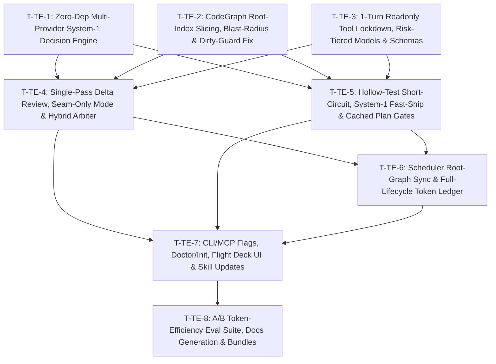

# Feature Specification: v2.0 Token-Efficient Prosecution, Adversarial Review, CodeGraph Slicing & System-1 Decision Engine

**Base:** `main` \
**Gate:** `{"build": "npm run build", "test": "npm test"}`

--------------------------------------------------------------------------------

## 1. Overview & Objectives

Resolve the primary user feedback on `antigravity-booster`: **excessive token and weekly pool-quota burn concentrated in cross-model prosecution (`lib/prosecute.mjs`) and multi-lens adversarial review (`lib/review.mjs`)**, while preserving every ADLC P1–P5 safety invariant (cross-model isolation, fail-closed mechanical gates, prompt-injection fencing, and mutation-testing enforcement).

### Root-Cause Audit of Current Token Multipliers (`v2.0.0` Baseline)

1. **Static-Diff Multi-Round Loop (`lib/review.mjs:602-724`)**: `reviewFleet()` defaults to `dryRounds = 2, maxRounds = 5` over the *identical static diff*. Even a 0-finding diff runs every lens twice (`8–10` frontier calls); diffs with findings run `15–25+` calls before a single line is edited, and outer ARL `--loop` re-sends the entire branch diff against `main` after fixes.
2. **Multi-Turn Repo Crawling in Readonly Workers (`lib/ndjson-worker.mjs:89-116`)**: `READONLY_DENY_TOOLS` leaves `read_file`, `view_file`, `grep_search`, `code_search`, `file_search`, `list_directory`, and `find_by_name` enabled. Frontier reviewers/prosecutors frequently take 3–10 tool-call turns, re-billing the entire `20k–45k`-token diff on every turn.
3. **Wasted Prosecutor Spawn on `hollow-test` Survivors (`lib/prosecute.mjs:161-213`)**: When `adlc hollow-test` finds surviving mutants, `prosecute()` already forces `verdict = 'block'` mechanically, yet still spawns an 8-minute high-effort `runAgy` LLM session.
4. **Fixed Frontier Over-Allocation & Unconditional LLM Arbiter (`lib/models.mjs:137-176`, `lib/review.mjs:406-470`)**: `ARL_LENS_MODELS` and `PROSECUTORS` route trivial leaf edits to `claude-opus-5-5-high` / `gemini-4-argon-high`, and `triageFindings()` spawns an LLM Arbiter even when `deterministicTriage()` already resolves `1–4` disjoint findings cleanly.
5. **Cross-Phase Pipeline Redundancy (`lib/plan.mjs:525`, `bin/agb.mjs:478`, `skills/agb/SKILL.md:105`)**: `coldstartTickets` runs twice on identical tickets (`agb plan` then `agb preflight`), Plan ARL overlaps Stage B probes, and `/agb` Phase 5 re-reviews 100% of single-ticket internal lines already prosecuted in Phase 4 instead of focusing on cross-ticket integration seams.
6. **Two Live CodeGraph Bugs (`lib/worktrees.mjs:114`, `lib/scheduler.mjs:2618`, `lib/prosecute.mjs:162`)**:
   - `codegraph init` creates an untracked `.codegraph/.gitignore` file that trips `isDirty(repo)` and blocks `agb run`.
   - `scheduler.mjs` and `prosecute.mjs` pass `repo: worktree` (`.worktrees/agb-<id>`) to `hasCodegraphIndex()`, which is always `false` in git worktrees, silently disabling CodeGraph during every `agb run`.
7. **Discarded Prosecution & Review Token Telemetry (`lib/prosecute.mjs:242`, `lib/review.mjs:761`)**: `scheduler.mjs` records `build.telemetry` only for builders while `prosecute()` and `reviewFleet()` discard `res.telemetry`, making review/prosecution token burn invisible in `agb status`, `FactoryLedger`, and Flight Deck.

### Aligned Three-Tier Architecture (`/grill-me` Decisions)

- **Tier 0 — Zero-Dependency Core (Default ON for all repositories)**:
  - Default `reviewFleet()` to **1 pass per static diff state** (`dryRounds = 1, maxRounds = 1`), add **delta fix-round review** for ARL Round 2+ (reviewing only the fix delta + touched symbol callers + open findings from Round `N-1`), and preserve `--thorough` / `--dry-rounds <n>` as explicit opt-ins.
  - Assemble a **host-side Context Pack** + **per-lens diff filter** and mechanically lock readonly roles (`prosecutor`, `review`, `review-plan`, `arbiter`, `coldstart`, `parallax`, `premortem`) to **strictly 1 turn** (denying `READ_ONLY_TOOLS` by default).
  - **Short-circuit `prosecute()` before LLM spawn** when `adlc hollow-test` reports surviving mutants (`0` LLM tokens).
  - **Blast-radius model tiering** across `PROSECUTORS` and `ARL_LENS_MODELS`, plus a **deterministic Arbiter fast-path** when `findings.length <= 4` with disjoint `file|claim` keys and zero contested blast-radius items (when no System-1 engine is configured).
  - **Provenance-cached plan/preflight gates** (`plan.gateProvenance` SHA-256 content hashes) and **`--seams-only` post-run review** when `.adlc/manifest.jsonl` proves per-ticket prosecution passed.
- **Tier 1 — Opt-In CodeGraph Accelerator (`CodeGraph`, auto-active when `<rootRepo>/.codegraph/` exists)**:
  - Fix `.codegraph/` dirty-tree handling in `ensureGitignore()` / `isDirty()`, share `<rootRepo>/.codegraph` read-only across worktrees while reading modified files from `worktree`, and run incremental `codegraph sync` under `mergeLock` in `integrate()`.
  - Upgrade `buildReviewContextPack()`, `computeDiffBlastRadius()`, `extractCrossTicketSeams()` (`lib/context-slice.mjs`), and `deriveImpactedTests()` (`lib/test-impact.mjs` via `codegraph affected --json`).
- **Tier 2 — Opt-In System-1 Decision Engine (`lib/decision-engine.mjs`, zero runtime npm deps)**:
  - Native Node `>=22` `fetch` HTTP adapter supporting **TypeSafe Jev** (`TYPESAFE_API_KEY`, `jev-latest`), **Google Gemini Decisions API** (`GEMINI_API_KEY`, `gemini-decision-1`, `0` output tokens), and **local/self-hosted Kev / OpenRouter** endpoints behind a unified `Noul` / `Choice` / `Score` primitive interface.
  - Powers **Calibrated Lens Gating** (`skip` lens when `p < 0.15` and `confidence >= 0.85`), **Typed Neutral Arbiter Triage**, **Batched Coldstart/Tier Scoring**, and **Low-Risk Fast-Ship** (strictly restricted to `hollow-test` = 0 survivors, `blastRadius.level === 'low'`, `ticket.tier !== 'frontier'`, per-AC `Noul >= 0.92`, charge risk `Noul < 0.10`, and `confidence >= 0.85`; fail-closed escalation to System-2 otherwise).

--------------------------------------------------------------------------------

## 2. Architecture & Ticket DAG

--------------------------------------------------------------------------------

## 3. Component Details & Ticket Specifications

### Ticket 1: `T-TE-1` — Zero-Dependency Multi-Provider System-1 Decision Engine

- **Scope**: `lib/decision-engine.mjs`, `test/decision-engine.test.mjs`
- **Rails**: `lib/lock.mjs`, `lib/gates.mjs`, `vendor/cache/**`, `scripts/rails-guard-ci.mjs`
- **Edges**: `T-TE-1 -> T-TE-4, T-TE-5`
- **Tier**: `mid`
- **Pool Hint**: `claude-gpt`
- **Objectives**:
  1. Create `lib/decision-engine.mjs` with zero external npm dependencies using Node `>=22` global `fetch` (plus injectable `transport` for offline unit tests, `AbortSignal.timeout`, strict HTTPS/loopback URL validation, and credential-redacted error reporting).
  2. Export `resolveDecisionConfig({ repo, env, enabled })` reading `.adlc/config.json` (`accelerators.decision`) and environment variables (`AGB_DECISION_PROVIDER`, `TYPESAFE_API_KEY`, `GEMINI_API_KEY`, `AGB_KEV_BASE_URL`, `AGB_DECISION_ENGINE=0` opt-out), returning `{ enabled: false }` by default when unconfigured.
  3. Implement provider drivers normalizing responses to `{ ok, provider, model, latencyMs, inputTokens, outputTokens: 0, answers }` across three primitives (`noul`, `choice`, `score`):
     - `jev`: TypeSafe Jev `systemOne` endpoint (`jev-latest`).
     - `gemini-decisions`: Google Gemini Decisions API (`gemini-decision-1`, zero output tokens).
     - `kev`: Local/self-hosted Kev or OpenRouter-compatible HTTP endpoint (`AGB_KEV_BASE_URL` / config `baseUrl`).
  4. Export high-level fail-closed recipes:
     - `gateReviewLenses(engine, { diff, contextSummary, lenses })`: skips a lens only when `noul` probability `< 0.15` and `confidence >= 0.85`; any error, timeout, or lower confidence returns `run`.
     - `screenTicketFastShip(engine, { ticket, diff, blastRadius, hollowTest })`: returns `fastShip: true` only when `hollowTest?.ok && hollowTest.survived === 0`, `blastRadius?.level === 'low'`, `ticket?.tier !== 'frontier'`, every extracted acceptance criterion has `noul >= 0.92`, every prosecution charge risk has `noul < 0.10`, and minimum confidence `>= 0.85`; otherwise returns `{ fastShip: false, reason }`.
     - `triageFindingsSystemOne(engine, { findings, targetType, context })`: batches `verdict` (`choice`), `severity` (`score`), `resolution_route` (`choice`), and `blast_radius` (`noul`), preserving `SHAPE-*` and `blast_radius` safety floors identical to `lib/review.mjs`.
     - `scoreColdstartTickets(engine, { tickets, gate })`: batches coldstart executable confidence per ticket, escalating uncertain tickets (`confidence < 0.85` or gap `noul >= 0.20`) to System-2.
- **Acceptance Criteria**:
  - `DecisionEngine` evaluates `noul`, `choice`, and `score` primitives across `jev`, `gemini-decisions`, and `kev` mock transports with `outputTokens === 0` and scrubs API keys on HTTP/timeout errors. Verify: `node --test test/decision-engine.test.mjs`
  - `screenTicketFastShip` and `gateReviewLenses` fail closed (escalating to System-2) whenever `hollowTest.survived > 0`, `blastRadius.level !== 'low'`, `ticket.tier === 'frontier'`, `confidence < 0.85`, or transport fails. Verify: `node --test test/decision-engine.test.mjs`

--------------------------------------------------------------------------------

### Ticket 2: `T-TE-2` — CodeGraph Root-Index Slicing, Blast-Radius Scorer, Seam Extractor & Dirty-Guard Fix

- **Scope**: `lib/context-slice.mjs`, `lib/test-impact.mjs`, `lib/worktrees.mjs`, `test/context-slice.test.mjs`, `test/test-impact.test.mjs`, `test/worktrees-codegraph.test.mjs`
- **Rails**: `lib/lock.mjs`, `lib/gates.mjs`, `vendor/cache/**`, `scripts/rails-guard-ci.mjs`, `test/unit.test.mjs`
- **Edges**: `T-TE-2 -> T-TE-4, T-TE-5`
- **Tier**: `mid`
- **Pool Hint**: `gemini`
- **Objectives**:
  1. In `lib/worktrees.mjs`, update `ensureGitignore()` to include `.codegraph/` and update `isDirty()` to ignore `.codegraph` / `.codegraph/**` untracked metadata (fixing the `codegraph init` `.codegraph/.gitignore` dirty-tree blocker); export `syncCodegraphIndex(rootRepo, { codegraphBin = 'codegraph', timeoutMs = 15_000 } = {})` that runs `codegraph sync` when `<rootRepo>/.codegraph` exists and degrades to `{ ok: false, error }` without throwing on failure.
  2. In `lib/context-slice.mjs`, support `{ repo, rootRepo, worktree, enabled }` in `hasCodegraphIndex()`, `buildContextSlice()`, and `discoverExternalCallers()` (honoring `AGB_CODEGRAPH=0` and `.adlc/config.json` `accelerators.codegraph === false`) so worktree callers resolve the SQLite graph at `rootRepo ?? repo` while reading edited file contents from `worktree ?? repo`.
  3. Upgrade symbol-hunk mapping in `lib/context-slice.mjs` to map unified diff `@@` line ranges onto enclosing functions/classes/methods in modified files (not just `^[+-]\s*export` lines), and export:
     - `buildReviewContextPack(diffText, { rootRepo, worktree, lens, scope, maxBytes = 16_384, tag })`: returns `{ filteredDiff, contextBlock, modifiedSymbols, callers, source: 'codegraph' | 'static-ast', omittedNoiseFiles }` using `codegraph callers --json` / `codegraph callees --json` when available (falling back to static-AST extraction) and stripping lens-irrelevant diff noise (lockfiles, generated `dist/`/`vendor/`/`website/generated/` chunks, snapshots).
     - `computeDiffBlastRadius(diffText, { rootRepo, worktree, scope })`: deterministically computes `{ level: 'low' | 'medium' | 'high', fanIn, externalCallersCount, touchesExportedApi, touchesSecuritySensitivePath, changedLoc, source }` in `0` LLM tokens via `codegraph impact --depth 2 --json` or static import/caller counts.
     - `extractCrossTicketSeams(diffText, ticketScopes, { rootRepo })`: extracts hunks touching symbols/files with cross-ticket import/caller edges plus `codegraph cycles` warnings for `--seams-only` post-run review.
  4. In `lib/test-impact.mjs`, accept `rootRepo` in `deriveImpactedTests()` and merge `codegraph affected --json` test candidates (strictly filtered through `isContainedValidTestFile` path/symlink containment) when `hasCodegraphIndex(rootRepo ?? repo)` is true.
- **Acceptance Criteria**:
  - A repository initialized with `codegraph init` (producing untracked `.codegraph/.gitignore`) reports `isDirty(repo) === false`, and `buildContextSlice` / `discoverExternalCallers` invoked from `.worktrees/agb-<id>` with `rootRepo` resolve `<rootRepo>/.codegraph` instead of silently falling back. Verify: `node --test test/worktrees-codegraph.test.mjs test/context-slice.test.mjs`
  - `buildReviewContextPack`, `computeDiffBlastRadius`, `extractCrossTicketSeams`, and `deriveImpactedTests` work both with fake/live `codegraph` JSON output and in zero-dependency `static-ast` fallback mode, while rejecting path-traversal strings from untrusted graph output. Verify: `node --test test/context-slice.test.mjs test/test-impact.test.mjs test/unit.test.mjs`

--------------------------------------------------------------------------------

### Ticket 3: `T-TE-3` — 1-Turn Readonly Tool Lockdown, Blast-Radius Model Tiering & Provenance Schemas

- **Scope**: `lib/ndjson-worker.mjs`, `lib/models.mjs`, `lib/schemas.mjs`, `test/ndjson-worker.test.mjs`, `test/models-registry.test.mjs`
- **Rails**: `lib/lock.mjs`, `lib/gates.mjs`, `vendor/cache/**`, `scripts/rails-guard-ci.mjs`
- **Edges**: `T-TE-3 -> T-TE-4, T-TE-5`
- **Tier**: `mid`
- **Pool Hint**: `gemini`
- **Objectives**:
  1. In `lib/ndjson-worker.mjs`, extend `buildRoleSettingsProfile(role, { hasCodegraph = false, allowReadTools = false, extraSettings = {} })` so `READONLY_ROLES` (`prosecutor`, `review`, `review-plan`, `arbiter`, `coldstart`, `parallax`, `premortem`, `readonly`) also deny filesystem/search read tools (`view_file`, `read_file`, `grep_search`, `code_search`, `file_search`, `list_directory`, `find_by_name`, `list_dir`, `search_in_file`, `view_file_outline`, `read_url_content`, `read_browser_page`, `search_web`) unless `allowReadTools === true`, guaranteeing single-turn `1x` input-token execution over pre-baked context packs.
  2. In `lib/models.mjs`, export `selectRiskTieredProsecutor(builderModel, { blastRadius = 'high', ticketTier = 'mid', pools } = {})` (preserving strict cross-family `familyOf(prosecutor) !== familyOf(builderModel)` invariant!) and `selectRiskTieredLensModel(lens, { blastRadius = 'high', pools, fallbackIndex = 0 } = {})`, routing `low` risk (`cheap`/`mid` non-high-blast changes) to `gemini-3.8-flash-medium` / `claude-sonnet-5-5-low` / `gpt-oss-120b-medium`, `medium` risk to `claude-sonnet-5-5-medium` / `gemini-4-argon-medium`, and `high` risk to full frontier `ARL_LENS_MODELS`.
  3. In `lib/schemas.mjs`, add optional `gateProvenance` schema definitions (`coldstartHashes`, `planArlSpecHash`, `prosecutedTickets`) and token-telemetry summary fields so `validatePlan` and review/prosecution callers share canonical validation.
- **Acceptance Criteria**:
  - `buildRoleSettingsProfile('prosecutor')` and `buildRoleSettingsProfile('review')` deny all filesystem search/read tools by default while `allowReadTools: true` and `builder` profiles preserve expected read permissions. Verify: `node --test test/ndjson-worker.test.mjs`
  - `selectRiskTieredProsecutor` never selects the same model family as `builderModel` across all `(builderFamily, blastRadius, ticketTier)` combinations, and `selectRiskTieredLensModel` scales down on `low`/`medium` blast radius while matching `ARL_LENS_MODELS` on `high`. Verify: `node --test test/models-registry.test.mjs`

--------------------------------------------------------------------------------

### Ticket 4: `T-TE-4` — Single-Pass Delta Review Fleet, Seam-Only Post-Run Mode, Lens Gating & Hybrid Arbiter

- **Scope**: `lib/review.mjs`, `test/review.test.mjs`, `test/review-arl.test.mjs`
- **Rails**: `lib/lock.mjs`, `lib/gates.mjs`, `vendor/cache/**`, `scripts/rails-guard-ci.mjs`
- **Edges**: `Depends on T-TE-1, T-TE-2, T-TE-3; T-TE-4 -> T-TE-6, T-TE-7`
- **Tier**: `frontier`
- **Pool Hint**: `claude-gpt`
- **Objectives**:
  1. Change `reviewFleet()` defaults in `lib/review.mjs` from `dryRounds = 2, maxRounds = 5` to **`dryRounds = 1, maxRounds = 1`** per static diff state, adding `thorough = false` (which restores `dryRounds = 2, maxRounds = 3` when requested) and explicit `dryRounds` override support.
  2. Add **Delta Fix-Round Review** (`deltaDiff`, `priorFindings`) so ARL Round 2+ evaluates only the fix delta + touched symbol callers from `buildReviewContextPack()` and verifies whether `priorFindings` were resolved, skipping lenses that produced `0` prior findings and whose relevant files are untouched in `deltaDiff`.
  3. Add **`seamsOnly` Post-Run Review Mode** (`seamsOnly = false`, plus `canUsePostRunSeams(repo, ref)` checking `.adlc/manifest.jsonl` for passing `prosecution` records): slices the diff via `extractCrossTicketSeams()` and runs targeted seam lenses (`contracts`, `correctness_redteam`, `security`) instead of re-auditing single-ticket internals.
  4. Wire `buildReviewContextPack()`, `computeDiffBlastRadius()`, `selectRiskTieredLensModel()`, and opt-in `gateReviewLenses()` (from `lib/decision-engine.mjs`), plus the **3-Tier Arbiter Cascade** in `triageFindings()`: (a) System-1 `triageFindingsSystemOne` when enabled, (b) `deterministicTriage()` fast-path when `indexed.length <= 4` with unique `key(f)` and zero contested escalations, (c) System-2 `runAgy` Arbiter otherwise.
  5. Aggregate `res.telemetry` across every lens and Arbiter call in `reviewFleet()` and `reviewPlan()`, returning `{ telemetry: { uncachedInputTokens, cachedTokens, outputTokens, inputTokens, billableTokens, system1Calls, skippedLenses, arbiterMode, estimatedTokensSaved } }`.
- **Acceptance Criteria**:
  - Default `reviewFleet({ diff })` executes at most `1` pass per active lens (`4` requests in 4-lens mode, `5` in `--five-lens` mode when unpruned) instead of `8–10+`, while `thorough: true` or `dryRounds: 2` runs multi-dry convergence. Verify: `node --test test/review.test.mjs test/review-arl.test.mjs`
  - `deltaDiff` + `priorFindings` skips clean untouched lenses on Round 2+, `seamsOnly: true` restricts review to cross-ticket seams, 3-tier `triageFindings` uses System-1 or deterministic fast-path when eligible, and `result.telemetry` reports aggregated token counts and `skippedLenses`. Verify: `node --test test/review.test.mjs test/review-arl.test.mjs`

--------------------------------------------------------------------------------

### Ticket 5: `T-TE-5` — Pre-Prosecution `hollow-test` Short-Circuit, System-1 Fast-Ship & Provenance-Cached Plan Gates

- **Scope**: `lib/prosecute.mjs`, `lib/plan.mjs`, `lib/preflight.mjs`, `test/prosecute.test.mjs`, `test/plan.test.mjs`
- **Rails**: `lib/lock.mjs`, `lib/gates.mjs`, `vendor/cache/**`, `scripts/rails-guard-ci.mjs`, `test/unit.test.mjs`
- **Edges**: `Depends on T-TE-1, T-TE-2, T-TE-3; T-TE-5 -> T-TE-6, T-TE-7`
- **Tier**: `frontier`
- **Pool Hint**: `gemini`
- **Objectives**:
  1. In `lib/prosecute.mjs`:
     - Accept `rootRepo` and `changedFiles` in `prosecute()` and forward both to `runHollowTest()`, `computeDiffBlastRadius()`, and `buildReviewContextPack()`.
     - **Short-circuit immediately before `runAgy`** when `hollowTest?.ok && hollowTest.survived > 0` (unless `shortCircuitHollowTest === false`), returning `{ verdict: 'block', model, shortCircuited: 'hollow-test', findings: [hollowSurvivorFinding], hollowTest, telemetry: zeroTelemetry }` in `0` LLM tokens.
     - When `hollowTest` has `0` survivors and opt-in `DecisionEngine` is enabled, evaluate `screenTicketFastShip()`; on `fastShip: true`, return `{ verdict: 'ship', model: decisionRes.model, fastShipped: 'system1', findings: [], hollowTest, telemetry }`; otherwise select risk-tiered cross-family model via `selectRiskTieredProsecutor` (when caller supplies `builderModel` or auto-tiering is enabled), attach `buildReviewContextPack` context block, run 1-turn `runAgy`, and return normalized `telemetry`.
  2. In `lib/preflight.mjs` and `lib/plan.mjs`:
     - Export `hashTicketColdstart(ticket, gate)` and `hashSpecPlanArl(specMarkdown)` (SHA-256).
     - Stamp `plan.gateProvenance = { coldstartHashes, specSha256 }` when `compilePlan()` completes Stage B (and support optional System-1 `scoreColdstartTickets` pre-screening before System-2 `coldstartTickets`).
     - In `preflight(plan, opts)`, skip re-running `coldstartTickets` on any ticket whose current `hashTicketColdstart(ticket, plan.gate)` matches `plan.gateProvenance?.coldstartHashes?.[ticket.id]` (unless `opts.forceColdstart === true`), reporting `cachedColdstartIds`.
- **Acceptance Criteria**:
  - When `runHollowTest` reports `survived > 0`, `prosecute()` returns `verdict: 'block'` with `shortCircuited: 'hollow-test'` and spawns `0` `agy` subprocesses; when `hollowTest` is clean, `prosecute()` attaches `res.telemetry` and honors System-1 fast-ship safety gates. Verify: `node --test test/prosecute.test.mjs test/unit.test.mjs`
  - Compiling a plan via `compilePlan()` stamps `plan.gateProvenance.coldstartHashes`, and running `preflight(plan)` immediately afterward makes `0` duplicate `coldstart` LLM calls while still re-probing any ticket whose body/scope/gate changed. Verify: `node --test test/plan.test.mjs`

--------------------------------------------------------------------------------

### Ticket 6: `T-TE-6` — Scheduler Root-Graph Sync on Merge & Full-Lifecycle Token Economics Ledger

- **Scope**: `lib/scheduler.mjs`, `lib/scheduler-verify.mjs`, `lib/factory-ledger.mjs`, `lib/status.mjs`, `test/scheduler.test.mjs`, `test/factory-ledger.test.mjs`
- **Rails**: `lib/lock.mjs`, `lib/gates.mjs`, `vendor/cache/**`, `scripts/rails-guard-ci.mjs`
- **Edges**: `Depends on T-TE-4, T-TE-5; T-TE-6 -> T-TE-7`
- **Tier**: `frontier`
- **Pool Hint**: `claude-gpt`
- **Objectives**:
  1. In `lib/scheduler.mjs` and `lib/scheduler-verify.mjs`, pass `rootRepo: repo` and `changedFiles` into `prepareTicketContextAndTdd()`, `deriveImpactedTests()`, and `prosecuteBranch()` / `prosecute()` (fixing worktree CodeGraph resolution end-to-end), and enable blast-radius prosecutor tiering (`builderModel` forwarded to `prosecute()`).
  2. Inside `integrate()` in `lib/scheduler.mjs` (under `mergeLock` after advancing `base`), invoke `syncCodegraphIndex(repo)` best-effort so merged Wave `N` changes are indexed in `<repo>/.codegraph` before Wave `N+1` builders and prosecutors slice from it.
  3. Track separate `buildTokens`, `prosecutionTokens`, `system1Calls`, `hollowShortCircuits`, and `estimatedTokensSaved` counters across `lib/scheduler.mjs`, `RunStatus` (`lib/status.mjs`), and `computeRunEconomics` / `FactoryLedger` (`lib/factory-ledger.mjs`), while keeping `BanditModelRouter.recordOutcome()` strictly scoped to builder tokens so prosecutor/System-1 tokens never skew builder model rankings.
- **Acceptance Criteria**:
  - During `runPlan()`, worktree context hydration and `prosecuteBranch()` pass `rootRepo: repo`, `integrate()` calls `syncCodegraphIndex(repo)` best-effort without failing merges when `codegraph` is absent, and `hollow-test` survivor short-circuits record `0` prosecutor LLM tokens. Verify: `node --test test/scheduler.test.mjs`
  - `FactoryLedger` and `RunStatus.snapshot()` persist split `{ buildTokens, prosecutionTokens, reviewTokens, system1Calls, estimatedTokensSaved }` while backward-compatible top-level `billableTokens` and `BanditModelRouter` builder metrics remain intact. Verify: `node --test test/factory-ledger.test.mjs test/scheduler.test.mjs`

--------------------------------------------------------------------------------

### Ticket 7: `T-TE-7` — CLI/MCP Flags, `doctor`/`init` Accelerators, Flight Deck Telemetry & Skill Workflows

- **Scope**: `bin/agb.mjs`, `mcp/server.mjs`, `lib/doctor.mjs`, `lib/tui.mjs`, `sidecars/app.js`, `skills/agb/SKILL.md`, `skills/agb-review/SKILL.md`, `skills/code-review/SKILL.md`, `skills/implement-and-review/SKILL.md`
- **Rails**: `lib/lock.mjs`, `lib/gates.mjs`, `vendor/cache/**`, `scripts/rails-guard-ci.mjs`
- **Edges**: `Depends on T-TE-4, T-TE-5, T-TE-6; T-TE-7 -> T-TE-8`
- **Tier**: `mid`
- **Pool Hint**: `gemini`
- **Objectives**:
  1. Extend `bin/agb.mjs` (`review`, `preflight`, `init`) and `mcp/server.mjs` (`agb_review`, `agb_preflight`, `agb_init`) with additive flags/options:
     - `agb review`: `--thorough`, `--dry-rounds <n>`, `--seams-only`, `--delta <base-ref>`, `--no-codegraph`, `--no-decision-engine`.
     - `agb preflight`: `--force-coldstart`.
     - `agb init`: `--with-codegraph` (runs `codegraph init` if installed and scaffolds `accelerators` in `.adlc/config.json`) and `--decision-provider <jev|gemini-decisions|kev>`.
  2. Extend `lib/doctor.mjs` with advisory accelerator readiness checks: `.codegraph/` index presence/staleness (`codegraph status`) and configured System-1 decision provider env/endpoint check (never failing `doctor` when opt-in accelerators are unconfigured).
  3. Surface split `Build / Prosecute+Review / System-1 / Saved` token telemetry in `lib/tui.mjs` (Flight Deck) and `sidecars/app.js`.
  4. Update `skills/agb/SKILL.md`, `skills/agb-review/SKILL.md`, `skills/code-review/SKILL.md`, and `skills/implement-and-review/SKILL.md` so `/agb` Phase 5 invokes `--seams-only` post-run review when per-ticket prosecution succeeded and fix loops pass `--delta` on Round 2+, then run `node scripts/sync-skills.mjs` if applicable.
- **Acceptance Criteria**:
  - `agb review --help` / `rejectUnknownFlags` and `mcp/server.mjs` `agb_review` schema accept `--thorough`, `--dry-rounds`, `--seams-only`, `--delta`, `--no-codegraph`, and `--no-decision-engine`, rejecting unknown flags cleanly. Verify: `node --test test/review.test.mjs test/review-arl.test.mjs`
  - `agb doctor` reports CodeGraph and System-1 accelerator status as advisory checks without failing unconfigured repos, and `npm run skills:check` passes. Verify: `npm run skills:check`

--------------------------------------------------------------------------------

### Ticket 8: `T-TE-8` — A/B Token-Efficiency Benchmark Suite, Reference Docs & Bundle Build

- **Scope**: `evals/subsystem-bench.mjs`, `website/env-docs.json`, `website/generated/**`, `dist/**`, `test/token-efficiency-v2.test.mjs`
- **Rails**: `lib/lock.mjs`, `lib/gates.mjs`, `vendor/cache/**`, `scripts/rails-guard-ci.mjs`
- **Edges**: `Depends on T-TE-7`
- **Tier**: `mid`
- **Pool Hint**: `claude-gpt`
- **Objectives**:
  1. Add an end-to-end deterministic A/B benchmark in `evals/subsystem-bench.mjs` and integration test suite in `test/token-efficiency-v2.test.mjs` comparing request counts and billable tokens across four configurations on representative multi-ticket + review scenarios:
     - Legacy `v2.0.0` settings (`dryRounds: 2`, multi-turn tools, duplicate preflight coldstart, full Phase 5 review)
     - Tier 0 Zero-Dependency Core (`1`-pass static diff, delta fix round, `hollow-test` short-circuit, cached coldstart, `--seams-only` post-run)
     - Tier 0 + Tier 1 (`CodeGraph` surgical context pack + blast-radius model tiering)
     - Tier 0 + Tier 1 + Tier 2 (`CodeGraph` + `DecisionEngine` lens gating, typed Arbiter, and low-risk fast-ship)
  2. Document all new environment variables (`AGB_CODEGRAPH`, `AGB_DECISION_ENGINE`, `AGB_DECISION_PROVIDER`, `TYPESAFE_API_KEY`, `GEMINI_API_KEY`, `AGB_KEV_BASE_URL`) in `website/env-docs.json`, run the docs reference generator (`website/scripts/gen-reference.mjs`), and rebuild all production bundles (`npm run build` + `npm run plugin:validate`).
- **Acceptance Criteria**:
  - `test/token-efficiency-v2.test.mjs` proves monotonic request and billable-token reductions across Tier 0 (`>= 50%` review request reduction), Tier 1, and Tier 2 while maintaining `100%` recall on planted blocking defects and `hollow-test` survivors. Verify: `node --test test/token-efficiency-v2.test.mjs`
  - `npm run build`, `npm run plugin:validate`, `npm run skills:check`, and `npm test` all exit `0` with zero bundle external leaks or doc-reference drift. Verify: `npm run build && npm run plugin:validate && npm test`
