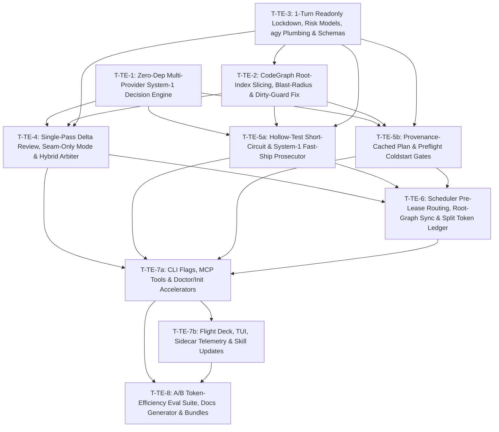

# Feature Specification: v2.0 Token-Efficient Prosecution, Adversarial Review, CodeGraph Slicing & System-1 Decision Engine

**Base:** `spec/v2-token-efficiency` \
**Gate:** `{"build": "npm run build", "test": "npm test"}`

--------------------------------------------------------------------------------

## 1. Overview & Objectives

Resolve the primary user feedback on `antigravity-booster`: **excessive token and weekly pool-quota burn concentrated in cross-model prosecution (`lib/prosecute.mjs`) and multi-lens adversarial review (`lib/review.mjs`)**, while preserving every ADLC P1–P5 safety invariant (cross-model isolation, fail-closed mechanical gates, prompt-injection fencing, and mutation-testing enforcement).

### Root-Cause Audit of Current Token Multipliers (`v2.0.0` Baseline)

1. **Static-Diff Multi-Round Loop (`lib/review.mjs:602-724`)**: `reviewFleet()` defaults to `dryRounds = 2, maxRounds = 5` over the *identical static diff*. Even a 0-finding diff runs every lens twice (`8–10` frontier calls); diffs with findings run `15–25+` calls before a single line is edited, and outer ARL `--loop` re-sends the entire branch diff against `main` after fixes.
2. **Multi-Turn Repo Crawling in Readonly Workers (`lib/ndjson-worker.mjs:89-116`)**: `READONLY_DENY_TOOLS` leaves `read_file`, `view_file`, `grep_search`, `code_search`, `file_search`, `list_directory`, and `find_by_name` enabled. Frontier reviewers/prosecutors frequently take 3–10 tool-call turns, re-billing the entire `20k–45k`-token diff on every turn.
3. **Wasted Prosecutor Spawn on `hollow-test` Survivors (`lib/prosecute.mjs:161-213`)**: When `adlc hollow-test` finds surviving mutants, `prosecute()` already forces `verdict = 'block'` mechanically, yet still spawns an 8-minute high-effort `runAgy` LLM session and holds a frontier pool lease.
4. **Fixed Frontier Over-Allocation & Unconditional LLM Arbiter (`lib/models.mjs:137-176`, `lib/review.mjs:406-470`)**: `ARL_LENS_MODELS` and `PROSECUTORS` route trivial leaf edits to `claude-opus-5-5-high` / `gemini-4-argon-high`, and `triageFindings()` spawns an LLM Arbiter even when `deterministicTriage()` already resolves `1–4` disjoint findings cleanly.
5. **Cross-Phase Pipeline Redundancy (`lib/plan.mjs:525`, `bin/agb.mjs:478`, `skills/agb/SKILL.md:105`)**: `coldstartTickets` runs twice on identical tickets (`agb plan` then `agb preflight`), and `/agb` Phase 5 re-reviews 100% of single-ticket internal lines already prosecuted in Phase 4 instead of focusing on cross-ticket integration seams.
6. **Two Live CodeGraph Bugs (`lib/worktrees.mjs:114`, `lib/scheduler.mjs:2618`, `lib/prosecute.mjs:162`)**:
   - `codegraph init` creates an untracked `.codegraph/.gitignore` file that trips `isDirty(repo)` and `verifyRootGitIntegrity()`, blocking `agb run`.
   - `scheduler.mjs` and `prosecute.mjs` pass `repo: worktree` (`.worktrees/agb-<id>`) to `hasCodegraphIndex()`, which is always `false` in git worktrees, silently disabling CodeGraph during every `agb run`.
7. **Discarded Prosecution & Review Token Telemetry (`lib/prosecute.mjs:242`, `lib/review.mjs:761`)**: `scheduler.mjs` records `build.telemetry` only for builders while `prosecute()` and `reviewFleet()` discard `res.telemetry`, making review/prosecution token burn invisible in `agb status`, `FactoryLedger`, Flight Deck (`mcp/ui-views.mjs`), and Sidecar.

### Aligned Three-Tier Architecture (Hardened via 5-Lens Plan ARL)

- **Tier 0 — Zero-Dependency Core (Default ON for all repositories)**:
  - Default `reviewFleet()` to **1 pass per static diff state** (`dryRounds = 1, maxRounds = 1` with `converged = !diffInfo.truncated && lastErrors.length === 0` in single-pass mode so non-blocking/dropped findings never false-fail exit code 2), add **delta fix-round review** (`--delta <base-ref>` + `.review/last-findings.json` / `--prior-findings`) for ARL Round 2+, and preserve `--thorough` / `--dry-rounds <n>` for stochastic multi-dry convergence.
  - Assemble a **host-side Context Pack** + **per-lens diff filter** and mechanically lock readonly roles (`prosecutor`, `review`, `review-plan`, `arbiter`, `coldstart`, `parallax`, `premortem`) to **strictly 1 turn** (denying `READ_ONLY_TOOLS` by default, with `allowReadTools: true` forwarded via `runAgy()` when host context is unavailable or truncated).
  - **Short-circuit `prosecute()` before pool lease acquisition & LLM spawn** when `adlc hollow-test` reports surviving mutants (`0` LLM tokens, `0` frontier pool wait).
  - **Blast-radius model tiering** across `PROSECUTORS` and `ARL_LENS_MODELS` (selected *before* `acquireWithQuotaHandling` so pool lease accounting matches the actual model), plus a **deterministic Arbiter fast-path** when `findings.length <= 4` with disjoint `file|claim` keys and zero contested blast-radius items (when no System-1 engine is configured).
  - **Provenance-cached preflight coldstart** (`plan.gateProvenance.coldstartHashes` SHA-256 hashes) and **`--seams-only` post-run review** strictly gated on merged commit-SHA prosecution records where `fastShipped !== 'system1'` (preventing System-1 fast-shipped tickets from ever skipping System-2 review in both Phase 4 and Phase 5).
- **Tier 1 — Opt-In CodeGraph Accelerator (`CodeGraph`, auto-active when `<rootRepo>/.codegraph/` exists)**:
  - Ignore `.codegraph/` in `isDirty()` and `verifyRootGitIntegrity()` without altering `ensureGitignore()`'s canonical stanza (preserving frozen `test/unit.test.mjs` and `test/scheduler.test.mjs`); only add `.codegraph/` to `.gitignore` on explicit `agb init --with-codegraph`.
  - Share `<rootRepo>/.codegraph` read-only across worktrees while reading modified files from `worktree`, and run incremental `codegraph sync` under `mergeLock` in `integrate()` only when the root working tree is actually updated.
  - Extend `discoverExternalCallers()` into `buildReviewContextPack()`, add `computeDiffBlastRadius()` (forcing `level = 'high'` whenever `touchesSecuritySensitivePath === true`), `extractCrossTicketSeams()`, and `codegraph affected --json` in `lib/test-impact.mjs`.
- **Tier 2 — Opt-In System-1 Decision Engine (`lib/decision-engine.mjs`, zero runtime npm deps)**:
  - Native Node `>=22` `fetch` HTTP adapter supporting **TypeSafe Jev** (`TYPESAFE_API_KEY`, `jev-latest`), **Google Gemini Decisions API** (`GEMINI_API_KEY`, `gemini-decision-1`, `0` output tokens), and **local/self-hosted Kev / OpenRouter** endpoints behind a unified `Noul` / `Choice` / `Score` primitive interface.
  - Fail-closed recipes: **Calibrated Lens Gating** (`skip` only when `p < 0.15` and `confidence >= 0.85`), **Typed Neutral Arbiter Triage**, **Batched Coldstart Scoring**, and **Low-Risk Fast-Ship** (strictly requiring `hollowTest.total > 0 && hollowTest.survived === 0`, `blastRadius.level === 'low'`, `ticket.tier !== 'frontier'`, `extractedACs.length > 0` with every AC `noul >= 0.92`, every charge `noul < 0.10`, and `confidence >= 0.85`).

--------------------------------------------------------------------------------

## 2. Architecture & Ticket DAG

--------------------------------------------------------------------------------

## 3. Component Details & Ticket Specifications

### Ticket 1: `T-TE-1` — Zero-Dependency Multi-Provider System-1 Decision Engine

- **Scope**: `lib/decision-engine.mjs`, `test/decision-engine.test.mjs`
- **Rails**: `lib/lock.mjs`, `lib/gates.mjs`, `vendor/cache/**`, `scripts/rails-guard-ci.mjs`
- **Edges**: `T-TE-1 -> T-TE-4, T-TE-5a, T-TE-5b`
- **Tier**: `mid`
- **Pool Hint**: `claude-gpt`
- **Objectives**:
  1. Create `lib/decision-engine.mjs` with zero external npm dependencies using Node `>=22` global `fetch` (plus injectable `transport` for offline unit tests, `AbortSignal.timeout`, strict HTTPS/loopback URL validation, and credential-redacted error reporting).
  2. Export `resolveDecisionConfig({ repo, env, enabled })` reading `.adlc/config.json` (`accelerators.decision`) and environment variables (`AGB_DECISION_PROVIDER`, `TYPESAFE_API_KEY`, `GEMINI_API_KEY`, `AGB_KEV_BASE_URL`, `AGB_DECISION_ENGINE=0` opt-out), returning `{ enabled: false }` by default when unconfigured.
  3. Implement provider drivers normalizing responses to `{ ok, provider, model, latencyMs, inputTokens, outputTokens: 0, answers }` across three primitives (`noul`, `choice`, `score`):
     - `jev`: TypeSafe Jev `systemOne` endpoint (`jev-latest`).
     - `gemini-decisions`: Google Gemini Decisions API (`gemini-decision-1`, zero output tokens).
     - `kev`: Local/self-hosted Kev or OpenRouter-compatible HTTP endpoint (`AGB_KEV_BASE_URL` / config `baseUrl`).
  4. Export fail-closed recipes:
     - `gateReviewLenses(engine, { diff, contextSummary, lenses })`: skips a lens only when `noul` probability `< 0.15` and `confidence >= 0.85`; any error, timeout, or lower confidence returns `run`.
     - `screenTicketFastShip(engine, { ticket, diff, blastRadius, hollowTest })`: returns `fastShip: true` ONLY when `hollowTest?.ok && hollowTest.total > 0 && hollowTest.survived === 0`, `blastRadius?.level === 'low'`, `ticket?.tier !== 'frontier'`, `extractedACs.length > 0` with every AC `noul >= 0.92`, every prosecution charge risk `noul < 0.10`, and minimum confidence `>= 0.85`; otherwise returns `{ fastShip: false, reason }`.
     - `triageFindingsSystemOne(engine, { findings, targetType, context })`: batches `verdict` (`choice`), `severity` (`score`), `resolution_route` (`choice`), and `blast_radius` (`noul`), preserving `SHAPE-*` and `blast_radius` safety floors identical to `lib/review.mjs`.
     - `scoreColdstartTickets(engine, { tickets, gate })`: batches coldstart executable confidence per ticket, escalating uncertain tickets (`confidence < 0.85` or gap `noul >= 0.20`) to System-2.
- **Acceptance Criteria**:
  - `resolveDecisionConfig` returns `{ enabled: false }` when unconfigured or when `AGB_DECISION_ENGINE=0`, and `DecisionEngine` evaluates `noul`, `choice`, and `score` across `jev`, `gemini-decisions`, and `kev` mock transports with `outputTokens === 0` while scrubbing API keys on HTTP/timeout errors. Verify: `node --test test/decision-engine.test.mjs`
  - `screenTicketFastShip` fails closed when `hollowTest.total === 0`, `hollowTest.survived > 0`, `extractedACs.length === 0`, `blastRadius.level !== 'low'`, `ticket.tier === 'frontier'`, `confidence < 0.85`, or transport fails; `gateReviewLenses`, `triageFindingsSystemOne` (preserving `SHAPE-*`/`blast_radius`), and `scoreColdstartTickets` fail closed on low confidence or errors. Verify: `node --test test/decision-engine.test.mjs`

--------------------------------------------------------------------------------

### Ticket 2: `T-TE-2` — CodeGraph Root-Index Slicing, Blast-Radius Scorer, Seam Extractor & Dirty-Guard Fix

- **Scope**: `lib/context-slice.mjs`, `lib/test-impact.mjs`, `lib/worktrees.mjs`, `test/context-slice.test.mjs`, `test/test-impact.test.mjs`, `test/worktrees-codegraph.test.mjs`
- **Rails**: `lib/lock.mjs`, `lib/gates.mjs`, `vendor/cache/**`, `scripts/rails-guard-ci.mjs`, `test/unit.test.mjs`
- **Edges**: `Depends on T-TE-3; T-TE-2 -> T-TE-4, T-TE-5a, T-TE-5b`
- **Tier**: `mid`
- **Pool Hint**: `gemini`
- **Objectives**:
  1. In `lib/worktrees.mjs`, leave `ensureGitignore()`'s canonical stanza unchanged (preserving frozen `test/unit.test.mjs` and `test/scheduler.test.mjs`), update `isDirty()` to ignore `.codegraph` / `.codegraph/**` untracked metadata (fixing the `codegraph init` `.codegraph/.gitignore` dirty-tree blocker), and export `syncCodegraphIndex(rootRepo, { codegraphBin = 'codegraph', timeoutMs = 15_000 } = {})` that runs `codegraph sync` when `<rootRepo>/.codegraph` exists and degrades cleanly to `{ ok: false, error }` without throwing.
  2. In `lib/context-slice.mjs`, support `{ repo, rootRepo, worktree, enabled }` in `hasCodegraphIndex()`, `buildContextSlice()`, and `discoverExternalCallers()` (honoring `AGB_CODEGRAPH=0` and `.adlc/config.json` `accelerators.codegraph === false`) so worktree callers resolve `<rootRepo>/.codegraph` for repository-wide graph queries while reading modified files directly from `worktree`.
  3. Upgrade `discoverExternalCallers()` in `lib/context-slice.mjs` to map unified diff `@@` line ranges onto enclosing modified functions/classes/methods (not just `^[+-]\s*export` lines) and use `codegraph callers --json` / `codegraph callees --json` when available (static-AST fallback otherwise); layer `buildReviewContextPack(diffText, { rootRepo, worktree, lens, scope, maxBytes = 16_384, tag })` on top of it to filter lens-irrelevant diff noise (lockfiles, generated `dist/`/`vendor/`/`website/generated/` chunks, snapshots) and return `{ filteredDiff, contextBlock, truncatedContext, modifiedSymbols, callers, source, omittedNoiseFiles }`.
  4. Export `computeDiffBlastRadius(diffText, { rootRepo, worktree, scope })` (forcing `level = 'high'` whenever `touchesSecuritySensitivePath === true`, e.g. `hooks/policy/**`, `lib/gates.mjs`, `lib/lock.mjs`, `lib/agy.mjs`, auth/sandbox paths) and `extractCrossTicketSeams(diffText, ticketScopes, { rootRepo })` (cross-ticket import/caller hunks + `codegraph cycles`).
  5. In `lib/test-impact.mjs`, accept `rootRepo` in `deriveImpactedTests()` and merge `codegraph affected --json` test candidates strictly validated through `isContainedValidTestFile` when `hasCodegraphIndex(rootRepo ?? repo)` is true.
- **Acceptance Criteria**:
  - A repository with untracked `.codegraph/.gitignore` reports `isDirty(repo) === false`, `ensureGitignore()` leaves `CANONICAL_STANZA` byte-identical, and `buildContextSlice` / `discoverExternalCallers` called with `{ rootRepo, worktree }` hit `<rootRepo>/.codegraph`. Verify: `node --test test/worktrees-codegraph.test.mjs test/context-slice.test.mjs test/unit.test.mjs`
  - `buildReviewContextPack`, `computeDiffBlastRadius` (including `touchesSecuritySensitivePath -> level: 'high'`), `extractCrossTicketSeams`, and `deriveImpactedTests` pass in both mock-CodeGraph and zero-dep `static-ast` fallback modes while rejecting path-traversal strings. Verify: `node --test test/context-slice.test.mjs test/test-impact.test.mjs`

--------------------------------------------------------------------------------

### Ticket 3: `T-TE-3` — 1-Turn Readonly Lockdown, Risk-Tiered Models, `agy.mjs` Plumbing & Schemas

- **Scope**: `lib/ndjson-worker.mjs`, `lib/models.mjs`, `lib/agy.mjs`, `lib/schemas.mjs`, `lib/plan-integrity.mjs`, `test/ndjson-worker.test.mjs`, `test/models-registry.test.mjs`, `test/agy-json-schema.test.mjs`
- **Rails**: `lib/lock.mjs`, `lib/gates.mjs`, `vendor/cache/**`, `scripts/rails-guard-ci.mjs`
- **Edges**: `T-TE-3 -> T-TE-2, T-TE-4, T-TE-5a, T-TE-5b`
- **Tier**: `mid`
- **Pool Hint**: `gemini`
- **Objectives**:
  1. In `lib/ndjson-worker.mjs`, extend `buildRoleSettingsProfile(role, { hasCodegraph = false, allowReadTools = false, extraSettings = {} })` so `READONLY_ROLES` deny filesystem/search read tools (`view_file`, `read_file`, `grep_search`, `code_search`, `file_search`, `list_directory`, `find_by_name`, `list_dir`, `search_in_file`, `view_file_outline`, `read_url_content`, `read_browser_page`, `search_web`) by default unless `allowReadTools === true`.
  2. In `lib/agy.mjs`, accept optional `allowReadTools = false` in `runAgy()` and forward `{ hasCodegraph, allowReadTools }` into `buildRoleSettingsProfile(role, ...)`.
  3. In `lib/models.mjs`, export `selectRiskTieredProsecutor(builderModel, { blastRadius = 'high', ticketTier = 'mid', pools } = {})` (strictly preserving `familyOf(prosecutor) !== familyOf(builderModel)`) and `selectRiskTieredLensModel(lens, { blastRadius = 'high', pools, fallbackIndex = 0 } = {})`, routing `low` risk to `gemini-3.8-flash-medium` / `claude-sonnet-5-5-low` / `gpt-oss-120b-medium`, `medium` risk to `claude-sonnet-5-5-medium` / `gemini-4-argon-medium`, and `high` risk to full frontier `ARL_LENS_MODELS`.
  4. In `lib/schemas.mjs` and `lib/plan-integrity.mjs`, add optional `gateProvenance: { coldstartHashes }` schema support (compatible with `BRAIN_PLAN_SCHEMA`'s `additionalProperties: false` and `validatePlan`).
- **Acceptance Criteria**:
  - `buildRoleSettingsProfile('prosecutor')` and `runAgy({ role: 'review', useRoleSettings: true })` deny filesystem read tools by default while `allowReadTools: true` and `builder` roles retain read access. Verify: `node --test test/ndjson-worker.test.mjs test/agy-json-schema.test.mjs`
  - `selectRiskTieredProsecutor` preserves cross-family isolation across all `(builderFamily, blastRadius, ticketTier)` inputs, `selectRiskTieredLensModel` scales across `low`/`medium`/`high`, and `validatePlan` accepts valid `gateProvenance.coldstartHashes`. Verify: `node --test test/models-registry.test.mjs test/agy-json-schema.test.mjs`

--------------------------------------------------------------------------------

### Ticket 4: `T-TE-4` — Single-Pass Delta Review Fleet, Seam-Only Post-Run Mode, Lens Gating & Hybrid Arbiter

- **Scope**: `lib/review.mjs`, `test/review.test.mjs`, `test/review-arl.test.mjs`
- **Rails**: `lib/lock.mjs`, `lib/gates.mjs`, `vendor/cache/**`, `scripts/rails-guard-ci.mjs`, `test/unit.test.mjs`
- **Edges**: `Depends on T-TE-1, T-TE-2, T-TE-3; T-TE-4 -> T-TE-6, T-TE-7a`
- **Tier**: `frontier`
- **Pool Hint**: `claude-gpt`
- **Objectives**:
  1. Change `reviewFleet()` defaults in `lib/review.mjs` from `dryRounds = 2, maxRounds = 5` to **`dryRounds = 1, maxRounds = 1`** per static diff state, adding `thorough = false` (`dryRounds = 2, maxRounds = 3`) and explicit `dryRounds` override. Fix convergence semantics so single-pass mode (`maxRounds === 1`) computes `converged = !diffInfo.truncated && lastErrors.length === 0` (preventing non-blocking or Arbiter-dropped Round-1 findings from forcing `gateVerdict = 'ITERATE'`).
  2. Add **Delta Fix-Round Review** (`deltaDiff`, `priorFindings`, plus `loadPriorFindings(repo, statePath)` / `savePriorFindings(repo, findings, statePath)` defaulting to `.review/last-findings.json`) so ARL Round 2+ reviews only the fix delta + touched symbol context from `buildReviewContextPack()` and verifies `priorFindings`, skipping lenses with `0` prior findings whose relevant files are untouched.
  3. Add **`seamsOnly` Post-Run Review Mode** (`seamsOnly = false`, `ticketScopes = null`, plus `canUsePostRunSeams(repo, ref)` reading both `.adlc/manifest.jsonl` and segmented `.adlc/manifest.d/*.jsonl`): verifies every commit SHA in `ref` maps to a merged ticket with a passing `prosecution` record whose `fastShipped !== 'system1'` (refusing `--seams-only` if any commit was unprosecuted or System-1 fast-shipped), loads `ticketScopes` from `ticketScopes` arg or `.adlc/tickets/`, slices via `extractCrossTicketSeams()`, and runs targeted seam lenses (`contracts`, `correctness_redteam`, `security`).
  4. Wire `buildReviewContextPack()`, `computeDiffBlastRadius()`, `selectRiskTieredLensModel()`, opt-in `gateReviewLenses()`, and `allowReadTools: Boolean(contextPack?.truncatedContext)` escalation in `reviewFleet()`, plus the **3-Tier Arbiter Cascade** in `triageFindings()`: (a) System-1 `triageFindingsSystemOne` when enabled, (b) `deterministicTriage()` fast-path when `indexed.length <= 4` with unique `key(f)` and zero contested escalations, (c) System-2 `runAgy` Arbiter otherwise.
  5. Aggregate exact observed `res.telemetry` across every lens and Arbiter call in `reviewFleet()` and `reviewPlan()`, returning `{ telemetry: { uncachedInputTokens, cachedTokens, outputTokens, inputTokens, billableTokens, system1Calls, skippedLenses, arbiterMode } }` (and persisting review telemetry to `FactoryLedger` when `recordLedger !== false` and `repo` is provided).
- **Acceptance Criteria**:
  - Default `reviewFleet({ diff })` runs `1` pass per active lens (`converged: true`, `gateVerdict: 'SHIP'` even when Round 1 emits a low/dropped finding), while `thorough: true` or `dryRounds: 2` runs multi-dry convergence and frozen `test/unit.test.mjs` passes. Verify: `node --test test/review.test.mjs test/review-arl.test.mjs test/unit.test.mjs`
  - `deltaDiff` + persisted `priorFindings` skips untouched clean lenses on Round 2+, `canUsePostRunSeams` rejects unprosecuted or `fastShipped === 'system1'` commits and supports `.adlc/manifest.d/`, 3-tier `triageFindings` cascades cleanly, and `result.telemetry` reports observed tokens and `skippedLenses`. Verify: `node --test test/review.test.mjs test/review-arl.test.mjs`

--------------------------------------------------------------------------------

### Ticket 5: `T-TE-5a` — Pre-Prosecution `hollow-test` Short-Circuit, Blast-Radius Slicing & System-1 Fast-Ship

- **Scope**: `lib/prosecute.mjs`, `test/prosecute.test.mjs`
- **Rails**: `lib/lock.mjs`, `lib/gates.mjs`, `vendor/cache/**`, `scripts/rails-guard-ci.mjs`, `test/unit.test.mjs`
- **Edges**: `Depends on T-TE-1, T-TE-2, T-TE-3; T-TE-5a -> T-TE-6, T-TE-7a`
- **Tier**: `frontier`
- **Pool Hint**: `gemini`
- **Objectives**:
  1. Export `prepareProsecutionPrecheck({ ticket, diff, worktree, rootRepo, testCmd, base, adlcBin, changedFiles, decisionEngine, shortCircuitHollowTest = true })` in `lib/prosecute.mjs` so callers (`scheduler.mjs` and `prosecute()`) can run `runHollowTest()`, `computeDiffBlastRadius()`, `buildReviewContextPack()`, and opt-in `screenTicketFastShip()` **before** acquiring a System-2 quota pool lease.
  2. Update `prosecute()` to reuse `prepareProsecutionPrecheck()` (accepting optional precomputed `precheck`, `rootRepo`, `changedFiles`, `shortCircuitHollowTest = true`):
     - When `shortCircuitHollowTest !== false` and `hollowTest?.ok && hollowTest.survived > 0`, immediately return `{ verdict: 'block', model, shortCircuited: 'hollow-test', findings: [hollowSurvivorFinding], hollowTest, telemetry: zeroTelemetry }` with `0` `agy` subprocesses spawned.
     - When `screenTicketFastShip()` returns `fastShip: true`, return `{ verdict: 'ship', model: decisionRes.model, fastShipped: 'system1', findings: [], hollowTest, telemetry }` with `0` `agy` tokens.
     - Otherwise invoke 1-turn `runAgy` (`allowReadTools: Boolean(contextPack?.truncatedContext)`), attach the `buildReviewContextPack` block, and return normalized observed `telemetry` alongside `blastRadius`.
  3. Update `test/prosecute.test.mjs` to verify both default `hollow-test` short-circuit (`0` LLM spawns) and `shortCircuitHollowTest: false` opt-out, plus System-1 fast-ship fail-closed behavior and `telemetry` forwarding.
- **Acceptance Criteria**:
  - `prosecute()` with surviving mutants short-circuits with `shortCircuited: 'hollow-test'` and `0` `agy` calls by default, while `shortCircuitHollowTest: false` still invokes `runAgy`; `prepareProsecutionPrecheck()` returns `blastRadius` and `fastShipped` before any LLM call. Verify: `node --test test/prosecute.test.mjs test/unit.test.mjs`
  - Clean `prosecute()` returns observed `telemetry` (`uncachedInputTokens`, `cachedTokens`, `outputTokens`, `inputTokens`, `system1Calls`) and respects `screenTicketFastShip()` fail-closed guards. Verify: `node --test test/prosecute.test.mjs`

--------------------------------------------------------------------------------

### Ticket 6: `T-TE-5b` — Provenance-Cached Plan & Preflight Coldstart Gates

- **Scope**: `lib/plan.mjs`, `lib/preflight.mjs`, `test/plan.test.mjs`
- **Rails**: `lib/lock.mjs`, `lib/gates.mjs`, `vendor/cache/**`, `scripts/rails-guard-ci.mjs`
- **Edges**: `Depends on T-TE-1, T-TE-2, T-TE-3; T-TE-5b -> T-TE-6, T-TE-7a`
- **Tier**: `mid`
- **Pool Hint**: `gemini`
- **Objectives**:
  1. Export `hashTicketColdstart(ticket, gate)` (deterministic SHA-256 over `ticket.id`, `ticket.title`, `ticket.body`, `ticket.scope`, `ticket.rails`, and `gate`) in `lib/preflight.mjs`.
  2. In `lib/plan.mjs` `compilePlan()`, optionally run System-1 `scoreColdstartTickets()` (when `DecisionEngine` is enabled) to screen clearly executable tickets before System-2 `coldstartTickets()`, and stamp `plan.gateProvenance = { coldstartHashes }` for every ticket that passed coldstart (after `applyModelRouterTiers` / `applyMergeForecast`).
  3. In `lib/preflight.mjs` `preflight(plan, opts)`, skip re-running `coldstartTickets` on any ticket whose `hashTicketColdstart(ticket, plan.gate)` matches `plan.gateProvenance?.coldstartHashes?.[ticket.id]` unless `opts.forceColdstart === true`, returning `cachedColdstartIds`.
- **Acceptance Criteria**:
  - Compiling a plan via `compilePlan()` stamps `plan.gateProvenance.coldstartHashes`, and running `preflight(plan)` immediately afterward makes `0` duplicate `coldstart` LLM calls (`cachedColdstartIds` lists all tickets) while re-probing any ticket whose body/scope/gate changed or when `forceColdstart: true`. Verify: `node --test test/plan.test.mjs`

--------------------------------------------------------------------------------

### Ticket 7: `T-TE-6` — Scheduler Pre-Lease Routing, Root-Graph Sync & Split Token Economics Ledger

- **Scope**: `lib/scheduler.mjs`, `lib/scheduler-verify.mjs`, `lib/factory-ledger.mjs`, `lib/status.mjs`, `test/scheduler.test.mjs`, `test/factory-ledger.test.mjs`
- **Rails**: `lib/lock.mjs`, `lib/gates.mjs`, `vendor/cache/**`, `scripts/rails-guard-ci.mjs`
- **Edges**: `Depends on T-TE-4, T-TE-5a, T-TE-5b; T-TE-6 -> T-TE-7a`
- **Tier**: `frontier`
- **Pool Hint**: `claude-gpt`
- **Objectives**:
  1. In `lib/scheduler.mjs` (`verifyRootGitIntegrity` / `snapshotRootGit`), ignore `.codegraph/` untracked entries so CodeGraph files never trigger false `root integrity violation` aborts.
  2. In `lib/scheduler.mjs` (`prosecuteBranch`) and `lib/scheduler-verify.mjs`, run `prepareProsecutionPrecheck({ rootRepo: repo, worktree, changedFiles, ... })` **before** `acquireWithQuotaHandling()` and `poolInFlightWorkers[prosPool]++`:
     - On `hollow-test` short-circuit or System-1 `fastShip`, return immediately without acquiring a frontier pool lease or starting `gate.twins` twice.
     - Otherwise pick the risk-tiered prosecutor via `selectRiskTieredProsecutor(builderModel, { blastRadius: precheck.blastRadius.level, ticketTier: t.tier, pools })` **before** calling `acquireWithQuotaHandling(prosecutorModel, ...)`, then pass `precheck` and `rootRepo: repo` into `prosecute()`.
  3. Pass `rootRepo: repo` into `prepareTicketContextAndTdd()` and `deriveImpactedTests()`. Inside `integrate()` (under `mergeLock` after advancing `base`), record post-merge `prosecution` manifest data including `{ mergedSha, fastShipped: Boolean(verdict.fastShipped), scope: t.scope }`, and run best-effort `syncCodegraphIndex(repo)` ONLY when the root working tree was actually updated (skip under `AGB_ALLOW_DIRTY=1` or non-base checkouts).
  4. Track exact observed `{ buildTokens, prosecutionTokens, reviewTokens, system1Calls, hollowShortCircuits, skippedLenses }` in `scheduler.mjs`, `RunStatus` (`lib/status.mjs` — emitting live `telemetry` events into `events.jsonl` for Sidecar SSE), and `FactoryLedger` (`lib/factory-ledger.mjs`), while keeping `BanditModelRouter.recordOutcome()` strictly scoped to builder tokens.
- **Acceptance Criteria**:
  - `prosecuteBranch()` skips pool lease acquisition on `hollow-test` short-circuits / System-1 fast-ships, acquires the lease for the exact risk-tiered prosecutor model selected, passes `rootRepo: repo` to worktree hydration/prosecution, and `integrate()` records `mergedSha` + `fastShipped` and syncs CodeGraph only when the root working tree updated. Verify: `node --test test/scheduler.test.mjs`
  - `FactoryLedger` and `RunStatus` persist exact split `{ buildTokens, prosecutionTokens, reviewTokens, system1Calls, hollowShortCircuits }` and stream telemetry events into `events.jsonl` while preserving backward-compatible `billableTokens` and builder-only `BanditModelRouter` metrics. Verify: `node --test test/factory-ledger.test.mjs test/scheduler.test.mjs`

--------------------------------------------------------------------------------

### Ticket 8: `T-TE-7a` — CLI Flags, MCP Tool Schemas & `doctor`/`init` Accelerators

- **Scope**: `bin/agb.mjs`, `mcp/server.mjs`, `lib/doctor.mjs`, `test/cli.test.mjs`, `test/mcp-apps.test.mjs`, `test/doctor.test.mjs`
- **Rails**: `lib/lock.mjs`, `lib/gates.mjs`, `vendor/cache/**`, `scripts/rails-guard-ci.mjs`
- **Edges**: `Depends on T-TE-4, T-TE-5a, T-TE-5b, T-TE-6; T-TE-7a -> T-TE-7b, T-TE-8`
- **Tier**: `mid`
- **Pool Hint**: `gemini`
- **Objectives**:
  1. Extend `bin/agb.mjs` and `mcp/server.mjs` with additive flags/schemas:
     - `agb review` / `agb_review`: `--thorough`, `--dry-rounds <n>`, `--seams-only`, `--plan-file <plan.json>` (source for `ticketScopes`), `--delta <base-ref>`, `--prior-findings <path>`, `--no-codegraph`, `--no-decision-engine` (and decouple `--loop` from forcing `maxRounds: 3` over static diffs).
     - `agb preflight` / `agb_preflight`: `--force-coldstart`.
     - `agb init` / `agb_init`: `--with-codegraph` (adds `.codegraph/` to `.gitignore`, runs `codegraph init` if installed, and scaffolds `accelerators.codegraph` in `.adlc/config.json`) and `--decision-provider <jev|gemini-decisions|kev>`.
  2. Extend `lib/doctor.mjs` with advisory accelerator readiness checks: `.codegraph/` index presence/staleness (`codegraph status`) and configured System-1 decision provider env/endpoint check (never failing `doctor` when opt-in accelerators are unconfigured).
- **Acceptance Criteria**:
  - `bin/agb.mjs` and `mcp/server.mjs` accept and forward all new `review`, `preflight`, and `init` flags/params while rejecting unknown flags cleanly. Verify: `node --test test/cli.test.mjs test/mcp-apps.test.mjs`
  - `agb doctor` reports CodeGraph and System-1 accelerator readiness as advisory checks without failing unconfigured repos. Verify: `node --test test/doctor.test.mjs`

--------------------------------------------------------------------------------

### Ticket 9: `T-TE-7b` — Flight Deck, TUI, Sidecar Telemetry UI & Skill Documentation Updates

- **Scope**: `mcp/ui-views.mjs`, `lib/tui.mjs`, `sidecars/app.js`, `sidecars/index.html`, `skills/agb*/SKILL.md`, `skills/code-review/SKILL.md`, `skills/implement-and-review/SKILL.md`, `skills/adversarial-review/SKILL.md`, `test/tui-hud.test.mjs`, `test/sidecar.test.mjs`
- **Rails**: `lib/lock.mjs`, `lib/gates.mjs`, `vendor/cache/**`, `scripts/rails-guard-ci.mjs`
- **Edges**: `Depends on T-TE-7a; T-TE-7b -> T-TE-8`
- **Tier**: `mid`
- **Pool Hint**: `claude-gpt`
- **Objectives**:
  1. Surface split `Build / Prosecute / Review / System-1` token and short-circuit counters in `mcp/ui-views.mjs` (Flight Deck & Mission Control Economics card), `lib/tui.mjs`, and `sidecars/app.js` + `sidecars/index.html` (consuming the live `telemetry` SSE event from `RunStatus`).
  2. Update `skills/agb/SKILL.md`, `skills/agb-review/SKILL.md`, `skills/agb-preflight/SKILL.md`, `skills/agb-doctor/SKILL.md`, `skills/code-review/SKILL.md`, `skills/implement-and-review/SKILL.md`, and `skills/adversarial-review/SKILL.md` to document single-pass + `--delta` fix loops, `--seams-only` post-run review, `--force-coldstart`, advisory accelerator checks, and 1-turn pre-baked context slices (removing the stale "You MAY read the repo for surrounding code" instruction in `adversarial-review/SKILL.md`).
- **Acceptance Criteria**:
  - Flight Deck (`mcp/ui-views.mjs`), `lib/tui.mjs`, and Sidecar (`sidecars/app.js` + `sidecars/index.html`) render split `Build / Prosecute / Review / System-1` counters cleanly without breaking existing layout tests. Verify: `node --test test/tui-hud.test.mjs test/sidecar.test.mjs`
  - All updated skill files pass `npm run skills:check` and reflect the new CLI/MCP flags and 1-turn readonly contract. Verify: `npm run skills:check`

--------------------------------------------------------------------------------

### Ticket 10: `T-TE-8` — A/B Token-Efficiency Benchmark Suite, Reference Docs & Bundle Build

- **Scope**: `evals/subsystem-bench.mjs`, `website/scripts/gen-reference.mjs`, `website/env-docs.json`, `website/generated/**`, `dist/**`, `test/token-efficiency-v2.test.mjs`
- **Rails**: `lib/lock.mjs`, `lib/gates.mjs`, `vendor/cache/**`, `scripts/rails-guard-ci.mjs`
- **Edges**: `Depends on T-TE-7a, T-TE-7b`
- **Tier**: `mid`
- **Pool Hint**: `claude-gpt`
- **Objectives**:
  1. Add a deterministic offline A/B benchmark in `evals/subsystem-bench.mjs` and integration test suite in `test/token-efficiency-v2.test.mjs` comparing request counts and billable tokens across four configurations on representative multi-ticket + review scenarios:
     - Legacy `v2.0.0` settings (`dryRounds: 2`, multi-turn read tools, duplicate preflight coldstart, full Phase 5 review)
     - Tier 0 Zero-Dependency Core (`1`-pass static diff, delta fix round, `hollow-test` short-circuit, cached coldstart, `--seams-only` post-run)
     - Tier 0 + Tier 1 (`CodeGraph` surgical context pack + blast-radius model tiering)
     - Tier 0 + Tier 1 + Tier 2 (`CodeGraph` + `DecisionEngine` lens gating, typed Arbiter, and low-risk fast-ship)
  2. Update `ENV_TOKEN` in `website/scripts/gen-reference.mjs` to recognize `TYPESAFE_API_KEY` and `GEMINI_API_KEY`, document all new environment variables (`AGB_CODEGRAPH`, `AGB_DECISION_ENGINE`, `AGB_DECISION_PROVIDER`, `TYPESAFE_API_KEY`, `GEMINI_API_KEY`, `AGB_KEV_BASE_URL`) in `website/env-docs.json`, regenerate `website/generated/**`, and rebuild all production bundles (`npm run build` + `npm run plugin:validate`).
- **Acceptance Criteria**:
  - `test/token-efficiency-v2.test.mjs` proves monotonic request and billable-token reductions across Tier 0 (`>= 50%` review request reduction), Tier 1, and Tier 2 while maintaining `100%` recall on planted blocking defects and `hollow-test` survivors. Verify: `node --test test/token-efficiency-v2.test.mjs`
  - `npm run build`, `npm run plugin:validate`, `npm run skills:check`, `node website/scripts/gen-reference.mjs --check`, and `npm test` all exit `0` with zero bundle external leaks or doc-reference drift. Verify: `npm run build && npm run plugin:validate && npm run skills:check && node website/scripts/gen-reference.mjs --check && npm test`
