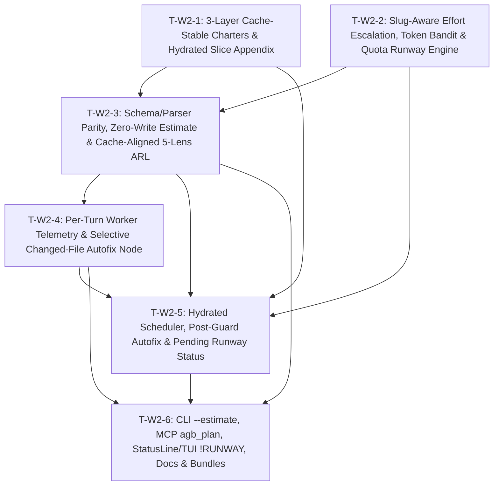

# Feature Specification: v2.0 Wave 2 — Cost-Effective Blueprint Engine, Prefix-Stable Prompts, Effort Ladder & Quota Runway Forecaster

**Base:** `explore-advancements` \
**Gate:** `{"test": "npm test"}`

--------------------------------------------------------------------------------

## 1. Overview & Objectives

Build **Wave 2** of the stacked `v2.0.0` Software Factory release atop `explore-advancements` (`34ef651`, PR #195), hardened across 3 rounds of 5-lens Plan ARL and owner design alignment:

1. **3-Layer KV-Cache Prefix-Stable Prompts & Pre-Build Slice Hydration (`T-W2-1`):**
   - Refactor `builderAgentsMd`, `regenPrompt`, `warmRegenPrompt`, and `prosecutionPrompt` in `lib/charters.mjs` into a strict **3-Layer Prefix-Stable Layout** (Layer 1: static ADLC charter & rules identical across all tickets; Layer 2: ticket specification + scope/rails; Layer 3: deterministic HMAC-fenced diff/diagnostic via `deriveDeterministicFenceTag(seed, content)` or pre-hydrated context appendix).
   - Export `formatHydratedBuilderAppendix({ slice, impactedTests, maxBytes })` in `lib/context-slice.mjs` to inject bounded line-numbered symbol slices and fast impacted test commands into worktree `AGENTS.md` before Turn 1.
2. **Slug-Aware Effort Escalation, Billable-Token Bandit & Quota Runway Engine (`T-W2-2`):**
   - Extend `lib/models.mjs` (`VALID_EFFORTS`, `escalateModelSlugInFamily`, `selectCliEffortFlag`) and `lib/stream-watchdog.mjs` (`resolveDynamicEffort`) so suffixed live catalog slugs step up within family on cold Strike-1 retries when staying in-family, CLI `--effort` is passed only on `ORCHESTRATOR_MODELS` or explicit `ticket.effort` / Strike-0 `AGB_DEFAULT_EFFORT`, and warm sessions preserve effort without respawning.
   - Normalize `BanditModelRouter` (`lib/bandit-router.mjs`) efficiency scoring via `billableTokens = uncachedInputTokens + 0.1 * cachedTokens + 3 * outputTokens` (immune to provider `cache_read_input_tokens` vs `input_tokens` reporting differences and parallel sibling workers), while recording `quotaDeltaPct` only across uncontested single-flight pool epochs.
   - Export `estimatePlanQuotaRunway(plan, { quota = null, records = [] } = {})` in `lib/pools.mjs` (tested in `test/quota-runway.test.mjs`, keeping `test/pools.test.mjs` as a frozen rail).
3. **Schema/Parser Parity (`gate.autofix`, `ticket.effort`, `cached_tokens`), Zero-Write `estimateOnly`, & Exported Cache-Aligned 5-Lens ARL (`T-W2-3`):**
   - Enforce `plan.gate.autofix` (`NPM_GATE_RE`), `ticket.effort` (`VALID_EFFORTS`), and `STREAM_EVENT_SCHEMA` `telemetry.cached_tokens` parity across `lib/schemas.mjs`, `lib/plan-integrity.mjs`, `lib/shape.mjs` (including `Effort` in `inAcceptanceBlock` termination regex), and `lib/brain.mjs` (`formatPlanMarkdown`, plus `skipArtifactWrite` in `brainToPlan`).
   - Export `lensPrompt` and `planLensPrompt` in `lib/review.mjs` with byte-identical Layer-1 + Layer-2 prefixes across all 5 lenses up to `## Active Lens`, and forward `seed` in `lib/prosecute.mjs`.
   - Implement strictly zero-write `estimateOnly = false` in `compilePlan` (`lib/plan.mjs`): reads `readFreshStatusLineQuotaCache()?.quota ?? pools?.quota ?? null` without calling `pools.refreshQuota` (zero `writeV2State` or circuit-breaker side effects!), skips Stage B LLM probes and all artifact/gitignore/ticket-projection writes (including `skipArtifactWrite: true` on `brainToPlan` fallback), and includes `quotaEstimate: null` on structural-failure early returns.
4. **Per-Turn Worker Token Telemetry & Post-Rails Selective Changed-File `gate.autofix` Node (`T-W2-4`):**
   - Extract normalized per-turn `{ uncachedInputTokens, cachedTokens, outputTokens, inputTokens }` telemetry in `lib/agy.mjs` and `lib/ndjson-worker.mjs` (computing per-turn deltas across multi-turn NDJSON sessions).
   - Preserve `gate.autofix` in `resolveTicketGateConfig` and implement `runDeterministicAutofixNode` in `lib/scheduler-verify.mjs`: verifies `HEAD === preAutofixSha` immediately after running `gate.autofix`, stages file-level autofix changes **strictly on `builderChangedFiles` plus newly created untracked files matching `ticket.scope` (excluding `ticket.rails`)**, discards incidental out-of-scope/untouched-file edits and ignored side effects (`git clean -fdx` with safe exclusions), and rolls back cleanly to `preAutofixSha` with `HEAD` verification on any error.
5. **Default-On Hydrated Scheduler, Post-Guard Autofix Wiring & Pending-Only Runway Persistence (`T-W2-5`):**
   - Filter `runConfiguredGates` (`lib/scheduler.mjs`) to execute **only** `build` and `test` keys (never `autofix`).
   - Run `runDeterministicAutofixNode` (wrapped in `materializeWorktreeNodeModules` / `removeMaterializedNodeModules`) **after** candidate `verifySymbolScope`, unioned `checkRailsGuard`, and `verifyGateScriptIntegrity` pass (right before `runConfiguredGates` on both primary and `consensus-fix` paths), re-verifying unioned `checkRailsGuard` + `verifyGateScriptIntegrity` when `autofixRes.applied === true` and updating `changed = autofixRes.changedFiles`.
   - Wire `runSeed`, default-on slice hydration, `buildOnce` `effort` forwarding + `lastConversationId`/`warmResume`-aware `resolveDynamicEffort`, monotonic pool-epoch single-flight `quotaDeltaPct` + token telemetry, and pending-only reachable `RunStatus.runway()` updates across `lib/scheduler.mjs` and `lib/status.mjs`.
6. **CLI `agb plan --estimate [--json]`, MCP `agb_plan`, StatusLine/TUI `!RUNWAY` Alert, Docs & Bundles (`T-W2-6`):**
   - Wire `--estimate` / `--json` in `bin/agb.mjs`, `estimate` in `mcp/server.mjs`, `!RUNWAY` alerts in `lib/cli-statusline.mjs` and `lib/tui.mjs`, `AGB_DEFAULT_EFFORT` in `website/env-docs.json`, and regenerate `website/generated/**` + `dist/**`.

--------------------------------------------------------------------------------

## 2. Architecture & Ticket DAG

--------------------------------------------------------------------------------

## 3. Component Details & Ticket Specifications

### Ticket 1: `T-W2-1` — 3-Layer Cache-Stable Charters & Pre-Hydrated `AGENTS.md` Appendix

- **Scope**: `lib/charters.mjs`, `lib/context-slice.mjs`, `test/context-slice.test.mjs`, `test/cache-stable-charters.test.mjs`
- **Rails**: `lib/lock.mjs`, `lib/gates.mjs`, `vendor/cache/**`, `scripts/rails-guard-ci.mjs`, `test/unit.test.mjs`, `test/security.test.mjs`
- **Edges**: `T-W2-1 -> T-W2-3, T-W2-5`
- **Tier**: `mid`
- **Pool Hint**: `gemini`
- **Objectives**:
  1. Export `deriveDeterministicFenceTag(seed, content)` and 3-layer cache-stable `builderAgentsMd`, `regenPrompt`, `warmRegenPrompt`, and `prosecutionPrompt` in `lib/charters.mjs` (preserving all `test/unit.test.mjs` and `test/security.test.mjs` substrings).
  2. Export `formatHydratedBuilderAppendix({ slice, impactedTests, maxBytes = 16_384 })` in `lib/context-slice.mjs`.
- **Acceptance Criteria**:
  - `builderAgentsMd`, `regenPrompt`, `warmRegenPrompt`, and `prosecutionPrompt` share identical byte-for-byte Layer-1 prefixes across distinct tickets/diffs, `deriveDeterministicFenceTag` returns deterministic 32-hex HMAC tags for `seed.length >= 16` and warns on short non-empty seeds, and frozen rails `test/unit.test.mjs` + `test/security.test.mjs` pass. Verify: `node --test test/cache-stable-charters.test.mjs test/unit.test.mjs test/security.test.mjs`
  - `formatHydratedBuilderAppendix` enforces `Buffer.byteLength(out, 'utf8') <= maxBytes` and sanitizes boundary markers. Verify: `node --test test/context-slice.test.mjs`

--------------------------------------------------------------------------------

### Ticket 2: `T-W2-2` — Slug-Aware Effort Escalation, Billable-Token Bandit & Quota Runway Engine

- **Scope**: `lib/models.mjs`, `lib/stream-watchdog.mjs`, `lib/bandit-router.mjs`, `lib/pools.mjs`, `test/models-registry.test.mjs`, `test/stream-watchdog.test.mjs`, `test/bandit-distill.test.mjs`, `test/quota-runway.test.mjs`
- **Rails**: `lib/lock.mjs`, `lib/gates.mjs`, `vendor/cache/**`, `scripts/rails-guard-ci.mjs`, `test/pools.test.mjs`
- **Edges**: `T-W2-2 -> T-W2-3, T-W2-5`
- **Tier**: `mid`
- **Pool Hint**: `claude-gpt`
- **Objectives**:
  1. Export `VALID_EFFORTS`, `escalateModelSlugInFamily`, and `selectCliEffortFlag` in `lib/models.mjs`, and extend `resolveDynamicEffort` in `lib/stream-watchdog.mjs` with `resolvedModel` and `cliEffort`.
  2. Persist `pool`, `effort`, `uncachedInputTokens`, `cachedTokens`, `outputTokens`, `inputTokens`, and single-flight `quotaDeltaPct` in `BanditModelRouter.recordOutcome`, weighting `rankCandidates` via `billableTokens = uncachedInputTokens + 0.1 * cachedTokens + 3 * outputTokens` (`costFactor = 1 / (1 + Math.min(0.35, billableTokens / 250_000))`).
  3. Export `estimatePlanQuotaRunway(plan, { quota = null, records = [] } = {})` in `lib/pools.mjs` with unit tests in `test/quota-runway.test.mjs`.
- **Acceptance Criteria**:
  - `escalateModelSlugInFamily`, `selectCliEffortFlag`, and `resolveDynamicEffort` pass all unit assertions without sending conflicting `--effort` flags on suffixed slugs. Verify: `node --test test/models-registry.test.mjs test/stream-watchdog.test.mjs`
  - `BanditModelRouter` bounds `costFactor` in `[0.74, 1.0]` across Claude/Gemini token envelopes and `estimatePlanQuotaRunway` forecasts wave exhaustion while `test/pools.test.mjs` passes untouched. Verify: `node --test test/bandit-distill.test.mjs test/quota-runway.test.mjs test/pools.test.mjs`

--------------------------------------------------------------------------------

### Ticket 3: `T-W2-3` — Schema/Parser Parity, Zero-Write `estimateOnly`, & Exported Cache-Aligned 5-Lens ARL

- **Scope**: `lib/schemas.mjs`, `lib/plan-integrity.mjs`, `lib/shape.mjs`, `lib/brain.mjs`, `lib/plan.mjs`, `lib/review.mjs`, `lib/prosecute.mjs`, `test/plan.test.mjs`, `test/shape.test.mjs`, `test/review-arl.test.mjs`, `test/prosecute.test.mjs`
- **Rails**: `lib/lock.mjs`, `lib/gates.mjs`, `vendor/cache/**`, `scripts/rails-guard-ci.mjs`
- **Edges**: `T-W2-3 -> T-W2-4, T-W2-5, T-W2-6`
- **Tier**: `mid`
- **Pool Hint**: `gemini`
- **Objectives**:
  1. Add `gate.autofix`, `ticket.effort`, and `telemetry.cached_tokens` support across `lib/schemas.mjs`, `lib/plan-integrity.mjs`, `lib/shape.mjs` (adding `Effort` to `inAcceptanceBlock` block-terminator regex and requiring `build` or `test` alongside `autofix`), and `lib/brain.mjs` (`formatPlanMarkdown` + `skipArtifactWrite` option on `brainToPlan`).
  2. Export cache-aligned `lensPrompt` and `planLensPrompt` in `lib/review.mjs` (byte-identical prefixes up to `## Active Lens`) and forward `seed` in `lib/prosecute.mjs`.
  3. Add zero-write `estimateOnly = false` to `compilePlan` (`lib/plan.mjs`) reading `readFreshStatusLineQuotaCache()?.quota ?? pools?.quota ?? null` with zero `refreshQuota` / `writeV2State` / artifact / gitignore / ticket-store writes and returning `quotaEstimate: null` on `fail()`.
- **Acceptance Criteria**:
  - `BRAIN_PLAN_SCHEMA`, `STREAM_EVENT_SCHEMA`, `validatePlan`, `parseStructuredSpec`, and `formatPlanMarkdown` handle `gate.autofix`, `ticket.effort`, and `cached_tokens` consistently. Verify: `node --test test/plan.test.mjs test/shape.test.mjs`
  - Exported `lensPrompt` and `planLensPrompt` share 100% byte-identical prefixes up to `## Active Lens`, and `compilePlan(..., { estimateOnly: true })` performs zero disk or V2-state writes. Verify: `node --test test/review-arl.test.mjs test/prosecute.test.mjs test/plan.test.mjs`

--------------------------------------------------------------------------------

### Ticket 4: `T-W2-4` — Per-Turn Worker Telemetry & Post-Rails Selective Changed-File `gate.autofix` Node

- **Scope**: `lib/agy.mjs`, `lib/ndjson-worker.mjs`, `lib/scheduler-verify.mjs`, `test/agy.test.mjs`, `test/ndjson-worker.test.mjs`, `test/autofix-blueprint.test.mjs`
- **Rails**: `lib/lock.mjs`, `lib/gates.mjs`, `vendor/cache/**`, `scripts/rails-guard-ci.mjs`
- **Edges**: `T-W2-4 -> T-W2-5, T-W2-6`
- **Tier**: `mid`
- **Pool Hint**: `claude-gpt`
- **Objectives**:
  1. Extract normalized per-turn `telemetry: { uncachedInputTokens, cachedTokens, outputTokens, inputTokens } | null` in `lib/agy.mjs` and `lib/ndjson-worker.mjs` (computing per-turn deltas when session counters are cumulative).
  2. Preserve `gate.autofix` in `resolveTicketGateConfig` and export `runDeterministicAutofixNode` in `lib/scheduler-verify.mjs`: verifies `HEAD === preAutofixSha` immediately after `runSandboxedCmd(gate.autofix)` exits, stages file-level changes strictly on `builderChangedFiles` + newly created untracked files matching `ticket.scope` (excluding `ticket.rails`), cleans incidental out-of-scope/ignored side effects (`git clean -fdx` with safe exclusions), verifies post-autofix scope & `verifyGateScriptIntegrity`, and rolls back cleanly to `preAutofixSha` (setting `fatalRollbackError: true` if rollback fails).
- **Acceptance Criteria**:
  - `runAgy` and `NdjsonWorkerDaemon.sendTurn` emit normalized per-turn token `telemetry` without double-counting across multi-turn sessions. Verify: `node --test test/agy.test.mjs test/ndjson-worker.test.mjs`
  - `runDeterministicAutofixNode` verifies `HEAD === preAutofixSha` post-command, stages only `builderChangedFiles` + new in-scope untracked files, cleans ignored side effects, and preserves `preAutofixSha` on rollback. Verify: `node --test test/autofix-blueprint.test.mjs`

--------------------------------------------------------------------------------

### Ticket 5: `T-W2-5` — Default-On Hydrated Scheduler, Post-Guard Autofix Wiring & Pending Runway Status

- **Scope**: `lib/scheduler.mjs`, `lib/status.mjs`, `test/scheduler.test.mjs`, `test/status.test.mjs`
- **Rails**: `lib/lock.mjs`, `lib/gates.mjs`, `vendor/cache/**`, `scripts/rails-guard-ci.mjs`
- **Edges**: `T-W2-5 -> T-W2-6`
- **Tier**: `frontier`
- **Pool Hint**: `claude-gpt`
- **Objectives**:
  1. Add `RunStatus.runway(runwayObj)` in `lib/status.mjs`.
  2. In `lib/scheduler.mjs`: filter `runConfiguredGates` to `name === 'build' || name === 'test'` only; validate `gate?.autofix` at startup and in `verifyGateScriptIntegrity`; wire `runSeed`, default-on `formatHydratedBuilderAppendix`, `buildOnce` `effort` forwarding + `warmResume`-aware effort/slug escalation (with `pickAlternateModel` taking precedence on cross-family fault failover), `materializeWorktreeNodeModules`-wrapped `runDeterministicAutofixNode` **after** candidate `verifySymbolScope`/`checkRailsGuard`/`verifyGateScriptIntegrity` (re-checking `checkRailsGuard` + `verifyGateScriptIntegrity` and updating `changed` when `autofixRes.applied === true`) on both primary and `consensus-fix` paths, monotonic pool-epoch single-flight `quotaDeltaPct` + token bandit recording, and pending-only reachable `status.runway()` updates.
- **Acceptance Criteria**:
  - `runConfiguredGates` ignores `gate.autofix`, `scheduler.mjs` runs `runDeterministicAutofixNode` with materialized `node_modules` after `checkRailsGuard` on primary and `consensus-fix` paths, hydrates `AGENTS.md` by default, and updates `RunStatus.runway()` over pending reachable tickets only. Verify: `node --test test/scheduler.test.mjs test/status.test.mjs`

--------------------------------------------------------------------------------

### Ticket 6: `T-W2-6` — CLI `agb plan --estimate [--json]`, MCP `agb_plan`, StatusLine/TUI `!RUNWAY`, Docs & Bundles

- **Scope**: `bin/agb.mjs`, `mcp/server.mjs`, `lib/cli-statusline.mjs`, `lib/tui.mjs`, `website/env-docs.json`, `website/generated/**`, `dist/**`, `test/cli-nextgen.test.mjs`, `test/cli-statusline.test.mjs`, `test/tui-hud.test.mjs`, `test/mcp-apps.test.mjs`
- **Rails**: `lib/lock.mjs`, `lib/gates.mjs`, `vendor/cache/**`, `scripts/rails-guard-ci.mjs`
- **Edges**: none
- **Tier**: `mid`
- **Pool Hint**: `gemini`
- **Objectives**:
  1. Wire `--estimate` and `--json` on `agb plan` (`bin/agb.mjs`, using `readFreshStatusLineQuotaCache` without calling `pools.refreshQuota` when `--estimate` is set) and `estimate` on MCP `agb_plan` (`mcp/server.mjs`).
  2. Render `!RUNWAY` in `lib/cli-statusline.mjs` and runway warning banners in `lib/tui.mjs` (`agb watch`), add `AGB_DEFAULT_EFFORT` to `website/env-docs.json`, and run `gen-reference.mjs` + `npm run build`.
- **Acceptance Criteria**:
  - `agb plan <spec> <repo> --estimate [--json]` and MCP `agb_plan` (`estimate: true`) succeed offline without `--force` when `plan.json` exists and mutate zero files; `renderCliStatusLine` and `lib/tui.mjs` surface `!RUNWAY`. Verify: `node --test test/cli-nextgen.test.mjs test/cli-statusline.test.mjs test/tui-hud.test.mjs test/mcp-apps.test.mjs`
  - Bundles and generated docs match source with zero git diff drift and full suite green. Verify: `npm run build && node website/scripts/gen-reference.mjs && git diff --exit-code dist/ website/generated/ && node website/scripts/check-all.mjs && npm run plugin:validate && npm run skills:check && npm test`

--------------------------------------------------------------------------------

## 4. Acceptance Criteria

- [ ] `builderAgentsMd`, `regenPrompt`, `warmRegenPrompt`, and `prosecutionPrompt` preserve byte-identical static Layer-1 prefixes across tickets/diffs, `deriveDeterministicFenceTag` produces deterministic 32-hex HMAC tags per `(seed, content)`, and `formatHydratedBuilderAppendix` bounds UTF-8 output `<= maxBytes`. Verify: `node --test test/cache-stable-charters.test.mjs test/context-slice.test.mjs test/unit.test.mjs test/security.test.mjs`
- [ ] `escalateModelSlugInFamily`, `selectCliEffortFlag`, and `resolveDynamicEffort` modulate effort cleanly, `BanditModelRouter` bounds `billableTokens` `costFactor` in `[0.74, 1.0]`, and `estimatePlanQuotaRunway` forecasts wave exhaustion while `test/pools.test.mjs` passes untouched. Verify: `node --test test/models-registry.test.mjs test/stream-watchdog.test.mjs test/bandit-distill.test.mjs test/quota-runway.test.mjs test/pools.test.mjs`
- [ ] `BRAIN_PLAN_SCHEMA`, `STREAM_EVENT_SCHEMA`, `validatePlan`, `parseStructuredSpec`, and `formatPlanMarkdown` enforce `gate.autofix`, `ticket.effort`, and `cached_tokens` parity; exported `lensPrompt` and `planLensPrompt` share byte-identical prefixes up to `## Active Lens`; and `compilePlan(..., { estimateOnly: true })` performs zero disk or V2-state writes. Verify: `node --test test/plan.test.mjs test/shape.test.mjs test/review-arl.test.mjs test/prosecute.test.mjs`
- [ ] `runAgy` and `NdjsonWorkerDaemon` extract per-turn token `telemetry`, and `runDeterministicAutofixNode` verifies `HEAD === preAutofixSha`, stages only `builderChangedFiles` + new in-scope untracked files, cleans side effects, and rolls back cleanly. Verify: `node --test test/agy.test.mjs test/ndjson-worker.test.mjs test/autofix-blueprint.test.mjs`
- [ ] `runConfiguredGates` ignores `gate.autofix`, `scheduler.mjs` runs `runDeterministicAutofixNode` with materialized `node_modules` after `checkRailsGuard` on primary and `consensus-fix` paths, hydrates `AGENTS.md` by default, and updates `RunStatus.runway()` over pending reachable tickets only. Verify: `node --test test/scheduler.test.mjs test/status.test.mjs`
- [ ] `agb plan --estimate [--json]`, MCP `agb_plan` (`estimate: true`), `!RUNWAY` statusline/TUI alerts, `AGB_DEFAULT_EFFORT` docs, and rebuilt `dist/**` + `website/generated/**` pass with zero git diff drift. Verify: `npm run build && node website/scripts/gen-reference.mjs && git diff --exit-code dist/ website/generated/ && node website/scripts/check-all.mjs && npm run plugin:validate && npm run skills:check && npm test`
