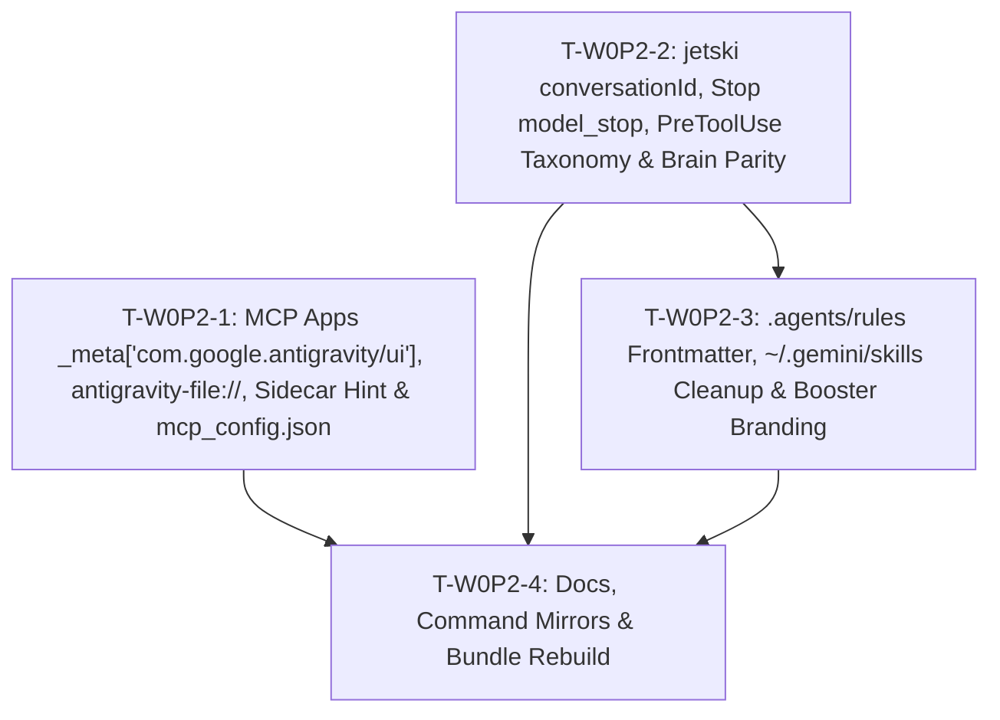

# Specification: MCP Apps Host Surfaces, `jetski` Remote-Agent Parity, Hook/Rule Fixes & Marketplace Branding (Wave 0 — PR 2)

**Base:** `origin/main` \
**Gate:** `{"build": "npm run build", "test": "npm test"}`

--------------------------------------------------------------------------------

## 1. Overview & Objectives

This specification executes **Wave 0 — PR 2** of the owner-approved `/grill-me` multi-surface roadmap (`A1`, `A4`, `A5`), resolving the remaining immediate platform compatibility bugs across **Antigravity Desktop App (`v2.30+`), Antigravity IDE & 7 IDE Extensions, CLI, Web, and Remote Agents (`jetski` / SSH)**:

1. **MCP Apps Host Surfaces (`_meta["com.google.antigravity/ui"]`), `antigravity-file://` URI Support, Non-UI `agb sidecar` Fallback & `mcp_config.json` (`T-W0P2-1`):**
   - Moves Antigravity host surface metadata (`surface`: `'aux_pane'`, `'global'`, `'file'` and `extensions`: `['.agbplan']`) out of `_meta.ui` into `_meta['com.google.antigravity/ui']` on `agb_flight_deck`, `agb_mission_control`, and `agb_plan_viewer` (retaining standard `{ resourceUri, visibility }` in `_meta.ui`).
   - Supports opaque `antigravity-file://...` URIs passed by Antigravity Desktop's file viewer to `agb_plan_viewer`: instead of failing with `ENOENT` in `fs.openSync`, `mcp/server.mjs` returns `{ ok: true, deferredRead: true, fileUri, repo, quotaCache }`, and `plan-viewer.html` (`mcp/ui-views.mjs`) loads via `__bridge.readResource(fileUri)` and saves via `__bridge.writeResource(fileUri, ...)`.
   - Tracks per-session `clientSupportsUiExtension` on `initialize`; when a non-UI client (VS Code, JetBrains, Zed, Antigravity IDE, SSH) invokes `agb_flight_deck`, `agb_mission_control`, or `agb_run`, includes a `sidecarHint` (`agb sidecar <repo>`) in the response.
   - Updates `mcp_config.json` to launch `node ${PLUGIN_ROOT}/dist/mcp-server.mjs` cross-platform (leveraging Antigravity's bundled Node fallback), sets `"timeoutSeconds": -1` (eliminating the 180s default MCP kill timer on `agb_run`/`agb_plan`/`agb_review`), and configures `"tools"` (`agb_run.background = "always"`, `agb_status.eager = true`, `agb_doctor.eager = true`).
2. **`jetski` Slash-Delimited `conversationId`, `Stop` `'model_stop'`, `PreToolUse` Tool Taxonomy & Brain Parity (`T-W0P2-2`):**
   - Updates `hooks/policy/paths.mjs` (`verifyBrainArtifactDirectory` + `isValidConversationId`) and `hooks/lifecycle.mjs` (`sessionStateFilename` + `isValidConversationId`) to accept Remote Agents (`jetski`) multi-segment `conversationId`s up to 4 `/`-delimited segments (`v1/default/jetski_remote_agents_3p_devbox/<uuid>`), verifying every intermediate directory segment for zero symlinks while encoding session state filenames flatly with SHA-256 so `/` never creates nested state directories or traversal.
   - Fixes `Stop` hook in `hooks/lifecycle.mjs` to accept `payload.terminationReason === 'model_stop' || payload.terminationReason === 'NO_TOOL_CALL'`.
   - Expands `hooks/policy/constants.mjs` & `hooks/policy/evaluate.mjs` to classify Antigravity App/Web/Remote built-in tools: read-only `google_search`, `browse`, `google:browse`, `list_skills`, `lookup_skill`, `lookup_skills`, `get_skill_resources` (permitted in active-rail ADLC repos, with path-traversal protection on `get_skill_resources.filenames`), and external/customization-mutating `create_github_repository`, `fork_github_repository`, `detach_github_repository`, `save_skill`, `update_skill`, `delete_skill` (`forceAsk` interactively, `deny` in headless/read-only workers).
   - Updates `lib/brain.mjs` to discover `.gemini/antigravity-ide/brain`, recursively scan up to depth 4 for `jetski` multi-segment brain directories (skipping `.system_generated` and `scratch`), support multi-segment `ANTIGRAVITY_CONVERSATION_ID` in `writePlanArtifact`, and remove HTML tags (` <i>(...)</i>`) from Mermaid node labels in `formatPlanMarkdown`.
3. **`.agents/rules/adlc-learned.md` YAML Frontmatter, `~/.gemini/skills` Cleanup & Marketplace Branding (`T-W0P2-3`):**
   - Updates `lib/distill.mjs` (`distillRepo`) so `--apply` writes `.agents/rules/adlc-learned.md` with valid Antigravity YAML frontmatter (`trigger: always_on` + `description`), enforcing zero-symlink checks on `.agents`, `.agents/rules`, and `adlc-learned.md`.
   - Updates `lib/bootstrap.mjs` so default `agb bootstrap` runs (where `destination` is not explicitly overridden and `antigravity-booster` is installed into `~/.gemini/config/plugins/antigravity-booster`) stop duplicating skill symlinks into `~/.gemini/skills/` and clean up stale `antigravity-booster/skills/*` symlinks there, while preserving explicit programmatic `bootstrap({ destination })` callers.
   - Sets `"displayName": "Booster"` and `"license": "MIT"` in `plugin.json` (retaining `"name": "antigravity-booster"`), and updates `rules/AGENTS.md` + `skills/agb/SKILL.md` from Claude-style `mcp__agb__*` to Antigravity's `antigravity-booster_agb` (`call_mcp_tool` / eager `mcp_antigravity-booster_agb_*`), 5 ARL lenses, and `.agents/rules/adlc-learned.md`.
4. **Docs, Bundles & Archive Hygiene (`T-W0P2-4`):**
   - Archives shipped PR #208 tickets (`T-NOV30-1`..`T-NOV30-4`), updates affected `website/` documentation and `commands/agb.md`, regenerates `dist/agb.mjs`, `dist/mcp-server.mjs`, and `dist/hooks/pre-tool-use.bundle.mjs`, and verifies all ADLC P5 gates.

--------------------------------------------------------------------------------

## 2. Ticket Dependency DAG

--------------------------------------------------------------------------------

## 3. Ticket Specifications

### Ticket 1: `T-W0P2-1` — MCP Apps Host Surfaces, `antigravity-file://`, Sidecar Hint & `mcp_config.json`

- **Scope**: `mcp/server.mjs`, `mcp/ui-views.mjs`, `mcp_config.json`, `test/mcp-apps.test.mjs`
- **Rails**: `lib/lock.mjs`, `lib/gates.mjs`, `vendor/cache/**`, `scripts/rails-guard-ci.mjs`
- **Edges**: `T-W0P2-1 -> T-W0P2-4`
- **Tier**: `frontier`
- **Pool Hint**: `gemini`
- **Objectives**:
  1. Move `surface` (`'aux_pane'`, `'global'`, `'file'`) and `extensions` (`['.agbplan']`) from `_meta.ui` to `_meta['com.google.antigravity/ui']` in `mcp/server.mjs`.
  2. Support `antigravity-file://` URIs in `agb_plan_viewer` (`mcp/server.mjs`) and `buildPlanViewerHtml` (`mcp/ui-views.mjs`) via `deferredRead: true` + `__bridge.readResource` / `__bridge.writeResource`.
  3. Record `clientSupportsUiExtension` on `initialize` in `mcp/server.mjs` and include a `sidecarHint` (`agb sidecar <repo>`) in `agb_flight_deck`, `agb_mission_control`, and `agb_run` text output when `!clientSupportsUiExtension`.
  4. Update `mcp_config.json` to `"command": "node"`, `"args": ["${PLUGIN_ROOT}/dist/mcp-server.mjs"]`, `"timeoutSeconds": -1`, and `"tools"` (`agb_run` background, `agb_status` & `agb_doctor` eager), and expand `test/mcp-apps.test.mjs`.
- **Acceptance Criteria**:
  - `npm run build:mcp && node --test test/mcp-apps.test.mjs` exits `0`.

--------------------------------------------------------------------------------

### Ticket 2: `T-W0P2-2` — `jetski` `conversationId`, `Stop` `'model_stop'`, `PreToolUse` Taxonomy & Brain Parity

- **Scope**: `hooks/lifecycle.mjs`, `hooks/policy/paths.mjs`, `hooks/policy/constants.mjs`, `hooks/policy/evaluate.mjs`, `lib/brain.mjs`, `test/lifecycle-hooks.test.mjs`, `test/pre-tool-use.test.mjs`, `test/cli-nextgen.test.mjs`
- **Rails**: `lib/lock.mjs`, `lib/gates.mjs`, `vendor/cache/**`, `scripts/rails-guard-ci.mjs`
- **Edges**: `T-W0P2-2 -> T-W0P2-3`, `T-W0P2-2 -> T-W0P2-4`
- **Tier**: `frontier`
- **Pool Hint**: `gemini`
- **Objectives**:
  1. Support 1–4 `/`-delimited safe `conversationId` segments in `hooks/policy/paths.mjs` (`verifyBrainArtifactDirectory` walking every segment for zero symlinks) and `hooks/lifecycle.mjs` (flat hash-suffixed `session-state` file keys).
  2. Accept `terminationReason === 'model_stop' || terminationReason === 'NO_TOOL_CALL'` in `hooks/lifecycle.mjs`.
  3. Add read-only (`google_search`, `browse`, `google:browse`, `list_skills`, `lookup_skill`, `lookup_skills`, `get_skill_resources`) and external/customization-mutating (`create_github_repository`, `fork_github_repository`, `detach_github_repository`, `save_skill`, `update_skill`, `delete_skill`) tool classifications in `hooks/policy/constants.mjs` and `hooks/policy/evaluate.mjs`.
  4. Add `.gemini/antigravity-ide/brain`, recursive 4-level `jetski` brain discovery, multi-segment `writePlanArtifact` session IDs, and HTML-free Mermaid node labels in `lib/brain.mjs`.
  5. Add comprehensive unit tests in `test/lifecycle-hooks.test.mjs`, `test/pre-tool-use.test.mjs`, and `test/cli-nextgen.test.mjs`.
- **Acceptance Criteria**:
  - `npm run build:hooks && node --test test/lifecycle-hooks.test.mjs test/pre-tool-use.test.mjs test/cli-nextgen.test.mjs` exits `0`.

--------------------------------------------------------------------------------

### Ticket 3: `T-W0P2-3` — `.agents/rules` Frontmatter, `~/.gemini/skills` Cleanup & Booster Branding

- **Scope**: `lib/distill.mjs`, `lib/bootstrap.mjs`, `bin/agb.mjs`, `plugin.json`, `rules/AGENTS.md`, `skills/agb/SKILL.md`, `test/bandit-distill.test.mjs`, `test/v14-integration.test.mjs`, `test/plugin-layout.test.mjs`, `test/bootstrap-install.test.mjs`
- **Rails**: `lib/lock.mjs`, `lib/gates.mjs`, `vendor/cache/**`, `scripts/rails-guard-ci.mjs`
- **Edges**: `T-W0P2-3 -> T-W0P2-4`
- **Tier**: `mid`
- **Pool Hint**: `gemini`
- **Objectives**:
  1. Update `lib/distill.mjs` (`distillRunDefenses` `--apply`) and `bin/agb.mjs` (`distill` help) to write `.agents/rules/adlc-learned.md` with `trigger: always_on` YAML frontmatter and zero-symlink checks.
  2. Update `lib/bootstrap.mjs` so default `bootstrap()` runs do not duplicate skill symlinks into `~/.gemini/skills/` when `antigravity-booster` is installed as a plugin and prune stale booster skill symlinks from `~/.gemini/skills/`, while preserving explicit `destination` overrides.
  3. Set `"displayName": "Booster"` and `"license": "MIT"` in `plugin.json`, and update `rules/AGENTS.md` + `skills/agb/SKILL.md` MCP naming (`antigravity-booster_agb`), 5 ARL lenses, and `.agents/rules/adlc-learned.md`.
  4. Update and expand `test/bandit-distill.test.mjs`, `test/v14-integration.test.mjs`, `test/plugin-layout.test.mjs`, and `test/bootstrap-install.test.mjs`.
- **Acceptance Criteria**:
  - `node --test test/bandit-distill.test.mjs test/v14-integration.test.mjs test/plugin-layout.test.mjs test/bootstrap-install.test.mjs test/unit.test.mjs` exits `0`.

--------------------------------------------------------------------------------

### Ticket 4: `T-W0P2-4` — Docs, Command Mirrors & Bundle Rebuild

- **Scope**: `commands/agb.md`, `test/commands.test.mjs`, `test/skills-cross-harness.test.mjs`, `website/content/docs/**`, `website/generated/**`, `dist/**`, `specs/wave0-pr2-mcp-apps-hooks-and-jetski-spec.md`
- **Rails**: `lib/lock.mjs`, `lib/gates.mjs`, `vendor/cache/**`, `scripts/rails-guard-ci.mjs`
- **Edges**: None
- **Tier**: `cheap`
- **Pool Hint**: `gemini`
- **Objectives**:
  1. Align `commands/agb.md` and `website/content/docs/` references (`.agents/rules/adlc-learned.md`, `_meta["com.google.antigravity/ui"]`, `antigravity-booster_agb`, `mcp_config.json`).
  2. Run `node website/scripts/gen-reference.mjs`, `npm run skills:check`, `npm run build`, and `npm test`.
- **Acceptance Criteria**:
  - `npm run build && node website/scripts/gen-reference.mjs --check && npm run skills:check && npm test` exits `0`.

--------------------------------------------------------------------------------

## 4. Acceptance Criteria

1. `agb_flight_deck`, `agb_mission_control`, and `agb_plan_viewer` declare `surface` and `extensions` under `_meta["com.google.antigravity/ui"]`, `agb_plan_viewer` handles `antigravity-file://` URIs without `ENOENT`, non-UI clients receive a `sidecarHint`, and `mcp_config.json` configures `node`, `timeoutSeconds: -1`, and background/eager tool metadata. Verify: `npm run build:mcp && node --test test/mcp-apps.test.mjs test/plugin-layout.test.mjs`
2. Slash-delimited `jetski` `conversationId`s (`v1/default/jetski_remote_agents_3p_devbox/<uuid>`) pass zero-symlink verification in `PreToolUse`, flat session keying in `hooks/lifecycle.mjs`, and 4-level discovery + HTML-free Mermaid rendering in `lib/brain.mjs`, while `Stop` fires on `'model_stop'` and App/Web/Remote built-in tools are classified in `constants.mjs` + `evaluate.mjs`. Verify: `npm run build:hooks && node --test test/lifecycle-hooks.test.mjs test/pre-tool-use.test.mjs test/cli-nextgen.test.mjs`
3. `agb distill --apply` writes `.agents/rules/adlc-learned.md` with `trigger: always_on` YAML frontmatter, `plugin.json` sets `displayName: "Booster"` + `license: "MIT"`, default `agb bootstrap` avoids `~/.gemini/skills` duplication when the plugin is installed, and `rules/AGENTS.md` + `skills/agb/SKILL.md` use Antigravity MCP naming. Verify: `node --test test/bandit-distill.test.mjs test/plugin-layout.test.mjs test/bootstrap-install.test.mjs`
4. Full bundle build, reference docs check, skills mirror check, mutation gate, and test suite pass with zero failures. Verify: `npm run build && node website/scripts/gen-reference.mjs --check && npm run skills:check && npm test`
