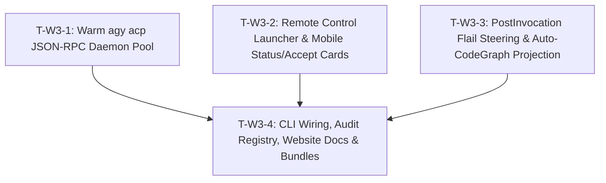

# Specification: Wave 3 — Remote Control Mobile UX, Warm `agy acp` Pool & Mid-Turn Flail Steering

## 1. Context & Problem Statement

Waves 0–2 migrated `antigravity-booster` (`agb`) onto the Nov 2026 Antigravity model catalog, fixed Desktop MCP Apps and `jetski` Cloud VM hooks, delivered zero-`agy` Cloud/Remote Agent orchestration (`agb gate-ticket`, `agb init --cloud`, async `/run-workflow`), and added IDE parity (`/agb-handoff`, `agb plan --delta`, `browserGate`, MCP file viewers, `agb init --automations`).

Three high-leverage mobility and throughput gaps remain from the harness deep review:
1. **Cold-start overhead on multi-lens prosecution (`agy acp`):** `agb review` and `prosecute` cold-spawn separate `agy --print` processes per lens instead of reusing persistent JSON-RPC 2.0 `agy acp` stdio workers.
2. **Remote Control mobile UX (`antigravity.google.com`):** Engineers steering local fleets from phones/tablets via `agy --remote-control` lack a dedicated `agb remote-control` launcher and compact vertical mobile status/P6 sign-off cards.
3. **Interactive mid-turn flail steering & CodeGraph auto-projection:** `hooks/lifecycle.mjs` leaves `PostInvocation` stubbed instead of detecting repeated identical tool failures and surfacing ADLC P4 flail-breaker hints, and `lib/agy.mjs` requires manual `AGB_ALLOW_CODEGRAPH_MCP=1` even when `.codegraph/` is already indexed in the workspace.

## 2. Architecture & DAG Topology

## 3. Ticket Decomposition

### Ticket 1: `T-W3-1` — Warm `agy acp` JSON-RPC Daemon Pool
- **Scope**: `lib/acp-pool.mjs`, `test/acp-pool.test.mjs`, `test/fixtures/fake-agy-acp`
- **Rails**: `lib/lock.mjs`, `lib/gates.mjs`, `vendor/cache/**`, `scripts/rails-guard-ci.mjs`
- **Edges**: `T-W3-1 -> T-W3-4`
- **Tier**: `mid`
- **Pool Hint**: `gemini`
- **Objectives**:
  1. Create `lib/acp-pool.mjs` exporting `isAcpPoolEnabled`, `AcpReviewPool`, and `createAcpReviewPool` implementing a bounded persistent stdio JSON-RPC 2.0 worker pool over `agy acp` (`initialize`, `session/new`, `session/set_config_option`, `session/prompt`, `session/cancel`) with timeout/crash recovery, clean `shutdown()`, and graceful `{ ok: false, fallback: true }` degradation when disabled (`AGB_ACP_POOL=0`) or unavailable.
  2. Add offline fixture `test/fixtures/fake-agy-acp` and unit tests in `test/acp-pool.test.mjs` covering multi-prompt session reuse, model/effort config switching, worker crash respawn, timeout cancellation, and disabled fallback.
- **Acceptance Criteria**:
  - `node --test test/acp-pool.test.mjs` passes with `0` failures.
  - Zero child processes leak after `pool.shutdown()`.

### Ticket 2: `T-W3-2` — Remote Control Launcher & Mobile-First Status / P6 Sign-Off Cards
- **Scope**: `lib/remote-control.mjs`, `lib/status.mjs`, `lib/accept.mjs`, `test/remote-control-and-mobile.test.mjs`
- **Rails**: `lib/lock.mjs`, `lib/gates.mjs`, `vendor/cache/**`, `scripts/rails-guard-ci.mjs`
- **Edges**: `T-W3-2 -> T-W3-4`
- **Tier**: `mid`
- **Pool Hint**: `gemini`
- **Objectives**:
  1. Create `lib/remote-control.mjs` exporting `isRemoteControlEnv`, `buildRemoteControlArgs`, `launchRemoteControl`, `formatMobileStatusCard`, and `formatMobileAcceptCard` for `antigravity.google.com` Remote Control sessions (`ANTIGRAVITY_REMOTE_CONTROL=1`) with compact vertical Markdown cards and `ask_question`-ready operator actions.
  2. Wire `{ mobile }` support into `renderStatus` (`lib/status.mjs`) and export `formatAcceptanceDossierMobile` in `lib/accept.mjs`.
  3. Add `test/remote-control-and-mobile.test.mjs`.
- **Acceptance Criteria**:
  - `node --test test/remote-control-and-mobile.test.mjs test/status.test.mjs test/accept.test.mjs` passes with `0` failures.

### Ticket 3: `T-W3-3` — `PostInvocation` Mid-Turn Flail Steering & Auto-CodeGraph Projection
- **Scope**: `hooks/lifecycle.mjs`, `lib/agy.mjs`, `test/lifecycle-flail-and-codegraph.test.mjs`
- **Rails**: `lib/lock.mjs`, `lib/gates.mjs`, `vendor/cache/**`, `scripts/rails-guard-ci.mjs`
- **Edges**: `T-W3-3 -> T-W3-4`
- **Tier**: `mid`
- **Pool Hint**: `gemini`
- **Objectives**:
  1. Keep `hooks/lifecycle.mjs` strictly Node built-ins only while tracking consecutive identical tool/command failures in `PostToolUse` (resetting on success), arming `flailAlertPending` in `PostInvocation` when consecutive failures reach `>= 2`, and emitting a zero-token `user_markdown` ADLC P4 Flail-Breaker hint in `PreInvocation`.
  2. Export `shouldProjectCodegraphMcp(repo, env)` in `lib/agy.mjs` to auto-enable read-only CodeGraph MCP projection whenever `<repo>/.codegraph` exists as a non-symlink directory (unless `AGB_CODEGRAPH=0` or `AGB_ALLOW_CODEGRAPH_MCP=0`) and wire it into `lib/agy.mjs`.
  3. Add `test/lifecycle-flail-and-codegraph.test.mjs`.
- **Acceptance Criteria**:
  - `node --test test/lifecycle-flail-and-codegraph.test.mjs test/plugin-layout.test.mjs` passes with `0` failures.

### Ticket 4: `T-W3-4` — CLI Wiring (`agb remote-control`, `--mobile`), Audit Registry, Website Docs & Bundles
- **Scope**: `bin/agb.mjs`, `scripts/release-audit-collect.mjs`, `commands/agb.md`, `skills/agb/SKILL.md`, `website/**`, `dist/**`, `specs/wave3-remote-control-acp-and-flail-steering-spec.md`
- **Rails**: `lib/lock.mjs`, `lib/gates.mjs`, `vendor/cache/**`, `scripts/rails-guard-ci.mjs`
- **Edges**: None
- **Tier**: `mid`
- **Pool Hint**: `gemini`
- **Objectives**:
  1. Wire `agb remote-control [repo] [--dry-run] [--json]`, `agb status --mobile`, and `agb accept --mobile` in `bin/agb.mjs`, and update `commands/agb.md` and `skills/agb/SKILL.md`.
  2. Register `lib/acp-pool.mjs`, `lib/remote-control.mjs`, and `remote-control` in `scripts/release-audit-collect.mjs`.
  3. Document `AGB_ACP_POOL` and `ANTIGRAVITY_REMOTE_CONTROL` in `website/env-docs.json`, create `website/content/docs/reference/cli/remote-control.mdx`, register `remote-control` in `website/content/docs/reference/cli/meta.json` and `website/scripts/ia.json`, regenerate `website/generated/*`, and rebuild `dist/**`.
- **Acceptance Criteria**:
  - `npm run build && node website/scripts/gen-reference.mjs --check && node website/scripts/check-all.mjs && npm run skills:check` exits `0`.
  - `adlc hollow-test --base origin/main` passes with `0` survivors and full `npm test` exits `0`.

## 4. Acceptance Criteria

1. `AcpReviewPool` reuses persistent stdio JSON-RPC 2.0 `agy acp` workers, switches model/effort config, recovers from worker crashes/timeouts, and degrades with `{ ok: false, fallback: true }` when `AGB_ACP_POOL=0` (verify: `node --test test/acp-pool.test.mjs`).
2. `agb remote-control`, `agb status --mobile`, and `agb accept --mobile` emit compact vertical mobile cards when `--mobile` or `ANTIGRAVITY_REMOTE_CONTROL=1` is set (verify: `node --test test/remote-control-and-mobile.test.mjs test/status.test.mjs test/accept.test.mjs`).
3. `hooks/lifecycle.mjs` remains zero-dependency Node built-ins only, tracks consecutive identical failures across `PostToolUse` -> `PostInvocation` -> `PreInvocation` to emit a one-shot ADLC P4 Flail-Breaker hint, and `shouldProjectCodegraphMcp` auto-projects read-only CodeGraph MCP when `.adlc/config.json` enables `accelerators.codegraph: true` (verify: `node --test test/lifecycle-flail-and-codegraph.test.mjs test/agy-no-mcp-storm.test.mjs test/plugin-layout.test.mjs`).
4. All bundles, website reference partials, skills mirrors, `adlc hollow-test --base origin/main` (`0` survivors), and full `npm test` pass cleanly (verify: `npm run build && node website/scripts/gen-reference.mjs --check && node website/scripts/check-all.mjs && npm run skills:check && npm test`).

