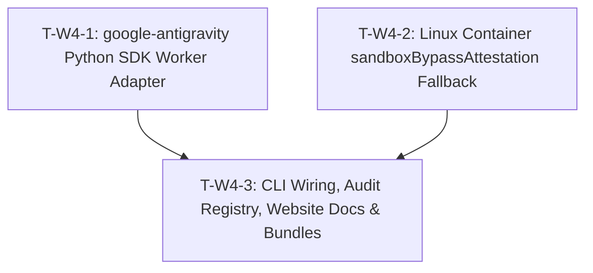

# Specification: Wave 4 — Multi-VM Cloud Bursting (`remote-sdk`) & Linux Container Containment Fallback

## 1. Context & Problem Statement

Waves 0–3 brought `antigravity-booster` (`agb`) to full parity across CLI, Desktop App, IDE/Extensions, Web Remote Control, and Cloud Devbox VMs. Two elastic-scale capabilities remain from the harness deep review:
1. **Multi-VM Cloud Bursting (`agb run --driver remote-sdk`):** Large ticket DAGs run locally are bounded by laptop CPU/RAM and local worktree I/O. An optional `google-antigravity` Python SDK worker backend lets `agb run --driver remote-sdk` fan out independent wave tickets across isolated cloud VMs while returning standard branch/session telemetry for local P5/P6 verification.
2. **Restricted Linux Container Containment Fallback:** In locked-down Docker/Kubernetes CI runners where unprivileged `userns` is disabled (`bwrap` unavailable), `prepareBuilderContainment` hard-fails on Linux with no opt-in attestation escape hatch. An explicitly opted-in, HMAC-SHA256 `ADLC_ADMIN_KEY`-signed Linux container `sandboxBypassAttestation` (`AGB_LINUX_CONTAINER_ATTESTATION=1`) unblocks container CI runners without relaxing default fail-closed Linux enforcement.

## 2. Architecture & DAG Topology

## 3. Ticket Decomposition

### Ticket 1: `T-W4-1` — `google-antigravity` Python SDK Cloud-Bursting Worker Adapter
- **Scope**: `lib/remote-sdk-worker.mjs`, `test/remote-sdk-worker.test.mjs`, `test/fixtures/fake-remote-sdk`
- **Rails**: `lib/lock.mjs`, `lib/gates.mjs`, `vendor/cache/**`, `scripts/rails-guard-ci.mjs`
- **Edges**: `T-W4-1 -> T-W4-3`
- **Tier**: `mid`
- **Pool Hint**: `gemini`
- **Objectives**:
  1. Create `lib/remote-sdk-worker.mjs` exporting `isRemoteSdkAvailable`, `buildRemoteSdkBridgeScript`, `runRemoteSdkTicket`, and `runRemoteSdkPlan` for wave-ordered cloud-VM ticket execution with bounded concurrency, timeout teardown, dry-run planning, and graceful `{ ok: false, kind, error }` degradation when the SDK is absent.
  2. Add offline executable fixture `test/fixtures/fake-remote-sdk` and comprehensive tests in `test/remote-sdk-worker.test.mjs`.
- **Acceptance Criteria**:
  - `node --test test/remote-sdk-worker.test.mjs` passes with `0` failures.

### Ticket 2: `T-W4-2` — Linux Container `sandboxBypassAttestation` Fallback
- **Scope**: `lib/agy.mjs`, `test/linux-container-containment.test.mjs`
- **Rails**: `lib/lock.mjs`, `lib/gates.mjs`, `vendor/cache/**`, `scripts/rails-guard-ci.mjs`
- **Edges**: `T-W4-2 -> T-W4-3`
- **Tier**: `mid`
- **Pool Hint**: `gemini`
- **Objectives**:
  1. Export `isLinuxContainerEnvironment` and `verifyLinuxContainerAttestation` in `lib/agy.mjs` and wire `AGB_LINUX_CONTAINER_ATTESTATION=1` into `prepareBuilderContainment` on Linux only when kernel `bwrap` is unavailable, a container runtime is detected, and a valid HMAC-SHA256 `ADLC_ADMIN_KEY`-signed attestation (`platform: 'linux'`) is verified.
  2. Preserve 100% of existing fail-closed behavior when `AGB_LINUX_CONTAINER_ATTESTATION` is unset.
  3. Add `test/linux-container-containment.test.mjs`.
- **Acceptance Criteria**:
  - `node --test test/linux-container-containment.test.mjs test/v14-integration.test.mjs test/builder-stream-json.test.mjs` passes with `0` failures.

### Ticket 3: `T-W4-3` — CLI Wiring (`agb run --driver`), Audit Registry, Website Docs & Bundles
- **Scope**: `bin/agb.mjs`, `scripts/release-audit-collect.mjs`, `commands/agb.md`, `skills/agb/SKILL.md`, `website/**`, `dist/**`, `specs/wave4-remote-sdk-and-linux-container-fallback-spec.md`
- **Rails**: `lib/lock.mjs`, `lib/gates.mjs`, `vendor/cache/**`, `scripts/rails-guard-ci.mjs`
- **Edges**: None
- **Tier**: `mid`
- **Pool Hint**: `gemini`
- **Objectives**:
  1. Wire `--driver <local|remote-sdk>` and `--dry-run` into `agb run` in `bin/agb.mjs`, and update `commands/agb.md` and `skills/agb/SKILL.md`.
  2. Register `lib/remote-sdk-worker.mjs` in `scripts/release-audit-collect.mjs`.
  3. Document `AGB_REMOTE_SDK_BIN` and `AGB_LINUX_CONTAINER_ATTESTATION` in `website/env-docs.json`, regenerate `website/generated/*`, verify `node website/scripts/check-all.mjs`, and rebuild `dist/**`.
- **Acceptance Criteria**:
  - `npm run build && node website/scripts/gen-reference.mjs --check && node website/scripts/check-all.mjs && npm run skills:check` exits `0`.

## 4. Acceptance Criteria

1. `runRemoteSdkPlan` groups ticket DAGs into topological waves, executes independent tickets concurrently via the `google-antigravity` SDK bridge (or `AGB_REMOTE_SDK_BIN`), halts downstream dependents of failed tickets, supports `dryRun`, and degrades cleanly on missing SDK or timeout (verify: `node --test test/remote-sdk-worker.test.mjs`).
2. `prepareBuilderContainment` permits HMAC-SHA256 `ADLC_ADMIN_KEY`-signed Linux container attestations strictly when `AGB_LINUX_CONTAINER_ATTESTATION=1` and kernel `bwrap` is unavailable, while preserving fail-closed Linux rejection by default (verify: `node --test test/linux-container-containment.test.mjs test/v14-integration.test.mjs test/builder-stream-json.test.mjs`).
3. `agb run --driver remote-sdk`, `website/env-docs.json`, `website/generated/*`, `dist/**`, `adlc hollow-test --base origin/main` (`0` survivors), and full `npm test` pass cleanly (verify: `npm run build && node website/scripts/gen-reference.mjs --check && node website/scripts/check-all.mjs && npm run skills:check && npm test`).
