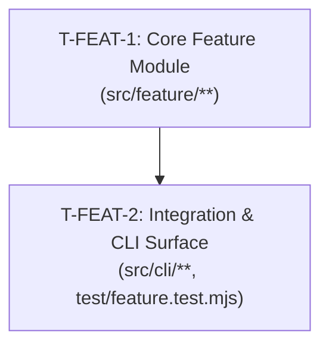

# Feature Specification: [Feature Name]

**Base:** `main` \
**Gate:** `{"test": "npm test"}`

--------------------------------------------------------------------------------

## 1. Overview & Objectives

Describe the feature, its context, and what success looks like in 1–3 sentences.

--------------------------------------------------------------------------------

## 2. Architecture & Ticket DAG

--------------------------------------------------------------------------------

## 3. Component Details & Ticket Specifications

### Ticket 1: `T-FEAT-1` — Core Feature Module

-   **Scope**: `src/feature/**`
-   **Rails**: `lib/**`
-   **Edges**: `T-FEAT-1 -> T-FEAT-2`
-   **Tier**: `mid`
-   **Pool Hint**: `auto`
-   **Objectives**:
    1.  Implement the core domain logic and exported interfaces in
        `src/feature/`.
    2.  Keep the module self-contained with explicit input/output contracts.
-   **Acceptance Criteria**:
    -   Core module exports match the documented contract for `T-FEAT-2`.
    -   `npm test` passes without regressions.

--------------------------------------------------------------------------------

### Ticket 2: `T-FEAT-2` — Integration & CLI Surface

-   **Scope**: `src/cli/**`, `test/feature.test.mjs`
-   **Rails**: `lib/**`
-   **Edges**: `(none)`
-   **Tier**: `mid`
-   **Pool Hint**: `auto`
-   **Objectives**:
    1.  Wire `src/feature/` into the CLI surface in `src/cli/`.
    2.  Add unit and integration tests in `test/feature.test.mjs`.
-   **Acceptance Criteria**:
    -   `node test/feature.test.mjs` and `npm test` pass with 0 failures.
    -   Code meets coverage thresholds and adheres to scope and rail
        constraints.
