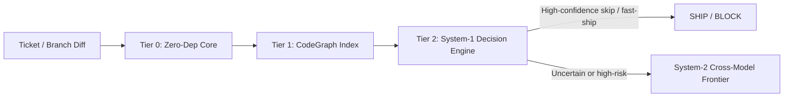

Prosecution and multi-lens adversarial review are where autonomous fleets spend most of their tokens and quota. Starting in `v2.0.0`, `antigravity-booster` layers three orthogonal efficiency tiers so you get large token reductions out of the box with zero extra dependencies, and even deeper savings when you opt into [CodeGraph](https://github.com/colbymchenry/codegraph) or Google's **Gemini Decisions API**.

## Three-tier architecture



Every optimization is **fail-closed**: if an accelerator is unavailable, times out, hits a truncation cap, or returns low confidence (`< 0.85`), `agb` automatically falls back to full System-2 cross-model prosecution and review.

### Tier 0 — Zero-dependency core (default ON)

Enabled automatically on every repository with zero external tools or API keys:

- **Single-pass static-diff review (`dryRounds=1`, `maxRounds=1`)**: `agb review` no longer re-sends identical static diffs twice by default. Pass `--thorough` or `--dry-rounds <n>` when stochastic multi-dry convergence is explicitly wanted.
- **Delta fix-round verification (`--delta` + `.review/last-findings.json`)**: After applying fixes, re-verify only the fix delta and prior open findings rather than re-billing the entire branch diff across all 5 lenses.
- **1-turn readonly tool lockdown**: Static-diff prosecutors and review lenses deny `read_file(*)` via `lib/role-settings.mjs` unless `contextPack.truncatedContext === true`, eliminating redundant multi-turn file reads that re-bill the diff prompt.
- **`hollow-test` pre-prosecution short-circuit**: When `adlc hollow-test` finds surviving mutants, `prepareProsecutionPrecheck()` returns `block` immediately without acquiring a System-2 quota lease or spawning `agy`.
- **Blast-radius risk-tiered routing**: `computeDiffBlastRadius()` scores every diff (`low`, `medium`, `high`, with security-sensitive paths forced to `high`) and scales non-frontier prosecutors and review lenses via `selectRiskTieredProsecutor()` and `selectRiskTieredLensModel()` while preserving cross-family isolation.
- **Deterministic Arbiter fast-path**: When `<= 4` disjoint, non-`blast_radius` findings survive across lenses, `triageFindings()` resolves triage deterministically in 0 tokens instead of spawning an LLM Arbiter.
- **Provenance-cached preflight coldstart & `--seams-only` post-run review**: `agb plan` stamps `plan.gateProvenance.coldstartHashes` so `agb preflight` skips redundant coldstart checks on unchanged tickets (`--force-coldstart` to bypass), and `--seams-only` audits only cross-ticket integration seams when every merged commit passed per-ticket System-2 prosecution.

### Tier 1 — CodeGraph accelerator (auto-detected)

When `<rootRepo>/.codegraph/` exists (created via `codegraph init` or `agb init --with-codegraph`), `agb` activates CodeGraph automatically across isolated ticket worktrees:

- **Shared root index & dirty-guard hygiene**: Ticket worktrees query `<rootRepo>/.codegraph/` directly (never requiring per-worktree re-indexing), `.codegraph/` is excluded from `isDirty()`, and `integrate()` conditionally runs `codegraph sync` when the root working tree advances cleanly.
- **Graph-backed context packs & blast-radius scoring**: Uses `codegraph callers`, `callees`, and `impact` to build bounded hunk-to-symbol context packs and fan-in scores, falling back to static-AST and elevating `truncatedContext` on any per-symbol failure or cap overflow.
- **Impacted test slicing**: `deriveImpactedTests()` queries `codegraph affected --json` to narrow Strike-0 and `hollow-test` runs to impacted test files (while always running the full `plan.gate.test` before final merge).

Disable at any time with `AGB_CODEGRAPH=0`, `--no-codegraph`, or `"accelerators": { "codegraph": false }` in `.adlc/config.json`.

### Tier 2 — System-1 Decision Engine (Gemini Decisions API)

`lib/decision-engine.mjs` is a zero-dependency Node `>= 22` `fetch` client for ultra-fast, **0-output-token** probabilistic decision models (`noul`, `choice`, `score` primitives) used for:

1. **Calibrated lens gating (`gateReviewLenses`)**: Skips a review lens only when defect probability `< 0.15` and confidence `>= 0.85`.
2. **Typed Arbiter triage (`triageFindingsSystemOne`)**: Classifies findings across verdict/severity/route/blast-radius while enforcing `SHAPE-*` and `blast_radius` safety floors and escalating low-confidence items to System-2.
3. **Batched coldstart screening (`scoreColdstartTickets`)**: Screens tickets in parallel and escalates uncertain or gap-risk tickets to System-2.
4. **Fail-closed low-risk fast-ship (`screenTicketFastShip`)**: Ships a non-frontier, low-blast-radius ticket with 0 `hollow-test` survivors only when every acceptance criterion scores `>= 0.92` and every prosecution charge scores `< 0.10` at `>= 0.85` confidence.

#### Automatic detection & priority

Because `antigravity-booster` is built for the Antigravity / Gemini ecosystem, **Google's Gemini Decisions API (`gemini-decision-1` at `POST https://generativelanguage.googleapis.com/v1beta/decisions`) is prioritized first and auto-detected whenever `GEMINI_API_KEY` is set**:

```sh
# Zero config needed — automatically activates gemini-decision-1
export GEMINI_API_KEY="AIza..."
agb doctor .
```

The Gemini Decisions driver transmits the diff **once** in the shared `input` field and evaluates all lens/AC/charge questions in a single forward pass with `0` output tokens.

Alternative providers (`jev` via `TYPESAFE_API_KEY`, or self-hosted `kev` via `AGB_KEV_BASE_URL`) remain supported via explicit `AGB_DECISION_PROVIDER` or `agb init --decision-provider <gemini-decisions|jev|kev>`. Disable System-1 gating completely with `AGB_DECISION_ENGINE=0` or `"accelerators": { "decision": { "enabled": false } }` in `.adlc/config.json`.

## Verified A/B benchmark results

Reproducible offline via `node --test test/token-efficiency-v2.test.mjs` (`evals/subsystem-bench.mjs`):

| Configuration | Review Reqs | System-2 Reqs | Billable Tokens | Token Reduction | Defect & Mutation Recall |
| --- | --- | --- | --- | --- | --- |
| Pre-optimization `agb` (tiers disabled) | 29 | 35 | 134,322 | — | 100% |
| Tier 0 (Zero-Dep Core) | 10 (-65.5%) | 12 | 16,171 | **-88.0%** | 100% |
| Tier 1 (+ CodeGraph) | 10 (-65.5%) | 12 | 14,177 | **-89.4%** | 100% |
| Tier 2 (+ Decision Engine) | 6 (-79.3%) | 7 | 9,677 | **-92.8%** | 100% |

## Split token telemetry

All runs and standalone reviews record split economics (`Build`, `Prosecute`, `Review`, `System-1 calls`, `Hollow short-circuits`, `Skipped lenses`, and `Arbiter mode`) to `FactoryLedger` and surface them in `agb status`, `agb watch`, the MCP Flight Deck / Mission Control views, and the Sidecar dashboard.
