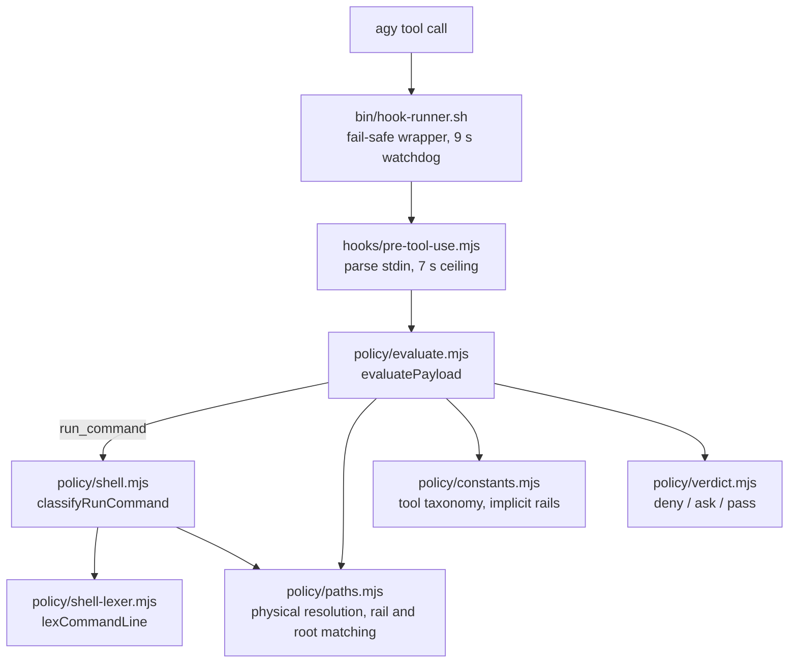

import { Step, Steps } from 'fumadocs-ui/components/steps';

The booster plugin registers one `PreToolUse` hook, `agb-policy-guard`, matching every tool (`"matcher": "*"`). It runs `/bin/sh bin/hook-runner.sh --timeout 9 dist/hooks/pre-tool-use.bundle.mjs` with a 15 s hook timeout; the runner is invoked through `/bin/sh`, which is why it is written in POSIX sh ([hooks.json](https://github.com/voodootikigod/antigravity-booster/blob/v1.0.0/hooks.json#L1-L16)). Its job is to stop an agent in an interactive or headless session from editing frozen rails, the ADLC trust root, or the platform's own configuration, before the edit happens. The merge-time `adlc rails-guard` check in `agb run` and CI remains the mechanical guarantee; this hook catches problems earlier. See [Rail enforcement](/docs/concepts/rail-enforcement) for how the layers fit.

## Verdicts

The guard emits one of three outcomes ([hooks/policy/verdict.mjs](https://github.com/voodootikigod/antigravity-booster/blob/v1.0.0/hooks/policy/verdict.mjs#L1-L15)):

| Verdict | stdout | Meaning |
|---|---|---|
| `deny` | `{"decision":"deny","reason":...}` | The tool call is blocked. |
| `ask` | `{"decision":"ask","reason":...}` | agy asks the operator to confirm. |
| `pass` | empty | Neutral: agy applies its normal policy. |

It **never emits `allow`**. When a single call produces several verdicts (several paths, several subcommands), the most restrictive wins: deny over ask over pass.

## Layers

### `bin/hook-runner.sh`

agy fails open when a hook exits non-zero, so the runner always exits 0 and decides what to print itself ([bin/hook-runner.sh](https://github.com/voodootikigod/antigravity-booster/blob/v1.0.0/bin/hook-runner.sh#L1-L12)). If the child crashes, times out, or prints anything other than one well-formed `ask`/`deny` line, the runner falls back: deny in headless worker mode or for an unparseable payload; ask for shell commands and deny for other tools in an ADLC repository; otherwise its `--fallback` decision. A child that prints `allow` is treated as a failure. If the launcher cannot find Node 22.19 or later (exit 86) outside an ADLC repository, the runner passes through. `AGB_HOOK_DISABLE` in agy's launch environment bypasses the guard entirely and logs a critical notice to `~/.gemini/antigravity-cli/plugin_data/antigravity-booster/logs/hooks.log`.

### `hooks/pre-tool-use.mjs`

The entry point reads one JSON payload from stdin. Invalid JSON is denied. A valid payload goes to `evaluatePayload`, and only `deny` or `ask` is printed. An internal 7 s ceiling exits non-zero so the runner's fail-safe applies ([hooks/pre-tool-use.mjs](https://github.com/voodootikigod/antigravity-booster/blob/v1.0.0/hooks/pre-tool-use.mjs#L13-L46)).

### `policy/constants.mjs`

The closed tool taxonomy, using agy's step-type names in lowercase ([hooks/policy/constants.mjs](https://github.com/voodootikigod/antigravity-booster/blob/v1.0.0/hooks/policy/constants.mjs#L5-L34)):

- **Read-only tools** (`view_file`, `read_file`, `grep_search`, `list_directory`, `list_dir`, `search_in_file`, ...), **CodeGraph read tools** (`codegraph_explore`, `mcp_codegraph_codegraph_explore`, `mcp__codegraph__codegraph_explore`), **orchestration tools** (`invoke_subagent`, `define_subagent`, `manage_subagents`, `manage_task`, `schedule`, `send_message`, `swarm`), **stdin / restricted execution tools** (`send_command_input`, `sed_file`, `notebook_execution`), and **workflow tools** (`run_workflow`).
- **Control steps**: only `finish`, whose arguments are the model's answer and are never scanned for paths.
- **Path-mutating tools** (`write_to_file`, `write_file`, `replace_file_content`, `edit_file`, `delete_file`, `move`, `notebook_edit`, ...), with per-tool schemas listing which argument keys carry paths.
- The booster's own 9 MCP tools (`agb_shape`, `agb_plan`, `agb_distill`, `agb_run`, `agb_preflight`, `agb_status`, `agb_doctor`, `agb_init`, `agb_review`).
- **Implicit rails** that apply in every ADLC repository whether or not a ticket declares them: the directories `.git`, `.adlc/ticket-archive`, `.adlc/ticket-transactions`, `.adlc/leases`, and the files `.adlc/config.json`, `.adlc/manifest.jsonl`, `.adlc/sessions.json`, `.adlc/tickets.json` ([hooks/policy/constants.mjs](https://github.com/voodootikigod/antigravity-booster/blob/v1.0.0/hooks/policy/constants.mjs#L74-L76)).

### `policy/shell-lexer.mjs`

A conservative POSIX lexer for `run_command` lines. It splits on control operators, tokenizes with POSIX quoting, records redirect targets and leading `VAR=value` assignments, and marks every construct whose effect cannot be known statically (expansions, substitutions, globs, subshells, heredocs, comments) as **dynamic**. It never evaluates anything. Unbalanced quoting makes the whole line un-lexable, which callers treat as dynamic ([hooks/policy/shell-lexer.mjs](https://github.com/voodootikigod/antigravity-booster/blob/v1.0.0/hooks/policy/shell-lexer.mjs#L1-L10)).

### `policy/paths.mjs`

Path handling shared by both classifiers: home expansion (`~`, `~user`, `$HOME`), physical resolution that follows symlinks within an evaluation budget, repository-relative paths, implicit and declared rail matching, and ticket-scope matching. It also defines the **protected roots**: `~/.gemini`, `~/.config/antigravity-booster`, `~/.local/bin/agb`, the usual Node version-manager directories (including macOS `~/Library/Application Support/fnm`), `/opt/homebrew`, and `/usr/local` ([hooks/policy/paths.mjs](https://github.com/voodootikigod/antigravity-booster/blob/v1.0.0/hooks/policy/paths.mjs#L127-L150)).

## Evaluation order

`evaluatePayload` is pure apart from reading the target repositories' ticket stores ([hooks/policy/evaluate.mjs](https://github.com/voodootikigod/antigravity-booster/blob/v1.0.0/hooks/policy/evaluate.mjs#L467-L484)):

<Steps>
<Step>
A payload with no tool name is denied. `finish` passes immediately.
</Step>
<Step>
**Step 1** normalizes argument keys case-insensitively (matching Go `encoding/json` ASCII/case-fold decoding) and inspects the paths every non-shell tool names, reads included. Top-level prose fields (`Prompt`/`SystemPrompt`/`Description`/`Role` on subagent calls, `brief`/`title`/`tasks` on `swarm`, `Script`/`Description` on `run_workflow`) are skipped so code or instructions naming a rail path are not misclassified as path mutations, while structured path fields (`ScriptPath`, `Cwd`, nested `Args`) are still inspected. Reading or changing booster plugin data (`boosterDataRoots`) or credentials is denied; changing a protected root is denied; an unresolvable mutation target (symlink loop, oversized path) is denied ([hooks/policy/evaluate.mjs](https://github.com/voodootikigod/antigravity-booster/blob/v1.0.0/hooks/policy/evaluate.mjs#L282-L310)).
</Step>
<Step>
**Read-only & CodeGraph tools**: standard read-only tools pass after Step 1 path and required-key checks. CodeGraph tools (`codegraph_explore`, `mcp_codegraph_codegraph_explore`, `mcp__codegraph__codegraph_explore`) are gated separately: they are permitted in **interactive** sessions only when every supplied path (`projectPath`, `path`, `DirectoryPath`, or scanned path-like argument) resolves inside the declared `workspaceRealPaths` and outside `boosterDataRoots`, and are **denied** in headless (`AGB_WORKER_TICKET`) and read-only (`AGB_WORKER_MODE`) worker sessions unless `AGB_ALLOW_CODEGRAPH_MCP=1` is set (still enforcing workspace containment and `boosterDataRoots` checks).
</Step>
<Step>
**Restricted editors, stdin & orchestration tools**:
- `sed_file` validates a bounded bracket/backref-free expression subset and routes target checks through the file-tool policy (zero-`ask`); `notebook_execution` is denied in headless/read-only workers and whenever active ADLC rails exist or the ticket store is unreadable; `send_command_input` is denied in headless workers and (except pure `terminate: true` without `input`) whenever active rails exist or the store is unreadable.
- **Orchestration tools**: `invoke_subagent`, `define_subagent`, and `manage_subagents` are denied for headless workers and corrupt/unreadable ADLC stores, and rail-check non-prose paths; `manage_task` allows `list`/`status`, denies `kill` in headless workers or corrupt stores, and denies `send_input` in headless workers or active-rail/corrupt-store ADLC repos; `schedule` and `send_message` are denied in headless (`AGB_WORKER_TICKET` / `AGB_WORKER_MODE`) worker sessions; `swarm` is denied in headless worker sessions and whenever any anchor ADLC repository has a corrupt/unreadable ticket store, normalizes keys case-insensitively to validate `workspace` (`inherit`, `share`, or `branch`), and rail-checks non-prose paths and bare tokens.
- **Workflow execution** (`run_workflow`) is denied for headless and read-only workers, validates workspace-contained `Cwd` and rail-free `ScriptPath`/arguments, denies on corrupt stores, and requires operator confirmation (`ask`) in an ADLC repository with active frozen rails.
</Step>
<Step>
`run_command` goes to the shell classifier (below).
</Step>
<Step>
**File tools** are the exact layer. Every target path is resolved physically. A target that contains a protected root or an ADLC repository is denied, as is any rail or implicit-rail match. New ticket shards under `.adlc/tickets/` must be valid tickets whose filename matches the id, validated across case-folded `CodeContent`/`Content` keys. A headless worker (`AGB_WORKER_TICKET`) may write only inside its own repository's ticket scope; a read-only worker (`AGB_WORKER_MODE`) may not write at all ([hooks/policy/evaluate.mjs](https://github.com/voodootikigod/antigravity-booster/blob/v1.0.0/hooks/policy/evaluate.mjs#L331-L386)).
</Step>
<Step>
**MCP tools**: any path-like argument that hits a rail or the trust root is denied, and conflicting `arguments`/`toolArgs` on `call_mcp_tool` are denied. For **booster's own MCP tools** (`agb` / `antigravity-booster_agb`): headless builder workers (`AGB_WORKER_TICKET`) are denied from invoking any booster MCP tool; read-only workers (`AGB_WORKER_MODE`) are denied from invoking mutating booster tools — `agb_run`, `agb_plan`, `agb_init`, `agb_distill` (unconditionally, regardless of `apply`), `agb_doctor` with `fix: true`, and `agb_shape` with `syncBrain: true` — while read-only calls (`agb_status`, `agb_preflight`, `agb_review`, non-fix `agb_doctor`, non-sync `agb_shape`) pass; interactive calls pass. **Third-party MCP tools** are denied for read-only workers and for headless workers in ADLC repositories (or without a workspace), and require operator confirmation (`ask`) in an interactive active-rail ADLC repository ([hooks/policy/evaluate.mjs](https://github.com/voodootikigod/antigravity-booster/blob/v1.0.0/hooks/policy/evaluate.mjs#L388-L414)).
</Step>
<Step>
**Unknown tools** get the same rail and trust-root check on every path-like argument, in any repository. They are then denied in a read-only worker session, in an ADLC repository with active frozen rails, or for any headless worker in an ADLC repository (or without a workspace), since their effect cannot be verified ([hooks/policy/evaluate.mjs](https://github.com/voodootikigod/antigravity-booster/blob/v1.0.0/hooks/policy/evaluate.mjs#L416-L433)).
</Step>
</Steps>

## Shell classification

`policy/shell.mjs` is explicitly best-effort defense in depth. A shell cannot be parsed soundly, so it blocks the cheap, high-value spellings and fails closed when it cannot follow the shell ([hooks/policy/shell.mjs](https://github.com/voodootikigod/antigravity-booster/blob/v1.0.0/hooks/policy/shell.mjs#L1-L10)).

`classifyRunCommand` normalizes keys case-insensitively and requires a working directory: in an ADLC repository, a relative `Cwd` or one outside the declared workspace paths is denied ([hooks/policy/shell.mjs](https://github.com/voodootikigod/antigravity-booster/blob/v1.0.0/hooks/policy/shell.mjs#L490-L503)). Each subcommand is then classified, following static intra-workspace `cd`/`pushd` (clean chained `cd` within the workspace updates the tracked `cwd` without a spurious `ask`, while dynamic or workspace-escaping `cd` fails closed). Safe null-device sink redirects (`/dev/null`, or `NUL` on Windows) are permitted on pure readers, test commands, and allowlisted worker build commands. Inline scripts (`sh -c`, `eval`) are classified recursively, up to three levels deep ([hooks/policy/shell.mjs](https://github.com/voodootikigod/antigravity-booster/blob/v1.0.0/hooks/policy/shell.mjs#L393-L443)):

| Stage | Commands | Verdict |
|---|---|---|
| Target checks | Any write, delete or redirect (other than `/dev/null`) aimed at a rail, the trust root, a protected root, or a glob that could reach them | deny |
| Ticket lifecycle | `adlc ticket complete/archive/update/...` | deny without `--authorize`; ask with it (deny for headless workers) |
| 1 | Pure readers (`cat`, `head`, `tail`, `grep`, `ls`, `wc`) and `git status/diff/log/show/blame` with known-safe flags, with no assignments, write redirects or dynamic parts | pass |
| 2 | `adlc ticket create`, and `git add` of literal ticket-shard paths | pass |
| Destructive | Repository-wide `git clean`, a hard `git reset`, `git stash -u/-a`, or `rm`/`mv` on a repository root or its parent | deny |
| Shim, `cd`, `git --output` | Invoking `agb` through the shim; a standalone or workspace-leaving directory change; `git diff/log --output` | ask in an active-rail ADLC repository (deny for headless workers using the shim or in Stage 5) |
| Routine | Headless builder worker allowlisted test commands (`npm test`, `npm run test*`, safe `node --test` invocations) and the exact configured `AGB_WORKER_BUILD_CMD` (`npm run <script>`); interactive `git add` / `git commit` without root pathspecs | pass |
| 5 | Everything else, including anything dynamic | ask in an active-rail ADLC repository; deny for headless or read-only workers in an ADLC repository; otherwise pass |

The Stage 5 rule is in `stage5` ([hooks/policy/shell.mjs](https://github.com/voodootikigod/antigravity-booster/blob/v1.0.0/hooks/policy/shell.mjs#L251-L262)).
